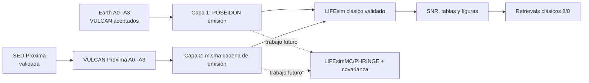

# Etapa III: emisión térmica con LIFE

**Estado (2026-08-31): rama LIFEsim clásica validada; rama
LIFEsimMC/PHRINGE pendiente.** Esta carpeta contiene forwards de emisión,
contrafactuales, productos LIFEsim clásico, tablas de S/N y una matriz canónica
de 8 retrievals Proxima A0--A3 × {10 h, 240 h}. Antes de ampliar una campaña,
recuperar el estado desde
[`../docs/project_resume.md`](../docs/project_resume.md) y confirmar el
backlog en [`../docs/project_status_tracker.md`](../docs/project_status_tracker.md).
La implementación se organizó en dos capas: el benchmark Tierra--Sol a 10 pc y
el análogo terrestre bajo el entorno de Proxima. La validación de la rama
clásica y la frontera instrumental están en la
[metodología completa](../docs/life_stage_iii_classic_methodology_2026-08-30.md),
en el [informe integrado de metodología, resultados y figuras](../docs/life_stage_iii_integrated_methodology_results_2026-08-30.md),
en la [validación consolidada](../docs/lifesim_classic_stage_iii_validation_2026-08-30.md), en
[`../docs/life_lifesim_stage_iii_plan.md`](../docs/life_lifesim_stage_iii_plan.md)
y en el [plan operativo de dos capas](../docs/life_stage_iii_two_layer_workplan_2026-07-20.md).

La instalación WSL reproducible usada para la rama clásica es el entorno conda
`POSEIDON`, con LIFEsim 0.2.32 y la variante `SpectRes 2.1.1` de
`fdannert/SpectRes`. La validación directa del piloto A3--500 h y su comparación
con el dataset usado por el retrieval están en
[`../docs/life_proxima_a3_500h_lifesim_direct_validation_2026-08-31.md`](../docs/life_proxima_a3_500h_lifesim_direct_validation_2026-08-31.md).
El ensayo posterior [`../docs/life_proxima_lifesim_noise_scaling_2026-08-31.md`](../docs/life_proxima_lifesim_noise_scaling_2026-08-31.md)
comparó observaciones directas y escaladas de LIFEsim en A0/A3: para la rama
clásica ambas rutas siguen la misma ley `sigma ∝ t^{-1/2}` dentro de la
precisión numérica. Esto valida el escalado como atajo de ruido diagonal, no
como sustituto de LIFEsimMC/PHRINGE.

## Papel científico

La Etapa III pregunta cómo se verían las atmósferas fotoquímicas de ExoFarm en
**emisión térmica planetaria** para una observación directa de LIFE. Es una rama
paralela, no una extensión de `Transmission_Spectroscopy/`:



La etapa reutiliza los perfiles PT y de abundancia canónicos exportados en
`../Transmission_Spectroscopy/profiles/`, pero **no** reutilizará espectros de
transmisión, archivos de ruido de PandExo, conteos de tránsitos ni productos de
retrieval JWST como si fueran observaciones LIFE.

Para ruido instrumental, el componente previsto es **LIFEsimMC con PHRINGE**,
no LIFEsim clásico: la documentación del proyecto lo recomienda para espectros
ruidosos de observaciones LIFE de una época y para ruido de inestabilidad
instrumental. LIFEsim clásico puede conservarse como sensibilidad de ruido
astrofísico o yield, pero no sustituye el caso instrumental.

## Alcance de objetivo fijado

La **Capa 1**, `life_earth_sun_10pc`, reutilizó los perfiles Tierra--Sol A0--A3
aceptados y congelados en 2026-06-15 para un análogo G2V a 10 pc. Es un
benchmark sintético de **interfaz** de observación directa: los 10 pc
pertenecen a LIFE, no cambian VULCAN ni describen la Tierra real como objetivo.
A2/A3 anteceden la corrección N2O activa, así que el manifiesto debe usar
`earth_20260615_pre_n2o_correction` y no presentar el resultado como la matriz
vigente sin una decisión/re-run. Véase la
[nota de procedencia](../docs/earth_sun_n2o_matrix_provenance_2026-07-20.md).

La **Capa 2**, `life_proxima_b_earthlike`, completó SED MUSCLES → flujo
superficial VULCAN → VULCAN Proxima A0--A3 → emisión → LIFEsim clásico → S/N →
retrievals. Usa PT/Kzz terrestre controlado y no consume perfiles TRAPPIST-1e.
Se trata de un análogo terrestre en el ambiente de Proxima, no de una atmósfera
medida de Proxima b.

La matriz canónica de retrievals se visualiza con
`scripts/plot_proxima_retrieval_products.py`, que produce en la carpeta de la
campaña un espectro global, tres ventanas moleculares y una figura conjunta de
perfiles/posteriores en PNG y PDF. Las figuras usan `F_p` directo y sólo los
casos A0--A3 de 10 h y 240 h; el producto A3--1200 h es un piloto de
auditoría excluido.

El 2026-08-31 se ejecutaron además retrievals robustos de auditoría para A3 a
500 h y 1200 h, con datasets directos de LIFEsim, `N_live=800`, prior físico de
radio y `Piette20`. Ambos terminaron con evidencia finita, pero permanecen
fuera de la matriz canónica. La inspección posterior muestra que `a1` queda
cerca del límite superior de su prior, por lo que se trata de robustez
computacional y no todavía de insensibilidad a priors; el detalle está en
[`../docs/life_proxima_a3_500h_1200h_robust_retrieval_2026-08-31.md`](../docs/life_proxima_a3_500h_1200h_robust_retrieval_2026-08-31.md).

El 2026-09-01 se ejecutó además un diagnóstico de parametrización vertical a
500 h: `X_profile=two-gradients` sólo para `NH3`, con `N_live=1000`, PT `Madhu`
y `Piette20`. Terminó con posterior completo (`ln Z=895.86 +/- 0.17`,
`chi^2_red=3.15`) pero no mejoró el retrieval isquímico robusto de referencia;
queda excluido de la matriz y se documenta en
[`../docs/life_proxima_a3_500h_nh3_two_gradients_2026-09-01.md`](../docs/life_proxima_a3_500h_nh3_two_gradients_2026-09-01.md).

El 2026-09-01 se añadió el experimento de auditoría
`life_bayes_factor_diagnostics_A3_240h`. Evalúa dos comparaciones de plantillas
fijas sobre el mismo dataset A3--240 h: A3 frente a A0 y A3 frente a A3 con
N2O reiniciado al perfil A0. Los resultados (`ln B=394.35` y `385.63`) son
diagnósticos de likelihood bajo sigma diagonal, sin marginalizar radio, PT,
abundancias ni `x_tol`; no reemplazan un Bayes factor formal de retrieval ni
se incorporan a la matriz canónica. El detalle está en
[`docs/life_proxima_bayes_factor_diagnostics_2026-09-01.md`](../docs/life_proxima_bayes_factor_diagnostics_2026-09-01.md).

El análogo TRAPPIST-1-like a 5 pc, Teegarden's Star b y TRAPPIST-1e real quedan
como controles/alternativas diferidos. La justificación, los límites y las
referencias están en
[`../docs/life_target_selection_2026-07-20.md`](../docs/life_target_selection_2026-07-20.md)
y el [plan operativo de dos capas](../docs/life_stage_iii_two_layer_workplan_2026-07-20.md).

## Estructura acordada

La estructura contiene scripts ejecutables y dos campañas clásicas con
manifiestos y resultados. `configs/` conserva por ahora los contratos narrativos;
los parámetros ejecutados están en los scripts, manifiestos y reportes de
campaña. La próxima configuración nueva será la rama MC con covarianza.

```text
Thermal_Emission_Spectroscopy/
├── README.md                         # este contrato de etapa
├── configs/
│   ├── life_earth_sun_10pc/          # manifiestos de la Capa 1
│   └── life_proxima_b_earthlike/     # manifiestos LIFE posteriores a VULCAN
├── scripts/                          # adaptadores y validadores futuros
├── notebooks/                        # análisis reproducible futuro
├── outputs/<campaign-id>/
│   ├── manifest.json                 # procedencia, versiones y parámetros
│   ├── forward_emission/             # espectros fuente de POSEIDON
│   ├── molecular_diagnostics/        # contrafactuales y bandas
│   ├── lifesim/                      # productos binados de la rama clásica
│   ├── tables/                       # tablas de SNR auditables
│   ├── plots/                        # figuras de diagnóstico/presentación
│   └── retrievals/                   # resultados y logs aprobados
└── final_products/                   # solo figuras promovidas explícitamente
```

Los ficheros de configuración, manifiestos y scripts pequeños deben estar
versionados. Los productos voluminosos se guardarán bajo `outputs/` o fuera de
Git según su tamaño, siempre con un manifiesto de procedencia.

## Contrato de entrada y salida

### Entradas congeladas en la rama clásica

- **Capa 1:** los pares PT y mezcla Tierra--Sol A0--A3 en
  `../Transmission_Spectroscopy/profiles/`, enlazados a sus `.vul` canónicos
  mediante escenario y hash/ruta. El manifiesto debe registrar el rótulo
  `earth_20260615_pre_n2o_correction` y los BC históricos/activos pertinentes.
  Los perfiles TRAPPIST-1e no se consumen.
- **Capa 2:** pares PT/química Proxima aceptados y manifiesto que enlaza SED
  MUSCLES, conversor a flujo superficial, parámetros estelares/orbitales,
  PT/Kzz terrestre controlado y supuestos planetarios.
- Parámetros planetarios, estelares, distancia, geometría orbital y escena
  astrofísica, consistentes entre POSEIDON y LIFEsim clásico; la rama futura
  debe volver a comprobar su contrato con LIFEsimMC.
- Configuración exacta del forward de emisión de POSEIDON: malla espectral,
  opacidades, superficie si aplica y cantidad física exportada.
- Versión/commit de LIFEsimMC, PHRINGE y POSEIDON; diseño LIFE, resolución,
  fondos, zodi/exozodi, tiempo de integración, semilla y modelo de ruido.

### Productos presentes y frontera pendiente

1. Espectro térmico de referencia sin ruido generado por POSEIDON.
2. Señales moleculares de `N2O` y `NH3`, acompañadas por moléculas de control
   que expliquen degeneraciones o solapamientos espectrales.
3. Observación simulada por LIFEsim clásico e incertidumbres diagonales
   (**presente**); LIFEsimMC/PHRINGE, SED extraído y covarianza espectral
   (**pendiente**).
4. Tabla de SNR por escenario, molécula, banda, tiempo de integración y
   realización de ruido; figuras que muestren señal e incertidumbre.
5. Matriz clásica de 8 retrievals (**completa**) y futura matriz mínima MC solo
   después de validar la covarianza.

La pasada visual del 2026-08-30 regeneró las figuras Proxima de espectro y
señal, además de la comparación SNR/proyección, con títulos compactos,
etiquetas moleculares sin guías verticales y rellenos claramente diferenciados.
La figura conjunta de emisión y señales conserva ahora la composición de tres
paneles del análogo de transmisión, pero mantiene el observable `F_p` y el eje
lineal propio de la banda LIFE. La comparación SNR/proyección acota su panel
inferior al intervalo útil de 1--1000 h y ajusta el rango superior a los puntos
representados. No modifica los datos, las unidades ni la interpretación de la
rama clásica.

## Estado de las puertas

Las puertas de interfaz, señal y S/N quedaron satisfechas para LIFEsim clásico.
No se transfieren automáticamente a la rama MC:

### Cerrado — rama clásica

1. Forward sin ruido, unidades y cuerpo negro validados.
2. Perfiles A0--A3, contrafactuales, escena LIFEsim y S/N validados.
3. SED y fotoquímica Proxima auditadas.
4. Retrievals clásicos Proxima 8/8 ejecutados; productos 1200 h clasificados
   como pilotos excluidos.

### Pendiente — rama LIFEsimMC/PHRINGE

1. Congelar versión/commit, licencia, perturbaciones, escena y semillas.
2. Validar la interfaz de espectro custom y preservar la covarianza.
3. Definir likelihood correlacionada o whitening reproducible.
4. Ejecutar varias realizaciones A0/A3 y comparar modelos con/sin molécula.

## Límites actuales

- La Etapa 0 (LPJmL) está suspendida. La Etapa III no debe presentar la matriz
  A0--A3 como un forzamiento derivado de LPJmL hasta reactivar y completar ese
  puente. Además, el perfil-set Tierra--Sol de Capa 1 no equivale aún a los BC
  N2O actuales; esa decisión se conserva en la nota de procedencia.
- Los perfiles TRAPPIST-1e conservan la salvedad de convergencia parcial de
  VULCAN junto a cualquier producto de control futuro que los utilice; no
  condicionan la Capa 1 ni se heredan como excepción para Proxima.
- `life_proxima_b_earthlike` es una rama controlada de entorno estelar. Sin un
  PT/Kzz climático independiente no autoriza afirmaciones sobre el clima o la
  atmósfera real de Proxima b.
- No asumir que un SNR alto equivale a una detección: la campaña futura deberá
  contrastar modelos, degeneraciones y desajuste de perfiles verticales.
- La interfaz estándar de datos de POSEIDON admite `Fp/Fs` o `Fp` con errores
  por bin; LIFEsimMC puede producir covarianza completa. La estrategia de
  whitening o likelihood correlacionado es una puerta de activación, no una
  simplificación silenciosa.

## Referencias de activación

- [Proyecto LIFE](https://life-space-mission.com/)
- [LIFEsim clásico: código](https://github.com/fdannert/LIFEsim)
- [LIFEsim clásico: documentación](https://lifesim.readthedocs.io/en/latest/)
- [LIFEsimMC: código](https://github.com/pahuber/LIFESIMMC)
- [PHRINGE: código](https://github.com/pahuber/PHRINGE)
- [POSEIDON: código](https://github.com/MartianColonist/POSEIDON)
- [VULCAN: código](https://github.com/shami-EEG/VULCAN)
- [LIFEsimMC: cuándo usarlo](https://lifesimmc.readthedocs.io/en/latest/when_to_use.html)
- [LIFEsimMC: espectro custom](https://lifesimmc.readthedocs.io/en/latest/tutorials/custom_spectrum.html)
- [LIFEsimMC: instrumento perturbado](https://lifesimmc.readthedocs.io/en/latest/tutorials/perturbed_instrument_example.html)
- [POSEIDON: forward de emisión](https://poseidon-retrievals.readthedocs.io/en/latest/content/notebooks/emission_basic.html)
- [Plan operativo de dos capas](../docs/life_stage_iii_two_layer_workplan_2026-07-20.md)
- [Procedencia N2O del benchmark Tierra--Sol](../docs/earth_sun_n2o_matrix_provenance_2026-07-20.md)
- [Selección de objetivo y referencias científicas](../docs/life_target_selection_2026-07-20.md)
