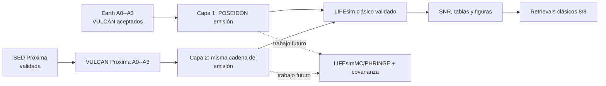

# Etapa III: emisión térmica con LIFE

**Para estudiar el flujo vigente:** [guía de lectura](GUIA_LECTURA.md) y [mapa de dependencias e inventario](../docs/life_flujo_inventario_decisiones_2026-11-14.md).

[Comparación con estudios LIFE y otras técnicas](../docs/life_proxima_detectabilidad_comparacion_literatura_2026-10-29.md): contexto de detectabilidad y diagnóstico de superficie, sin corridas nuevas; el análisis integrado conserva la tabla oficial.


**Referencia científica vigente LIFE Proxima A1/A3:** [análisis integrado](../docs/life_proxima_a1_a3_retrievals_analisis_integrado_2026-10-29.md) y sus tablas reproducibles: 42 modelos corregidos, 36 ablaciones emparejadas, enriquecimiento, regiones y ajuste. La extensión de 1000 h se presenta separada y mantiene su aceptación pendiente. Las entradas LIFE A1/A3 anteriores en esta página son bitácora de ejecución y auditoría, conservada como procedencia.

El [inventario de integridad LIFE A1/A3](../docs/evidence/life_proxima_a1_a3_release_2026-10-28/README.md) reúne 979 rutas y, por separado, 12 registros de supervisor con sus SHA-256. Existe una copia en E: comprobada archivo por archivo; se añadió una lista posterior de paquetes del entorno actual, pero el respaldo no contiene las opacidades externas ni el entorno Conda completo.

### LIFE noise curves on molecular signals (2026-10-27)

The Proxima figure overlays the 31-channel synthetic LIFE A3 uncertainties at
1, 10, and 100 h as ±1σ curves in the lower N₂O/NH₃ signal panels. The upper
emission spectra remain clear. Input hashes and the fixed signal limits are
recorded in the sidecar. Model curves are rebinned to R=200 for presentation
only. These are synthetic uncertainties, not observations, and they do not
replace the instrumental operator in the likelihood. [PNG](outputs/life_proxima_b_earthlike_v1/plots/emission_molecular_residuals_proxima_LIFE_A3_1_10_100h.png) · [PDF](outputs/life_proxima_b_earthlike_v1/plots/emission_molecular_residuals_proxima_LIFE_A3_1_10_100h.pdf) · [sidecar](outputs/life_proxima_b_earthlike_v1/plots/emission_molecular_residuals_proxima_LIFE_A3_1_10_100h.provenance.json) · [report](../docs/life_proxima_emission_spectra_with_life_data_2026-10-27.md).

### Matriz LIFE A1/A3 con binning corregido — cerrada y auditada (2026-10-28)

Los 33 retrievals de la campaña r01 pasaron auditoría independiente: tres completos y 18 LOO A1, más 12 LOO A3. También pasaron los tres completos A3 usados como referencias. El manifiesto está conciliado en `complete_validated`; el supervisor terminó con salida 0 y no hay corridas activas. Las comparaciones LOO usan exclusivamente el completo emparejado por escenario, exposición y dataset. [Informe y resultados](../docs/life_proxima_a1_a3_corrected_binning_matrix_results_2026-10-28.md) · [tablas de modelos](../docs/life_proxima_a1_a3_corrected_binning_matrix_models_2026-10-28.csv) · [contrastes](../docs/life_proxima_a1_a3_corrected_binning_matrix_loo_2026-10-28.csv) · [README/ledger](outputs/life_proxima_b_earthlike_v1/retrievals/a1_a3_corrected_binning_matrix_loo_20261021_r01/README.md). Se preservan la recuperación, snapshots preauditoría, campañas anteriores y productos con binning previo.

### Atlas oficial A1/A3: N₂O/NH₃ primero y sin panel P–T (2026-10-28)

El atlas oficial vigente muestra los completos A1/A3 a 1/10/100 h con N₂O y NH₃ en las dos primeras columnas, sin panel P–T ni nota de estado. [PNG](final_products/figures/retrieval_A1_A3_1_10_100h_official_posteriors_N2O_NH3_first_no_PT_proxima_20261028.png) · [PDF](final_products/figures/retrieval_A1_A3_1_10_100h_official_posteriors_N2O_NH3_first_no_PT_proxima_20261028.pdf) · [SVG](final_products/figures/retrieval_A1_A3_1_10_100h_official_posteriors_N2O_NH3_first_no_PT_proxima_20261028.svg) · [procedencia](final_products/figures/retrieval_A1_A3_1_10_100h_official_posteriors_N2O_NH3_first_no_PT_proxima_20261028.provenance.json). Los perfiles verticales moleculares se mantienen; los seis completos pasaron auditoría. Las ediciones previas del 26-oct y del 28-oct con P–T siguen preservadas. [Informe y reproducción](../docs/life_proxima_corrected_binning_full_posteriors_plot_2026-10-28.md) · [cierre de matriz](../docs/life_proxima_a1_a3_corrected_binning_matrix_results_2026-10-28.md).

### A3 a 1 h/10 h con binning corregido — cerrada y validada (2026-10-21)

Las seis recuperaciones (completo, sin NH₃ y sin N₂O en 1 h y 10 h) finalizaron con `return_code=0` y superaron la auditoría independiente de productos y configuración. Para cada exposición, `ΔlnZ=lnZ_completo−lnZ_sinX` usa únicamente su pareja del mismo dataset y el error numérico se combina en cuadratura. A 10 h, la inclusión de N₂O está fuertemente favorecida (`+9.141993±0.292323`; sigma bilateral calibrado `+4.664`, auxiliar). Para NH₃, `ΔlnZ=−0.225706±0.292617`, compatible con empate, mientras el posterior completo asigna `P(NH₃>A0)=0.8040`. A 1 h, ambos contrastes son compatibles con cero o favorecen levemente quitar la especie. Esto describe preferencia condicional entre modelos y posterior de abundancia; no establece origen ExoFarm. El [informe completo](../docs/life_proxima_a3_1_10h_corrected_binning_loo_results_2026-10-21.md) incluye evidencias, posteriores, límites e incertidumbres; los archivos de campaña, CSV/JSON y figura están en [r03](outputs/life_proxima_b_earthlike_v1/retrievals/a3_1_10h_binning_corrected_loo_20261020_r03/README.md). El ledger se reconcilió después de salir el supervisor y r01/r02 permanecen preservados.

### Regiones de abundancia respecto a A1: cálculo actualizado (2026-10-26)

Se validaron los priors efectivos y se clasificaron las muestras corregidas A3 de 1/10/100 h en cuatro regiones conjuntas N₂O/NH₃, sin retrievals nuevos. `P(R11|D)=6.42/73.07/98.665 %` y `K(R11/complemento)=0.106/4.181/113.924`. La incertidumbre Monte Carlo y la sensibilidad al umbral siguen pendientes; las celdas R01/R00 de 10 h y las regiones con N₂O < A1 a 100 h tienen cobertura insuficiente. La comparación causal entre familias ExoFarm y preagrícola necesita distribuciones predictivas justificadas. La matriz general A1/A3 de 33 retrievals es independiente. [Informe con masas previas/posteriores, LOO, hashes y límites](../docs/life_proxima_a1_regions_corrected_binning_2026-10-26.md).

**Registro histórico de progreso del 20-oct:** las lecturas de contadores, filas y memoria que siguen documentan el muestreo. No hay samplers activos en esta campaña cerrada.

### Registro histórico del estado intermedio — matriz r01 (2026-10-26)

Este bloque describe el alcance congelado y el corte de progreso del 26-oct; sus estados parciales son históricos. El cierre validado del 28-oct, con auditoría de productos y ledger reconciliado, se conserva en el [informe final](../docs/life_proxima_a1_a3_corrected_binning_matrix_results_2026-10-28.md) y el [README de campaña](outputs/life_proxima_b_earthlike_v1/retrievals/a1_a3_corrected_binning_matrix_loo_20261021_r01/README.md). Las tres comparaciones A3–100 h con gases fijados a A0 siguen siendo una posible extensión, fuera del alcance r01.

### Atlas V2 del 2026-10-20 — versión histórica preservada

La edición oficial vigente se regeneró el 2026-10-28 tras la auditoría, con N₂O/NH₃ primero, sin panel P–T ni comentario sobre el binning. Las versiones anteriores permanecen como historial. [Informe y procedencia](../docs/life_proxima_corrected_binning_full_posteriors_plot_2026-10-28.md) · [cierre de matriz](../docs/life_proxima_a1_a3_corrected_binning_matrix_results_2026-10-28.md).

### Resultados A3–100 h actualizados (2026-10-20)

El [postprocesado reproducible](../docs/life_proxima_a3_100h_corrected_results_update_2026-10-20.md) integra el completo y las dos ablaciones corregidas aceptadas. NH3 tiene `ln B=2.749±0.345`, `P(X≥A1)=98.67 %` e intervalo central 95 % `[2.57,25.38] A1`; N2O, `ln B=84.661±0.347` e intervalo `[3.24,5.18] A1`. Las tablas vigentes identifican qué filas siguen usando el operador histórico. Las restricciones A0 de 100 h con el operador nuevo siguen pendientes. Los priors y K regionales se actualizaron con el [análisis de cuatro celdas](../docs/life_proxima_a1_regions_corrected_binning_2026-10-26.md).

### A3–100 h: ablaciones moleculares con bineador corregido (cerrada y validada, 2026-10-20)

Se compararon dos modelos con el retrieval completo corregido: opacidad y parámetro de NH3 retirados (MPI8), y opacidad y parámetro de N2O retirados (MPI7). Los dos casos pasaron auditoría independiente con exit 0, posterior, espectro, PT, `log_X`, MultiNest, finitud, hashes, priors y callback corregido. Para el dataset común de 31 canales (SHA-256 `78662546181a5b74391a14b7b73ae80d879200a74db6a4bc5338e3ce7eee4705`), `ΔlnZ` favorece incluir NH3 por +2.748991±0.344630 y N2O por +84.660508±0.346532; las sigmas calibradas son auxiliares. En el posterior completo, `P(NH3>A0)=0.9913` y `P(N2O>A0)=1.0000`; especie retirada = N/A. `χ²_red=3.57` en el completo y 13.55 en sin N2O aconsejan condicionar la interpretación a la adecuación del ajuste. [README/ledger de campaña](outputs/life_proxima_b_earthlike_v1/retrievals/a3_100h_binning_corrected_loo_20261019/README.md) · [informe de método y resultados](../docs/life_proxima_a3_100h_corrected_binning_molecular_ablation_2026-10-19.md). Las comparaciones con el bineado histórico también cambiaron la ventana espectral (3.8–19 frente a 3–20 μm), por lo que no aíslan exclusivamente el operador.

### Seguimiento adicional A3–100 h con operador de bineado corregido

La corrida serial iniciada el 2026-10-17 se detuvo por solicitud del usuario y
se reanudó desde su checkpoint MultiNest validado con **14 ranks MPICH/Hydra**
el 2026-10-18. El preflight paralelo pasó y el muestreo terminó el 2026-10-18
21:01 COT con `exit_code=0`, 44.526 reemplazos, 1.474.040 evaluaciones y
`ln(ev)=894.331224 ± 0.246654`. La auditoría independiente del 2026-10-20
validó posterior, espectro, P–T, `log_X`, MultiNest, finitud, hashes, priors y
operador; el baseline quedó aceptado como referencia para las ablaciones
emparejadas. La comparación con el bineado histórico da `ln Z=884.333304 ±
0.244466`, `χ²_red=4.94` frente a `3.57` y medianas de NH₃ `−8.2578` frente a
`−8.1704`; `Δ ln Z≈+9.998` es sensibilidad metodológica, no factor de Bayes.
El primer preflight incompatible se conserva en el campo histórico de error;
el retry MPICH/Hydra pasó y el muestreo final devolvió exit 0. La rejilla
nativa corregida de 3–20 μm difiere de 3.8–19 μm del retrieval histórico de
100 h, así que la comparación no aísla únicamente el cambio de bineado. Véanse la
[bitácora de ejecución](../docs/life_proxima_a3_100h_binning_corrected_mpi14_resume_2026-10-18.md)
y el [estado/matriz de la campaña](outputs/life_proxima_b_earthlike_v1/retrievals/a3_100h_binning_corrected_mpi14_resume_20261018/README.md). La
[comparación numérica y figura de posteriores](../docs/life_proxima_a3_100h_binning_corrected_mpi14_resume_2026-10-18.md)
separan explícitamente el cambio de operador del cambio de rejilla.

**Intento serial A3–100 h con binning corregido (2026-10-17):** quedó detenido
por solicitud del usuario y preservado; el checkpoint validado se continuó en
la campaña MPI14 enlazada arriba. La comparación final preliminar ya está en
la [bitácora MPI14](../docs/life_proxima_a3_100h_binning_corrected_mpi14_resume_2026-10-18.md).

**Cierre A3–1000 h, 2026-10-17:** las tres referencias A0 con binning
corregido terminaron exit0 y pasaron la auditoría de posterior/prior,
espectro, P–T, `log_X`, MultiNest, hashes, operador y dataset. Resultados:
N₂O fija `ln B=626.5061±0.3845`; NH₃ fija `−0.9927±0.3825` (sigma N/A);
ambas fijas `626.0635±0.3822`. La aceptación queda pendiente por seis `NaN`
solo en desviaciones derivadas de coordenadas fijas; originales intactos y
momentos centrados estables en sidecar. La posterior completa favorece
direccionalmente N₂O sobre A0; NH₃ sigue ancho y su masa sobre A0 es menor
que la del prior nominal. `χ²_red=14.29` del completo limita la interpretación.
[Informe de auditoría y enlaces de productos](../docs/life_proxima_a3_1000h_a0_fixed_binning_corrected_audit_2026-10-17.md).

**Integración al manuscrito 2026-10-16:** [texto, tablas y referencias](../docs/life_manuscript_bayesian_integration_2026-10-16.md) incorporados al `.tex` abierto en su ruta original. K de región nominales y limitaciones de la serie preservadas; no se lanzaron retrievals. Compilación integrada bloqueada por ausencia preexistente de `aastex701.cls`; revisión del PDF pendiente.

**Sensibilidad A1 calculada 2026-10-15:** [restricciones individuales A0](../docs/life_proxima_a1_posterior_regions_2026-10-15.md#ampliación-sensibilidad-a-los-retrievals-alternativos-a0) reutilizadas para probabilidades de región y cambios nominales de odds. NH3 ≥ A1: 92,19 % con ambas libres, 94,43 % con N2O fija A0; N2O permanece ≈100 % al fijar NH3. Análisis condicional sobre serie histórica, con prior efectivo y corrección del operador pendientes. Sin nueva campaña.

**Análisis A1 ejecutado 2026-10-15:** el usuario adoptó ≥ A1 como umbral descriptivo. Se calcularon probabilidades individuales y conjuntas, intervalos y odds nominales sobre las seis posteriores históricas: [resultados y procedencia](../docs/life_proxima_a1_posterior_regions_2026-10-15.md). La [revisión de Wogan](../docs/life_proxima_wogan_abundance_region_bayes_2026-10-15.md) fundamenta el método. Prior efectivo y atribución causal pendientes; limitación de binning preservada, sin nuevos retrievals.

**Interrupción A3–1000h A0, detectada2026-10-16 11:44UTC:** supervisor/MPI
ausentes. `campaign_state.json` y `manifest.csv` contienen solo NUL (mtime
10:10:30UTC); inspector devuelve JSONDecodeError al leer el estado. Últimas
cuentas: 41400/38550/37550 reemplazos y704371/700838/693688 muestras; scratch
con ocho outputs MultiNest por caso retenidos. Sin exit/cierre registrado ni
causa establecida; aceptación pendiente. No reanudar sin nueva autorización.
Detalle en [registro de campaña](../docs/life_proxima_a3_1000h_a0_binning_corrected_2026-10-15.md).

**Campaña activa 2026-10-16, revisión06:48UTC:** tres referencias A0 A3–1000h,
MPI5×3/quince ranks activos. Reemplazos N₂O/NH₃/conjunta36600/31600/31950,
evaluaciones523684/519880/510680; CPU aumentó en todos. RAM22.93GiB disponible,
PSS≈6.833GiB, swap0. Ocho archivos MultiNest/caso, binding5/5 y cero patrones
fatales. Dataset/operator hashes, callback y priors libres verificados;
aceptación pendiente, sin interpretar ln Z provisional. Monitor90min; otros
tiempos aplazados.

**Campaña activa 2026-10-16, revisión05:22UTC:** tres referencias A0 A3–1000h,
MPI5×3/quince ranks. Reemplazos N₂O/NH₃/conjunta34150/28000/29650,
evaluaciones453477/452117/446379; CPU avanzó en todos. RAM24.41GiB disponible,
PSS≈6.412GiB, swap0; dataset, operador y auditoría de equivalencia PASS,
sin errores fatales. Aceptación pendiente; monitor90min y exposiciones1/10/100h
aplazadas. [Informe operativo](../docs/life_proxima_a3_1000h_a0_binning_corrected_2026-10-15.md).

**Campaña activa 2026-10-16, revisión03:54UTC:** referencias A0 A3–1000h,
MPI5×3 y quince ranks. Reemplazos N₂O/NH₃/conjunta31400/25400/26900 y
evaluaciones393646/393759/387996; CPU avanzó en todos los workers. RAM
23.32GiB disponible, PSS≈6.629GiB, swap0; dataset, operador y equivalencia
de fuente verificados, sin errores fatales. Aceptación pendiente; monitor90min,
exposiciones1/10/100h aplazadas.
[Informe operativo](../docs/life_proxima_a3_1000h_a0_binning_corrected_2026-10-15.md).

**Campaña activa 2026-10-16, revisión02:31UTC:** referencias A0 A3–1000h,
MPI5×3 con quince ranks activos. N₂O/NH₃/conjunta: 27250/23100/23650
reemplazos y326778/325815/323781 evaluaciones; CPU aumentó en los quince
ranks. RAM23.75GiB disponible, PSS≈6.788GiB, swap0; preflight/configuraciones
PASS, sin señales fatales. La aceptación posterior sigue pendiente; monitor
cada90min y exposiciones1/10/100h aplazadas.
[Informe operativo](../docs/life_proxima_a3_1000h_a0_binning_corrected_2026-10-15.md).

**Campaña activa 2026-10-15, revisión2026-10-16 01:03UTC:** tres referencias A0 A3–1000 h, con el
operador corregido del completo, cinco ranks por corrida y hasta tres
simultáneas. Preflight3/3 y gate PSS PASS; quince ranks activos, contadores/CPU
avanzando, RAM23.47GiB disponible y swap0. Seguimiento cada90min; revisión
de 100 h aplazada. Se preservan todas las campañas anteriores.
[Registro de ejecución y aceptación](../docs/life_proxima_a3_1000h_a0_binning_corrected_2026-10-15.md).

**Cierre vigente 2026-10-15 — A3–1000 h con binning coherente:** campaña
MPI15 terminada con exit0; productos/comparación guardados y procesos ausentes.
Se preservaron datos, priors, física y rejilla térmica; solo cambió el
operador. χ² 542,64→242,88; χ² reducido corregido≈14,29, aún alto.
`Δln Z=148,6876±0,3835` mide sensibilidad al operador, no evidencia molecular.
N₂O mediana +0,051 dex; NH₃ +1,357 dex, posterior aún ancha. Figura revisada;
aceptación científica formal pendiente. A0 anteriores emplean otro operador,
por lo que no forman una pareja de evidencia comparable. El generador integra
fotones en celdas de bordes-punto-medio y convierte de vuelta en el centro LIFE
preciso; el operador anterior reconstruía bordes simétricos desde
centro±semiancho y ponderaba energía. La diferencia de bordes dominó el control
cuantitativo. El wrapper nuevo actuó en la likelihood real de esta corrida y
restauró el callback al salir; está congelado para el A3–1000 h y su hash, no
como opción automática del runner general. Esa corrida conservó PT; la
autorización posterior de las tres referencias A0 figura arriba.
[Informe, comparación y figura](../docs/life_proxima_a3_1000h_binning_corrected_2026-10-14.md).

**2026-10-14 — capacidad espectral P–T completada:** dos búsquedas Madhu
de seis coordenadas y161 forwards, química vertical/geometría fijas,
binning coherente. Menor Q41.0199; ventanaNH₃ máximo0.9216σ, residual
16.64 μm−4.164σ. Trece hashes/auditoría PASS y figura revisada. xtol con
gradientes altos y soluciones distintas, no óptimo certificado. Opacidades
por nodo térmico más próximo10 K, control numérico de resolución pendiente.
Ruido excluido, cero nuevos retrievals; no editar campañas anteriores.
[Método y límites](../docs/life_proxima_a3_pt_spectral_capacity_2026-10-14.md).

**Alcance vigente 2026-10-14 — binning/P–T, ruido excluido:** adaptador
aislado del operador fotónico del generador; doce pruebas PASS e identidad
con LIFE2.265×10⁻¹⁴. Aproximación Madhu al perfil verdadero con mismos
priors terminada; tres forwards P–T con química vertical fija completados,
RMS flujo8.437/10.137 %. Vector completo archivado por forward_model real
da χ²542.643→365.856 sin optimización. Diecinueve hashes/auditoría PASS y
figura inspeccionada. No se modifica POSEIDON ni se lanzan retrievals.
La likelihood nueva exige una campaña distinta; checkpoints antiguos
intactos y no reutilizables bajo el nuevo operador.
[Procedimiento](../docs/life_proxima_a3_binning_pt_controls_2026-10-14.md).

**2026-10-14 — efecto isochem aislado y ruido:** tres forwards A3 solo
N₂O/NH₃/ambas constantes con PT/resto VULCAN intactos. Máximos0.477/0.872/
0.871 veces σ1000 h; siete hashes, contratos y finitud PASS, figura revisada.
El presupuesto actual es fotónico optimista: revisión LIFE XII/II y Huber2025
sin piso universal transferible, sin añadir ruido. Cuatro retrievals1000 h
ya cerrados exit0; auditoría científica sigue pendiente. No se corrige
likelihood ni se ejecutan nuevos retrievals.
[Método, interpretación y fuentes](../docs/life_proxima_a3_target_isochem_and_noise_budget_2026-10-14.md).

**Control tres espectros 2026-10-14 completado:** A3 vertical POSEIDON y
LIFE sin ruido coinciden con operador común. A3 isochem promediado en presión
difiere RMS22.28 %/máximo58.30 %, manteniendo PT verdadero. La incompatibilidad
de likelihood es una diferencia separada; no se corrige ni acepta1000 h.
Dos forwards, contratos/hashes PASS y figura PNG/PDF revisada.
[Comparación, valores y límites](../docs/life_proxima_a3_vertical_life_isochem_comparison_2026-10-14.md).

**Advertencia científica 2026-10-14:** discrepancia confirmada entre binning
del generador LIFE y likelihood POSEIDON (bordes/ponderación), hasta8.986σ
a1000 h sobre el mismo espectro verdadero. Los ln B/posteriores preliminares
no deben interpretarse como demostración limpia ExoFarm/A0 hasta controlar
la interfaz. Resultados anteriores preservados, incluida aceptación técnica
100 h; registrar esta limitación nueva. No se implementó fix ni nueva corrida.
[Evidencia y siguiente control](../docs/life_proxima_nh3_1000h_interface_diagnosis_2026-10-14.md).

[Posteriores completas A3 1/10/100/1000 h frente a A0](../docs/life_proxima_a3_posterior_enrichment_plot_2026-10-13.md):
figura descriptiva reproducible, exportación PDF/PNG y ocho resúmenes con
hashes. 1000 h es preliminar y no acepta resultados pendientes de auditoría.

**Registro histórico 2026-10-13:** completo A3–1000 h cerrado exit0, pendiente
auditoría. Tres variantes A0 reanudadas en MPI5 por petición del usuario;
checkpoints validados y 24 archivos respaldados. Supervisor5062,
MPI5080/5090/5100 activos, quince ranks en inicialización. Logs nuevos
`recovery_20261013_MPI5_R1/`; MPI3 inferior describe el arranque histórico.
[Registro de reasignación](../docs/life_proxima_a3_1000h_mpi5_resume_2026-10-13.md).

**Alcance vigente 2026-10-12:** cuatro modelos A3–1000 h autorizados:
completo MPI6 conservado y N₂O/NH₃/ambas fijas a A0 en MPI3 cada una.
Presupuesto global quince ranks, mismo dataset y configuración física.
RUNNING, supervisor 1139; preflight 3/3 PASS, MPI 1208/1238/1271,
nueve ranks nuevos activos en carga inicial. La exclusión anterior
de A0 a 1000 h queda superada; A1, LOO y cambios PT siguen fuera de alcance.
[Procedimiento y fuentes](../docs/life_proxima_a3_1000h_a0_comparison_2026-10-12.md).

**A3–1000 h, recuperación autorizada 2026-10-12:** se confirmó interrupción,
sin supervisor/MPI; checkpoint finito y dentro de priors PASS, con 800 puntos
vivos y 2 646 212 evaluaciones. R1 RUNNING desde 17:25:14 COT, seis ranks
en inicialización, respaldo íntegro y MPI6 `--resume`; mismo dataset, modelo,
priors y rejilla nativa. El log nuevo está
en `native_grid_retry/recovery_20261012_R1/retrieval.log` y el estado vigente
en `native_grid_retry/campaign_state.json`. El arranque histórico inferior
no describe el estado posterior a la interrupción.
[Registro de recuperación](../docs/life_proxima_a3_1000h_checkpoint_resume_2026-10-12.md).

**Nueva extensión autorizada 2026-10-11: solo A3–1000 h**, un retrieval
completo con Madhu/isochem y priors oficiales intactos, O2, superficie negra
fija en 1 bar, sin inflación, R=10000, N_live=800 y seis ranks MPI.
Dataset e índice separados; preflight antes de muestreo y auditoría antes
de aceptación. No se ejecutan modelos comparativos ni se modifica P–T.
Primer intento conservado tras preflight FAIL; diagnóstico con rejilla nativa
reprodujo exactamente el espectro guardado. Preparación corregida independiente
en `native_grid_retry/`, usando 3–20 μm a R=10000, mismos 31 bins y priors.
**RUNNING desde 19:42:38 UTC**, preflight PASS, un MPI6 con seis ranks activos
en carga inicial de opacidades. Aceptación pendiente de auditoría posterior.
[Procedimiento](../docs/life_proxima_a3_1000h_extension_2026-10-11.md) y
[campaña](outputs/life_proxima_b_earthlike_v1/retrievals/a3_1000h_full_20261011/README.md).

**Auditoría A0 2026-10-11:** tres A3-100 h terminadas con exit 0;
supervisor/MPI inactivos. Productos primarios, priors, hashes y evidencias
PASS; finitud estricta FAIL por `NaN` en desviaciones de coordenadas fijas
en resúmenes MultiNest de N₂O/conjunta. Tabla final ln B
`29.440/1.170/31.103`, sigma calibrado `7.96/2.12/8.17`.
Aceptación explícita del usuario: `ACCEPTED_WITH_FIXED_MOMENT_SALVEDAD`;
resumen auxiliar estable con dispersión cero, originales preservados y
52 hashes sin cambios. Monitor eliminado tras verificar el cierre.
[Informe, diagnóstico y tabla](../docs/life_proxima_a3_100h_a0_fixed_audit_2026-10-11.md).
[Síntesis de las capas y conclusión ExoFarm/LIFE](../docs/life_proxima_exofarm_retrieval_layers_synthesis_2026-10-11.md).

**Rama A0 autorizada 2026-10-10:** enriquecimiento posterior de N₂O/NH₃
calculado respecto al promedio VULCAN A0 del atlas; CSV marginal/conjunto,
matemáticas, interpretación y referencia congelada en el
[informe A0](../docs/life_proxima_a0_enrichment_methodology_2026-10-10.md).
El usuario limitó la ejecución a **tres retrievals A3-100 h**: N₂O fija,
NH₃ fija y ambas fijas, conservando opacidades y el mismo dataset oficial.
Preflight PASS; ejecución 2026-10-10/11 terminada, tres códigos 0,
sin procesos activos y con máximo dos MPI6 durante el muestreo.
Las otras 15 candidatas se preservan como diseño sin ejecución autorizada.
Consultar selección/estado/manifiesto en `retrievals/a0_fixed_reference_20261010/`.
Los seis completos, los 36 LOO y la matriz legacy 8/8 se preservan.

**Estado vigente (2026-10-03):** la serie focal de retrievals POSEIDON LIFE
Proxima A1/A3 a 1/10/100 h está cerrada, validada y documentada. A1-1 h usa
ahora la realización independiente, seed `2125532119`; la primera (seed
`368516754`) queda preservada como sensibilidad. La decisión fue post hoc,
tras revisar ambos posteriores. La V2 del atlas de seis especies y P--T queda
promovida como figura oficial y salida por defecto: usa límites por perfiles
VULCAN y posteriores, recortados al prior. La subcampaña clásica focal queda
cerrada; la Etapa III global sigue abierta hasta validar ruido instrumental
correlacionado y robustez entre realizaciones. El atlas se refinó:
los perfiles VULCAN moleculares aparecen en las tres filas y el z descriptivo
se define frente a A0 efectiva. Los demás retrievals
temporales quedan como legacy para esta pregunta y se preservan. La matriz
amplia A0--A3 × {10 h, 240 h} y su índice 8/8 permanecen intactos como archivo
legacy.
La rama LIFEsim clásica sigue validada; LIFEsimMC/PHRINGE continúa pendiente.
Esta carpeta contiene forwards de emisión, contrafactuales, productos
LIFEsim clásico, tablas de S/N y la matriz histórica de 8 retrievals Proxima
A0--A3 × {10 h, 240 h}. Antes de ampliar una campaña,
recuperar el estado desde
[`../docs/project_resume.md`](../docs/project_resume.md) y confirmar el
backlog en [`../docs/project_status_tracker.md`](../docs/project_status_tracker.md).
La metodología reproducible específica de la serie focal A1/A3 1/10/100 h,
incluidos la procedencia de bases de datos, la relación metodológica con LIFE X,
el ruido y la proyección de S/N, los priors y la lectura visual de resultados,
está en
[`../docs/life_proxima_a1_a3_1_10_100h_methodology_2026-10-03.md`](../docs/life_proxima_a1_a3_1_10_100h_methodology_2026-10-03.md).
La implementación se organizó en dos capas: el benchmark Tierra--Sol a 10 pc y
el análogo terrestre bajo el entorno de Proxima. La validación de la rama
clásica y la frontera instrumental están en la
[metodología completa](../docs/life_stage_iii_classic_methodology_2026-08-30.md),
en el [informe integrado de metodología, resultados y figuras](../docs/life_stage_iii_integrated_methodology_results_2026-08-30.md),
en la [validación consolidada](../docs/lifesim_classic_stage_iii_validation_2026-08-30.md), en
[`../docs/life_lifesim_stage_iii_plan.md`](../docs/life_lifesim_stage_iii_plan.md)
y en el [plan operativo de dos capas](../docs/life_stage_iii_two_layer_workplan_2026-07-20.md).

Para aprender el flujo desde consola, con una explicación paso a paso del código,
la escena, el S/N y los datasets sintéticos, consulta la
[guía de aprendizaje de LIFEsim clásico](../docs/guia-aprendizaje-lifesim-clasico-sin-gui.md).

La instalación WSL reproducible usada para la rama clásica es el entorno conda
`POSEIDON`, con LIFEsim 0.2.32 y la variante `SpectRes 2.1.1` de
`fdannert/SpectRes`. La validación directa del piloto A3--500 h y su comparación
con el dataset usado por el retrieval están en
[`../docs/life_proxima_a3_500h_lifesim_direct_validation_2026-08-31.md`](../docs/life_proxima_a3_500h_lifesim_direct_validation_2026-08-31.md).
El ensayo posterior [`../docs/life_proxima_lifesim_noise_scaling_2026-08-31.md`](../docs/life_proxima_lifesim_noise_scaling_2026-08-31.md)
comparó observaciones directas y escaladas de LIFEsim en A0/A3: para la rama
clásica ambas rutas siguen la misma ley `sigma ∝ t^{-1/2}` dentro de la
precisión numérica. Esto valida el escalado como atajo de ruido diagonal, no
como sustituto de LIFEsimMC/PHRINGE.

El diagnóstico A1/A3 del 2026-10-02 reutiliza ese producto directo guardado
de 10 h, calcula las plantillas N2O/NH3 a 1/10/100 h y comprueba las columnas
de sigma de los seis datasets. El acuerdo máximo es 4.68e-7, consistente con
el redondeo de los dat; el informe y figura están en
[el informe fechado](../docs/life_proxima_lifesim_snr_a1_a3_1_10_100h_2026-10-02.md)
y en outputs/life_proxima_b_earthlike_v1/{tables,plots/audit}/. Las llamadas
directas anteriores de LIFEsim 0.2.32 siguen siendo la validación del método.
En la sesión actual el módulo no se pudo importar en el entorno WSL activo;
por ello este diagnóstico no afirma llamadas nuevas a LIFEsim ni nuevas
realizaciones. La matriz canónica 8/8 y los retrievals quedan sin cambios.

## Papel científico

La Etapa III pregunta cómo se verían las atmósferas fotoquímicas de ExoFarm en
**emisión térmica planetaria** para una observación directa de LIFE. Es una rama
paralela, no una extensión de `Transmission_Spectroscopy/`:



La etapa reutiliza los perfiles PT y de abundancia canónicos exportados en
`../Transmission_Spectroscopy/profiles/`, pero **no** reutilizará espectros de
transmisión, archivos de ruido de PandExo, conteos de tránsitos ni productos de
retrieval JWST como si fueran observaciones LIFE.

Para ruido instrumental, el componente previsto es **LIFEsimMC con PHRINGE**,
no LIFEsim clásico: la documentación del proyecto lo recomienda para espectros
ruidosos de observaciones LIFE de una época y para ruido de inestabilidad
instrumental. LIFEsim clásico puede conservarse como sensibilidad de ruido
astrofísico o yield, pero no sustituye el caso instrumental.

## Alcance de objetivo fijado

La **Capa 1**, `life_earth_sun_10pc`, reutilizó los perfiles Tierra--Sol A0--A3
aceptados y congelados en 2026-06-15 para un análogo G2V a 10 pc. Es un
benchmark sintético de **interfaz** de observación directa: los 10 pc
pertenecen a LIFE, no cambian VULCAN ni describen la Tierra real como objetivo.
A2/A3 anteceden la corrección N2O activa, así que el manifiesto debe usar
`earth_20260615_pre_n2o_correction` y no presentar el resultado como la matriz
vigente sin una decisión/re-run. Véase la
[nota de procedencia](../docs/earth_sun_n2o_matrix_provenance_2026-07-20.md).

La **Capa 2**, `life_proxima_b_earthlike`, completó SED MUSCLES → flujo
superficial VULCAN → VULCAN Proxima A0--A3 → emisión → LIFEsim clásico → S/N →
retrievals. Usa PT/Kzz terrestre controlado y no consume perfiles TRAPPIST-1e.
Se trata de un análogo terrestre en el ambiente de Proxima, no de una atmósfera
medida de Proxima b.

El atlas histórico de la matriz A0--A3 se visualiza con
`scripts/plot_proxima_retrieval_products.py`, que produce espectro global,
ventanas moleculares y perfiles/posteriores en PNG/PDF para sus casos de 10 y
240 h. La serie focal A1/A3 por tiempo usa el mismo generador y el modo
`--official-a1-a3-times`: una fila por 1/10/100 h, columnas H2O, CO2, CH4, O3,
N2O, NH3 y P--T, con posterior q16–q84, perfiles verticales VULCAN, referencia
A0 efectiva y distancias `z` descriptivas. El render se ajustó a ~7.28 in de
ancho para página de dos columnas. O2 permanece en el retrieval, pero se omite
su columna para dar más espacio a las seis especies mostradas. A1 se ve en
verde, A3 en rosa y A0 efectiva en verde oscuro punteado; cada encabezado da
una sola vez el valor logarítmico de A0. Debajo de cada panel aparecen, con el
color de su escenario, `q50=...; z=...`. Una ecuación única, sin recuadro,
define `z_(s|A0)^desc=[q50_s-log10(VMR_A0,eff)]/σ68_s`; aquí
`σ68_s=(q84_s-q16_s)/2`. Es una distancia descriptiva condicionada al
posterior isochem, no una significancia de detección. Las marginales y los
perfiles VULCAN de abundancia aparecen en las tres filas. Cada fila conserva
el P--T recuperado y sus bandas 68/95%; el perfil VULCAN de entrada solo se
muestra en la primera fila, en negro discontinuo. La columna P--T no lleva
entrada explicativa adicional ni métricas de ajuste; estas últimas se
encuentran en la tabla del informe de campaña. Los histogramas se normalizan a
área uno y cada panel ajusta por separado su rango vertical; sus alturas no se
comparan entre tiempos. La V2 oficial usa límites dinámicos definidos por
perfiles VULCAN y muestras, acotados al prior `[-12,-1]` dex. V1 conserva el
prior completo y V3 calcula los límites solo desde las posteriores. En ambas
vistas dinámicas los perfiles que queden fuera del encuadre se recortan solo
visualmente; no se baja de −12. La
separación entre filas y bajo la última deja sitio para las métricas sin
invadir los ejes. La figura
oficial y la vista histórica 10/100/240 h se conservan separadas. El producto
A3--1200 h es un piloto de auditoría excluido.

La campaña oficial cerró el 2026-10-01 con seis retrievals (A1/A3 × 1/10/100 h)
bajo `isochem`, O2, superficie negra fija a 1 bar, `R=10000`, `N_live=800`, sin
`x_tol` ni inflación, sobre 31 bins LIFE y ruido diagonal. Los runs de 1 h
terminaron con `[retrieval_exit] 0`; el wrapper falló al cosechar por asumir
una ubicación plana, por lo que sus productos se recuperaron sin sobrescribir
desde el scratch Linux preservado. La ruta del lanzador se corrigió. Ajustes
`χ²_red` (16 dof) A1/A3: 1 h `1.10/1.66`, 10 h `1.55/1.28`, 100 h `3.18/4.94`.
Hay una realización por dataset: las distancias a A0 son descriptivas y
condicionales al perfil isochem y al ajuste; `ln Z` de datasets distintos no es
un factor de Bayes. Detalles y posteriores:
[`informe de campaña`](../docs/life_proxima_a1_a3_1_10_100h_official_retrieval_campaign_2026-10-01.md),
[`figura oficial PNG`](final_products/figures/retrieval_A1_A3_1_10_100h_official_six_species_PT_proxima.png),
[`figura oficial PDF`](final_products/figures/retrieval_A1_A3_1_10_100h_official_six_species_PT_proxima.pdf) /
[`SVG`](final_products/figures/retrieval_A1_A3_1_10_100h_official_six_species_PT_proxima.svg).
La V2 (perfiles+posteriores, xlim dinámico acotado al prior) está promovida
como producto final en `final_products/figures/`; la copia reproducible y las
variantes se conservan en `outputs/life_proxima_b_earthlike_v1/plots/`. Se
conservan V1 (prior completo) en
[`PNG`](outputs/life_proxima_b_earthlike_v1/plots/retrieval_A1_A3_1_10_100h_official_six_species_PT_proxima_full_prior_xlim.png) /
[`PDF`](outputs/life_proxima_b_earthlike_v1/plots/retrieval_A1_A3_1_10_100h_official_six_species_PT_proxima_full_prior_xlim.pdf) /
[`SVG`](outputs/life_proxima_b_earthlike_v1/plots/retrieval_A1_A3_1_10_100h_official_six_species_PT_proxima_full_prior_xlim.svg) y V3 (xlim calculado solo desde las posteriores, también acotado al prior) en
[`PNG`](outputs/life_proxima_b_earthlike_v1/plots/retrieval_A1_A3_1_10_100h_official_six_species_PT_proxima_posterior_xlim.png) /
[`PDF`](outputs/life_proxima_b_earthlike_v1/plots/retrieval_A1_A3_1_10_100h_official_six_species_PT_proxima_posterior_xlim.pdf) /
[`SVG`](outputs/life_proxima_b_earthlike_v1/plots/retrieval_A1_A3_1_10_100h_official_six_species_PT_proxima_posterior_xlim.svg).

El A1-1 h oficial seleccionado (seed `2125532119`, MPI6 PID `1874`, tag
`_O2_fixedBlack1bar_noxtol_MPI6_NOISE2`) cerró con exit 0 y productos finitos:
7.334 muestras, espectro 16.094 × 6, P–T 100 × 6, log-X de ocho especies y
archivos MultiNest. `χ²_red=1.10` (16 dof); N₂O q16/q50/q84
`−10.901/−9.200/−7.441`. La primera realización seed `368516754`, con
`χ²_red=1.93` y mediana N₂O `−5.767`, se conserva como sensibilidad. Esta
selección se hizo después de revisar ambos posteriores (post hoc); dos
realizaciones no bastan para estimar cobertura ni robustez poblacional. El
índice amplio 8/8 permanece intacto y legacy. [Informe y comparación](../docs/life_proxima_a1_1h_independent_noise_repeat_2026-10-02.md).

El 2026-08-31 se ejecutaron además retrievals robustos de auditoría para A3 a
500 h y 1200 h, con datasets directos de LIFEsim, `N_live=800`, prior físico de
radio y `Piette20`. Ambos terminaron con evidencia finita, pero permanecen
fuera de la matriz canónica. La inspección posterior muestra que `a1` queda
cerca del límite superior de su prior, por lo que se trata de robustez
computacional y no todavía de insensibilidad a priors; el detalle está en
[`../docs/life_proxima_a3_500h_1200h_robust_retrieval_2026-08-31.md`](../docs/life_proxima_a3_500h_1200h_robust_retrieval_2026-08-31.md).

El 2026-09-01 se ejecutó además un diagnóstico de parametrización vertical a
500 h: `X_profile=two-gradients` sólo para `NH3`, con `N_live=1000`, PT `Madhu`
y `Piette20`. Terminó con posterior completo (`ln Z=895.86 +/- 0.17`,
`chi^2_red=3.15`) pero no mejoró el retrieval isquímico robusto de referencia;
queda excluido de la matriz y se documenta en
[`../docs/life_proxima_a3_500h_nh3_two_gradients_2026-09-01.md`](../docs/life_proxima_a3_500h_nh3_two_gradients_2026-09-01.md).

El 2026-09-01 se añadió el experimento de auditoría
`life_bayes_factor_diagnostics_A3_240h`. Evalúa dos comparaciones de plantillas
fijas sobre el mismo dataset A3--240 h: A3 frente a A0 y A3 frente a A3 con
N2O reiniciado al perfil A0. Los resultados (`ln B=394.35` y `385.63`) son
diagnósticos de likelihood bajo sigma diagonal, sin marginalizar radio, PT,
abundancias ni `x_tol`; no reemplazan un Bayes factor formal de retrieval ni
se incorporan a la matriz canónica. El detalle está en
[`docs/life_proxima_bayes_factor_diagnostics_2026-09-01.md`](../docs/life_proxima_bayes_factor_diagnostics_2026-09-01.md).

El 2026-09-23 se cerró una auditoría adicional de A3 a 10 h y 240 h con
N_live=800, error_inflation=none, x_tol retirado y el modo heredado
`surface=False` con malla hasta 1 bar. A 10 h el ajuste es razonable
(chi^2_red=1.43); a 240 h es muy malo
(chi^2_red=13.07) y vuelve engañosa la precisión aparente del posterior de
N2O. Los productos quedan fuera de la matriz canónica; el detalle y la
comparación con A0 efectiva están en
[el informe de auditoría](../docs/life_proxima_a3_10_240h_fixedp1bar_noxtol_audit_2026-09-23.md).
La comparación visual de posteriores `N2O`/`NH3` canónicas y de auditoría está
en [`outputs/life_proxima_b_earthlike_v1/plots/retrieval_A3_molecular_posteriors_audit_comparison_proxima.png`](outputs/life_proxima_b_earthlike_v1/plots/retrieval_A3_molecular_posteriors_audit_comparison_proxima.png)
([PDF](outputs/life_proxima_b_earthlike_v1/plots/retrieval_A3_molecular_posteriors_audit_comparison_proxima.pdf));
se genera con `scripts/plot_proxima_a3_molecular_posteriors.py` y no altera los
productos canónicos.

La auditoría intermedia A3--100 h quedó completada con la misma configuración.
El dataset de 31 bins usa una realización independiente y el escalado temporal
de sigma validado para LIFE clásico; el retrieval directo de LIFEsim no estaba
disponible en el entorno POSEIDON. El resultado da `ln Z=877.05±0.24` y
`chi²_red=5.27` (18 dof); las separaciones respecto de A0 efectiva son
`z_N2O=+4.69` y `z_NH3=+3.04`, valores descriptivos bajo tensión de ajuste, no
detecciones. El atlas de auditoría 10/100/240 h presenta perfiles VULCAN,
posteriores isochem, referencias y métricas en
[`outputs/life_proxima_b_earthlike_v1/plots/retrieval_A3_audit_profiles_posteriors_10_100_240h_proxima.png`](outputs/life_proxima_b_earthlike_v1/plots/retrieval_A3_audit_profiles_posteriors_10_100_240h_proxima.png)
([PDF](outputs/life_proxima_b_earthlike_v1/plots/retrieval_A3_audit_profiles_posteriors_10_100_240h_proxima.pdf));
se reproduce con [`scripts/plot_proxima_a3_10_100_240h_audit.py`](scripts/plot_proxima_a3_10_100_240h_audit.py). Los `ln Z` se reportan por
dataset y no como Bayes factor entre tiempos. La matriz canónica 8/8 permanece
sin cambios; detalles en el
[informe de auditoría](../docs/life_proxima_a3_100h_fixedp1bar_noxtol_audit_2026-09-23.md).

El diagnóstico posterior de residuos A3 a 10/100/240 h integra el forward
verdadero y los espectros medianos recuperados sobre los mismos 31 bins LIFE.
La figura y la tabla muestran un patrón coherente de mal ajuste a 100/240 h,
principalmente fuera de las ventanas moleculares estrechas; aún no separan el
efecto de PT del de perfiles químicos. Véase
[el informe](../docs/life_proxima_a3_retrieval_residuals_2026-09-23.md)
y [la figura](outputs/life_proxima_b_earthlike_v1/plots/retrieval_A3_fixedP1bar_noxtol_residual_audit_10_100_240h.png).

La prueba posterior de [forwards controlados](../docs/life_proxima_a3_forward_swap_audit_2026-09-23.md)
identificó una diferencia de interfaz: la verdad usa O2 y `surface=True` a
1 bar; las auditorías `fixed-bottom` omiten O2 y usan `surface=False`.
La etiqueta histórica no representa una superficie negra fija. Se reprodujo
exactamente el forward original, se aislaron ambas diferencias y se inspeccionó
la [figura por bin](outputs/life_proxima_b_earthlike_v1/forward_swap_audit/forward_swap_residuals.png).
No se lanzó otro retrieval. La siguiente decisión debe ser una configuración
con O2 y superficie explícita fija validada frente al forward antes de
interpretar horas A3--A0 desde las posteriores. A continuación se ejecutó la
repetición corregida descrita abajo.

La repetición corregida A3--100 h se cerró el 2026-09-26. Incluye O2 recuperado,
superficie negra explícita a 1 bar (`surface=True`, `log_P_surf=0`), `R=10000`,
`N_live=800`, `isochem`, sin `x_tol` ni inflación. El forward verdadero
reproduce la entrada en 31 bins con RMS 0.2518 sigma y máximo 0.8048 sigma.
MultiNest terminó con 1,804,581 evaluaciones y `ln Z=884.33±0.24`; el wrapper
falló después al buscar una muestra con extensión `.dat`, aunque MultiNest la
había escrito sin ella. Se recuperaron y validaron las salidas desde esos
mismos puntos, sin repetir el muestreo. El mejor ajuste da `chi²_red=4.94`
(16 dof); frente a A0 efectiva, `z_N2O=+13.24` y `z_NH3=+5.63` son distancias
descriptivas, no detecciones, porque persiste el desajuste entre abundancias
isochem y perfiles verticales VULCAN. La comparación legacy/corregida y los
residuos están en la
[figura PNG](outputs/life_proxima_b_earthlike_v1/plots/retrieval_A3_100h_legacy_vs_o2_fixed_surface_recovery_proxima.png)
([PDF](outputs/life_proxima_b_earthlike_v1/plots/retrieval_A3_100h_legacy_vs_o2_fixed_surface_recovery_proxima.pdf));
el resumen y residuos por bin están en `outputs/life_proxima_b_earthlike_v1/tables/`.
El retrieval sigue fuera de la matriz amplia 8/8, pero desde 2026-10-01 forma
el brazo A3--100 h de la serie focal oficial; véase el
[informe completo](../docs/life_proxima_a3_100h_o2_fixed_surface_audit_2026-09-23.md).

La auditoría corregida A3--10 h terminó con la misma configuración (`isochem`,
O2, superficie negra fija a 1 bar, `R=10000`, `N_live=800`, sin inflación ni
`x_tol`). La validación previa dio RMS 0.07963 sigma y máximo 0.2545 sigma en
los 31 bins. MultiNest cerró con 1,201,886 evaluaciones y `ln Z=890.97±0.21`;
el wrapper salió con código 1 después, cuando Analyzer pidió el sufijo `.dat`
y el archivo de muestras estaba guardado con terminación `.d`. La causa quedó
localizada: el runner pasaba el tag duplicado como `model_name` y
`retrieval_name`, que POSEIDON concatena; la raíz alcanzó 100 caracteres. Se
verificó el hash, se preservó el original y se creó una copia byte-idéntica
para completar el postproceso POSEIDON sin volver a muestrear. El runner ya
evita esa duplicación en futuras corridas. Los productos numéricos son
finitos: 6,972 × 15 muestras, espectro recuperado, P--T 100 × 6 y log-X de ocho
especies. El ajuste da `chi²_red=1.28` (16 dof), `R_p_ref=1.2269 R_⊕`,
`log_N2O=-6.0598`, `log_NH3=-8.6841` y `log_O2=-3.1956`.

El contraste con el A3 corregido de 100 h usa cada realización en sus propios
31 bins. A 10 h, las distancias descriptivas a A0 efectiva son
`z_N2O=+5.59` y `z_NH3=+0.85`; a 100 h son `+13.24` y `+5.63`, respectivamente.
La posterior de NH3 a 10 h es amplia (sigma68 `1.49` dex); la posterior de
100 h es más estrecha, aunque conserva `chi²_red=4.94` y tres bins con residuo
de la mediana espectral por encima de 3 sigma. Estas cifras son condicionales:
hay una realización de ruido diagonal por tiempo y el perfil retrieval `isochem`
no reproduce la estructura vertical de VULCAN. Los `ln Z` pertenecen a
datasets distintos y no se comparan como Bayes factor; ninguna distancia z
constituye por sí sola una detección. Figura:
[PNG](outputs/life_proxima_b_earthlike_v1/plots/retrieval_A3_10_vs_100h_o2_fixed_surface_proxima.png)
([PDF](outputs/life_proxima_b_earthlike_v1/plots/retrieval_A3_10_vs_100h_o2_fixed_surface_proxima.pdf));
datos completos en el [resumen JSON](outputs/life_proxima_b_earthlike_v1/tables/retrieval_A3_10_vs_100h_o2_fixed_surface_proxima_summary.json)
y [residuos CSV](outputs/life_proxima_b_earthlike_v1/tables/retrieval_A3_10_vs_100h_o2_fixed_surface_proxima_residuals.csv).
El retrieval sigue fuera de la matriz amplia 8/8, pero desde 2026-10-01 forma
el brazo A3--10 h de la serie focal oficial; detalles en el
[informe](../docs/life_proxima_a3_10h_o2_fixed_surface_audit_2026-09-27.md).

El chequeo P--T de esos retrievals confirma una tensión adicional: la mediana
de 100 h se aparta más del perfil VULCAN de entrada que la de 10 h. Sobre los
97 niveles comunes de `5e-8` a `1 bar`, RMS de `T_mediana−T_VULCAN` = 32.71 K
(10 h) y 60.36 K (100 h); la anchura mediana de la banda marginal 68% baja de
43.40 a 20.61 K, mientras la referencia cae dentro de la banda punto-a-punto
de 2σ en 54.6% y 9.3% de niveles. Esto es descriptivo, no una
región creíble conjunta ni una atribución causal. La figura de perfiles y
diferencias se reproduce con
[`scripts/plot_proxima_a3_retrieved_pt_comparison.py`](scripts/plot_proxima_a3_retrieved_pt_comparison.py)
y se guarda como
[`retrieval_A3_recovered_PT_10_vs_100h_proxima.png`](outputs/life_proxima_b_earthlike_v1/plots/retrieval_A3_recovered_PT_10_vs_100h_proxima.png).
No se cambia la matriz canónica 8/8.

### Auditoría corregida A1--10/100 h (completada 2026-09-29)

La comparación usa la interfaz POSEIDON corregida de A3: O2, superficie negra
fija a 1 bar, `R=10000`, `N_live=800`, `X_profile=isochem`, sin inflación ni
`x_tol`, sobre los 31 bins LIFE con errores diagonales. El dataset canónico de
10 h permanece intacto; el dataset de auditoría de 100 h usa sigma escalada
como `sqrt(t)` y una realización independiente (semilla `460512527`). Tras un
fallo de escritura de los primeros MPI6, ambos casos se reanudaron desde sus
checkpoints con seis ranks en el filesystem ext4 de WSL. MPI6R1 terminó con
`exit_code=0` y el postproceso completó. Los logs no registraron el marcador de
cosecha esperado, así que se copiaron los productos desde scratch tras verificar
los cierres y que los destinos no existían; scratch y checkpoints fuente se
conservaron. El validador confirmó finitud, tamaños, muestras, salidas y hashes
de los checkpoints originales.

Resultados por dataset: 10 h `ln Z=889.38±0.21`, `chi²_red=1.55` (16 dof),
`log_N2O=−9.522`, `log_NH3=−10.080`; 100 h `ln Z=899.58±0.24`,
`chi²_red=3.18`, `log_N2O=−7.127`, `log_NH3=−10.662`. N2O queda bastante más
concentrado a 100 h, pero la realización de 100 h es independiente, el ajuste
queda más tensionado y el PT recuperado no cubre bien el perfil VULCAN. Las
distancias a A0/A1 son condicionales y descriptivas: el resultado no establece
una detección formal ni separación A1/A0. Los `ln Z` no forman un Bayes factor
entre tiempos, pues los datos son distintos.

La figura compacta de posteriores y PT está en
[PNG](outputs/life_proxima_b_earthlike_v1/plots/retrieval_A1_10_100h_MPI6R1_posteriors_PT_proxima.png)
([PDF](outputs/life_proxima_b_earthlike_v1/plots/retrieval_A1_10_100h_MPI6R1_posteriors_PT_proxima.pdf));
la tabla y validaciones están en
[`summary JSON`](outputs/life_proxima_b_earthlike_v1/tables/retrieval_A1_10_100h_MPI6R1_posteriors_PT_proxima_summary.json)
y el análisis se reproduce con
[`audit_proxima_a1_mpi_retrievals.py`](scripts/audit_proxima_a1_mpi_retrievals.py).
Este retrieval sigue fuera de la matriz amplia 8/8, pero desde 2026-10-01
forma el brazo A1--10/100 h de la serie focal oficial; se preservan los datos
amplios, el dataset independiente de 100 h y los checkpoints MPI6 fuente. Véase el
[informe completo](../docs/life_proxima_a1_10_100h_o2_fixed_surface_audit_2026-09-29.md).

El análogo TRAPPIST-1-like a 5 pc, Teegarden's Star b y TRAPPIST-1e real quedan
como controles/alternativas diferidos. La justificación, los límites y las
referencias están en
[`../docs/life_target_selection_2026-07-20.md`](../docs/life_target_selection_2026-07-20.md)
y el [plan operativo de dos capas](../docs/life_stage_iii_two_layer_workplan_2026-07-20.md).

## Estructura acordada

La estructura contiene scripts ejecutables y dos campañas clásicas con
manifiestos y resultados. `configs/` conserva por ahora los contratos narrativos;
los parámetros ejecutados están en los scripts, manifiestos y reportes de
campaña. La próxima configuración nueva será la rama MC con covarianza.

```text
Thermal_Emission_Spectroscopy/
├── README.md                         # este contrato de etapa
├── configs/
│   ├── life_earth_sun_10pc/          # manifiestos de la Capa 1
│   └── life_proxima_b_earthlike/     # manifiestos LIFE posteriores a VULCAN
├── scripts/                          # adaptadores y validadores futuros
├── notebooks/                        # análisis reproducible futuro
├── outputs/<campaign-id>/
│   ├── manifest.json                 # procedencia, versiones y parámetros
│   ├── forward_emission/             # espectros fuente de POSEIDON
│   ├── molecular_diagnostics/        # contrafactuales y bandas
│   ├── lifesim/                      # productos binados de la rama clásica
│   ├── tables/                       # tablas de SNR auditables
│   ├── plots/                        # figuras de diagnóstico/presentación
│   └── retrievals/                   # resultados y logs aprobados
└── final_products/                   # solo figuras promovidas explícitamente
```

Los ficheros de configuración, manifiestos y scripts pequeños deben estar
versionados. Los productos voluminosos se guardarán bajo `outputs/` o fuera de
Git según su tamaño, siempre con un manifiesto de procedencia.

## Contrato de entrada y salida

### Entradas congeladas en la rama clásica

- **Capa 1:** los pares PT y mezcla Tierra--Sol A0--A3 en
  `../Transmission_Spectroscopy/profiles/`, enlazados a sus `.vul` canónicos
  mediante escenario y hash/ruta. El manifiesto debe registrar el rótulo
  `earth_20260615_pre_n2o_correction` y los BC históricos/activos pertinentes.
  Los perfiles TRAPPIST-1e no se consumen.
- **Capa 2:** pares PT/química Proxima aceptados y manifiesto que enlaza SED
  MUSCLES, conversor a flujo superficial, parámetros estelares/orbitales,
  PT/Kzz terrestre controlado y supuestos planetarios.
- Parámetros planetarios, estelares, distancia, geometría orbital y escena
  astrofísica, consistentes entre POSEIDON y LIFEsim clásico; la rama futura
  debe volver a comprobar su contrato con LIFEsimMC.
- Configuración exacta del forward de emisión de POSEIDON: malla espectral,
  opacidades, superficie si aplica y cantidad física exportada.
- Versión/commit de LIFEsimMC, PHRINGE y POSEIDON; diseño LIFE, resolución,
  fondos, zodi/exozodi, tiempo de integración, semilla y modelo de ruido.

### Productos presentes y frontera pendiente

1. Espectro térmico de referencia sin ruido generado por POSEIDON.
2. Señales moleculares de `N2O` y `NH3`, acompañadas por moléculas de control
   que expliquen degeneraciones o solapamientos espectrales.
3. Observación simulada por LIFEsim clásico e incertidumbres diagonales
   (**presente**); LIFEsimMC/PHRINGE, SED extraído y covarianza espectral
   (**pendiente**).
4. Tabla de SNR por escenario, molécula, banda, tiempo de integración y
   realización de ruido; figuras que muestren señal e incertidumbre.
5. Matriz clásica de 8 retrievals (**completa**) y futura matriz mínima MC solo
   después de validar la covarianza.

La pasada visual del 2026-08-30 regeneró las figuras Proxima de espectro y
señal, además de la comparación SNR/proyección, con títulos compactos,
etiquetas moleculares sin guías verticales y rellenos claramente diferenciados.
La figura conjunta de emisión y señales conserva ahora la composición de tres
paneles del análogo de transmisión, pero mantiene el observable `F_p` y el eje
lineal propio de la banda LIFE. La comparación SNR/proyección acota su panel
inferior al intervalo útil de 1--1000 h y ajusta el rango superior a los puntos
representados. No modifica los datos, las unidades ni la interpretación de la
rama clásica.

El diagnóstico vigente de S/N integrado se genera con
`scripts/plot_emission_snr_integrated.py`. Como LIFE tiene un único instrumento
en cada campaña, su panel superior contiene dos categorías —`N2O` y `NH3`— y
el panel inferior muestra las dos proyecciones A3 con las horas requeridas para
S/N=3 y S/N=5. La figura anterior basada en picos permanece como evidencia
legacy. La suma integrada usa incertidumbres diagonales de LIFEsim clásico;
LIFEsimMC/PHRINGE y la covarianza instrumental siguen pendientes.

## Estado de las puertas

Las puertas de interfaz, señal y S/N quedaron satisfechas para LIFEsim clásico.
No se transfieren automáticamente a la rama MC:

### Cerrado — rama clásica

1. Forward sin ruido, unidades y cuerpo negro validados.
2. Perfiles A0--A3, contrafactuales, escena LIFEsim y S/N validados.
3. SED y fotoquímica Proxima auditadas.
4. Retrievals clásicos Proxima 8/8 ejecutados; productos 1200 h clasificados
   como pilotos excluidos.

### Pendiente — rama LIFEsimMC/PHRINGE

1. Congelar versión/commit, licencia, perturbaciones, escena y semillas.
2. Validar la interfaz de espectro custom y preservar la covarianza.
3. Definir likelihood correlacionada o whitening reproducible.
4. Ejecutar varias realizaciones A0/A3 y comparar modelos con/sin molécula.

## Retrievals Proxima A1/A3: esquema oficial 1/10/100 h; los demás son legacy

### Esquema oficial de retrievals A1/A3 (decisión 2026-10-01)

La serie oficial focal del contraste es A1 y A3 a **1, 10 y 100 h**. Los seis
retrievals comparten POSEIDON, `X_profile=isochem`, O2, superficie negra fija a
1 bar (`log_P_surf=0`), `R=10000`, `N_live=800`, sin `x_tol` ni inflación de
errores, y 31 bins LIFE con ruido diagonal. La señal de 1 h usa el forward
guardado; su sigma fotónica se escala desde 10 h como
`sigma(1 h)=sigma(10 h)*sqrt(10)`, igual que el método clásico validado. Se usa
una realización por dataset. Los inputs están bajo
`outputs/life_proxima_b_earthlike_v1/life_data/`. La elección actual de A1-1 h
se registra en `dataset_index_A1_A3_1h_official_revision_20261002.json`; el
índice de generación inicial queda como historial. El índice amplio 8/8 no se
modifica.
Los 10 h A1/A3 conservan los datasets de la matriz amplia; los 100 h usan las
realizaciones independientes ya registradas (semillas A1 `460512527` y A3
`129315834`).

El espacio de parámetros es el mismo en las tres exposiciones: Madhu P–T con
`a1,a2 ~ U[0.02,2]`, `log_P1,log_P2 ~ U[-6,1]`, `log_P3 ~ U[-2,1]`,
`T_ref ~ U[150,400] K`; radio `R_p_ref ~ U[0.8,1.3] R_nominal`; abundancias
isochem de H2O, CO2, CH4, O3, N2O y NH3 uniformes en `log10(VMR) ~ U[-12,-1]`,
y O2 en `log10(VMR) ~ U[-6,log10(0.5)]`. El parámetro de superficie permanece
fijo en `log_P_surf=0` (1 bar). A1 y A3 de 1 h cerraron con
`[retrieval_exit] 0`; los 13 archivos por escenario se recuperaron sin
sobrescribir desde los scratch Linux preservados después de corregir la ruta
anidada de cosecha del wrapper. Los seis productos oficiales A1/A3 × 1/10/100 h
pasaron validación de muestras, espectros, P--T, log-X, MultiNest y finitud.
El informe final, métricas y procedencia están en
[`campaña oficial A1/A3`](../docs/life_proxima_a1_a3_1_10_100h_official_retrieval_campaign_2026-10-01.md).

La decisión reclasifica **todos los demás retrievals como legacy para esta
pregunta**, incluidos 240 h y las variantes previas de A3. Sus datos y
productos se preservan; la matriz amplia A0–A3 × {10 h, 240 h} tampoco se
borra ni reescribe, pero deja de definir el análisis focal vigente. `z` es
condicional al perfil, prior, ruido y realización; `ln Z` se interpreta por
dataset y no como factor de Bayes entre tiempos/realizaciones.

Los dos retrievals MPI6, con seis ranks MPICH cada uno, cerraron con `exit_code=0`
y se cosecharon bajo el sufijo `_O2_fixedBlack1bar_noxtol_MPI6_AUDIT`. Usaron
POSEIDON, `N_live=800`, `isochem`, O2, superficie negra fija a 1 bar,
`R=10000`, sin inflación ni `x_tol`, y ruido diagonal en los datasets LIFE
canónicos de 31 bins. La auditoría es adicional: la matriz 8/8 y sus entradas
siguen intactas. El informe con procedencia, checksums, configuración y
limitaciones está en
[`../docs/life_proxima_a1_a3_240h_o2_fixed_surface_audit_2026-09-29.md`](../docs/life_proxima_a1_a3_240h_o2_fixed_surface_audit_2026-09-29.md).

Las salidas MultiNest, muestras, espectro, P–T y `log_X` se validaron; no se
detectaron valores no finitos. El ajuste queda tensionado: `χ²_red=9.55` para
A1 y `11.20` para A3 (16 dof). A3 presenta una posterior N2O estrecha y
descriptivamente separada de A0 efectiva (`z=+24.30 σ68`), aunque su mediana
está `2.39 σ68` por debajo de A3 efectiva. NH3 permanece amplia. La recuperación
P–T se aparta del perfil VULCAN y el preflight A3 no satisface el umbral
heredado (RMS `0.3901 sigma`, máximo `1.247 sigma` en 31 bins). En conjunto esto no
permite afirmar detección formal ni una distinción robusta A3/A0; los `ln Z`
pertenecen a realizaciones independientes y no son un factor de Bayes
comparativo.

- Figura histórica/legacy por tiempos (filas 10/100/240 h): [PNG](outputs/life_proxima_b_earthlike_v1/plots/retrieval_A1_A3_10_100_240h_audit_molecular_profiles_PT_proxima.png) / [PDF](outputs/life_proxima_b_earthlike_v1/plots/retrieval_A1_A3_10_100_240h_audit_molecular_profiles_PT_proxima.pdf). Se conserva intacta como registro.
- Figura oficial vigente (filas 1/10/100 h; A1-1 h seed 2125532119): V2 (perfiles+posteriores, acotada al prior `[-12,-1]`) usa el nombre base y es la salida por defecto; V1 prior completo está en `_full_prior_xlim` y V3 posterior-only en `_posterior_xlim`. Las tres tienen PNG/PDF/SVG. Cada versión ocupa una página de ancho completo (PDF vectorial 7.287×5.232 in; PNG 2187×1569 a 300 dpi), tipografía ≥6 pt. Se muestran H2O, CO2, CH4, O3, N2O y NH3 (O2 sigue recuperado), perfiles VULCAN A1/A3 en las tres filas y marginales q16–q84. El encabezado indica `A0` una vez por especie; debajo de cada panel se imprimen `q50=...; z=...`, y una ecuación sin marco define el z descriptivo respecto a A0 efectiva. Cada histograma tiene área unitaria y densidad dex⁻¹, con límite vertical autoajustado por panel; las alturas no se comparan entre filas. Los perfiles que salgan del encuadre quedan recortados visualmente. Se separan las filas y la última etiqueta x queda próxima a los paneles. La entrada P--T de VULCAN es negra y discontinua en la primera fila; las bandas recuperadas mantienen los colores A1/A3. La leyenda global omite P--T y la clave redundante del intervalo; no hay pie gris. χ²red/ln Z y cautelas están en el informe. A1 verde, A3 rosa, A0 verde oscuro punteado. Seed A1-1 h 368516754 es sensibilidad.
- Lanzador MPI de 1 h: [`launch_proxima_a1_a3_1h_official_mpi.sh`](scripts/launch_proxima_a1_a3_1h_official_mpi.sh); generador de los datasets aislados: [`prepare_proxima_a1_a3_1h_official_datasets.sh`](scripts/prepare_proxima_a1_a3_1h_official_datasets.sh). Estado, semillas, logs y rutas reproducibles: [informe de campaña](../docs/life_proxima_a1_a3_1_10_100h_official_retrieval_campaign_2026-10-01.md).
- Vistas previas solo de 240 h: [posteriores + P–T](outputs/life_proxima_b_earthlike_v1/plots/retrieval_A1_A3_240h_MPI6_AUDIT_posteriors_PT_proxima.png) y [posteriores + perfiles verticales de abundancia](outputs/life_proxima_b_earthlike_v1/plots/retrieval_A1_A3_240h_MPI6_AUDIT_profiles_posteriors_proxima.png). Se conservan como registro de las composiciones anteriores; la figura comparativa nueva organiza todos los paneles por tiempo.
- Resumen verificable: [JSON](outputs/life_proxima_b_earthlike_v1/tables/retrieval_A1_A3_240h_MPI6_AUDIT_posteriors_PT_proxima_summary.json).
- Validador: [`scripts/audit_proxima_a1_a3_240h_mpi.py`](scripts/audit_proxima_a1_a3_240h_mpi.py). La figura comparativa se reproduce con [`scripts/plot_proxima_retrieval_products.py --audit-a1-a3-times`](scripts/plot_proxima_retrieval_products.py); la opción carga muestras, perfiles `log_X_retrieved`, perfiles VULCAN y P–T, y genera solo el producto de auditoría, sin modificar las figuras canónicas.

Comparación de las dos realizaciones A1-1 h: [figura PNG](outputs/life_proxima_b_earthlike_v1/plots/retrieval_A1_1h_selected_official_vs_previous_N2O_NH3_PT_proxima.png) / [PDF](outputs/life_proxima_b_earthlike_v1/plots/retrieval_A1_1h_selected_official_vs_previous_N2O_NH3_PT_proxima.pdf). El modo `--a1-1h-noise-repeat` compara posteriores N₂O/NH₃, perfiles VULCAN, referencias efectivas A0/A1 y P–T recuperado; seed 2125532119 es la seleccionada actual y seed 368516754 queda como sensibilidad. La promoción fue post hoc.

### Evidencia molecular con modelos LOO: campaña completada y auditada (2026-10-10)

La matriz de 36 retrievals sin una especie cuantifica la preferencia condicional
de cada espectro LIFE por H₂O, CO₂, CH₄, O₃, N₂O y NH₃, en A1/A3 y 1/10/100 h.
Cada modelo se compara con el retrieval completo oficial sobre exactamente el
mismo dataset; la métrica es `ln B = lnZ(completo) − lnZ(sin X)`. La tabla de
reporte usa sigma calibrado bilateral según Benneke & Seager (2013), citado
por Lin et al. (2021), y `N/A` para `ln B ≤ 0`; sigue siendo una calibración
histórica auxiliar. Los seis retrievals completos se reutilizaron y la matriz
8/8 permanece intacta.

El estado final registra 36/36 corridas con código 0, 36/36 preflight `PASS` y
14 parámetros por variante. La validación independiente aceptó posteriores,
espectros, P–T, log-X, archivos MultiNest y finitud para los 36 retrievals;
verificó además la concordancia de evidencia de los seis modelos completos y
la identidad SHA-256 de cada dataset emparejado. No hay casos activos ni
pendientes. Informe completo y discusión: [informe LOO](../docs/life_proxima_molecular_ablation_loo_2026-10-04.md); tabla
computable: [`loo_results_validated_20261010.csv`](outputs/life_proxima_b_earthlike_v1/retrievals/molecule_ablation_loo_20261004/loo_results_validated_20261010.csv); auditoría: [`validation_report_20261010.json`](outputs/life_proxima_b_earthlike_v1/retrievals/molecule_ablation_loo_20261004/validation_report_20261010.json); figura: [`ln B condicional (SVG)`](final_products/figures/life_proxima_molecular_ablation_loo_lnB_2026-10-10.svg).
Validador reproducible: [`scripts/validate_proxima_molecular_ablation_loo.py`](scripts/validate_proxima_molecular_ablation_loo.py). La [carpeta de campaña](outputs/life_proxima_b_earthlike_v1/retrievals/molecule_ablation_loo_20261004/README.md) conserva manifiesto, estado, logs y 36 productos archivados.
Tabla vigente: [`ln B y sigma calibrado (CSV)`](final_products/tables/life_proxima_loo_lnB_sigma_lin_2026-10-10.csv),
con 27 cifras y nueve `N/A`; [método verificado y tabla legible](../docs/life_proxima_loo_sigma_lin_convention_2026-10-10.md).
Reproducción sin nuevos retrievals: [`report_proxima_loo_lin_sigma.py`](scripts/report_proxima_loo_lin_sigma.py).

La caída eléctrica y el uso seguro de `--resume` para los checkpoints de
`A1_100h_no_H2O` y `A3_100h_no_H2O` están preservados en el
[log de recuperación](outputs/life_proxima_b_earthlike_v1/retrievals/molecule_ablation_loo_20261004.resume_20261010_power_recovery.log);
es un registro histórico, no una indicación de actividad actual.

## Límites actuales

- La Etapa 0 (LPJmL) está suspendida. La Etapa III no debe presentar la matriz
  A0--A3 como un forzamiento derivado de LPJmL hasta reactivar y completar ese
  puente. Además, el perfil-set Tierra--Sol de Capa 1 no equivale aún a los BC
  N2O actuales; esa decisión se conserva en la nota de procedencia.
- Los perfiles TRAPPIST-1e conservan la salvedad de convergencia parcial de
  VULCAN junto a cualquier producto de control futuro que los utilice; no
  condicionan la Capa 1 ni se heredan como excepción para Proxima.
- `life_proxima_b_earthlike` es una rama controlada de entorno estelar. Sin un
  PT/Kzz climático independiente no autoriza afirmaciones sobre el clima o la
  atmósfera real de Proxima b.
- No asumir que un SNR alto equivale a una detección: la campaña futura deberá
  contrastar modelos, degeneraciones y desajuste de perfiles verticales.
- La interfaz estándar de datos de POSEIDON admite `Fp/Fs` o `Fp` con errores
  por bin; LIFEsimMC puede producir covarianza completa. La estrategia de
  whitening o likelihood correlacionado es una puerta de activación, no una
  simplificación silenciosa.

## Referencias de activación

- [Proyecto LIFE](https://life-space-mission.com/)
- [LIFEsim clásico: código](https://github.com/fdannert/LIFEsim)
- [LIFEsim clásico: documentación](https://lifesim.readthedocs.io/en/latest/)
- [LIFEsimMC: código](https://github.com/pahuber/LIFESIMMC)
- [PHRINGE: código](https://github.com/pahuber/PHRINGE)
- [POSEIDON: código](https://github.com/MartianColonist/POSEIDON)
- [VULCAN: código](https://github.com/shami-EEG/VULCAN)
- [LIFEsimMC: cuándo usarlo](https://lifesimmc.readthedocs.io/en/latest/when_to_use.html)
- [LIFEsimMC: espectro custom](https://lifesimmc.readthedocs.io/en/latest/tutorials/custom_spectrum.html)
- [LIFEsimMC: instrumento perturbado](https://lifesimmc.readthedocs.io/en/latest/tutorials/perturbed_instrument_example.html)
- [POSEIDON: forward de emisión](https://poseidon-retrievals.readthedocs.io/en/latest/content/notebooks/emission_basic.html)
- [Plan operativo de dos capas](../docs/life_stage_iii_two_layer_workplan_2026-07-20.md)
- [Procedencia N2O del benchmark Tierra--Sol](../docs/earth_sun_n2o_matrix_provenance_2026-07-20.md)
- [Selección de objetivo y referencias científicas](../docs/life_target_selection_2026-07-20.md)


**Resguardo 2026-11-14:** los 480 insumos del análisis vigente coinciden con sus hashes y se verificó una copia independiente del árbol de emisión, informes y registros. [Alcance y dependencias pendientes](../docs/life_proxima_resguardo_resultados_vigentes_2026-11-14.md).

**Mapa del flujo LIFE (2026-11-14):** [insumos, campañas activas y evidencia histórica por revisar](../docs/life_proxima_mapa_flujo_y_custodia_2026-11-14.md). Las rutas de las campañas usadas por el análisis deben conservarse hasta auditar y actualizar sus dependencias.

**Análisis centrado 1/10/100 h (2026-11-14):** tablas primarias reproducidas sin 1000 h ni comparación histórica. [Informe de procedencia y verificación](../docs/life_proxima_flujo_1_10_100h_2026-11-14.md).
