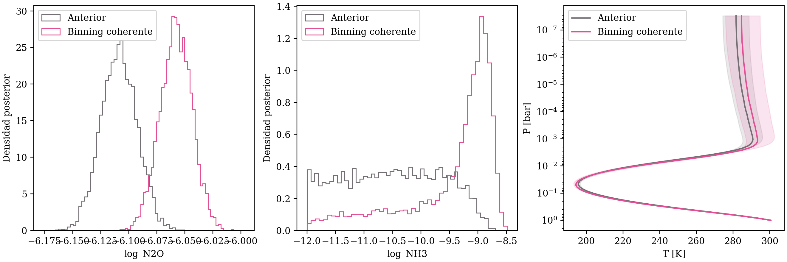

# Comparación A3–1000 h: operador de canales

La corrida nueva cerró con exit 0. Datos observados, priors, modelo físico y
malla térmica se conservaron; el operador LIFE de binning es el cambio
controlado.

| Métrica | Operador anterior | Binning coherente |
|---|---:|---:|
| χ² del mejor ajuste | 542.64 | 242.88 |
| dof efectivos | 17 | 17 |
| χ² reducido | 31.920 | 14.287 |
| ln Z ± error numérico | 677.923472817355 ± 0.26942780548743245 | 826.6110777592237 ± 0.27287356136243 |

`Δln Z = 148.6876049418687 ± 0.383472714623074` (errores numéricos en
cuadratura) mide sensibilidad al operador. No es un Bayes factor entre
hipótesis atmosféricas, no representa evidencia molecular y no se convierte
a sigma. Aunque χ² se reduce ≈55.3 %, χ² reducido≈14.29 continúa indicando una
discrepancia sustancial con el modelo/ruido asumido.

Los cuantiles son 2.5/16/50/84/97.5 %:

| Parámetro | Anterior | Corregido |
|---|---|---|
| `log_N2O` | −6.14042 / −6.12485 / −6.10887 / −6.09274 / −6.07793 | −6.08659 / −6.07232 / −6.05786 / −6.04397 / −6.03037 |
| `log_NH3` | −11.93358 / −11.49513 / −10.48663 / −9.52916 / −9.05097 | −11.61744 / −10.33934 / −9.12999 / −8.83145 / −8.66668 |

NH₃ desplaza su mediana +1.357 dex, aunque mantiene una cola posterior amplia
hacia abundancias bajas. N₂O cambia +0.051 dex. La figura fue inspeccionada
visualmente el 2026-10-15; muestra el posterior y el perfil P–T para ambos
operadores. La aceptación científica formal permanece pendiente. Véase el
[informe de método, validación e interpretación](../../../../../docs/life_proxima_a3_1000h_binning_corrected_2026-10-14.md)
y [comparison.json](comparison.json) para detalles de auditoría.

