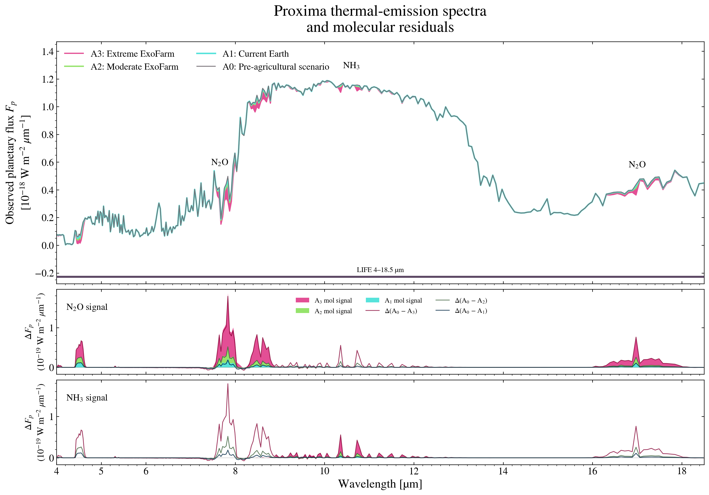
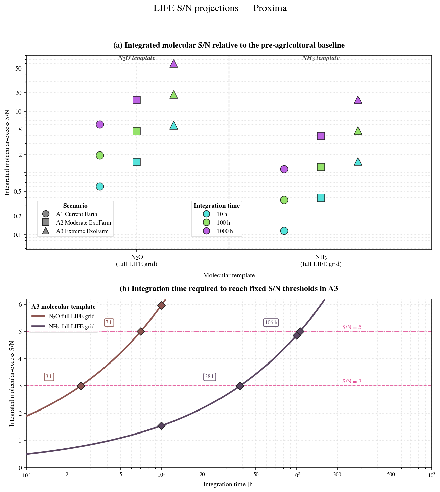
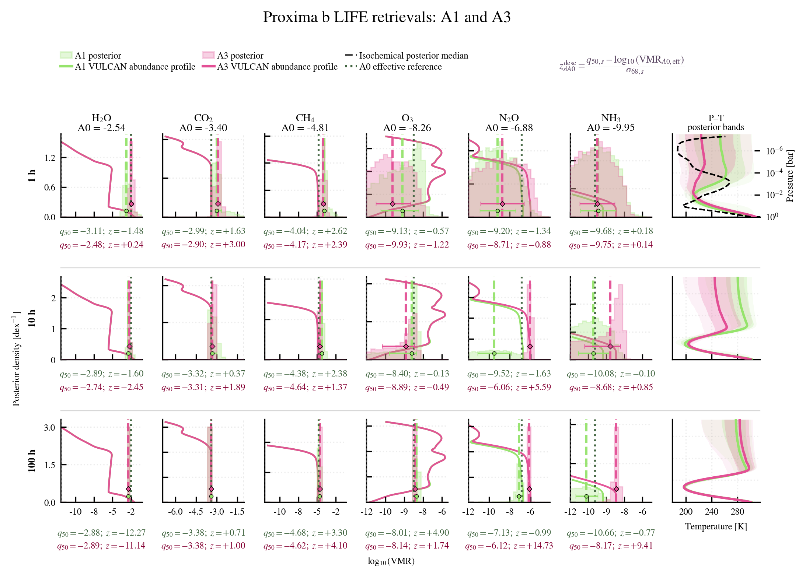

# Metodología reproducible de los retrievals LIFE Proxima A1/A3 a 1, 10 y 100 h

**Fecha de cierre documental:** 2026-10-03  
**Estado:** subcampaña clásica focal completada; seis retrievals A1/A3 × 1/10/100 h validados.  
**Pregunta:** dado un espectro de emisión térmica sintético de un análogo terrestre bajo el entorno radiativo de Proxima, ¿cómo se recuperan sus abundancias al aumentar el tiempo de integración y cuánto se separan descriptivamente de la referencia natural A0?

## Resumen ejecutivo

La cadena ejecutada fue

```text
SED MUSCLES de Proxima → flujo incidente en VULCAN → química vertical A0–A3
→ espectro de emisión POSEIDON → bins/ruido fotónico LIFEsim clásico
→ datos sintéticos LIFE → retrieval de emisión POSEIDON/MultiNest
→ posteriores, perfiles P–T y atlas oficial.
```

El objetivo es un **análogo terrestre controlado bajo la radiación de Proxima Centauri**. No es una reconstrucción de la atmósfera medida de Proxima b. La serie focal vigente contiene A1 y A3 a 1, 10 y 100 h; A0 funciona como referencia efectiva de abundancia, sin un retrieval A0 adicional en esta serie. El atlas V2 oficial muestra las posteriores de H₂O, CO₂, CH₄, O₃, N₂O y NH₃, perfiles de abundancia VULCAN y perfiles P–T.

La conclusión metodológica es cautelosa: las posteriores de N₂O/NH₃ dependen de la realización de ruido y del supuesto `isochem`; en particular, a 100 h los ajustes tienen `χ²_red=3.18` para A1 y `4.94` para A3. Por ello, valores estrechos o distancias grandes frente a A0 no equivalen aquí a significancias de detección. El análisis usa ruido diagonal de LIFEsim clásico y una realización por dataset, no la covarianza instrumental temporal de LIFEsimMC/PHRINGE.

## 1. Alcance y escenarios

Los escenarios mantienen la atmósfera terrestre de control y cambian los forzamientos fotoquímicos de N₂O/NH₃ de acuerdo con la matriz ExoFarm A0–A3. La rama Proxima sustituye el campo estelar solar por la SED de Proxima y conserva una estructura PT/Kzz terrestre controlada para aislar esa elección. Para VULCAN se emplea la SED MUSCLES de GJ 551/Proxima Centauri, parte del estudio pancromático de [France et al. (2016)](https://doi.org/10.3847/0004-637X/820/2/89) y distribuida como [producto v22 en MAST](https://archive.stsci.edu/hlsp/muscles). En el forward térmico posterior, POSEIDON usa la malla de espectros estelares sintéticos PHOENIX descrita por [Husser et al. (2013)](https://doi.org/10.1051/0004-6361/201219058); cumple una función distinta de la SED fotoquímica. Los forzamientos activos de esta rama corresponden a la corrección de N₂O adoptada el 2026-07-01; no se deben confundir con los perfiles Tierra–Sol congelados antes de esa corrección.

Los parámetros de sistema adoptados de LIFE X son `d=1.30 pc`, `T_eff=3050 K`, `R_star=0.14 R_sun`, `R_p=1.23 R_earth`, `M_p=1.59 M_earth`, `T_eq=229 K`, `a=0.0485 AU` y separación angular `0.0373 arcsec`. Varios son parámetros estadísticos/estimados, no mediciones directas de una atmósfera de Proxima b. El manifiesto de campaña y la bitácora de Capa 2 conservan la procedencia exacta.

## 2. SED estelar y fotoquímica VULCAN

### 2.1 Espectro de entrada y conversión geométrica

**Dato de entrada.** Se usó la SED pancromática v22 del MUSCLES Treasury Survey para GJ 551/Proxima Centauri, archivo `adapt-const-res-sed` de resolución aproximadamente constante. El archivo tiene 54 997 muestras entre 3 Å y 5.5 μm y combina observaciones/modelos de distintas bandas (UV, óptico, rayos X y fotosfera). Las columnas utilizadas son `WAVELENGTH` [Å] y `FLUX` [erg s⁻¹ cm⁻² Å⁻¹], medidas en el observador terrestre. La variante `var-res-sed` se conserva como referencia de archivo.

**Transformación.** VULCAN espera el flujo en la superficie estelar; el conversor aplica una sola vez

\[
F_{\rm surf}=F_{\rm obs}\left(\frac{d}{R_\star}\right)^2,
\]

con `d=1.30 pc`, `R_star=0.14 R_sun` y factor `(d/R_star)^2=1.696242×10^17`. También convierte Å→nm (`/10`) y flujo por Å→por nm (`×10`). Los valores negativos se fijan en cero; en esta SED no hubo ninguno. VULCAN aplica después la geometría estelar–órbita `(R_star/a)^2` una sola vez. Así se evita duplicar la dilución geométrica.

### 2.2 Configuración fotoquímica y perfiles entregados

VULCAN se ejecutó con la red `SNCHO_full_photo_network` y fotólisis. Las entradas A0–A3 están en `Photochemical_Modeling/Config/planets/earth_proxima_b/input_earth_proxima_b_A*.yml`; los perfiles aceptados se guardaron en `Photochemical_Modeling/Results/Outputs/` y se exportaron como PT y química en `Transmission_Spectroscopy/profiles/`. La campaña aceptó `end_case=1` para los cuatro escenarios.

Los flujos inferiores de N₂O/NH₃ se aplicaron como condiciones de contorno. La bitácora de la rama registra estos valores de superficie en VMR:

| Escenario | N₂O superficial | NH₃ superficial |
| --- | ---: | ---: |
| A0 | `1.32×10⁻⁷` | `1.22×10⁻¹⁰` |
| A1 | `1.87×10⁻⁷` | `5.38×10⁻¹⁰` |
| A2 | `2.81×10⁻⁷` | `1.58×10⁻⁹` |
| A3 | `9.79×10⁻⁷` | `6.37×10⁻⁹` |

Son abundancias impuestas en el límite inferior del modelo, no promedios verticales ni abundancias que el retrieval deba recuperar exactamente. La química fotoquímica y el transporte producen los perfiles dependientes de presión que alimentan el cálculo espectral. La procedencia y el contexto de estos valores están en la [bitácora de la rama Proxima](life_proxima_b_branch_bitacora_2026-07-22.md).

El perfil PT/Kzz inicial es `atm/atm_Earth_Jan_Kzz.txt`, una estructura terrestre de control. La convención de bloqueo por marea y geometría diurna está registrada como decisión de proyecto; no es un clima observado de Proxima b. Las abundancias VULCAN varían con presión. Esa variación es la “verdad” usada para producir los espectros y es importante porque el retrieval posterior adopta abundancias isquímicas constantes.

**Validación de la SED.** La integral bolométrica observada fue `2.964×10⁻⁸ erg s⁻¹ cm⁻²`, razón `1.037` frente a la referencia de luminosidad usada; Lyα y las bandas FUV/NUV quedaron positivas y en rangos documentados. El manifiesto identifica los cuatro archivos de perfil y sus hashes normalizados.

## 3. Forward de emisión térmica con POSEIDON

El script [`emission_forward.py`](../Thermal_Emission_Spectroscopy/scripts/emission_forward.py) carga los archivos VULCAN de PT y química, interpola las entradas a 100 capas logarítmicas desde 1 bar hasta `3×10⁻⁸ bar` y calcula la emisión térmica con POSEIDON. El N₂ actúa como gas de fondo; las especies con opacidades parametrizadas son H₂O, CO₂, CH₄, O₂, O₃, N₂O y NH₃.

La estrella del cálculo espectral se genera desde la rejilla estelar PHOENIX (`T_eff=3050 K`, `log g≈5.2`, metalicidad solar), la biblioteca de atmósferas y espectros sintéticos descrita por [Husser et al. (2013)](https://doi.org/10.1051/0004-6361/201219058). PHOENIX cumple aquí la función de espectro estelar del modelo directo; la SED MUSCLES alimenta la fotoquímica VULCAN. Se usó `Opacity_database_v1.3.hdf5` de POSEIDON, base High-T que contiene opacidades para N₂O y NH₃.

La atmósfera tiene superficie opaca explícita (`surface=True`) fijada en 1 bar. Se calcularon dos productos: el contraste `Fp/Fs` y el flujo planetario directo `Fp_obs` a la distancia del sistema. LIFE y POSEIDON retrieval usan `Fp_obs`, no profundidad de tránsito. El flujo se expresa en `W m⁻² m⁻¹`. El forward nativo cubre 3–20 μm, con `R=10000` y 18 971 puntos; el modelo de retrieval usa una rejilla de 3.8–19 μm a la misma resolución.

Los productos guardados se encuentran bajo `Thermal_Emission_Spectroscopy/outputs/life_proxima_b_earthlike_v1/forward_emission/`. La interfaz de superficie/O₂ se contrastó con el forward LIFE A3 en los 31 bins: las auditorías registran desviaciones RMS inferiores a `0.3 σ` y máximas inferiores a `1 σ` para las comparaciones explícitamente validadas. La comprobación de cuerpo negro de A0 a 10 μm dio `Fp_obs=1.19×10⁻¹²` frente a `9.25×10⁻¹³ W m⁻² m⁻¹` (razón 1.28), como prueba de interfaz, no como ajuste de la atmósfera real.

La figura siguiente enseña el producto espectral de esta rama. Arriba se superponen los flujos planetarios `Fp_obs` de A0–A3; abajo se muestran las contribuciones diferenciales asociadas a N₂O y NH₃ respecto de A0. Las curvas de flujo total casi se solapan, así que el panel superior sirve para comprobar la forma y escala espectral, mientras que los paneles inferiores hacen visibles las diferencias moleculares pequeñas. La figura presenta flujo planetario en emisión, no profundidad de tránsito ni `Fp/Fs`.



*Figura 1. Forward térmico de Proxima b: `Fp_obs` para A0–A3 (panel superior) y señales diferenciales de N₂O y NH₃ (paneles inferiores). La escala de las diferencias es mucho menor que la del flujo total; por eso una inspección del espectro superpuesto no basta para juzgar la detectabilidad. [PNG](../Thermal_Emission_Spectroscopy/final_products/figures/emission_molecular_residuals_proxima.png) · [PDF](../Thermal_Emission_Spectroscopy/final_products/figures/emission_molecular_residuals_proxima.pdf). La figura fuente y sus datos siguen bajo `outputs/life_proxima_b_earthlike_v1/`.*

## 4. Escena LIFE y estimación de ruido

### 4.1 Configuración de la escena

La escena Proxima sigue la configuración de referencia LIFE X: cuatro colectores de 2 m, banda `4–18.5 μm`, resolución espectral `R=20`, 31 canales y throughput nominal 5 %. Se usan distancia `1.30 pc`, estrella de `3050 K` y `0.14 R_sun`, separación angular `0.0373 arcsec` y exozodi de 3 zodis; la latitud eclíptica para el zodi local se deriva de las coordenadas del objetivo. La escena selecciona el escenario `baseline` de LIFEsim clásico. A diferencia del análisis de población de LIFE X, este caso usa una configuración de sistema fija y no una distribución de realizaciones orbitales para cada blanco.

Se conectaron `Instrument`, `TransmissionMap`, `PhotonNoiseStar` (fuga estelar), `PhotonNoiseLocalzodi` y `PhotonNoiseExozodi`. La salida de incertidumbre representa ruido de fotones de esas fuentes, por canal. No incorpora inestabilidades instrumentales ni una matriz de covarianza temporal/espectral.

#### Relación con la metodología de LIFE X

LIFE X usa LIFEsim para calcular el tiempo de integración requerido para alcanzar un S/N de banda ancha de 7 entre `4–18.5 μm`, con un límite de 100 h para clasificar un planeta como detectable en ese estudio. La simulación incluye fuga estelar, zodi local y exozodi como fuentes de ruido astrofísico; no añade una realización de ruido instrumental. La configuración de referencia adopta cuatro telescopios de 2 m, throughput total del 5 % y una línea de base de nulación entre 10 y 100 m. Para el estudio de población, los parámetros orbitales se muestrean en realizaciones y se resumen para alimentar el cálculo de rendimiento; la escena de esta campaña usa en cambio los valores tabulados del caso Proxima y exozodi de 3 zodis. LIFE X también compara configuraciones instrumentales pesimista y optimista, mientras esta campaña se limita a la referencia. Estos detalles están descritos en [Carrión-González et al. 2023, §2, tabla 2 y apéndice de parámetros](https://doi.org/10.1051/0004-6361/202347027).

La campaña conserva esa escena instrumental de referencia y amplía la pregunta científica: en lugar de limitarse al S/N broadband de un planeta, pasa por LIFEsim los espectros moleculares de POSEIDON, calcula incertidumbres por canal y evalúa plantillas diferenciales de N₂O y NH₃ sobre los 31 canales. Es una adaptación para estudiar señales moleculares; los umbrales de S/N de esa adaptación no deben confundirse con el criterio broadband S/N=7 de LIFE X ni con una predicción completa de rendimiento de misión. La configuración clásica tampoco modela la covarianza/instabilidad instrumental de LIFEsimMC/PHRINGE.

Antes del análisis molecular, [`validate_proxima_life_scene.py`](../Thermal_Emission_Spectroscopy/scripts/validate_proxima_life_scene.py) compara la escena con los anclajes de LIFE X usando un planeta de cuerpo negro (`T_eq=229 K`, `R_p=1.23 R_earth`) y 10 h de integración. Para las aperturas de 1, 2 y 3.5 m, el S/N broadband calculado fue `48.4`, `166.5` y `412.4`, frente a `45`, `170` y `466` en la tabla 3 de LIFE X; las tres diferencias quedan dentro de la tolerancia de calibración de ±40 % registrada para esta interfaz. Es una prueba del ensamblaje escena/unidades, previa a los espectros fotoquímicos; no calibra el retrieval molecular.

### 4.2 Interfaz de unidades

POSEIDON entrega flujo energético directo `Fp_obs(λ)` en `W m⁻² m⁻¹`. Antes de entregarlo a LIFEsim, se convierte a densidad de flujo de fotones:

\[
F_{\rm ph}(\lambda)=F_{p,\rm obs}(\lambda)\,\frac{\lambda}{hc}
\quad[\mathrm{ph\,m^{-2}\,s^{-1}\,m^{-1}}].
\]

LIFEsim rebinó el flujo y calculó S/N y `sigma_ph` en los 31 canales. Para el `.dat` que lee POSEIDON, el flujo fotónico vuelve a unidades energéticas con la operación inversa `sigma_F=sigma_ph hc/λ`. Cada dataset tiene cuatro columnas: centro del bin [μm], semiancho [μm], flujo observado `Fp` [`W m⁻² m⁻¹`] e incertidumbre `sigma_Fp` en las mismas unidades.

### 4.3 Tiempos, realizaciones y procedencia de los datasets

La ancla de 10 h procede del producto directo guardado de LIFEsim clásico 0.2.32 (SpectRes 2.1.1 compatible). Para el régimen fotónico se usó

\[
\sigma(t)=\sigma(10\,\mathrm{h})\sqrt{\frac{10\,\mathrm{h}}{t}},
\qquad \mathrm{S/N}(t)\propto\sqrt{t}.
\]

La equivalencia entre observaciones directas LIFEsim y escalado se validó en A0/A3 a 1, 10, 100, 240, 500 y 1200 h: diferencia relativa máxima en `sigma=6.7×10⁻¹⁶` y diferencia máxima de la realización emparejada `8.5×10⁻¹⁵ σ`. La verificación específica posterior de los seis datasets focales encontró una discrepancia máxima de `4.68×10⁻⁷`, compatible con redondear los `.dat` a seis cifras significativas.

Los 31 flujos ruidosos se generaron como

\[
F_{\rm obs,i}=F_{\rm noiseless,i}+\mathcal{N}(0,1)\,\sigma_i,
\]

con semilla independiente por escenario/duración. En concreto, 1 h usa sigma escalada desde 10 h por `√10`; 100 h usa sigma reducida por `√10`; 10 h conserva los datasets canónicos originales. Las realizaciones de 1, 10 y 100 h son independientes, por lo que diferencias entre flujos residuales/posteriores no constituyen una secuencia de ruido anidada.

La procedencia que importa para comparar las filas es: 10 h reutiliza el par A1/A3 del índice canónico 8/8; 100 h usa dos datasets de auditoría independientes; y 1 h usa datasets propios, con la realización A1 que se promovió después de una comparación post hoc. Por tanto, las tres filas tienen la misma escala de ruido esperada según el tiempo, pero no comparten una misma realización aleatoria escalada. Los índices JSON guardan las semillas exactas y la correspondencia con cada `.dat`, que resulta más útil para reproducir los datos que una lista de semillas aislada:

| Duración | Procedencia y estado | Índice de datos |
| --- | --- | --- |
| 1 h | Datasets focales independientes; A1 usa la repetición promovida post hoc. | [`dataset_index_A1_A3_1h_official_revision_20261002.json`](../Thermal_Emission_Spectroscopy/outputs/life_proxima_b_earthlike_v1/life_data/dataset_index_A1_A3_1h_official_revision_20261002.json) |
| 10 h | A1/A3 reutilizados desde la matriz canónica 8/8. | [`dataset_index.json`](../Thermal_Emission_Spectroscopy/outputs/life_proxima_b_earthlike_v1/life_data/dataset_index.json) |
| 100 h | Datasets independientes de auditoría A1 y A3. | [`Índice A1`](../Thermal_Emission_Spectroscopy/outputs/life_proxima_b_earthlike_v1/life_data/dataset_index_A1_100h_O2_fixedBlack1bar_noxtol_audit.json) · [`Índice A3`](../Thermal_Emission_Spectroscopy/outputs/life_proxima_b_earthlike_v1/life_data/dataset_index_A3_100h_fixedP1bar_noxtol_audit.json) |

La matriz A0–A3 × {10 h, 240 h}, sus datos e índice canónico permanecen intactos como referencia legacy; no se incorporan a la serie focal oficial.

### 4.4 S/N molecular integrado y proyección de exposición

El S/N mediano de continuo por canal es 14.85, 46.96 y 148.49 a 1, 10 y 100 h, respectivamente. El S/N integrado de plantilla molecular sobre los 31 bins, calculado mediante el espectro completo menos un contrafactual donde se reinicia esa molécula a A0, es:

\[
({\rm S/N})_{\rm mol}=\sqrt{\sum_{i=1}^{31}\left(\frac{\Delta F_i}{\sigma_i}\right)^2},
\qquad \Delta F_i=F_{i,\rm full}-F_{i,\rm molecule\to A0}.
\]

Esta norma ponderada reúne la contribución diferencial en los canales LIFE, bajo el supuesto de errores diagonales. No es el S/N de un solo pico ni el S/N broadband de detección de LIFE X.

| Escenario | Plantilla | 1 h | 10 h | 100 h |
| --- | --- | ---: | ---: | ---: |
| A1 | N₂O | 0.192 | 0.607 | 1.920 |
| A1 | NH₃ | 0.037 | 0.115 | 0.365 |
| A3 | N₂O | 1.886 | 5.965 | 18.864 |
| A3 | NH₃ | 0.486 | 1.536 | 4.857 |

Estos son S/N de plantillas bajo ruido diagonal, no probabilidades de detección ni garantía de recuperación por retrieval.

La figura de S/N recoge dos lecturas complementarias. El panel (a) compara las plantillas integradas de N₂O y NH₃ para A1–A3 y varias exposiciones; forma y color distinguen escenario y tiempo. El panel (b) proyecta el S/N de las plantillas A3 al aumentar la exposición, usando la escala fotónica `S/N∝√t`, e indica los tiempos en que las curvas cruzan S/N=3 y 5. Para esta métrica integrada, las intersecciones son aproximadamente 3 y 7 h para N₂O, y 38 y 106 h para NH₃. Son tiempos proyectados a partir del escalado de ruido, no retrievals ejecutados ni detecciones garantizadas. El punto auxiliar de 1000 h que aparece en el panel superior queda fuera de la serie focal oficial de retrievals (1/10/100 h).



*Figura 2. S/N molecular integrado sobre la rejilla LIFE y proyección de exposición para las plantillas A3. La proyección responde a cuándo la norma de señal ponderada alcanzaría umbrales de referencia bajo ruido fotónico diagonal; no modela la recuperación posterior, el perfil vertical ni la covarianza instrumental. [PNG](../Thermal_Emission_Spectroscopy/final_products/figures/life_classic_snr_integrated_proxima.png) · [PDF](../Thermal_Emission_Spectroscopy/final_products/figures/life_classic_snr_integrated_proxima.pdf) · [datos tabulados](../Thermal_Emission_Spectroscopy/final_products/life_classic_snr_integrated_proxima.csv).*

## 5. Modelo de retrieval y espacio de parámetros

El runner es [`run_life_retrieval.py`](../Thermal_Emission_Spectroscopy/scripts/run_life_retrieval.py), con POSEIDON 1.4.0 y MultiNest 3.10. La verosimilitud compara el flujo planetario observado `Fp` de los 31 bins con el espectro de emisión directa calculado por POSEIDON. La campaña usa `thermal=True`, `thermal_scattering=False`, `spectrum_type="direct_emission"`, unidad `Fp`, `R=10000`, superficie explícita negra a 1 bar y gas de fondo N₂.

### 5.1 Parametrización

- **Perfil térmico:** `PT_profile="Madhu"`, seis parámetros (`a1`, `a2`, `log_P1`, `log_P2`, `log_P3`, `T_ref`).
- **Química recuperada:** `X_profile="isochem"`, `X_dim=1`: una abundancia constante con altura para cada especie recuperable H₂O, CO₂, CH₄, O₂, O₃, N₂O y NH₃. O₂ está incluido en el modelo aun cuando el atlas focal omite su columna para conservar legibilidad.
- **Radio:** `R_p_ref` en radios terrestres, referido a la superficie a 1 bar.
- **Superficie:** `log_P_surf=0`, presión fija exactamente en 1 bar (prior de anchura cero); se usa `surface=True`. Esto reproduce la frontera opaca del generador. El modo heredado `fixed-bottom` con `surface=False` no es equivalente y queda fuera de la configuración oficial.
- **Errores:** `error_inflation=none`; `x_tol` no forma parte del vector muestreado. Se usa sigma diagonal por canal, sin añadir un término fraccional de discrepancia.

### 5.2 Priors

| Parámetro(s) | Prior usado | Interpretación |
| --- | --- | --- |
| `a1`, `a2` | uniforme `[0.02, 2]` | Curvatura/forma del perfil Madhu |
| `log_P1`, `log_P2` | uniforme `[-6, 1]` | Presiones de transición, log₁₀(bar) |
| `log_P3` | uniforme `[-2, 1]` | Presión adicional del perfil, log₁₀(bar) |
| `T_ref` | uniforme `[150, 400] K` | Temperatura de referencia |
| `R_p_ref` | uniforme `[0.8, 1.3] × R_nominal` | Para `R_nominal=1.23 R_earth`: `[0.984, 1.599] R_earth` |
| `log₁₀(VMR)` de H₂O, CO₂, CH₄, O₃, N₂O, NH₃ | uniforme `[-12, -1]` | Abundancia isquímica, en dex |
| `log₁₀(VMR)` de O₂ | uniforme `[-6, log₁₀(0.5)]` | Incluye la abundancia de O₂ del escenario en el soporte del prior |
| `log_P_surf` | fijo `0` | Superficie negra en 1 bar; sin anchura libre |

#### Por qué se eligieron estos límites

La parametrización de Madhusudhan–Seager aporta una forma flexible de seis parámetros que puede describir perfiles con y sin inversión térmica; el artículo de origen define la estructura funcional, pero no establece estos límites concretos como universales para una atmósfera terrestre templada. El comentario del runner los llama *broad but physical* y dice que los rangos de presión siguen la parametrización estándar y que `T_ref` debe abarcar una atmósfera rocosa templada. El repositorio no documenta una optimización específica, calibración con datos simulados ni prueba de sensibilidad que derive exactamente `0.02`, `2`, `−6`, `1` o `−2`. Por eso, aquí deben leerse como elecciones operativas de esta campaña, no como límites impuestos por LIFE o por la física de Proxima b.

En unidades lineales, `log_P1` y `log_P2` cubren `10⁻⁶–10 bar`, y `log_P3`, `10⁻²–10 bar`. La malla y la superficie opaca llegan solo hasta 1 bar: la parte del prior con transición a presiones mayores que 1 bar cae por debajo de la frontera visible del modelo y puede ser poco informativa. Esto no invalida automáticamente los retrievals, pero sí hace pertinente revisar ocupación en los bordes y repetir con prior acotado al dominio atmosférico que realmente contribuye. En la forma analítica original, `a1/a2` controlan la escala de los gradientes por medio de términos cuadráticos; tomar valores positivos evita la duplicación de signo y el límite inferior evita el denominador nulo. El intervalo concreto sigue siendo una elección operativa: sus extremos no se han justificado con una sensibilidad publicada para esta campaña. Antes de atribuir significado físico a las colas de P–T, conviene comparar priors y verificar la cobertura de perfiles VULCAN. Madhusudhan & Seager justifican la familia del perfil, no los límites exactos del runner.

El modelo tiene 15 nombres de parámetros en los archivos POSEIDON; el parámetro de superficie tiene prior de anchura cero. Los resultados de campaña reportan 16 grados de libertad, equivalentes a `31−15`. Para un uso formal de `χ²_red` en un manuscrito debe declararse esta convención y confirmarse el conteo efectivo de parámetros fijados en la implementación. Todas las cifras siguientes reproducen la convención reportada en los resultados.

### 5.3 Muestreo y ejecución

Se usó MultiNest con `N_live=800`; los lanzamientos MPI documentados ejecutaron seis ranks con MPICH del entorno conda `POSEIDON` y limitaron a una hebra BLAS por rank. Los resultados se validaron en muestras posteriores, espectro, P–T, log-X y archivos crudos MultiNest; los seis runs focales están cerrados. Para reconstruir la configuración de un caso nuevo, el runner acepta, por ejemplo:

```bash
python Thermal_Emission_Spectroscopy/scripts/run_life_retrieval.py \
  --campaign proxima --scenario A3 --hours 10 --n-live 800 \
  --x-profile isochem --error-inflation none \
  --surface-pressure-mode fixed-black --include-o2 --R 10000 \
  --wl-min 3.8 --wl-max 19.0
```

La ejecución real requiere activar el entorno POSEIDON, configurar las rutas de opacidades/datos estelares y seleccionar el `.dat` e índice correctos. La orden es una plantilla de configuración, no una afirmación de que se haya vuelto a ejecutar esta campaña al redactar el informe.

## 6. Resultados focales

Las medianas/intervalos proceden de las muestras de igual peso. `log_X` está en `log₁₀(VMR)`. `ln Z` pertenece a su dataset individual; comparar valores de `ln Z` entre realizaciones, escenarios o duraciones distintas no da un factor de Bayes.

| Escenario | Tiempo | `ln Z ± error` | `χ²_red` (16 dof reportados) | `R_p_ref` mediana [q16,q84] (`R_earth`) | `log_N2O` q16 / q50 / q84 | `log_NH3` q16 / q50 / q84 |
| --- | ---: | ---: | ---: | ---: | ---: | ---: |
| A1 | 1 h | 867.68 ± 0.17 | 1.10 | 1.210 [1.172, 1.254] | −10.901 / −9.200 / −7.441 | −11.159 / −9.680 / −8.197 |
| A3 | 1 h | 866.37 ± 0.16 | 1.66 | 1.164 [1.147, 1.191] | −10.81 / −8.71 / −6.64 | −11.22 / −9.75 / −8.31 |
| A1 | 10 h | 889.38 ± 0.21 | 1.55 | 1.210 [1.191, 1.230] | −11.16 / −9.52 / −7.89 | −11.33 / −10.08 / −8.81 |
| A3 | 10 h | 890.97 ± 0.21 | 1.28 | 1.227 [1.208, 1.246] | −6.22 / −6.06 / −5.92 | −10.81 / −8.68 / −7.83 |
| A1 | 100 h | 899.58 ± 0.24 | 3.18 | 1.212 [1.206, 1.218] | −7.44 / −7.13 / −6.95 | −11.61 / −10.66 / −9.71 |
| A3 | 100 h | 884.33 ± 0.24 | 4.94 | 1.220 [1.214, 1.227] | −6.21 / −6.15 / −6.10 | −8.66 / −8.26 / −8.06 |



*Figura 3. Atlas oficial V2 de los retrievals A1/A3 a 1, 10 y 100 h. Cada fila corresponde a una duración; las seis primeras columnas muestran H₂O, CO₂, CH₄, O₃, N₂O y NH₃, y la última compara los perfiles P–T recuperados. Las áreas coloreadas son posteriores isquímicas; los perfiles moleculares VULCAN se repiten por duración. El P–T VULCAN de entrada se dibuja como referencia negra discontinua en la fila superior, y las bandas coloreadas muestran los P–T recuperados por escenario en cada fila. Se anotan la mediana `q₅₀` y el `z_desc` respecto de A0 efectiva debajo de cada panel molecular. Las densidades se normalizan por panel y sus escalas verticales son independientes; por eso la altura de una distribución no mide qué tiempo “recupera mejor”. [PNG](../Thermal_Emission_Spectroscopy/final_products/figures/retrieval_A1_A3_1_10_100h_official_six_species_PT_proxima.png) · [PDF](../Thermal_Emission_Spectroscopy/final_products/figures/retrieval_A1_A3_1_10_100h_official_six_species_PT_proxima.pdf) · [SVG](../Thermal_Emission_Spectroscopy/final_products/figures/retrieval_A1_A3_1_10_100h_official_six_species_PT_proxima.svg).*

La figura deja ver dos resultados que la tabla condensa. Primero, las marginales de una hora son amplias: los datos débiles permiten que las abundancias isquímicas de N₂O y NH₃ permanezcan próximas a A0 efectiva dentro de intervalos extensos. A 10 h, el posterior de N₂O en A3 se concentra alrededor de `−6.06`, mientras A1 sigue ancho y centrado por debajo de A0. A 100 h, las medianas de N₂O de A1 y A3 se separan: A1 queda relativamente cerca de A0 y A3 se desplaza a mayor abundancia; A3 también desplaza NH₃ respecto de A0 efectiva. Segundo, el panel de P–T importa para interpretar esas marginales: una curva térmica flexible puede compensar rasgos del espectro mientras la abundancia constante intenta representar una química que cambia con presión.

La fila de 100 h requiere cautela especial. Aunque sus posteriores N₂O/NH₃ son estrechas y sus `z_desc` son grandes en A3, los ajustes tienen `χ²_red=3.18` (A1) y `4.94` (A3). La concentración describe el posterior condicionado al modelo `isochem`, al perfil Madhu, al prior y a esa realización de ruido; con esta tensión de ajuste no debe leerse como precisión física ni como detección. El `z_desc` es una comparación descriptiva, no una significancia. Los tres formatos finales del atlas se inspeccionaron visualmente y se conservan en la carpeta de productos finales.

La abundancia de O₂ recuperada queda cerca de `log₁₀(VMR)≈−3.1` en los seis casos, con intervalos amplios del orden de 1.8 dex. El radio recuperado permanece alrededor de `1.16–1.23 R_earth` en la mayoría de los casos; las cifras por escenario se documentan en el resumen de campaña. El atlas no dibuja una columna de O₂, pero esa especie sí está dentro del retrieval.

### 6.1 Referencia A0 y significado de z

Para comparar una abundancia isquímica con el perfil vertical de A0 se calcula un promedio ponderado en presión:

\[
\overline X_{A0,\rm eff}=\frac{\int X_{A0}(p)\,dp}{p_{\rm bottom}-p_{\rm top}},
\qquad
z^{\rm desc}_{s|A0}=\frac{q_{50,s}-\log_{10}(\overline X_{A0,\rm eff})}{\sigma_{68,s}},
\qquad
\sigma_{68,s}=\frac{q_{84,s}-q_{16,s}}{2}.
\]

La referencia A0 efectiva es H₂O `−2.54`, CO₂ `−3.40`, CH₄ `−4.81`, O₃ `−8.26`, N₂O `−6.88` y NH₃ `−9.95` en `log₁₀(VMR)`. El promedio ponderado en presión aproxima el peso de masa de columna hidrostática; no es un posterior de A0.

| Tiempo | Escenario | `z_desc(N₂O|A0)` | `z_desc(NH₃|A0)` |
| ---: | --- | ---: | ---: |
| 1 h | A1 | −1.34 | +0.18 |
| 1 h | A3 | −0.88 | +0.14 |
| 10 h | A1 | −1.63 | −0.10 |
| 10 h | A3 | +5.59 | +0.85 |
| 100 h | A1 | −0.99 | −0.77 |
| 100 h | A3 | +13.24 | +5.63 |

El subíndice `desc` importa: `z` divide el desplazamiento de la mediana frente a A0 efectiva por la semianchura posterior central. No es una significancia gaussiana, no integra incertidumbre de A0, no marginaliza el perfil vertical, y puede ser grande cuando la posterior es artificialmente estrecha bajo un modelo inadecuado.

## 7. Interpretación científica y límites

1. **El S/N no determina por sí solo el resultado del retrieval.** A3 tiene una plantilla integrada de N₂O con S/N esperado `5.97` a 10 h y `18.86` a 100 h; el posterior se estrecha, pero el ajuste A3 de 100 h tiene `χ²_red=4.94`. La posterior estrecha está condicionada al likelihood diagonal y al modelo isochem.
2. **A1 es un control de señal más débil.** Las plantillas A1 integradas quedan por debajo de S/N=2 incluso a 100 h (`1.92` N₂O; `0.37` NH₃). No sorprende que la recuperación sea sensible a la realización y a degeneraciones.
3. **Las medianas no forman una curva temporal suave.** Cada exposición usa una realización independiente, así que 1/10/100 h no son posteriores de un mismo flujo con el mismo ruido escalado. La realización A1-1 h originalmente seleccionada tenía `log_N2O≈−5.77`; la repetición independiente vigente dio `−9.20` con las mismas sigmas. La diferencia de 3.43 dex demuestra sensibilidad de ese caso a la realización. La nueva realización se promovió después de ver los resultados, decisión post hoc que debe acompañar cualquier interpretación.
4. **La discrepancia de ajuste crece en 100 h.** `χ²_red=3.18` para A1 y `4.94` para A3 señala tensión entre datos sintéticos de alta precisión y el modelo recuperador, que usa una química isquímica frente a perfiles VULCAN verticales. La realización independiente también influye, pero no se ha aislado una causa única para cada residuo.
5. **La evidencia `ln Z` no ordena horas/escenarios.** Cada número corresponde a un dataset distinto, a menudo con otra escala de sigma y otra realización; no son Bayes factors entre A1/A3 ni entre tiempos.
6. **No hay detección formal presentada.** Para sostener una afirmación de distinguir A3 de A0 hace falta un análisis emparejado que compare modelos con/sin la opacidad de N₂O/NH₃, marginalice los nuisance, pruebe sensibilidad al perfil y a los priors, y mida la variabilidad entre realizaciones. La siguiente capa debe incluir la covarianza/instabilidad instrumental LIFE.

## 8. Figura oficial y productos reproducibles

La figura oficial se generó adaptando [`plot_proxima_retrieval_products.py`](../Thermal_Emission_Spectroscopy/scripts/plot_proxima_retrieval_products.py) con `--official-a1-a3-times`. La V2 es la vista elegida: límites de abundancia definidos por perfiles VULCAN y posteriores y recortados al prior `[-12,−1]`; V1 conserva el prior completo y V3 calcula los límites solo desde las posteriores. El panel tiene filas 1/10/100 h y columnas H₂O, CO₂, CH₄, O₃, N₂O, NH₃ y P–T. La densidad de cada posterior se normaliza a área uno; por eso las alturas entre tiempos no son comparables. Los perfiles VULCAN se muestran en cada fila; el P–T de VULCAN se dibuja negro discontinuo en la fila superior y cada fila conserva el P–T recuperado.

- **Producto oficial PNG:** [`retrieval_A1_A3_1_10_100h_official_six_species_PT_proxima.png`](../Thermal_Emission_Spectroscopy/final_products/figures/retrieval_A1_A3_1_10_100h_official_six_species_PT_proxima.png)
- **PDF:** [`retrieval_A1_A3_1_10_100h_official_six_species_PT_proxima.pdf`](../Thermal_Emission_Spectroscopy/final_products/figures/retrieval_A1_A3_1_10_100h_official_six_species_PT_proxima.pdf)
- **SVG:** [`retrieval_A1_A3_1_10_100h_official_six_species_PT_proxima.svg`](../Thermal_Emission_Spectroscopy/final_products/figures/retrieval_A1_A3_1_10_100h_official_six_species_PT_proxima.svg)
- **Informe de campaña, seeds, resultados completos y validación:** [`life_proxima_a1_a3_1_10_100h_official_retrieval_campaign_2026-10-01.md`](life_proxima_a1_a3_1_10_100h_official_retrieval_campaign_2026-10-01.md)
- **Índice de la escena/productos:** [`manifest.json`](../Thermal_Emission_Spectroscopy/outputs/life_proxima_b_earthlike_v1/manifest.json)
- **Índices de datasets:** `life_data/dataset_index.json`, `dataset_index_A1_A3_1h_official_revision_20261002.json` y los índices de auditoría de A1/A3-100 h.

Código de fuente principal: [`convert_proxima_muscles_sed.py`](../Photochemical_Modeling/Scripts/Simulation/convert_proxima_muscles_sed.py), configs/runner VULCAN bajo `Photochemical_Modeling/`, [`emission_forward.py`](../Thermal_Emission_Spectroscopy/scripts/emission_forward.py), [`life_scene_classic.py`](../Thermal_Emission_Spectroscopy/scripts/life_scene_classic.py), [`make_life_datasets.py`](../Thermal_Emission_Spectroscopy/scripts/make_life_datasets.py), [`run_life_retrieval.py`](../Thermal_Emission_Spectroscopy/scripts/run_life_retrieval.py) y [`retrieval_reference.py`](../Thermal_Emission_Spectroscopy/scripts/retrieval_reference.py).

## 9. Qué está cerrado y qué falta

**Cerrado para el objetivo focal:** generación/validación de los forwards, ruido LIFE clásico diagonal, datasets independientes A1/A3 a 1/10/100 h, retrievals POSEIDON con una configuración común, auditoría estructural/finitud de productos y atlas oficial revisado visualmente. Los productos de 240 h, 500/1200 h, las variantes antiguas de superficie/interfaz y la primera realización A1-1 h se conservan como legacy o sensibilidad; no sustituyen la serie focal.

**Pendiente para una conclusión robusta de detección/observabilidad:**

- ejecutar LIFEsimMC/PHRINGE con la escena y versión congeladas y conservar la covarianza instrumental completa (o implementar whitening/likelihood correlacionado validado);
- repetir datasets y retrievals con múltiples realizaciones independientes para cobertura y estabilidad;
- comparar retrievals emparejados/marginalizados con y sin N₂O y NH₃, manteniendo igual likelihood y dataset;
- probar parametrizaciones verticales compatibles con VULCAN y sensibilidad a priors;
- confirmar y reportar la convención de grados de libertad, especialmente por la presión superficial de anchura cero;
- mantener separado este análogo terrestre de cualquier afirmación sobre la atmósfera real de Proxima b.

## 10. Fuentes

- MUSCLES Treasury Survey v22, GJ 551, MAST HLSP, DOI [`10.17909/T9DG6F`](https://doi.org/10.17909/T9DG6F).
- France et al. (2016), *The MUSCLES Treasury Survey. I. Motivation and Overview*, DOI [`10.3847/0004-637X/820/2/89`](https://doi.org/10.3847/0004-637X/820/2/89).
- Husser et al. (2013), *A new extensive library of PHOENIX stellar atmospheres and synthetic spectra*, DOI [`10.1051/0004-6361/201219058`](https://doi.org/10.1051/0004-6361/201219058).
- Tsai et al. (2021), VULCAN, DOI [`10.3847/PSJ/abd022`](https://doi.org/10.3847/PSJ/abd022).
- MacDonald (2023), POSEIDON, DOI [`10.21105/joss.04873`](https://doi.org/10.21105/joss.04873).
- Quanz et al. (2022), LIFE I, DOI [`10.1051/0004-6361/202140366`](https://doi.org/10.1051/0004-6361/202140366); Dannert et al. (2022), LIFE II, DOI [`10.1051/0004-6361/202141958`](https://doi.org/10.1051/0004-6361/202141958).
- Carrión-González et al. (2023), LIFE X, DOI [`10.1051/0004-6361/202347027`](https://doi.org/10.1051/0004-6361/202347027).
- Madhusudhan & Seager (2009), parametrización analítica de perfiles P–T, DOI [`10.1088/0004-637X/707/1/24`](https://doi.org/10.1088/0004-637X/707/1/24); la referencia justifica la familia paramétrica, no los límites de prior elegidos en este runner.
- Feroz, Hobson & Bridges (2009), MultiNest, DOI [`10.1111/j.1365-2966.2009.14548.x`](https://doi.org/10.1111/j.1365-2966.2009.14548.x).
- Bitácora de procedencia de la rama: [`life_proxima_b_branch_bitacora_2026-07-22.md`](life_proxima_b_branch_bitacora_2026-07-22.md); metodología general: [`life_stage_iii_classic_methodology_2026-08-30.md`](life_stage_iii_classic_methodology_2026-08-30.md).
