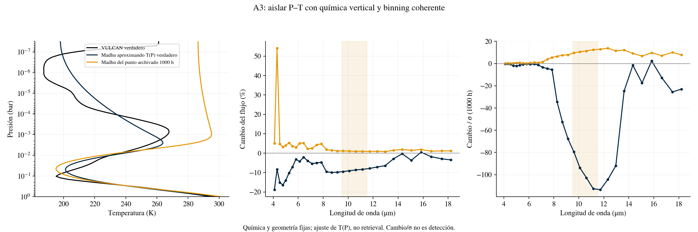

# A3: organizar un binning coherente y aislar el efecto del P–T

Fecha: 2026-10-14. Alcance confirmado por el usuario: **binning y P–T;
ruido instrumental excluido**. No se cambian observaciones, errores,
retrievals previos, priors ni código instalado de POSEIDON. Se construye
un adaptador diagnóstico separado y se evalúan forwards deterministas.
No se lanza MultiNest ni se calculan nuevas evidencias o sigmas.

Estado final: **COMPLETE_DIAGNOSTIC_ONLY**. Dos etapas exit0, tres forwards
P–T y una reevaluación de vector archivado, auditoría independiente PASS;
diecinueve hashes de fuentes intactos. La aceptación científica de los
retrievals anteriores permanece pendiente.

## Por qué separar estos controles

La [investigación de interfaz](life_proxima_nh3_1000h_interface_diagnosis_2026-10-14.md)
identificó diferencias entre el operador que generó los datos y el que
evalúa la likelihood. El [control híbrido N₂O/NH₃](life_proxima_a3_target_isochem_and_noise_budget_2026-10-14.md)
mostró que hacer constantes esos dos gases, con P–T/resto VULCAN intactos,
cambia poco el espectro. Se organiza la continuación para medir primero
la coherencia de canales y después la contribución térmica. La revisión
de literatura de ruido queda como antecedente; no se ejecuta esa tercera vía.

## 1. Contrato único de canales, conservando los datos

El dato actual representa una densidad de flujo fotónica promediada sobre
celdas con bordes de puntos medios, después convertida a energía en el
centro original. En centros logarítmicos, esos bordes no son simétricos
alrededor del centro. El adaptador conserva los centros originales precisos
del NPZ LIFEsim y reconstruye sus bordes exactamente; no reemplaza el
dataset por una observación con otra respuesta espectral.

Para el flujo nativo Fᵢ en W m⁻² m⁻¹, se implementa el operador lineal

\[
F_k=\sum_i W_{ki}F_i,\qquad
W_{ki}=\frac{\Delta\lambda_{ki}}{\Delta\lambda_k}
       \frac{\lambda_i}{\lambda_k},
\]

donde Δλki es el solapamiento entre las celdas nativas y el canal k. El
factor λi/λk procede de convertir energía→fotones antes de integrar y
fotones→energía al terminar; hc se cancela. La integración considera los
valores constantes por celda, como SpectRes. No añade una PSF ni un segundo
suavizado instrumental: reproduce el operador que creó estos datos.

Los pesos no nulos se precomputan y se guardan, junto a centros y bordes.
Se rechazan cobertura incompleta, grids modificados, datos no finitos,
canales/semianchos incompatibles y cualquier instrumento distinto de LIFE.
El semiancho exportado sirve para verificar procedencia; no define los
bordes utilizados por el adaptador. Se admite únicamente la diferencia
de redondeo del archivo de texto, atol=5×10⁻⁶ μm.

La conexión a `POSEIDON.retrieval.bin_spectrum_to_data` es temporal y local
al proceso diagnóstico, con restauración obligatoria incluso ante excepción.
Se comprueba que el global referenciado por `forward_model` es el mismo.
No se edita `instrument.py`, `retrieval.py` ni `run_life_retrieval.py`.

### Cierre sobre el forward verdadero guardado

| Verificación a 1000 h | Resultado |
| --- | ---: |
| Diferencia relativa máxima adaptador vs LIFE sin ruido | 2.265×10⁻¹⁴ |
| χ² dato vs verdad, adaptador coherente | 32.9784 |
| χ² dato vs misma verdad, operador anterior | 314.5190 |
| RMS diferencia anterior / σ | 2.92568 |
| Máximo diferencia anterior / σ | 8.98581 |

Son 31 canales y el mismo dataset/hash. χ²=32.98 es un residual respecto
a una plantilla verdadera fija; no se restan parámetros ajustados ni se
etiqueta como evidencia. La identidad numérica demuestra el cierre del
contrato de esta observación sintética, no calibración de un instrumento real.

## 2. Capacidad de aproximación térmica y efecto radiativo

Se distinguen tres perfiles:

1. **Verdadero VULCAN:** referencia controlada A3.
2. **Madhu aproximando el verdadero:** minimización directa del error en
   temperatura, con las mismas seis coordenadas y límites del retrieval.
3. **Madhu del punto archivado 1000 h:** parámetros térmicos del vector con
   mayor log-likelihood en la posterior de igual peso guardada; no es el
   perfil mediano punto a punto ni una combinación de medianas marginales.

La función térmica se toma del código instalado: `compute_T_Madhu`, seguido
del suavizado gaussiano de tres capas (`mode='nearest'`). T_ref está definido
en P_param_set=0.01 bar, coincidiendo con el default que usa la campaña.
Se exige logP3≥logP1 y logP3≥logP2. No se cambian priors.

La aproximación minimiza

\[
J(\theta)=\frac{1}{100}\sum_{j=1}^{100}
    [T_{\rm Madhu}(p_j;\theta)-T_{\rm VULCAN}(p_j)]^2.
\]

Los cien niveles están espaciados uniformemente en log(p), de 1 a
3×10⁻⁸ bar. Todos tienen el mismo peso en esta prueba. Es un ajuste del
perfil conocido: **no usa los flujos observados ni sus errores**. Dos
arranques de evolución diferencial, seeds 20261014/20261015, con refinado
SLSQP, convergieron al mismo error dentro de precisión numérica. Se registran
los mensajes y evaluaciones. Esto no prueba un óptimo global ni el menor
error espectral alcanzable; los niveles no tienen igual relevancia radiativa.

| Perfil vs verdadero | RMS T en todas las capas | Máximo absoluto | RMS T, 10⁻⁴–1 bar |
| --- | ---: | ---: | ---: |
| Madhu aproximando T(P) | 17.091 K | 63.177 K | 8.766 K |
| Madhu del punto archivado 1000 h | 59.980 K | 100.281 K | 22.909 K |

El último parámetro logP3 difiere entre los dos arranques de aproximación
sin cambiar el error: se encuentra por debajo de la superficie del dominio
modelado. Esa redundancia no añade una nueva medición térmica.

**Prueba radiativa organizada:** aplicar cada T(P) a la misma química
vertical VULCAN, con el mismo radio de referencia, masa, distancia,
superficie negra a 1 bar, cien capas, opacidades y grid nativo 3–20 μm a
R=10000. Se verifica igualdad exacta de X; se permite la respuesta física
de densidad/estructura hidrostática al cambio de temperatura. Se usa una
tabla de opacidades compartida y la interpolación original 180–310 K.
Los perfiles seleccionados están dentro de ese rango.

Todos los espectros pasan por el operador coherente anterior. Se exige
regenerar la verdad dentro de rtol=10⁻¹⁰ antes de interpretar diferencias.
Los residuos relativos y divididos por σ1000 h son diagnósticos, no
significancias de detección. El ajuste térmico no optimiza el espectro.

También se organiza la reevaluación de **un único vector completo archivado**
con el `forward_model` real de POSEIDON, alternando los operadores sobre su
mismo espectro. Se conserva su química isochem y radio solo en ese control
de conexión. Se etiqueta por separado de los tres controles P–T con química
vertical. No es un nuevo mejor ajuste ni permite recalcular lnZ.

### Resultado radiativo con el operador coherente

| Química vertical fija; solo cambia T(P) | RMS relativo del flujo | Máximo relativo | RMS diferencia / σ1000 h |
| --- | ---: | ---: | ---: |
| P–T VULCAN regenerado | ≈0 | 2.265×10⁻¹² % | ≈0 |
| Madhu aproximando T(P) verdadero | 8.437 % | 18.808 % | 51.276 |
| Madhu del punto archivado 1000 h | 10.137 % | 54.083 % | 7.586 |

La columna dividida por σ es una escala diagnóstica entre plantillas, no
una significancia. El máximo relativo de cada caso no corresponde
necesariamente al canal de mayor precisión. En 9.5–11.5 μm, el RMS relativo
es 8.911 % para la aproximación térmica y 1.024 % para el P–T archivado;
los máximos de diferencia/σ son 112.73 y 12.50, respectivamente.

**Resultado directo:** la forma térmica modifica sustancialmente el
espectro aun con toda la química y geometría fijadas. Acercarse a la
temperatura verdadera en una norma uniforme sobre log(p) no garantiza
acercarse al espectro. La aproximación Madhu tiene menor RMS T global,
pero una diferencia de −6.061 K en la superficie y mayor discrepancia
espectral en los canales precisos. El perfil archivado tiene +0.603 K
en superficie y grandes desviaciones térmicas en capas altas. Esas
diferencias ocurren juntas; no se atribuye todo el cambio espectral a una
única capa sin una prueba adicional.

**Inferencia del proyecto:** la norma térmica trata igual las capas,
mientras la emisión les asigna una relevancia dependiente de longitud de
onda, opacidad y estructura. El test confirma una vía térmica importante;
no establece un límite inferior del residual del modelo Madhu al ajustar
flujos. Tampoco demuestra que el P–T sea la única causa del cambio de NH₃.

### Conexión comprobada con el forward real de la likelihood

Se evaluó el vector completo archivado con su radio y abundancias isochem
originales, sin ajustar ninguna coordenada. El forward real usa exactamente
el adaptador temporal y al salir restaura su operador anterior. Resultado:

| Mismo punto archivado, mismo espectro nativo/dataset | χ² |
| --- | ---: |
| Operador anterior | 542.6429 |
| Adaptador coherente | 365.8558 |

La primera cifra reproduce el χ² publicado del punto original a su precisión
de exportación. La segunda **no es el mejor χ² de un nuevo ajuste**: ese
punto fue elegido bajo la likelihood anterior. Es improcedente concluir
que 365.86 sea el residual mínimo después de corregir el binning. La prueba
demuestra la conexión end-to-end del adaptador a `forward_model`, además
del cierre con la verdad; no ejecuta el muestreador.

## Estado de ejecución y productos

**Ambas etapas completadas:** setup PID454 y forwards PID466, exit0.
Cierre de binning PASS y dos optimizaciones T(P) convergentes. Doce pruebas
unitarias del adaptador PASS, incluida su restauración ante excepción.
Verdad regenerada rtol=10⁻¹⁰ PASS; X idéntico para los tres controles,
temperaturas verificadas, espectros y arrays finitos. Diecinueve fuentes
protegidas coinciden por SHA-256, incluidos scripts oficiales y fuentes
instaladas. Auditoría posterior independiente recomputó binning y métricas
desde los NPZ sin importar POSEIDON: PASS. Figura PNG/PDF inspeccionada.

Directorio diagnóstico independiente:
`Thermal_Emission_Spectroscopy/outputs/life_proxima_b_earthlike_v1/diagnostics/A3_binning_PT_controls_20261014/`.

- [Adaptador aislado](../Thermal_Emission_Spectroscopy/scripts/life_bin_operator_diagnostic.py).
- [Pruebas](../Thermal_Emission_Spectroscopy/scripts/test_life_bin_operator_diagnostic.py).
- [Driver de controles](../Thermal_Emission_Spectroscopy/scripts/diagnose_proxima_a3_binning_pt_controls.py).
- [Alcance seleccionado](../Thermal_Emission_Spectroscopy/outputs/life_proxima_b_earthlike_v1/diagnostics/A3_binning_PT_controls_20261014/selected_scope.json).
- [Cierre de canales](../Thermal_Emission_Spectroscopy/outputs/life_proxima_b_earthlike_v1/diagnostics/A3_binning_PT_controls_20261014/binning_closure.json).
- [Aproximación térmica](../Thermal_Emission_Spectroscopy/outputs/life_proxima_b_earthlike_v1/diagnostics/A3_binning_PT_controls_20261014/thermal_approximation.json).
- [PT, química y parámetros NPZ](../Thermal_Emission_Spectroscopy/outputs/life_proxima_b_earthlike_v1/diagnostics/A3_binning_PT_controls_20261014/thermal_inputs.npz).
- [Operador precomputado NPZ](../Thermal_Emission_Spectroscopy/outputs/life_proxima_b_earthlike_v1/diagnostics/A3_binning_PT_controls_20261014/operator.npz).
- [Fuentes y hashes protegidos](../Thermal_Emission_Spectroscopy/outputs/life_proxima_b_earthlike_v1/diagnostics/A3_binning_PT_controls_20261014/preserved_inputs.json).
- [Resultados forward JSON](../Thermal_Emission_Spectroscopy/outputs/life_proxima_b_earthlike_v1/diagnostics/A3_binning_PT_controls_20261014/forward_comparison.json).
- [Espectros nativos y canales NPZ](../Thermal_Emission_Spectroscopy/outputs/life_proxima_b_earthlike_v1/diagnostics/A3_binning_PT_controls_20261014/forward_controls.npz).
- [Figura PDF](../Thermal_Emission_Spectroscopy/outputs/life_proxima_b_earthlike_v1/diagnostics/A3_binning_PT_controls_20261014/PT_only_comparison.pdf).
- [Auditor independiente](../Thermal_Emission_Spectroscopy/scripts/audit_proxima_binning_pt_diagnostic.py).
- [Auditoría y versiones JSON](../Thermal_Emission_Spectroscopy/outputs/life_proxima_b_earthlike_v1/diagnostics/A3_binning_PT_controls_20261014/post_execution_audit.json).

Reproducibilidad: entorno Ubuntu `/home/dasan/anaconda3/envs/POSEIDON`,
Python3.10.13, POSEIDON1.4.0, NumPy1.26.4, SciPy1.15.3,
Matplotlib3.10.8; threads numéricos uno. Ejecutar el driver `--setup-only` y después
`--forwards`; el primer modo rechaza un directorio ya existente y el segundo
rechaza un diagnóstico ya cerrado. No sobrescribir estos productos para
repetir: una réplica exige un ID/directorio nuevo y documentado.

## Criterio para una eventual continuación

**Continuación autorizada por el usuario:** se inició el control de capacidad
espectral P–T, manteniendo las seis coordenadas Madhu, toda la química vertical
y geometría fijas y el operador coherente. Directorio separado
`diagnostics/A3_PT_spectral_capacity_20261014/`; no se lanza un retrieval.
Esta continuación supersede el estado «todavía no ejecutado» del punto 2
de la lista histórica de organización más abajo. Cerró con161 forwards,
exit0 y auditoría PASS. [Resultado y límites](life_proxima_a3_pt_spectral_capacity_2026-10-14.md):
ventanaNH₃ máximo0.9216σ, residual16.64 μm−4.164σ, búsqueda finita con
paradas xtol y gradientes altos. No se demostró óptimo global.

El nuevo objetivo es Σ[(Fp(T)−Fp_A3_sin_ruido)/σ1000 h]²: utiliza el espectro
verdadero, no la realización de ruido observada. Dos inicializaciones,
aproximación T(P) y perfil archivado, con least_squares y límite de cincuenta
evaluaciones principales por arranque; las diferencias finitas requieren
forwards adicionales. Se conserva el error declarado exclusivamente como
peso, sin simular ni modificar ruido. No se calcula evidencia ni posterior.

La tabla de interpolación de opacidades se extiende a100–400 K con el mismo
paso10 K y todos los nodos180–310 K originales retenidos; se exige reproducir
la verdad previamente a la búsqueda. Las temperaturas fuera de100–400 K
se rechazan y cuentan. Esta cobertura es una restricción numérica explícita
del control, además de los límites oficiales de las seis coordenadas;
un resultado insatisfactorio no probaría incapacidad en todo el espacio
térmico del prior. No se cambia el modelo de opacidades ni una campaña previa.

La aceptación científica de los cuatro retrievals1000 h sigue pendiente.
Un operador distinto cambia la likelihood: **los checkpoints anteriores no
pueden reanudarse con este operador nuevo** como si fuera la misma campaña.
Una eventual comparación completo/A0 necesitaría un nuevo espacio de
productos y el mismo contrato para los cuatro modelos, con autorización
específica. Este turno no despacha esa campaña.

La elección de un P–T más flexible debe depender del control radiativo y de
la exploración posterior con operador consistente. La diferencia entre
perfiles por sí sola no demuestra qué capas son observables ni qué
parametrización permitiría recuperar NH₃. El ruido instrumental permanece
excluido del alcance vigente por decisión del usuario.

### Organización concreta del siguiente paso, sin despacho

1. **Contrato de datos congelado:** usar estos centros/bordes y pesos en
   una ruta nueva, identificada explícitamente como generator-compatible.
   El preflight debe llamar al mismo punto de entrada del forward real que
   utilizará la likelihood y exigir el cierre con la verdad guardada.
2. **Prueba de capacidad espectral P–T:** con la química vertical conocida
   fija, minimizar el residual de Fp para la parametrización Madhu bajo
   el operador coherente. Diferenciar este ajuste determinista de la
   aproximación actual, cuyo objetivo es T(P). Evaluar la contribución
   de superficie/capas; no imponer una nueva parametrización por el RMS T.
   Esta optimización espectral se ejecutó posteriormente en la continuación
   enlazada, como búsqueda finita, no como prueba de óptimo global.
3. **Decidir la familia térmica:** si el control espectral Madhu deja tensión,
   comparar una representación por nodos en log(p) con regularización y
   priors explícitos. Cambiar el número de parámetros o el prior modifica
   la comparación de modelos; mantener la misma familia en cada pareja
   completo/A0. Solo sería una nueva hipótesis controlada, no una promoción
   automática a modelo oficial.
4. **Eventual inferencia:** una campaña nueva bajo el operador consistente
   debe aplicar los mismos datos, modelo térmico y priors restantes a
   completo y a las restricciones A0 autorizadas. Haría falta autorización
   específica para esas corridas; conservar íntegros los resultados actuales.

La organización y los controles solicitados quedaron registrados y
verificados. Las optimizaciones espectrales, familias térmicas alternativas
y nuevos retrievals de esta lista son siguientes decisiones, no ejecuciones
realizadas ni ampliaciones automáticas del alcance.

### Seguimiento posterior (2026-10-15)

La recomendación de validar una pareja con operador coherente se concretó
después mediante una nueva autorización limitada al completo A3–1000 h. Esa
corrida cambió solo el operador y terminó con `exit_code=0`; su wrapper,
preflight, comparación y límites están en
[`life_proxima_a3_1000h_binning_corrected_2026-10-14.md`](life_proxima_a3_1000h_binning_corrected_2026-10-14.md).
No se ejecutaron las restricciones A0 como parte de esa repetición. Por ello,
la pregunta A3/A0 aún requiere una pareja homogénea y autorización propia.
