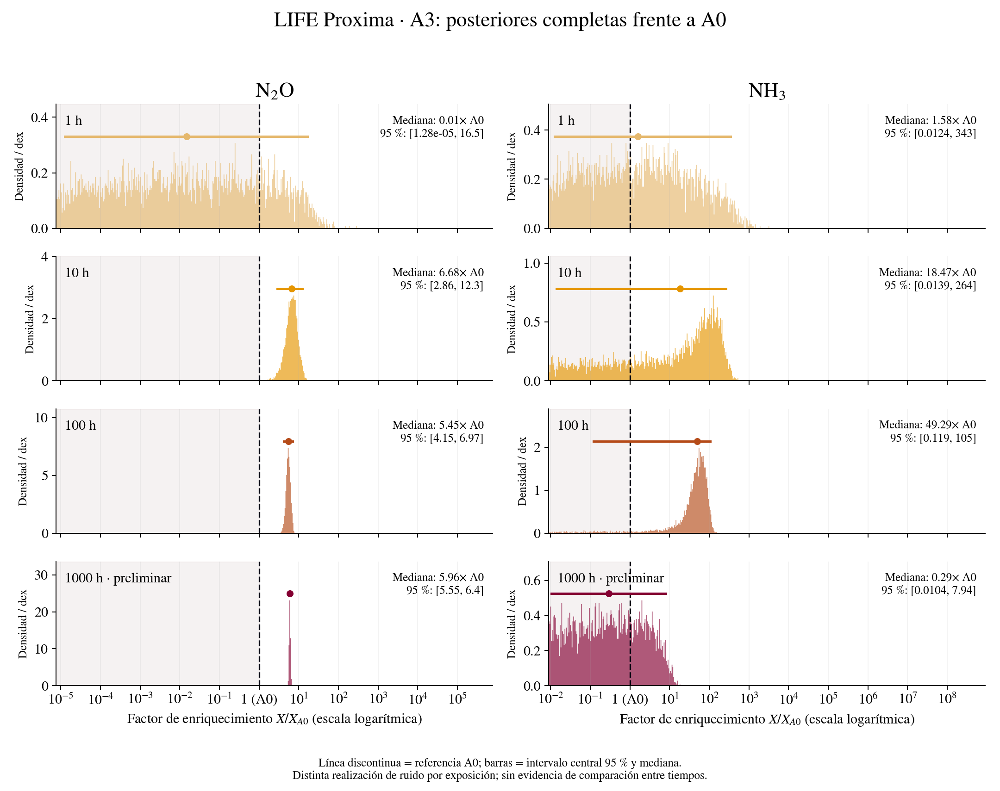

# Posteriores completas A3: 1, 10, 100 y 1000 horas frente a A0

Fecha: 2026-10-13. Figura descriptiva solicitada por el usuario, sin nuevas
corridas ni aceptación de productos pendientes.

## Qué se muestra

Ocho marginales de los cuatro modelos completos libres: N₂O y NH₃ para A3
a 1/10/100/1000 h. Todas las combinaciones fueron encontradas, ninguna ausente.
No se usan posteriors LOO ni muestras incompletas de variantes A0 fijadas.
Una coordenada fija representa un punto impuesto, no una distribución libre.

Eje horizontal: factor X/X_A0, con posiciones logarítmicas. Histograma
empírico normalizado por dex de log₁₀(X/X_A0); 550 intervalos comunes entre
exposiciones para cada gas, sin KDE ni extrapolación. Línea discontinua en
1; zona sombreada inferior a A0. Barras y puntos: intervalo central de 95 %
y mediana. Las alturas verticales se ajustan por panel: comparar posiciones,
anchuras e intervalos, no alturas como evidencia de detección.

La referencia A0 conserva la procedencia/perfil/hash comprobados por
`fixed_abundance_reference.py`: −6.884325289636784 para log₁₀ X_N₂O y
−9.950526295665036 para log₁₀ X_NH₃. Es referencia escalar exacta del
[procedimiento A0](life_proxima_a0_enrichment_methodology_2026-10-10.md).

## Verificaciones y reproducción

- [Script](../Thermal_Emission_Spectroscopy/scripts/plot_proxima_a3_posterior_enrichment.py).
- [PNG](../Thermal_Emission_Spectroscopy/final_products/figures/life_proxima_A3_full_posterior_enrichment_1_10_100_1000h_preliminary.png).
- [PDF](../Thermal_Emission_Spectroscopy/final_products/figures/life_proxima_A3_full_posterior_enrichment_1_10_100_1000h_preliminary.pdf).
- [JSON: ocho resúmenes, rutas y hashes](../Thermal_Emission_Spectroscopy/final_products/figures/life_proxima_A3_full_posterior_enrichment_1_10_100_1000h_preliminary.json).

Reproducir desde raíz: `.venv/Scripts/python.exe Thermal_Emission_Spectroscopy/scripts/plot_proxima_a3_posterior_enrichment.py`.
Finitud, 15 columnas, priors químicos y área integral de cada histograma PASS.
1000 h: exportación cotejada con las 7101 muestras MultiNest de igual peso;
cuantiles calculados desde la salida precisa. Figura renderizada e inspeccionada.
Para 1/10/100 h se usan las exportaciones oficiales indexadas por DATASETS;
6190/6972/7479 muestras respectivamente. Los hashes quedan en JSON.

## Lectura científica y límites

N₂O a 1000 h: mediana 5.963× A0, intervalo 95 % [5.545,6.403]. NH₃:
mediana 0.291×, intervalo [0.0104,7.935]. El 30.76 % de las muestras NH₃
queda por encima de A0; ninguna muestra N₂O queda debajo. Este último
conteo no acredita probabilidad matemática exactamente uno ni sigma infinita.

Interpretación preliminar: N₂O muestra enriquecimiento concentrado, NH₃
no se separa con claridad del valor A0 en el completo de 1000 h. La marcada
diferencia NH₃ respecto a 100 h requiere auditar residuos, posterior y
degeneraciones; aquí no se identifica su causa.

Las realizaciones de ruido difieren entre tiempos. 1000 h usa la rejilla
nativa 3–20 μm; los anteriores usaron 3.8–19 μm, R=10000 común. La figura
no aísla únicamente el efecto de exposición ni compara evidencias entre
datasets. La corrección de rejilla está en
[extensión 1000 h](life_proxima_a3_1000h_extension_2026-10-11.md).
El modelo isochem/Madhu y la referencia escalar limitan la interpretación.
1000 h sigue PRELIMINARY_PENDING_AUDIT; producir esta figura no acepta
los nuevos resultados ni la atribución causal agrícola.
