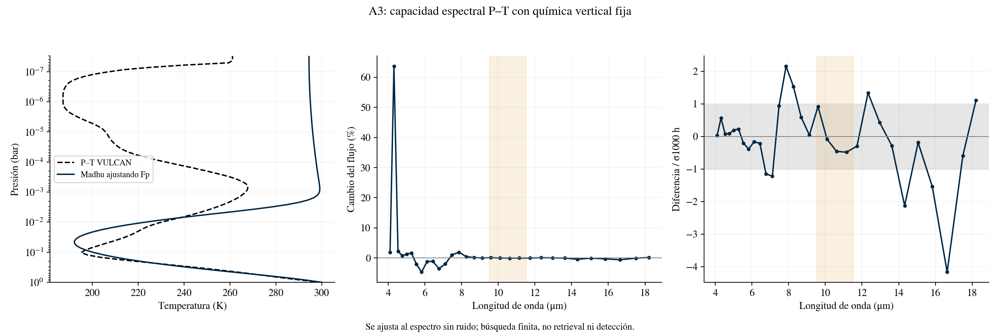

# A3: capacidad espectral Madhu con química vertical fija

Fecha: 2026-10-14. Continuación solicitada por el usuario del
[control de binning/P–T](life_proxima_a3_binning_pt_controls_2026-10-14.md).
Estado: **COMPLETE_DIAGNOSTIC_ONLY**, exit0, auditoría independiente PASS
y figura inspeccionada. Ruido instrumental excluido. Cero nuevos
retrievals, posteriores, evidencias o realizaciones de ruido.

## Método y alcance

Se ajustan únicamente a1, a2, logP1, logP2, logP3 y T_ref, con los límites
oficiales archivados. Química vertical VULCAN, radio, masa, distancia,
superficie negra1 bar, cien capas y grid3–20 μm R=10000 permanecen fijos.
Se usa el operador LIFE coherente ya verificado. El control conoce la
química verdadera; no es una caracterización observacional general.

\[
Q(\theta)=\sum_{k=1}^{31}
\left[\frac{F_{k,\rm Madhu}(\theta)-F_{k,A3,\rm sin\ ruido}}
{\sigma_{k,1000h}}\right]^2.
\]

El espectro observado con ruido no entra en el objetivo. Los errores
originales actúan como pesos de aproximación, sin modificar el ruido.
Q es una norma entre plantillas: no es χ² contra la realización observada,
lnB, sigma de detección ni probabilidad de enriquecimiento. No hay MultiNest.

Se usa `least_squares`, región de confianza, dos inicializaciones:
aproximación de T(P) verdadero y P–T archivado1000 h. Presupuesto de
cincuenta evaluaciones principales por arranque; diferencias finitas
añaden forwards. Se realizaron161 evaluaciones radiativas válidas.

La cobertura térmica de opacidades se amplió a100–400 K, paso10 K,
conservando todos los nodos180–310 K previos. La verdad regenerada conserva
el espectro a rtol=10⁻¹⁰ y los canales a rtol=10⁻¹² antes de optimizar.
Se rechazan temperaturas fuera de esa cobertura u orden Madhu inválido;
no hubo rechazos. Esta cobertura es una restricción numérica diagnóstica
adicional explícita; no modifica priors o física de una campaña oficial.

## Resultados directos

| Inicialización | Q inicial | Q final devuelto | Parada |
| --- | ---: | ---: | --- |
| Aproximación T(P) | 81507.46 | 2385.87 | xtol,14 evaluaciones principales |
| P–T archivado1000 h | 1783.86 | 41.17 | xtol,17 evaluaciones principales |

El menor Q encontrado, incluidas las sondas de diferencias finitas,
fue **41.0199**. Se distingue del punto final devuelto por el optimizador.

| Métrica del candidato de menor Q | Resultado |
| --- | ---: |
| RMS diferencia/σ1000 h,31 canales | 1.15031 |
| Máximo absoluto diferencia/σ1000 h | 4.16444 |
| RMS y máximo relativos, todo el espectro | 11.523 % /63.653 % |
| RMS relativo,9.5–11.5 μm | 0.06118 % |
| RMS y máximo diferencia/σ,9.5–11.5 μm | 0.56972 /0.92164 |
| RMS error T, todas las capas logarítmicas | 65.100 K |
| Diferencia T en superficie | −0.06951 K |

El RMS relativo global sigue grande por canales con flujo pequeño y baja
precisión; no contradice la mejora de la norma ponderada. En la ventana
NH₃, todos los canales quedan por debajo de una barra de error.

| Mayores residuos firmados | Diferencia/σ | Cambio relativo |
| --- | ---: | ---: |
| 16.642 μm | −4.164 | −0.591 % |
| 7.860 μm | +2.157 | +1.875 % |
| 14.323 μm | −2.126 | −0.437 % |
| 15.830 μm | −1.536 | −0.299 % |
| 8.263 μm | +1.530 | +0.427 % |

16.64 μm es relevante para N₂O, aunque no se atribuye todo ese canal a una
única molécula. Estas diferencias de plantillas no son detecciones.

## Interpretación y límites numéricos

**Resultado directo:** ajustar Madhu al espectro mejora la aproximación
radiativa aunque T(P) se aleje del perfil verdadero. La química permanece
exactamente fija. La distancia entre temperaturas, por sí sola, no determina
la capacidad espectral: las capas tienen distinto peso radiativo.

**Inferencia condicionada:** atribuir el resultado NH₃ únicamente a una
incapacidad de Madhu para representar esa ventana queda debilitado por
este control. Se obtiene allí una diferencia pequeña sin cambiar NH₃.
No demuestra recuperación correcta de abundancias cuando se libera toda
la química, ni separación A3/A0, ni un ajuste globalmente satisfactorio.

Ambas búsquedas devuelven `success=True` por **xtol**, no por cumplir
la tolerancia de gradiente. Sus valores de `optimality` son altos:
347209 y76038. Las soluciones son distintas; no son réplicas convergentes
de un mismo óptimo. El mejor candidato está próximo a a1=2.0. Q41.02 es
el menor valor de una búsqueda finita, no un límite de precisión Madhu
ni certificación de óptimo local/global.

**Hecho comprobado en código:** POSEIDON1.4.0, fuente instalada
`/home/dasan/Astro/POSEIDON/POSEIDON/absorption.py:1104–1159`, selecciona
el índice térmico más cercano de `T_fine` y utiliza directamente
`sigma_stored[..., idx_T_fine, ...]`; CIA usa ese índice también. La tabla
está preinterpolada, pero durante el forward la selección es por nodo
más próximo, no una interpolación continua entre nodos. Aquí el paso es10 K.

**Inferencia del proyecto:** cruzar celdas térmicas puede introducir saltos
y afectar los gradientes numéricos. Es pertinente para las paradas xtol;
todavía no se cuantificó su contribución a16.64 μm ni al cambio de NH₃.
No se afirma que sea causa única o dominante.

El siguiente control debería comparar el mismo T(P)/química en una malla
térmica más fina, antes de interpretar residuales como incapacidad física
de Madhu. Cambiar la resolución también puede cambiar el forward verdadero:
se debe medir ese cambio y preservar el dataset actual. Esa comparación
de resolución no se ejecutó en esta continuación. No se eligió otra familia
P–T ni se despacharon campañas nuevas.

## Productos y auditoría

Directorio: `Thermal_Emission_Spectroscopy/outputs/life_proxima_b_earthlike_v1/diagnostics/A3_PT_spectral_capacity_20261014/`.

- [Script](../Thermal_Emission_Spectroscopy/scripts/fit_proxima_a3_pt_spectral_capacity.py).
- [Alcance](../Thermal_Emission_Spectroscopy/outputs/life_proxima_b_earthlike_v1/diagnostics/A3_PT_spectral_capacity_20261014/selected_scope.json).
- [Cobertura térmica](../Thermal_Emission_Spectroscopy/outputs/life_proxima_b_earthlike_v1/diagnostics/A3_PT_spectral_capacity_20261014/opacity_interpolation.json).
- [Resultados y optimización JSON](../Thermal_Emission_Spectroscopy/outputs/life_proxima_b_earthlike_v1/diagnostics/A3_PT_spectral_capacity_20261014/spectral_capacity.json).
- [Historial de161 forwards](../Thermal_Emission_Spectroscopy/outputs/life_proxima_b_earthlike_v1/diagnostics/A3_PT_spectral_capacity_20261014/optimization_history.json).
- [Espectros y P–T NPZ](../Thermal_Emission_Spectroscopy/outputs/life_proxima_b_earthlike_v1/diagnostics/A3_PT_spectral_capacity_20261014/best_control.npz).
- [Figura PDF](../Thermal_Emission_Spectroscopy/outputs/life_proxima_b_earthlike_v1/diagnostics/A3_PT_spectral_capacity_20261014/spectral_capacity.pdf).
- [Auditor](../Thermal_Emission_Spectroscopy/scripts/audit_proxima_pt_spectral_capacity.py).
- [Auditoría JSON](../Thermal_Emission_Spectroscopy/outputs/life_proxima_b_earthlike_v1/diagnostics/A3_PT_spectral_capacity_20261014/post_execution_audit.json).
- [Trece entradas/hashes](../Thermal_Emission_Spectroscopy/outputs/life_proxima_b_earthlike_v1/diagnostics/A3_PT_spectral_capacity_20261014/preserved_inputs.json).

PID467, exit0. Finitud, X fijo y cierre de verdad PASS. Auditoría independiente
sin importar POSEIDON: trece hashes intactos, operador/Q recomputados,
conteo y mínimo del historial verificados. Figura revisada. Entorno Ubuntu
POSEIDON, Python3.10.13, POSEIDON1.4.0, NumPy1.26.4, SciPy1.15.3,
un thread numérico. Cuatro retrievals1000 h archivados, seis oficiales
anteriores,36 LOO y matriz8/8 intactos; aceptación científica previa pendiente.
