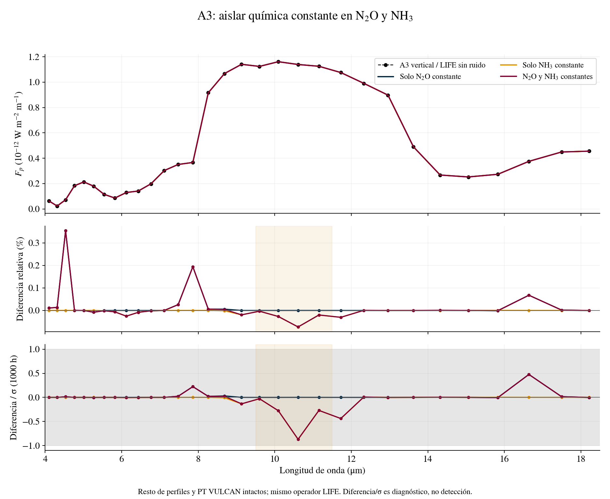

# A3: aislar N₂O/NH₃ isochem y revisar el presupuesto de ruido LIFE

Fecha: 2026-10-14. Estado: **tres forwards diagnósticos completados y
verificados; revisión de literatura completada; sin nuevos retrievals ni
modificaciones del ruido o de la likelihood oficial**.

## Pregunta y alcance

El usuario propone separar dos explicaciones del comportamiento de las
posteriores a 1000 h: la representación vertical de N₂O/NH₃ y una posible
extrapolación optimista del ruido. Se ejecutan tres controles A3 manteniendo
el P–T verdadero y las demás abundancias VULCAN. La revisión instrumental
investiga qué supuesto respaldan los artículos de LIFE y qué falta para
aplicarlo a Proxima. Son diagnósticos de capas distintas.

El [control anterior de toda la química constante](life_proxima_a3_vertical_life_isochem_comparison_2026-10-14.md)
dio RMS relativo 22.28 % y máximo 58.30 %. La
[incompatibilidad del operador instrumental](life_proxima_nh3_1000h_interface_diagnosis_2026-10-14.md)
ya está identificada, independientemente de estas nuevas pruebas. Ninguna
de esas capas se corrige en esta ejecución.

## Método de los controles híbridos

Para cada especie seleccionada se sustituye su perfil por el promedio A3
en presión usado por el proyecto:

\[
\overline X_{i,A3}=\frac{\int X_{i,A3}(p)\,dp}{p_{\max}-p_{\min}}.
\]

| Control | N₂O | NH₃ | Resto de química y P–T |
| --- | --- | --- | --- |
| N₂O constante | 9.6814009729×10⁻⁷ | Perfil original | Originales |
| NH₃ constante | Perfil original | 5.8680860861×10⁻⁹ | Originales |
| Ambas constantes | 9.6814009729×10⁻⁷ | 5.8680860861×10⁻⁹ | Originales |

Estos valores son promedios de perfiles A3, **no los valores A0 ni constantes
optimizadas**. El control conjunto conserva N₂ leído de archivo exactamente;
el ensayo previo all-isochem completaba el balance con N₂. Por tanto, la
comparación entre ensayos también requiere considerar esa representación
del gas de fondo. Los híbridos son sustituciones radiativas controladas;
no se presentan como nuevas soluciones de equilibrio fotoquímico.

Se utiliza la misma geometría Proxima a 1.30 pc, planeta de 1.23 R⊕ y
1.59 M⊕, 100 capas y superficie negra a 1 bar. Rejilla nativa 3–20 μm,
R=10000, una tabla compartida de opacidades. El observable es Fp recibido,
en W m⁻² m⁻¹. Los tres forwards se comparan con el producto LIFE **sin
realización de ruido**, en 31 canales a R=20, usando el mismo operador del
generador: integración de densidad fotónica en bordes de puntos medios y
conversión a energía en el centro. Esto aísla química; no valida ni modifica
el operador discrepante de la likelihood instalada.

Se resumen dos diferencias por canal:

\[
\epsilon_k=F_{k,\mathrm{híbrido}}/F_{k,A3}-1,\qquad
r_k=(F_{k,\mathrm{híbrido}}-F_{k,A3})/\sigma_{k,1000h}.
\]

Los RMS promedian cuadrados en los 31 canales; los máximos son absolutos.
**r es una diferencia de plantillas en unidades de error declarado, no un
sigma de detección, factor de Bayes ni prueba de separación A3/A0.**

## Resultados directos

| Sustitución | RMS relativo | Máximo relativo | RMS de r | Máximo de \|r\| |
| --- | ---: | ---: | ---: | ---: |
| Solo N₂O | 0.07382 % | 0.35429 % | 0.09496 | 0.47669 |
| Solo NH₃ | 0.01664 % | 0.07337 % | 0.19027 | 0.87194 |
| N₂O y NH₃ | 0.07567 % | 0.35429 % | 0.21248 | 0.87103 |

El mayor cambio relativo de N₂O está en 4.534 μm, donde el error fotónico
es grande; el mayor r de N₂O se encuentra en 16.642 μm. Para NH₃ ambos
máximos están en 10.610 μm. En 9.5–11.5 μm, cuatro canales, el control
solo NH₃ da RMS relativo 0.04036 %, máximo 0.07337 % y RMS de r=0.47723.
El control conjunto no se presupone aditivo.

Como comprobación agregada, sqrt(Σr²) es 0.529, 1.059 y 1.183 para
N₂O, NH₃ y ambas. Esta norma conserva la hipótesis diagonal de los errores
usados; tampoco es significancia de detección.

**Inferencia del proyecto:** a esta resolución y con el P–T/otras especies
verdaderos, sustituir solo los dos perfiles por sus promedios tiene un
efecto pequeño frente a los errores fotónicos actuales. El contraste grande
del all-isochem involucra las restantes abundancias y/o su combinación con
la composición de fondo; no queda explicado por N₂O/NH₃ solas. No se ha
aislado H₂O ni los otros gases individualmente. Tampoco se ha probado aquí
el ajuste conjunto de química constante y P–T parametrizado del retrieval.
Las degeneraciones pueden modificar la inferencia aun cuando este efecto
directo es pequeño. El ensayo no demuestra que la posterior NH₃ sea correcta.

## Qué ruido contiene realmente la campaña

**Hecho del código local:**
[LifeSceneClassic](../Thermal_Emission_Spectroscopy/scripts/life_scene_classic.py)
conecta la transmisión instrumental y PhotonNoiseStar, PhotonNoiseLocalzodi
y PhotonNoiseExozodi. Trata la fuga estelar geométrica y los fondos
astrofísicos dentro del presupuesto fotónico. No incorpora un presupuesto
explícito de inestabilidades de fase/amplitud/polarización, calibración
residual, detector y covarianza instrumental.

El [índice de A3–1000 h](../Thermal_Emission_Spectroscopy/outputs/life_proxima_b_earthlike_v1/life_data/dataset_index_A3_1000h_official.json)
declara:

\[
\sigma(t)=\sigma(10h)\sqrt{10/t}.
\]

No es una simulación instrumental de 1000 h; es un escalado del caso clásico
validado de 10 h, seguido de una realización gaussiana independiente
(seed 1450560596). La integración equivale a 41.6667 días. Recalculando
σ/F sobre el flujo sin ruido, se obtiene:

| Cantidad a 1000 h | Valor |
| --- | ---: |
| Mediana SNR de flujo por canal | 469.5534 |
| Mediana de σ/F | 0.21297 % |
| Menor σ/F entre los 31 canales | 0.06844 % |
| σ/F en 9.600 / 10.093 / 10.610 / 11.154 μm | 0.11957 / 0.09680 / 0.08414 / 0.07422 % |

Las fracciones están referidas al flujo **planetario**, no al estelar; no
son directamente comparables con pisos en ppm de profundidad de tránsito
JWST. SNR de flujo tampoco equivale a detección molecular.

## Qué dicen las fuentes primarias

### LIFE XII — Angerhausen et al. (2024)

[Artículo, arXiv:2401.08492](https://arxiv.org/abs/2401.08492),
[DOI:10.3847/1538-3881/ad1f4b](https://doi.org/10.3847/1538-3881/ad1f4b).
§2.2, p. 7 del PDF: considera ruido fotónico fundamental, sin términos
instrumentales explícitos. §3.2, pp. 9–10: campañas de 10, 50 y 100 días,
con señal planetaria estacionaria y combinación de visitas sin ruido
adicional significativo. Tabla 1: R=50; nuestra campaña usa R=20.
Por ello respalda estudiar integraciones largas dentro de esa hipótesis,
pero no certifica la precisión de una campaña Proxima de 1000 h.

### LIFE II — Dannert et al. (2022)

[Artículo, arXiv:2203.00471](https://arxiv.org/abs/2203.00471),
[DOI:10.1051/0004-6361/202141958](https://doi.org/10.1051/0004-6361/202141958).
§2.3.2 y apéndice A: la simulación clásica adopta el régimen dominado por
ruido fotónico fundamental; analiza por separado las exigencias de
estabilidad y detector. A.1 define σfund≥σinst. A.4 advierte que sus
requisitos son aproximaciones de orden de magnitud dependientes del
objetivo y del combinador. No proporciona un porcentaje universal de error
en Fp para Proxima. La fuga asociada al suelo de nulidad óptica es otra
cantidad; no equivale directamente a un piso constante de σ/F planetario.

### Huber et al. (2025) — errores correlacionados y LIFEsimMC

[Artículo, arXiv:2508.15756v1](https://arxiv.org/html/2508.15756v1),
[DOI:10.3847/1538-3881/adfb6b](https://doi.org/10.3847/1538-3881/adfb6b).
§III.4 introduce LIFEsimMC/PHRINGE. §IV, figura 10: los errores extraídos
dependen de las perturbaciones y del tratamiento de la covarianza. El caso
optimista con whitening se aproxima al ideal; otros casos empeoran,
particularmente por debajo de 10 μm. Para su Tierra–Sol a 10 pc, a 4 μm
los errores aumentan aproximadamente ×3 en el pesimista whitened y ×6 en
el optimista unwhitened. Esos factores no se transfieren a Proxima ni a
NH₃ globalmente. Tabla 2: 0.1 % de amplitud y 1.5 nm de pistón son
perturbaciones de haces, no errores fraccionales del espectro planetario.
§V.1–V.3 explicita límites de la calibración; §II.3 y conclusión dejan el
tratamiento temporal completo pendiente. No fija un piso temporal universal.

### Complemento: LIFE XI — Matsuo et al. (2023)

[Artículo, arXiv:2308.01478](https://arxiv.org/abs/2308.01478).
El resumen identifica la estabilidad de amplitud/OPD durante días o semanas
como dificultad y propone PSSD para separar señal y fuga sistemática,
reduciendo la exigencia de estabilidad a minutos. La demostración es
numérica para sistemas alrededor de una estrella solar a 10 pc. Refuerza
que el rendimiento depende también de modulación y extracción; no es una
calibración de ruido de Proxima ni un piso adoptable en nuestra campaña.

## Interpretación del posible piso y siguiente control

**Conclusión de revisión:** el SNR actual es una referencia fotónica
optimista. Las fuentes revisadas justifican considerar ruido instrumental
y correlaciones. No permiten afirmar que nuestros errores sean físicamente
imposibles ni adoptar un piso numérico universal para este objetivo.

**Modelo conceptual del proyecto:** un término aleatorio con tiempo de
correlación finito puede seguir reduciéndose con la integración; una
calibración residual persistente puede limitar la precisión. Para componentes
independientes, una representación de presupuesto es

\[
C(t)=C_{\mathrm{fotónico}}(t)+C_{\mathrm{instrumental}}(t)
     +C_{\mathrm{calibración}}(t).
\]

Solo si se supone un residuo de calibración independiente del tiempo aparece
una asíntota fija; su tamaño y estructura espectral requieren justificación.
Con correlaciones se debe usar la matriz y sus términos cruzados pertinentes,
no únicamente inflar cada barra. La ecuación es una propuesta de organización
del presupuesto, no una calibración extraída de los artículos.

Orden recomendado, **por autorizar**, sin implementación en este turno:

**Decisión posterior del usuario, 2026-10-14:** continúa únicamente
binning y P–T mediante [controles diagnósticos aislados](life_proxima_a3_binning_pt_controls_2026-10-14.md).
La tercera vía, ruido instrumental, queda excluida de esta continuación.
La lista siguiente conserva la propuesta histórica, no una autorización.

1. Armonizar generador y likelihood en una copia diagnóstica y demostrar el
   cierre con el mismo forward verdadero. La discrepancia conocida alcanza
   RMS2.926 y máximo8.986 en unidades σ1000 h, muy por encima del efecto
   híbrido conjunto. Aumentar el ruido para ocultarla impediría identificar
   la causa numérica.
2. Separar la aproximación de otras especies y del P–T, con el operador ya
   consistente. Un control híbrido en retrieval sería una herramienta de
   atribución condicionada a perfiles conocidos, no una caracterización
   observacional general que pueda asumir esos perfiles desconocidos.
3. Definir un presupuesto instrumental para esta escena Proxima y probar
   extracción/covarianza con LIFEsimMC/PHRINGE o un modelo justificado, varias
   realizaciones y dependencia temporal. Un piso fraccional hipotético
   serviría como sensibilidad etiquetada, nunca como rendimiento LIFE validado.

## Productos y verificación

[Script ejecutado](../Thermal_Emission_Spectroscopy/scripts/compare_proxima_a3_target_isochem.py)
en Ubuntu, entorno `/home/dasan/anaconda3/envs/POSEIDON`, con un proceso y
threads numéricos limitados a uno. PID458, exit0; etapa
COMPLETE_DIAGNOSTIC_ONLY. Tres forwards, cero optimizaciones/retrievals.
Igualdad exacta de P–T y de todas las especies no seleccionadas PASS;
constantes seleccionadas verificadas a rtol=10⁻¹²; finitud de todos los
arrays PASS; siete hashes originales intactos. Figura revisada visualmente.

Directorio independiente:
`Thermal_Emission_Spectroscopy/outputs/life_proxima_b_earthlike_v1/diagnostics/A3_N2O_NH3_hybrid_isochem_20261014/`.

- [Métricas JSON](../Thermal_Emission_Spectroscopy/outputs/life_proxima_b_earthlike_v1/diagnostics/A3_N2O_NH3_hybrid_isochem_20261014/comparison.json).
- [Arrays nativos y binned NPZ](../Thermal_Emission_Spectroscopy/outputs/life_proxima_b_earthlike_v1/diagnostics/A3_N2O_NH3_hybrid_isochem_20261014/hybrid_spectra.npz).
- [Figura PDF](../Thermal_Emission_Spectroscopy/outputs/life_proxima_b_earthlike_v1/diagnostics/A3_N2O_NH3_hybrid_isochem_20261014/hybrid_comparison.pdf).
- [Entradas y SHA-256](../Thermal_Emission_Spectroscopy/outputs/life_proxima_b_earthlike_v1/diagnostics/A3_N2O_NH3_hybrid_isochem_20261014/preserved_inputs.json).
- [Verificación independiente posterior a la ejecución y ruido declarado](../Thermal_Emission_Spectroscopy/outputs/life_proxima_b_earthlike_v1/diagnostics/A3_N2O_NH3_hybrid_isochem_20261014/post_execution_audit.json).

La verificación posterior vuelve a comparar hashes y finitud sin importar
POSEIDON ni repetir los forwards. Las unidades y los índices de canales
proceden de los arrays exportados y del dataset oficial; las incertidumbres
permanecen intactas.

**Estado operativo actualizado:** los cuatro modelos A3–1000 h, completo
y N₂O/NH₃/ambas fijas a A0, figuran COMPLETE_PENDING_VALIDATION con exit0
en los estados de campaña leídos. NH₃ terminó; la ejecución MPI ya no es
la tarea pendiente. La auditoría independiente integral de los cuatro y la
interpretación científica siguen pendientes. Este informe acepta únicamente
el diagnóstico forward como cálculo verificado; no promueve las posteriores
o evidencias preliminares. Se preservan seis completos oficiales, 36 LOO,
contrastes A0–100 h, matriz 8/8 y todos los productos de 1000 h.
