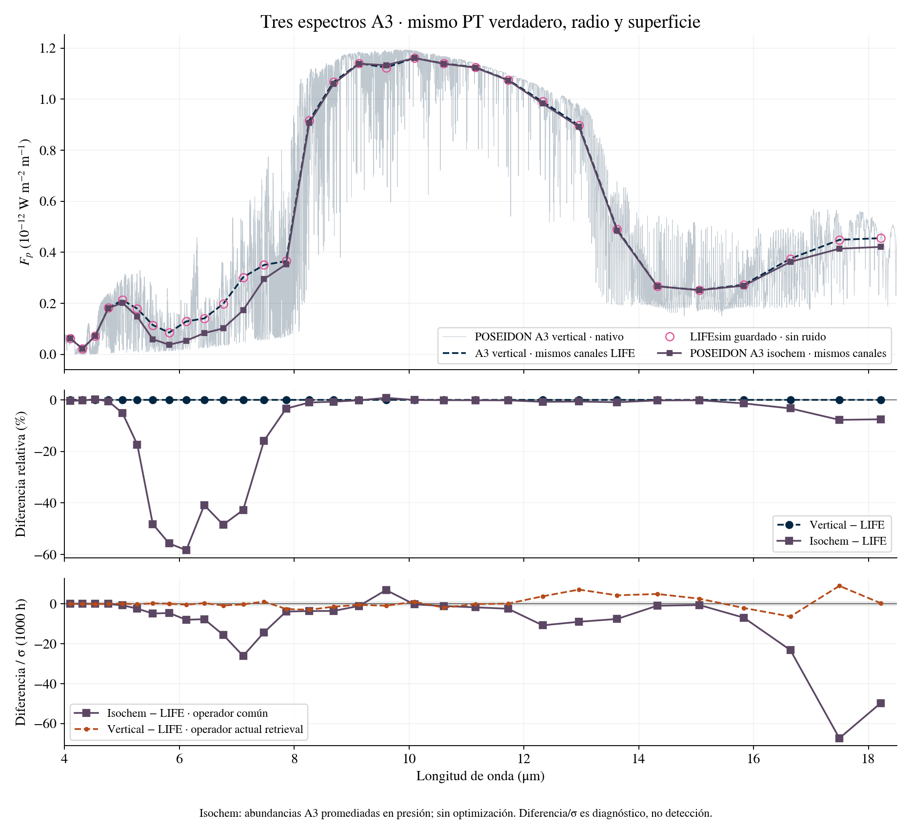

# A3: comparación POSEIDON vertical, LIFE e isochem

Fecha: 2026-10-14. Control autorizado por el usuario para entender qué
cambia entre el espectro atmosférico, el producto instrumental y la química
constante. Dos forwards nuevos, cero retrievals y cero optimizaciones.

## Tres espectros y definición de «verdadero»

1. **POSEIDON A3 vertical:** regeneración desde los perfiles PT/química
   VULCAN canónicos de Proxima, todas las opacidades y superficie negra a 1 bar.
2. **LIFE sin ruido:** producto clásico ya guardado, `flux_binned_A3`, convertido
   de fotones a flujo energético del centro. No se repite LIFEsim ni se crea
   una realización de ruido. La observación con ruido se conserva aparte.
3. **POSEIDON A3 isochem:** mismas siete especies y P–T verdadero, con cada
   abundancia constante igual al promedio A3 ponderado en presión:

\[
X_{i,\mathrm{iso}}=\frac{\int X_{i,A3}(p)\,dp}{p_{\max}-p_{\min}}.
\]

Este valor es una aproximación reproducible a un perfil vertical, no un
parámetro optimizado ni una equivalencia radiativa demostrada. N₂ completa
el balance isochem. El control mantiene PT leído de archivo; no es un
ajuste Madhu y no evalúa la flexibilidad del modelo térmico de retrieval.

Geometría común: análogo terrestre Proxima, 1.30 pc, Rₚ=1.23 R⊕, Mₚ=1.59 M⊕,
100 capas, superficie negra1 bar. Rejilla nativa guardada 3–20 μm a R=10000,
una misma tabla de opacidades para ambos modelos. Observable Fp recibido,
W m⁻² m⁻¹. No mezclar transmisión ni contraste Fp/Fs.

## Comparación consistente y control instrumental separado

Los tres se comparan en los mismos 31 centros LIFE mediante el operador
del generador: integración de densidad fotónica en bordes de puntos medios,
conversión final a energía. Se exige que el vertical regenerado coincida
con el forward nativo guardado y que al rebin coincida con LIFE sin ruido.

Un control adicional pasa ambos espectros por el operador actual de la
likelihood, preservando la diferencia identificada en el
[diagnóstico anterior](life_proxima_nh3_1000h_interface_diagnosis_2026-10-14.md).
No se confunde esta diferencia numérica con el cambio físico a isochem.
Los residuos relativos y diferencias divididas por σ1000 h se guardan
como diagnósticos; no son evidencias, p-values ni sigma de detección.

## Productos, ejecución y verificaciones

- [Script](../Thermal_Emission_Spectroscopy/scripts/compare_proxima_a3_vertical_life_isochem.py).
- Directorio separado: `Thermal_Emission_Spectroscopy/outputs/life_proxima_b_earthlike_v1/diagnostics/A3_vertical_LIFE_isochem_20261014/`.
- `execution_state.json`: etapa actual; `preserved_inputs.json`: hashes de entradas.
- `comparison.json`: abundancias exactas, contratos, métricas y limitaciones.
- `three_spectra.npz`: nativos, binned comunes, likelihood, σ y PT.
- `three_spectra.png/pdf`: comparación visual.

Se verifica igualdad exacta de temperaturas y orden de especies; todas las
abundancias constantes de la atmósfera contra sus valores impuestos,
finitud de espectros, identidad con forward/LIFE y hashes de entradas antes
y después. Fuentes científicas previas permanecen intactas.

**Completado:** dos forwards nuevos ejecutados en Ubuntu POSEIDON, PID8038,
exit0. Identidad de PT/especies/VMR y finitud PASS; siete entradas protegidas
por hash permanecen intactas. Figura PNG/PDF generada e inspeccionada.

## Resultados

El vertical regenerado coincide con el forward guardado dentro de tolerancia
relativa 10⁻¹⁰. Al rebinear con el operador común coincide con LIFE sin ruido:
diferencia relativa máxima 2.26×10⁻¹⁴. Esta igualdad responde por la ruta
canónica POSEIDON→producto LIFE guardado, no valida la likelihood discrepante.

| Comparación con LIFE sin ruido | RMS relativo | Máximo relativo | RMS / σ1000 h |
| --- | ---: | ---: | ---: |
| POSEIDON vertical, operador común | ≈0 | ≈0 | ≈0 |
| A3 isochem promediado, operador común | 22.28 % | 58.30 % | 17.27 |
| POSEIDON vertical, operador real de likelihood | 1.90 % | 8.14 % | 2.93 |

El isochem alcanza 67.33σ de diferencia en un canal. Esa escala es una
comparación de plantillas deterministas con los errores declarados, no
significancia de detección ni factor de Bayes. Mayor discrepancia relativa
en 6.121 μm (−58.30 %), seguida de 5.822/6.765/5.538/7.112 μm.
En los cuatro canales de 9.5–11.5 μm la diferencia relativa máxima del
isochem es solo 0.826 % (RMS0.421 %). Este control cambia todos los gases;
no atribuye el desajuste total ni esa ventana exclusivamente a NH₃.

| Especie | VMR constante A3 usada | log₁₀ VMR |
| --- | ---: | ---: |
| H₂O | 2.90611208×10⁻³ | −2.536688 |
| CO₂ | 4.02031851×10⁻⁴ | −3.395740 |
| CH₄ | 1.45648508×10⁻⁵ | −4.836694 |
| O₂ | 0.201480807 | −0.695766 |
| O₃ | 5.06998881×10⁻⁹ | −8.294993 |
| N₂O | 9.68140097×10⁻⁷ | −6.014062 |
| NH₃ | 5.86808609×10⁻⁹ | −8.231504 |

Estas referencias escalares A3 equivalen a 7.418× A0 en N₂O y 52.363×
en NH₃. Son promedios de perfiles verdaderos, no abundancias efectivas
demostradas para emisión ni cantidades necesariamente recuperables.

## Interpretación y límites

**Resultado directo:** POSEIDON A3 vertical y LIFE sin ruido coinciden al
igualar resolución y operador; convertir toda la química a esos promedios
constantes modifica el espectro aun con P–T idéntico. Por separado, el
operador de likelihood vigente introduce la discrepancia ya diagnosticada.

**Inferencia del proyecto:** la aproximación escalar elegida no sustituye
radiativamente a la atmósfera A3 vertical. Esto explica por qué «valores
verdaderos» entre comillas necesitan una definición al hacer isochem.
El resultado no demuestra que ningún conjunto de abundancias constantes
pueda aproximar el espectro: no se optimizaron constantes ni PT. Tampoco
determina qué gas origina cada residual sin controles especie a especie.
Mantener 1000 h pendiente de auditoría y coherencia de interfaz.

[Datos NPZ](../Thermal_Emission_Spectroscopy/outputs/life_proxima_b_earthlike_v1/diagnostics/A3_vertical_LIFE_isochem_20261014/three_spectra.npz) ·
[Métricas y configuración JSON](../Thermal_Emission_Spectroscopy/outputs/life_proxima_b_earthlike_v1/diagnostics/A3_vertical_LIFE_isochem_20261014/comparison.json) ·
[PDF](../Thermal_Emission_Spectroscopy/outputs/life_proxima_b_earthlike_v1/diagnostics/A3_vertical_LIFE_isochem_20261014/three_spectra.pdf).
