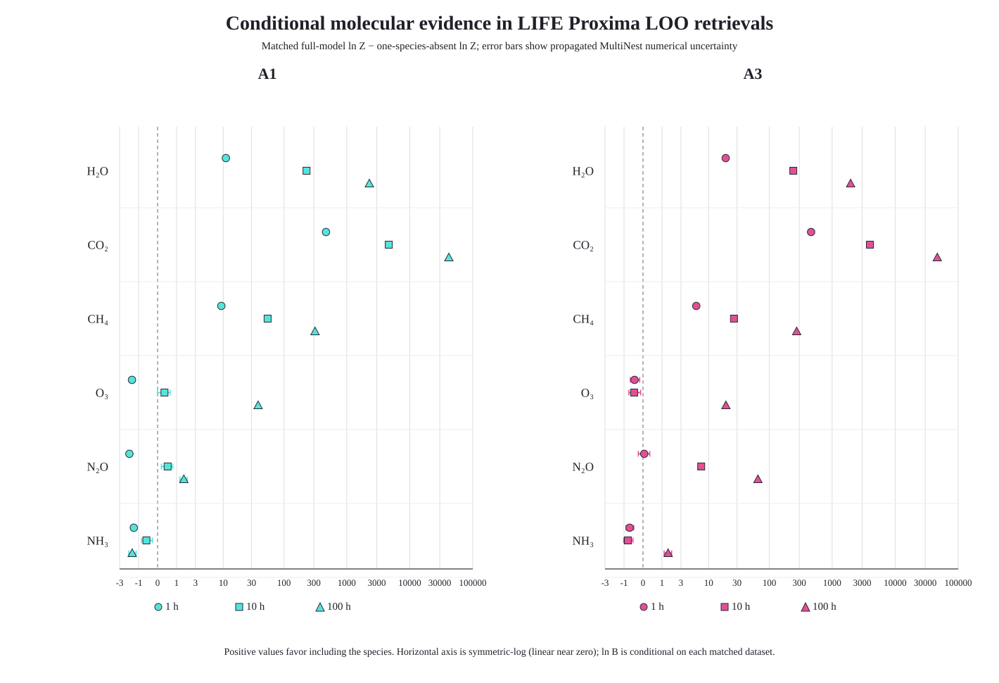

# Comparación LIFE Proxima con/sin moléculas: campaña LOO, 2026-10-04

## Pregunta y alcance

Esta campaña cuantifica cuánto favorece cada espectro LIFE simulado un modelo
que permite una molécula concreta frente a otro que la omite. La motivación
es el análisis de Lin & Kaltenegger: contrastar retrievals completos con
modelos en los que se excluyen especies y derivar la significancia a partir de
la evidencia bayesiana. Trasladamos esa lógica a la serie focal LIFE Proxima
A1/A3 sin multiplicar retrievals para buscar post hoc qué realización produce
la respuesta más atractiva.

La matriz contiene 36 modelos sin una molécula:

\[
2\ \text{escenarios (A1,A3)}
\times 3\ \text{exposiciones (1,10,100 h)}
\times 6\ \text{especies (H₂O, CO₂, CH₄, O₃, N₂O, NH₃)}.
\]

Cada uno se contrasta con el retrieval completo oficial del mismo escenario,
tiempo y archivo de datos. Los seis retrievals completos ya existen; no se
repiten. O₂ permanece activo en todos los modelos y no forma parte de las seis
ablaciones porque la pregunta focal considera las seis especies del atlas.
La matriz histórica 8/8, los datasets y los productos completos se preservan.

## Definición del contraste

Para una misma observación \(D_{s,t}\), con escenario \(s\), exposición \(t\)
y realización de ruido fija, calcularemos

\[
\Delta\ln Z_X(D_{s,t}) =
\ln Z_{\rm completo}(D_{s,t}) -
\ln Z_{\rm sin\ }X(D_{s,t}).
\]

Un valor positivo favorece el modelo que incluye \(X\); el factor de Bayes
condicional es \(B_{\rm completo,sin\,X}=\exp(\Delta\ln Z_X)\). Se reportarán
las incertidumbres numéricas de ambas evidencias. No se compararán evidencias
de datasets distintos —por ejemplo, 1 h contra 100 h, A1 contra A3 o
realizaciones diferentes— como factores de Bayes. Las distancias \(z\) del
atlas frente a A0 efectiva son descriptivas y no sustituyen este contraste.

“Sin X” significa retirar la opacidad de \(X\) y su parámetro de abundancia,
manteniendo los restantes gases y parámetros. El modelo completo recupera
15 parámetros; cada ablación debe recuperar 14. Los parámetros compartidos,
sus priors, el PT Madhu, la superficie y la likelihood permanecen iguales.
La comparación es condicional al modelo y a esos priors; no marginaliza
incertidumbres de perfil químico vertical ni ruido correlacionado.

### Convención de reporte: ln B principal; sigma solo como referencia controvertida

La métrica principal será

\[
\ln B_{X/-X} \equiv \ln Z_{\rm completo}-\ln Z_{\rm sin\,X}.
\]

Así, `ln B > 0` favorece incluir la especie y `ln B < 0` favorece el modelo
que la omite, siempre dentro de la pareja emparejada. `ln B` es el logaritmo
del factor de Bayes; por sí solo no es una probabilidad posterior del modelo.
Las odds posteriores requieren además las odds previas entre modelos. La
incertidumbre numérica de la tabla es
\(\sigma_{\ln B}=\sqrt{\sigma_{\ln Z,\,completo}^2+
\sigma_{\ln Z,\,sinX}^2}\), suponiendo errores numéricos independientes de
las dos ejecuciones MultiNest. No representa incertidumbre observacional ni
incertidumbre del modelo.

**Actualización solicitada 2026-10-10:** la tabla de reporte adopta la
calibración bilateral citada por Lin et al. (2021), con `N/A` cuando `ln B ≤ 0`,
como en su tabla 2. La fórmula explícita procede de Benneke & Seager (2013),
ecuaciones (8)–(9). La derivación, controles y las 36 filas están en
[sigma con convención Lin](life_proxima_loo_sigma_lin_convention_2026-10-10.md).
Para `ln B > 0` se invierte la calibración de Sellke como igualdad:

\[
B=\exp(\ln B),\qquad -e\,p\ln p=B^{-1},\qquad
\sigma_{\rm cal}=\Phi^{-1}(1-p/2).
\]

La relación original es una cota; su inversión como igualdad es una convención
histórica, no una significancia frecuentista observada ni una conversión única
de Bayes factor a sigma. El CSV auditado anterior conserva la columna firmada
como registro histórico; el nuevo CSV de reporte elimina los sigma negativos.
Kipping & Benneke (2025) recomiendan dejar de convertir los
Bayes factors a sigma, y Thorngren, Sing & Mukherjee (2025; aceptado en ApJS)
argumentan que la conversión habitual es inválida y sensible a los priors.
Por eso, la cifra no se usará para afirmar detecciones ni para aplicar umbrales
de 3σ/5σ. Como guía bayesiana descriptiva, Trotta (2008) usa aproximadamente
`|ln B| < 1` inconcluso, `1–2.5` débil, `2.5–5` moderado a fuerte y `>5`
fuerte. Estas bandas no son reglas universales de descubrimiento; la
sensibilidad de la evidencia a los priors debe acompañar cualquier
interpretación.

Madhusudhan et al. (2025) reportan conjuntamente `ln(B)` y significancias de
2.9–3.2σ en sus comparaciones DMS/DMDS de K2-18 b. Se cita como ejemplo de la
práctica que queremos contextualizar, no como validación de una conversión
específica: su artículo no fija en la tabla una fórmula universal que podamos
trasladar aquí. Lin et al. (2021) motivan el diseño completo/sin-especie y la
regla `N/A`; su referencia Benneke & Seager (2013) fija la calibración que
reproducimos, sin atribuir a Lin una ecuación que no imprimen.

### Resultados finales: 36 pares validados (2026-10-10)

Se calcularon las 36 diferencias a partir de las evidencias finales de
`*-stats.dat` de MultiNest, emparejando cada ablación con su retrieval completo
por escenario, exposición, ruta de dataset y semilla. La incertidumbre numérica
de `ln B` se propagó en cuadratura. La columna sigma calibrado se recalculó desde
el valor central de `ln B`, sin barra de error ni interpretación como
significancia frecuentista medida. `ln B > 0` favorece el
modelo que incluye la especie; `ln B < 0` favorece el modelo que la omite.

| Escenario | Tiempo | Especie X | ln B (± incertidumbre numérica) | σ calibrado, convención Lin |
| --- | ---: | --- | ---: | ---: |
| A1 | 1 h | H₂O | +11.127 ± 0.238 | +5.09 |
| A1 | 1 h | CO₂ | +469.134 ± 0.290 | +30.75 |
| A1 | 1 h | CH₄ | +9.280 ± 0.238 | +4.69 |
| A1 | 1 h | O₃ | −1.548 ± 0.240 | N/A |
| A1 | 1 h | N₂O | −1.797 ± 0.240 | N/A |
| A1 | 1 h | NH₃ | −1.380 ± 0.242 | N/A |
| A1 | 10 h | H₂O | +229.565 ± 0.298 | +21.57 |
| A1 | 10 h | CO₂ | +4644.255 ± 0.352 | +96.43 |
| A1 | 10 h | CH₄ | +54.680 ± 0.290 | +10.69 |
| A1 | 10 h | O₃ | +0.288 ± 0.292 | +1.47 |
| A1 | 10 h | N₂O | +0.447 ± 0.296 | +1.63 |
| A1 | 10 h | NH₃ | −0.501 ± 0.294 | N/A |
| A1 | 100 h | H₂O | +2289.864 ± 0.351 | +67.74 |
| A1 | 100 h | CO₂ | +41729.861 ± 0.446 | +288.91 |
| A1 | 100 h | CH₄ | +314.093 ± 0.337 | +25.20 |
| A1 | 100 h | O₃ | +38.404 ± 0.336 | +9.03 |
| A1 | 100 h | N₂O | +1.608 ± 0.340 | +2.36 |
| A1 | 100 h | NH₃ | −1.526 ± 0.341 | N/A |
| A3 | 1 h | H₂O | +19.517 ± 0.234 | +6.57 |
| A3 | 1 h | CO₂ | +462.849 ± 0.294 | +30.54 |
| A3 | 1 h | CH₄ | +5.996 ± 0.233 | +3.89 |
| A3 | 1 h | O₃ | −0.359 ± 0.232 | N/A |
| A3 | 1 h | N₂O | +0.047 ± 0.234 | +1.12 |
| A3 | 1 h | NH₃ | −0.629 ± 0.231 | N/A |
| A3 | 10 h | H₂O | +241.513 ± 0.310 | +22.12 |
| A3 | 10 h | CO₂ | +3970.537 ± 0.376 | +89.16 |
| A3 | 10 h | CH₄ | +26.796 ± 0.290 | +7.61 |
| A3 | 10 h | O₃ | −0.381 ± 0.292 | N/A |
| A3 | 10 h | N₂O | +7.388 ± 0.291 | +4.25 |
| A3 | 10 h | NH₃ | −0.734 ± 0.292 | N/A |
| A3 | 100 h | H₂O | +1964.190 ± 0.357 | +62.74 |
| A3 | 100 h | CO₂ | +46592.005 ± 0.430 | +305.28 |
| A3 | 100 h | CH₄ | +272.924 ± 0.335 | +23.50 |
| A3 | 100 h | O₃ | +19.652 ± 0.339 | +6.59 |
| A3 | 100 h | N₂O | +65.550 ± 0.341 | +11.67 |
| A3 | 100 h | NH₃ | +1.506 ± 0.342 | +2.31 |

La tabla de reporte vigente con sigma calibrado y `N/A` guarda todos los decimales
en [`life_proxima_loo_lnB_sigma_lin_2026-10-10.csv`](../Thermal_Emission_Spectroscopy/final_products/tables/life_proxima_loo_lnB_sigma_lin_2026-10-10.csv).
La auditoría original conserva los valores de evidencia y su columna firmada histórica en
[`loo_results_validated_20261010.csv`](../Thermal_Emission_Spectroscopy/outputs/life_proxima_b_earthlike_v1/retrievals/molecule_ablation_loo_20261004/loo_results_validated_20261010.csv)
y el inventario de comprobaciones en
[`validation_report_20261010.json`](../Thermal_Emission_Spectroscopy/outputs/life_proxima_b_earthlike_v1/retrievals/molecule_ablation_loo_20261004/validation_report_20261010.json).
El eje de la figura es simétrico-logarítmico para mantener visibles tanto las
diferencias próximas a cero como las evidencias muy grandes:

**Lectura de los resultados, condicionada a estos modelos y datos:** H₂O,
CO₂ y CH₄ favorecen la inclusión en las seis parejas. CO₂ muestra las mayores
diferencias (`ln B` de aproximadamente 463 a 46 592); H₂O varía entre 11 y
2 290, y CH₄ entre 6 y 314. O₃ favorece su inclusión con claridad solo a 100 h
en A1/A3 (`ln B` ≈ 38/20); a 1 y 10 h las comparaciones son débiles o favorecen
el modelo sin O₃. N₂O favorece la inclusión en cinco de seis parejas, con la
mayor evidencia en A3 a 10/100 h (`ln B` ≈ 7.39/65.55); A1 a 1 h favorece
omitirlo y A1 a 10/100 h presenta evidencia inconclusa/débil. NH₃ favorece
débilmente su inclusión solo en A3 a 100 h (`ln B` ≈ 1.51); las otras cinco
parejas favorecen su omisión.

La magnitud de estas diferencias no convierte automáticamente cada especie en
una detección observacional robusta. Son factores de Bayes **condicionales** a
los priors, a la parametrización isochem, a una realización diagonal de ruido
por caso y a los retrievals completos ya fijados. En particular, perfiles
verticales distintos, degeneraciones entre opacidades y sensibilidad de la
evidencia a los priors siguen siendo límites importantes. Las cifras calibradas
alcanzan valores auxiliares muy altos (hasta ≈305), derivados de igualar
una cota; no son `sigma` frecuentistas medidos. La conclusión científica se expresa en
`ln B` y se restringe a esta comparación emparejada.

## Inputs oficiales congelados

Los hashes se verifican antes del preflight. Cada pareja completo/ablacionado
usa exactamente el mismo archivo de 31 bins; así, el contraste no mezcla el
efecto de retirar una especie con un cambio de realización de ruido.

| Caso | Dataset | Semilla registrada | SHA-256 |
| --- | --- | ---: | --- |
| A1, 1 h | LIFE_proxima_A1_1h_O2_fixedBlack1bar_noiseRepeat2.dat | 2125532119 | 93fb65765101950063d5aa9a3dafae4df38273292cb0e3349e94b8a34516cfcc |
| A3, 1 h | LIFE_proxima_A3_1h_O2_fixedBlack1bar_official.dat | 1376328125 | a3043e5de76a834983949e6eca12636ea4de174ebdb2db0853155282c100dee2 |
| A1, 10 h | LIFE_proxima_A1_10h.dat | 1099171982 | ed39ae6dc5b8ff0d5c8aca3d126a2945343a289be30f3b8d9e8e72c434ee9b8f |
| A3, 10 h | LIFE_proxima_A3_10h.dat | 1469409748 | 46a026504b9b9521fa29407a501169b9d3cfc433de40a91b8ade86d7767abb5b |
| A1, 100 h | LIFE_proxima_A1_100h_O2_fixedBlack1bar_noxtol_audit.dat | 460512527 | d66c886238a2916312c645589be8601828fbf0a7cd2f02a383ef1d6a3454b5e3 |
| A3, 100 h | LIFE_proxima_A3_100h.dat | 129315834 | 78662546181a5b74391a14b7b73ae80d879200a74db6a4bc5338e3ce7eee4705 |

La entrada A1 de 1 h es la realización independiente oficial NoiseRepeat2,
promovida tras revisar sus posteriores; la semilla 368516754 se conserva como
sensibilidad y no se sustituye aquí. Las realizaciones de 100 h son
independientes por diseño, pero cada ablación se empareja con su retrieval
completo sobre la misma realización.

## Retrieval setup

Todas las ablaciones usan el lanzador existente
[run_life_retrieval.py](../Thermal_Emission_Spectroscopy/scripts/run_life_retrieval.py)
con POSEIDON, escenario A1/A3, exposición 1/10/100 h, una especie excluida,
O₂ incluido, perfil isochem, superficie negra explícita fija a 1 bar,
error_inflation desactivada, R=10000, N_live=800, archivo de datos congelado,
etiqueta de salida única y directorio absoluto aislado.

POSEIDON y MPICH proceden del entorno conda POSEIDON en Ubuntu/WSL. Cada
MultiNest usa seis ranks MPI y un hilo por rank para las bibliotecas BLAS /
OpenMP. Se fijan POSEIDON_input_data y PYSYN_CDBS para las opacidades y rejillas
estelares. Se mantiene una malla de presión de 100 capas, perfil térmico Madhu
flexible, y abundancias isochem para las especies restantes. Los priors
compartidos conservan la configuración de los retrievals completos:
log10(VMR) uniforme en [-12,-1] y para O₂ [-6, log10(0.5)]. Los priors de PT,
radio y superficie también permanecen iguales; log_P_surf tiene prior de ancho
cero en 0, correspondiente a 1 bar. Los seis resultados completos se indican
por nombre de archivo en el manifiesto de campaña.

## Paralelismo y runtime

Ubuntu/WSL expone 16 CPU lógicas y 31 GiB de RAM. La cola ejecutará como máximo
dos retrievals simultáneos, cada uno con seis ranks (12 ranks totales), dejando
cuatro CPU lógicas para WSL, el sistema y la E/S. Elegimos este esquema frente
a asignar 12 o 16 ranks a un único retrieval porque el proyecto ya completó
dos retrievals Proxima de 240 h concurrentes en MPI6 y aún no hay benchmark
que muestre escalado eficiente de MultiNest con más ranks para una posterior.
Lanzar los 36 a la vez saturaría CPU y E/S.

El orden priorizó N₂O/NH₃ a 100 h, luego 10 h y 1 h; después CH₄, O₃, CO₂ y
H₂O. La estimación inicial era 5–8 días de tiempo de pared bajo concurrencia
dos. El estado final registra inicio 2026-10-04 22:29:29 UTC y cierre
2026-10-10 21:16:44 UTC: 142.79 h (5.95 días) de pared y 208.00 h de runtime
agregadas en las 36 celdas; cada corrida duró 1.28–13.25 h. El intervalo incluye la pausa
por corte eléctrico y la continuación de dos checkpoints. El paralelismo se
mantuvo en dos retrievals MPI6 como previsto; no se alteró el número de ranks.

## Organización durable y recuperación

El supervisor reproducible es
[run_proxima_molecule_ablation_campaign.py](../Thermal_Emission_Spectroscopy/scripts/run_proxima_molecule_ablation_campaign.py).
El lanzador durable de esta campaña es
[`launch_proxima_molecule_ablation_loo_20261004.sh`](../Thermal_Emission_Spectroscopy/scripts/launch_proxima_molecule_ablation_loo_20261004.sh);
la inspección de estado sin lanzar nada usa `--status-only` en el supervisor.
Su raíz es
Thermal_Emission_Spectroscopy/outputs/life_proxima_b_earthlike_v1/retrievals/molecule_ablation_loo_20261004/.
Contiene:

- campaign_state.json y manifest.csv: 36 celdas, hashes, preflight, estado,
  PID, código de salida, marcas de tiempo, duración y rutas;
- configs/: comando y configuración efectiva de cada run;
- preflight/: 36 logs setup-only con parámetros y especie excluida;
- pids/ y logs/: PID y log durable por corrida;
- runs/: copias completas de scratch solo después de exit 0.

MultiNest escribe en el filesystem Linux WSL:
/home/dasan/exofarm_proxima_molecule_loo_20261004/runs/<run_id>/. El supervisor
limita la concurrencia a dos, evita sobrescribir, detiene la cola ante la
primera falla y no reintenta automáticamente. El scratch y el log de una falla
se conservan para diagnóstico. Los seis modelos completos, los archivos LIFE
originales y la matriz 8/8 son entradas de solo lectura.

Desde la raíz del repositorio, la vista resumida de estado es:

    python Thermal_Emission_Spectroscopy/scripts/run_proxima_molecule_ablation_campaign.py --status-only

El README de la carpeta de campaña, el estado JSON, manifiesto, configuración,
log y PID por corrida, junto con este informe, son el handoff entre sesiones.
Si WSL o el supervisor se detienen, primero se inspeccionan estado, procesos y
logs. El modo explícito `--resume-existing` verifica que los PIDs activos hayan
desaparecido y que los casos interrumpidos tengan el conjunto de checkpoints
MultiNest; continúa esos casos con `--resume` en el mismo scratch y usa logs y
configuraciones nuevos. También agenda únicamente las celdas fallidas o
pendientes validadas. El modo de campaña nueva sigue rechazando una raíz ya
existente. No inferir éxito por tiempo transcurrido ni repetir una celda que
carezca de evidencia de reanudación segura.

## Validación e interpretación

Antes del muestreo, los 36 casos pasaron setup-only: hash del input, resultado
completo correspondiente, datos con 31 bins, ausencia de la especie solicitada
en `param_names`, exactamente 14 parámetros y configuración común. Al cierre,
las 36 corridas registraron `return_code=0`; se auditaron posterior, espectro,
P–T, perfiles log-X, archivos MultiNest y finitud numérica. Las evidencias y
sus errores en `stats.dat` concuerdan con los resúmenes POSEIDON a la precisión
impresa. Se comprobó además que los seis retrievals completos y las ablaciones
apuntan a archivos con el mismo SHA-256 para cada pareja. El informe de auditoría
registra 36/36 productos válidos, seis modelos completos validados y cero
errores; la matriz 8/8 no fue modificada.

La validación se reproduce con
[`validate_proxima_molecular_ablation_loo.py`](../Thermal_Emission_Spectroscopy/scripts/validate_proxima_molecular_ablation_loo.py).
Comprueba posterior exportada frente a las muestras de igual peso de MultiNest,
`resume.dat` frente a `ev.dat`, 800 puntos vivos, 100 capas P–T con presión
positiva y descendente, perfiles log-X finitos, cuantiles ordenados y espectros
finitos con longitud de onda creciente. El resumen tabular, la figura y el
JSON de auditoría se guardan en las rutas enlazadas arriba.

### Límites científicos

- El resultado corresponde a una realización de ruido por caso; no mide
  repetibilidad ni controla por sí mismo falsos positivos frecuentistas.
- LIFEsim clásico proporciona ruido fotónico diagonal; estos datos no incluyen
  una covarianza instrumental.
- La recuperación usa abundancias isochem aunque VULCAN varía verticalmente.
  El perfil Madhu recuperado también puede diferir de VULCAN. Una posterior
  estrecha o ΔlnZ positivo se interpreta junto con residuos, perfil térmico y
  degeneraciones.
- A1-1 h se seleccionó post hoc entre dos realizaciones. Su contraste es
  exploratorio y no constituye una predicción ciega.
- Ninguna lnZ entre tiempos, escenarios o realizaciones distintas es un factor
  de Bayes. No se declara detección formal solo por S/N, separación posterior
  z o un contraste condicional aislado.

### Cierre operativo al 2026-10-10

`campaign_state.json` registra `campaign_status=completed`, 36/36 corridas con
`return_code=0`, 36/36 prevalidaciones `PASS`, 14 parámetros por ablación y
ningún caso activo o pendiente. La auditoría final aceptó 36/36 conjuntos de
productos, verificó los seis modelos completos y no encontró errores. La
consulta de procesos en WSL tampoco encontró supervisor ni procesos MPI de la
campaña al cerrar el chequeo. El estado indica que los seis retrievals
completos se reutilizaron y `canonical_8of8_modified=false`.

El cálculo de `ln B` de arriba usa `stats.dat` final, no mensajes de progreso.
El CSV, JSON, figura y validador vinculados en la sección de resultados son
los productos auditados para este cierre. Esta es la fotografía operativa
vigente; los dos registros siguientes explican la evolución histórica y no
describen procesos activos.

### Estado intermedio al 2026-10-08 22:51 COT (histórico)

`campaign_state.json` registra 36/36 prevalidaciones aprobadas, 24 ablaciones
completadas, dos en ejecución y 10 pendientes. Las corridas activas son
`A1_100h_no_CO2` (intento 2) y `A3_100h_no_CO2` (intento 1). La primera
ejecución de A1 terminó con código 1 al intentar abrir
`/mnt/d/Proyectos/IA_SpecAtm_Bio/Data/POSEIDON/inputs/stellar_grids/grid/phoenix/catalog.fits`:
`OSError: [Errno 19] No such device`. La evidencia operativa identifica un
montaje `D:`/`drvfs` no disponible en WSL; después de restaurarlo se confirmó
que el catálogo está presente y mide 1,497,600 bytes. Este error sucedió antes
del muestreo y no aporta evidencia científica. El intento original, su log y
scratch permanecen preservados. A1 se reanudó en el directorio separado
`A1_100h_no_CO2_attempt02`; A3 conserva su directorio original.

La verificación en vivo confirma el supervisor PID 23342 y dos procesos
`mpiexec -n 6` (A1 PID 23344 y A3 PID 23348), es decir, 12 ranks de retrieval.
Los logs muestran la configuración isochem y la lista de 14 parámetros. A las
22:51 COT, A1 registraba 3,200 replacements/6,464 samples/acceptance 0.495050
y A3 3,200 replacements/6,543 samples/acceptance 0.489072. Las lnZ
impresas durante el muestreo son provisionales y no se interpretan
científicamente. La
cola tiene máximo dos MPI6 y se detendrá ante un nuevo fallo, sin relanzar
automáticamente. El log de esta reanudación está en
`Thermal_Emission_Spectroscopy/outputs/life_proxima_b_earthlike_v1/retrievals/molecule_ablation_loo_20261004.resume_20261008.log`;
la entrada durable es `campaign_state.json` junto con `manifest.csv`. Los seis
retrievals completos, sus datasets oficiales y la matriz 8/8 siguen intactos
(`canonical_8of8_modified=false`).

### Recuperación tras corte eléctrico: estado al 2026-10-10 06:08 UTC (histórico)

El usuario informó que el equipo perdió energía. La inspección confirmó que WSL
había reiniciado y que los procesos anteriores no seguían activos. Los dos
directorios de scratch conservaban los archivos de checkpoint MultiNest
`resume.dat`, `live.points` y `phys_live.points`; se usó `--resume` para
continuar ambos procesos en esos mismos directorios, sin regenerar los datos ni
sobrescribir los 30 archivos archivados. La rutina registra una continuación
por caso con los hashes de checkpoint, el PID, el log previo y la hora de
interrupción; los logs/configuraciones nuevos tienen sufijo
`continuation01`.

En el lanzamiento, el estado guardó 30 ablaciones completadas, dos en
ejecución (`A1_100h_no_H2O` y `A3_100h_no_H2O`, continuación 01) y cuatro
pendientes. Los dos logs de continuación confirman `resume=True`, 14
parámetros por variante y la salida de MultiNest `resuming from previous job`.
El supervisor PID 429 mantiene dos y solo dos `mpiexec -n 6` (A1 PID 733; A3
PID 743), con seis ranks activos observados por escenario y sin errores visibles
en los logs.
El log durable es
`Thermal_Emission_Spectroscopy/outputs/life_proxima_b_earthlike_v1/retrievals/molecule_ablation_loo_20261004.resume_20261010_power_recovery.log`.
Esta actualización describe un estado intermedio: la lnZ mostrada por un
muestreo aún activo sigue siendo provisional y no se reporta como resultado.
Las 36 prevalidaciones continúan aprobadas; los seis modelos completos y la
matriz 8/8 permanecen intactos.

## Referencias y productos relacionados

- Lin, Z., MacDonald, R. J., Kaltenegger, L., & Wilson, D. J. (2021),
  “Differentiating modern and prebiotic
  Earth scenarios for TRAPPIST-1e: high-resolution transmission spectra and
  predictions for JWST”, *MNRAS*, 505, 3562–3578,
  [doi:10.1093/mnras/stab1486](https://doi.org/10.1093/mnras/stab1486). Su
  comparación de modelos con especies ausentes motiva este diseño; aquí se
  adapta a los espectros de emisión LIFE de Proxima y a la parametrización
  isochem del proyecto.
- Benneke, B. & Seager, S. (2013), “How to Distinguish between Cloudy Mini-Neptunes
  and Water/Volatile-Dominated Super-Earths”,
  [arXiv:1306.6325](https://arxiv.org/abs/1306.6325), §2.2, ecuaciones (8)–(9)
  y tabla 2. Calibración explícita citada por Lin et al.; adoptada para la
  nueva columna sigma calibrado.
- Trotta, R. (2008), “Bayes in the sky: Bayesian inference and model selection
  in cosmology”, *Contemporary Physics*, 49, 71–104,
  [arXiv:0803.4089](https://arxiv.org/abs/0803.4089). Revisión de evidencia
  bayesiana, escala de Jeffreys y sensibilidad a los priors.
- Sellke, T., Bayarri, M. J., & Berger, J. O. (2001), “Calibration of p Values
  for Testing Precise Null Hypotheses”, *The American Statistician*, 55(1),
  62–71, [doi:10.1198/000313001300339950](https://doi.org/10.1198/000313001300339950).
  Fuente de la cota que se invierte solo para la columna sigma auxiliar.
- Madhusudhan, N. et al. (2025), “New Constraints on DMS and DMDS in the
  Atmosphere of K2-18 b from JWST MIRI”, *ApJL*,
  [arXiv:2504.12267](https://arxiv.org/abs/2504.12267). Ejemplo de publicación
  conjunta de `ln(B)` y significancias para comparaciones de modelos con/sin
  especies; aquí no se adopta su conversión como regla universal.
- Kipping, D. & Benneke, B. (2025), “Exoplaneteers Keep Overestimating Sigma
  Significances”, [arXiv:2506.05392](https://arxiv.org/abs/2506.05392). Explica
  que invertir la cota de Sellke produce un límite superior de sigma y
  recomienda comunicar Bayes factors directamente.
- Thorngren, D. P., Sing, D. K., & Mukherjee, S. (2025), “Bayesian Model
  Comparison and Significance: Widespread Errors and how to Correct Them”,
  aceptado en *ApJS*, [arXiv:2510.00169](https://arxiv.org/abs/2510.00169).
  Discute la invalidez y sensibilidad a priors de la conversión habitual a
  sigma, y recomienda la interpretación bayesiana de odds/probabilidades de
  modelo.
- [Campaña focal A1/A3 1/10/100 h](life_proxima_a1_a3_1_10_100h_official_retrieval_campaign_2026-10-01.md).
- [Atlas oficial V2](../Thermal_Emission_Spectroscopy/final_products/figures/retrieval_A1_A3_1_10_100h_official_six_species_PT_proxima.png).
