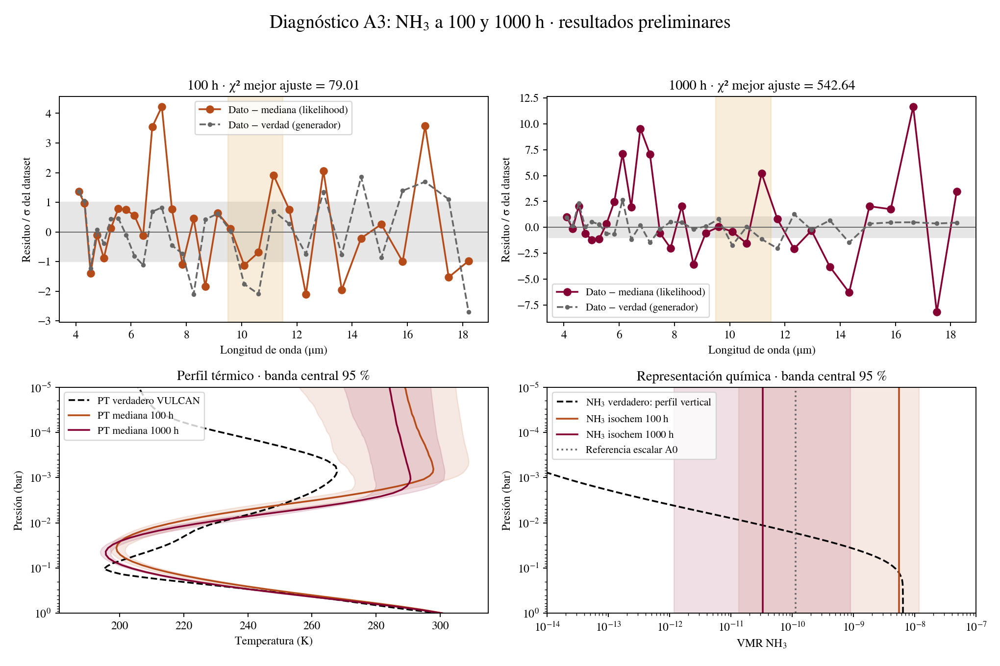

# NH₃ a 1000 h: discrepancia de integración instrumental y tensión de modelo

Investigación iniciada 2026-10-13; registrada 2026-10-14. Petición: diagnosticar
el cambio de la posterior NH₃ de A3–100 a A3–1000 h. No se autorizaron cambios
de modelo/dataset, relanzamientos, instalación de dependencias ni aceptación.
Todos los análisis usan productos guardados; solo se escriben diagnósticos.

## Resultado principal

**Hecho confirmado en código y control numérico:** el generador LIFE y la
likelihood instalada de POSEIDON usan operadores diferentes para los mismos
canales. El preflight existente aplica el operador del generador en ambos
lados; su PASS no valida igualdad con el operador real de la likelihood.
La rejilla nativa 3–20 μm corrigió una discrepancia distinta, pero dejó este
desajuste de integración intacto. La hipótesis de atribuir el cambio únicamente
al perfil P–T no está demostrada.

| Control | 100 h | 1000 h |
| --- | ---: | ---: |
| χ² dato vs forward verdadero, operador generador | 42.36 | 32.98 |
| χ² dato vs el mismo forward, operador real de likelihood | 60.06 | 314.52 |
| RMS diferencia entre operadores / σ | 0.925 | 2.926 |
| Máximo diferencia entre operadores / σ | 2.842 | 8.986 |
| Mejor χ² del retrieval, resultado guardado | 79.01 | 542.64 |
| χ² del espectro mediano, operador de likelihood | 78.86 | 543.13 |

31 canales en ambos datasets. El forward verdadero con el mismo operador que
generó los datos presenta ruido de escala razonable. El exceso de χ² no se
explica por una realización 1000 h anormalmente ruidosa. El máximo desajuste
relativo de operadores es 8.140 %, idéntico sobre el mismo espectro en ambos
datasets; al reducir σ por √10 aumenta su importancia estadística.

El χ² reducido comunicado por POSEIDON usa 16 grados de libertad (31−15);
hay 14 coordenadas efectivamente libres. Con 17 grados, el mejor χ²/dof de
1000 h es 31.92. Ninguna convención elimina la tensión de ajuste.

## Origen de la discrepancia

Generador: [make_life_datasets.py](../Thermal_Emission_Spectroscopy/scripts/make_life_datasets.py),
líneas 129–153: bordes definidos por puntos medios de centros, `spectres`
sobre densidad fotónica, después conversión al flujo energético del centro.
Solo exporta centro y mitad de la anchura total, junto a flujo/error.

Código instalado POSEIDON 1.4.0, proyecto editable
`/home/dasan/Astro/POSEIDON/POSEIDON/`: `retrieval.py:534–546` usa
`bin_spectrum_to_data`; `instrument.py:146–320` reconstruye bordes como
centro ± semiancho y los asigna al índice nativo más próximo;
`instrument.py:321–448` convoluciona con una PSF dummy estrecha e integra
directamente el flujo energético con trapecios y sensibilidad uniforme.

En centros logarítmicos, el centro original difiere del punto medio de
sus dos bordes. Exportar únicamente mitad de anchura pierde ese desplazamiento:
con centros [1,2,4], los bordes del canal central son [1.5,3], pero reconstruir
2±0.75 da [1.25,2.75]. Esta diferencia es independiente de la atmósfera.
En LIFE el desplazamiento máximo alcanza 0.033055 μm.

Control sobre el mismo forward nativo, descomposición vectorial:

| Componente del desajuste | RMS / σ de 1000 h | Máximo absoluto / σ |
| --- | ---: | ---: |
| Energía vs ponderación fotónica, mismos bordes | 0.619 | 1.528 |
| Bordes simétricos exportados vs puntos medios originales | 2.414 | 8.459 |
| Resto de discretización/integración POSEIDON | 0.350 | 1.347 |
| Diferencia total | 2.926 | 8.986 |

Los vectores se suman; sus χ²/RMS no son contribuciones aditivas en cuadratura.
La reconstrucción de bordes es el componente de mayor norma en este control.
La PSF LIFE desconocida se asigna a FWHM=0.00001 μm, no a R=20; no se ha
silenciosamente introducido una PSF instrumental gaussiana grande.

## Qué se comprobó de la posterior y de la recuperación

Las 7479/7101 muestras de 100/1000 h corresponden a las exportaciones y
MultiNest de igual peso, con finitud PASS. Se confirmó el descenso de NH₃:
factor mediano respecto A0 49.288→0.291; intervalo 95 %
[0.119,105.418]→[0.0104,7.935]. No es una confusión de columnas o archivo.

Antes de reanudar el completo, sus 800 puntos vivos ya tenían log NH₃
mediano −10.473, intervalo empírico [−11.931,−9.191], y ninguno por encima
de −8.8. La posterior final tiene mediana −10.487 y 8/7101 muestras por
encima de −8.8. Los puntos vivos no son la posterior; acreditan que la región
de NH₃ baja ya existía antes del reinicio. No se observó evidencia de que
el reinicio creara el cambio; tampoco se ha demostrado exploración exhaustiva
de todos los modos mediante una realización independiente.

Centros/semianchos observados entre tiempos idénticos; σ1000=σ100/√10 con
error relativo máximo 5.14×10⁻⁷. Las semillas son independientes (correlación
empírica de ruido −0.195), conforme al diseño; no se pretende una tendencia
monótona de una molécula degenerada a través de distintas realizaciones.

## P–T y química: tensión real, causalidad pendiente

El perfil térmico mediano difiere del verdadero VULCAN: a 0.001 bar, 1000 h
recupera 290.74 K frente a 266.83 K; a 0.1 bar, 203.48 K frente a 195.40 K.
NH₃ verdadero es vertical, con log VMR entre −21.81 y −8.20 sobre todo el
perfil; el retrieval impone una sola abundancia constante. Esas
aproximaciones pueden generar compensaciones químico-térmicas al mejorar S/N.
Las correlaciones marginales NH₃ a 1000 h son débiles (máxima |ρ|≈0.104);
no permiten atribuir la causa a un único parámetro.

**Inferencia del proyecto:** mayor S/N está haciendo más visibles desajustes
numéricos y de representación, en lugar de garantizar una posterior más
cercana al perfil verdadero. La causa exacta del descenso NH₃ y su reparto
entre binning, P–T, isochem y muestreo necesitan un control con contrato de
observación coherente. El desajuste instrumental ya está demostrado sin
cambiar ni aproximar la atmósfera.

Panel superior: residuos con el operador real de la likelihood, frente al
ruido alrededor del generador verdadero; región 9.5–11.5 μm sombreada.
Panel inferior: P–T mediana/intervalo 95 % y NH₃ constante frente a perfiles
verdaderos. Los espectros medianos por longitud de onda no son un único
estado atmosférico; su χ² se distingue del mejor ajuste.

## Consecuencia científica y siguiente acción autorizable

Mantener aceptación 1000 h pendiente; no presentar su posterior NH₃ ni sus
ln B muy grandes como una demostración física limpia de ExoFarm/A0. Esos
ln B comparan modelos que comparten la interfaz discrepante y pueden estar
sesgados. Esto no borra los archivos ni cambia decisiones anteriores de
aceptación técnica. La interfaz también afecta 100 h: registrar esta
limitación nueva al usar sus resultados ya aceptados. No corregirlos ni
revocar/cambiar valores silenciosamente.

Primer paso recomendado, **requiere autorización de implementación**:
preparar una copia diagnóstica de la likelihood que reproduzca exactamente
los bordes y ponderación del generador, usando el mismo dataset congelado.
Comprobar con el espectro verdadero χ²≈32.98 y discrepancia instrumental
cero a precisión numérica. Después evaluar candidatos existentes y decidir
si hace falta repetir controles/retrievals; solo entonces separar P–T e
isochem mediante pruebas controladas. No se ha implementado esta corrección.

## Reproducción, pruebas y productos

- [Posprocesado posterior/residuos/PT](../Thermal_Emission_Spectroscopy/scripts/diagnose_proxima_nh3_1000h_posterior.py).
- [Control del operador instalado](../Thermal_Emission_Spectroscopy/scripts/diagnose_proxima_life_binning_operator.py).
- [Descomposición sin nuevos forwards](../Thermal_Emission_Spectroscopy/scripts/diagnose_proxima_life_bin_components.py).
- [Pruebas unitarias](../Thermal_Emission_Spectroscopy/scripts/test_life_binning_diagnostic.py): campo constante conservado, centros logarítmicos asimétricos y cobertura rechazada, 3/3 PASS.
- [JSON posterior, residuos y hashes](../Thermal_Emission_Spectroscopy/outputs/life_proxima_b_earthlike_v1/diagnostics/nh3_1000h_posterior_change_20261013/diagnostic.json).
- [JSON operador real](../Thermal_Emission_Spectroscopy/outputs/life_proxima_b_earthlike_v1/diagnostics/nh3_1000h_posterior_change_20261013/binning_operator.json).
- [JSON componentes](../Thermal_Emission_Spectroscopy/outputs/life_proxima_b_earthlike_v1/diagnostics/nh3_1000h_posterior_change_20261013/binning_components.json).

Posprocesado y comparación del operador ejecutados en Ubuntu POSEIDON;
descomposición/pruebas en .venv local. PNG/PDF generados e inspeccionados.
Los hashes de entradas del posprocesado se verificaron antes y después.
No se cargaron opacidades, no se calcularon atmósferas nuevas, no se tocaron
workers, dataset, priors, runner oficial, posterior o campañas archivadas.

### Seguimiento posterior (2026-10-15)

La frase anterior «No se ha implementado esta corrección» describe el estado
al cierre de este diagnóstico, el 2026-10-14. Después, el usuario autorizó una
repetición completa A3–1000 h que aisló el operador; se implementó un binding
de proceso y se ejecutó dentro de la likelihood real, con preflight y
comparación documentados en
[`life_proxima_a3_1000h_binning_corrected_2026-10-14.md`](life_proxima_a3_1000h_binning_corrected_2026-10-14.md).
La implementación sigue limitada a ese dataset/hash: este resultado no
actualiza automáticamente el runner general ni vuelve comparables los A0
históricos.
