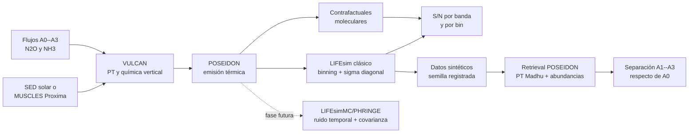
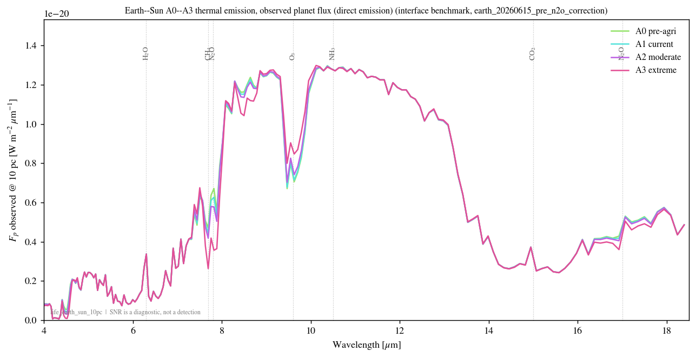
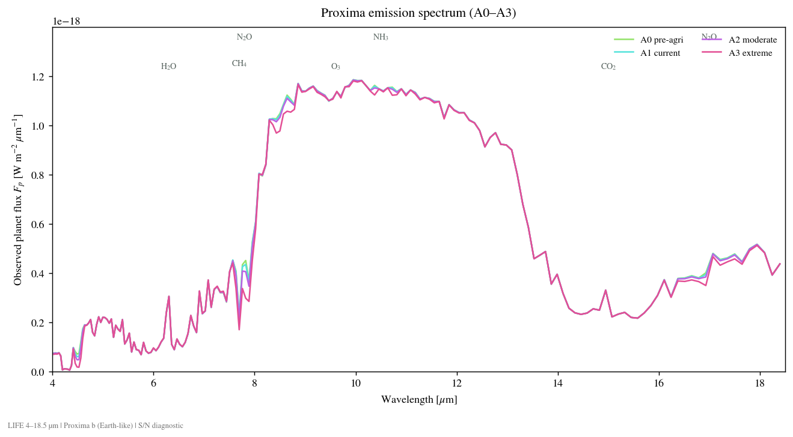
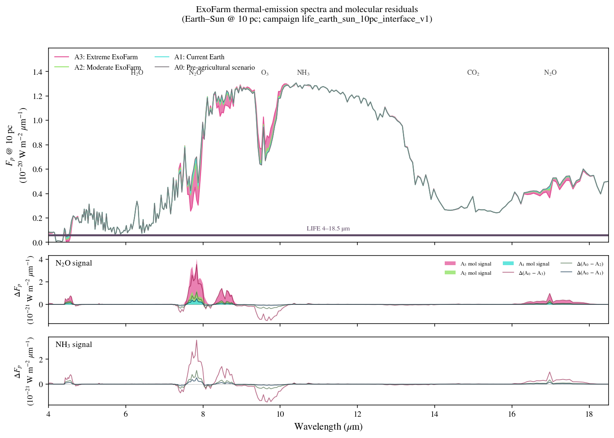
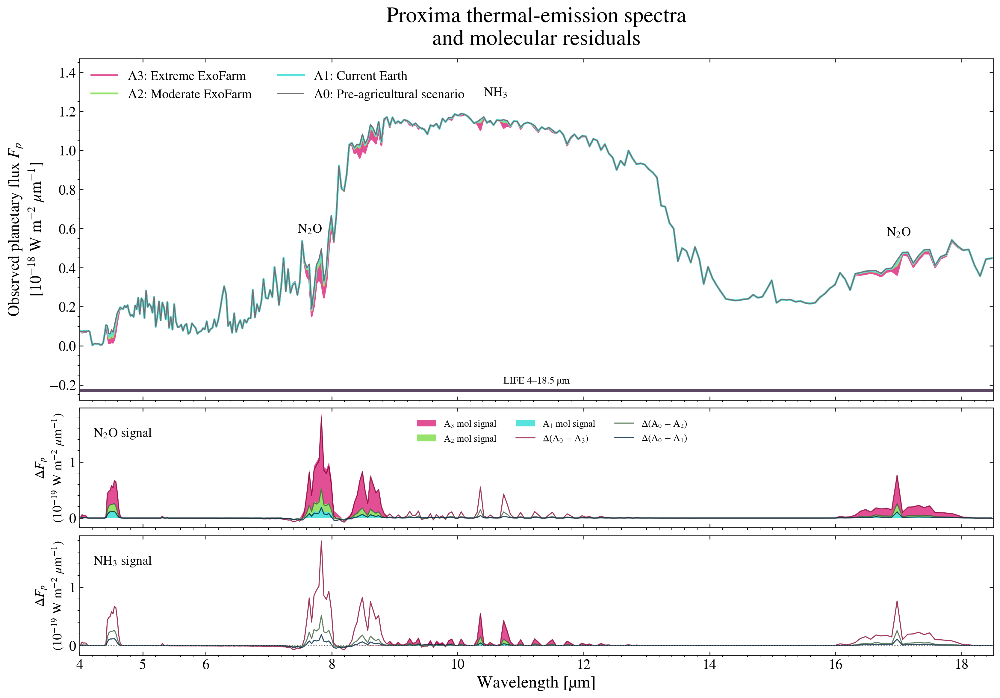
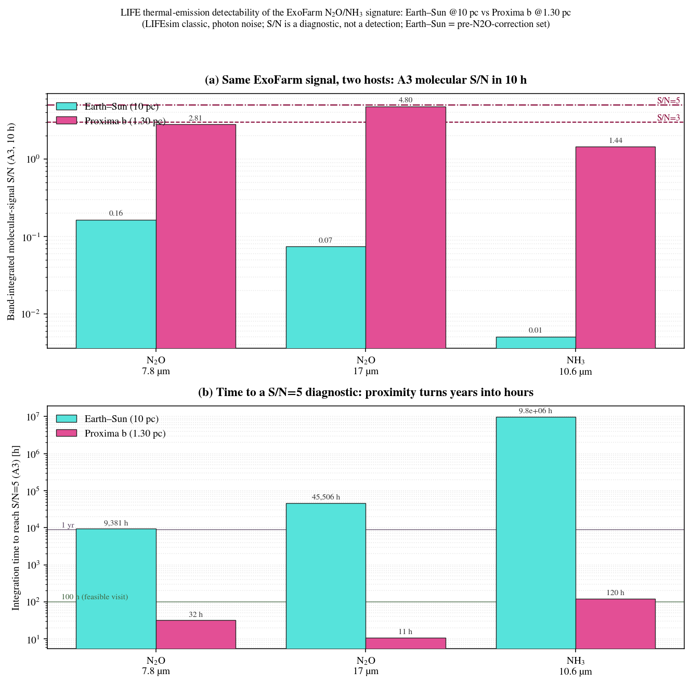
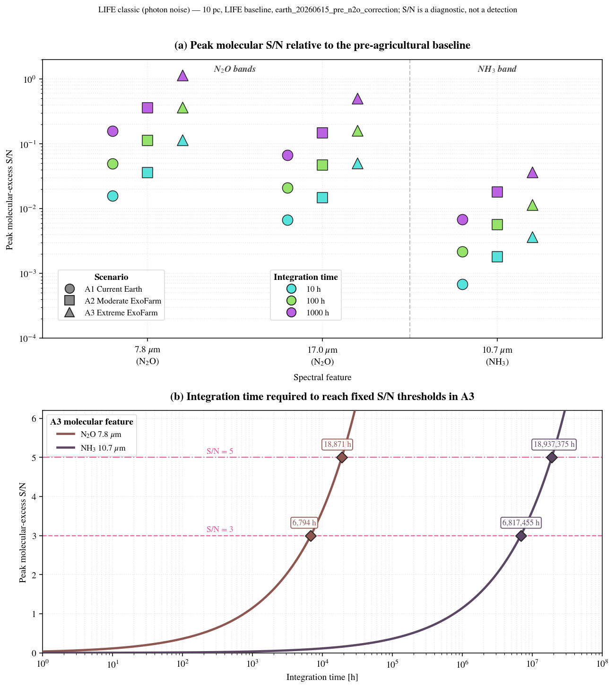
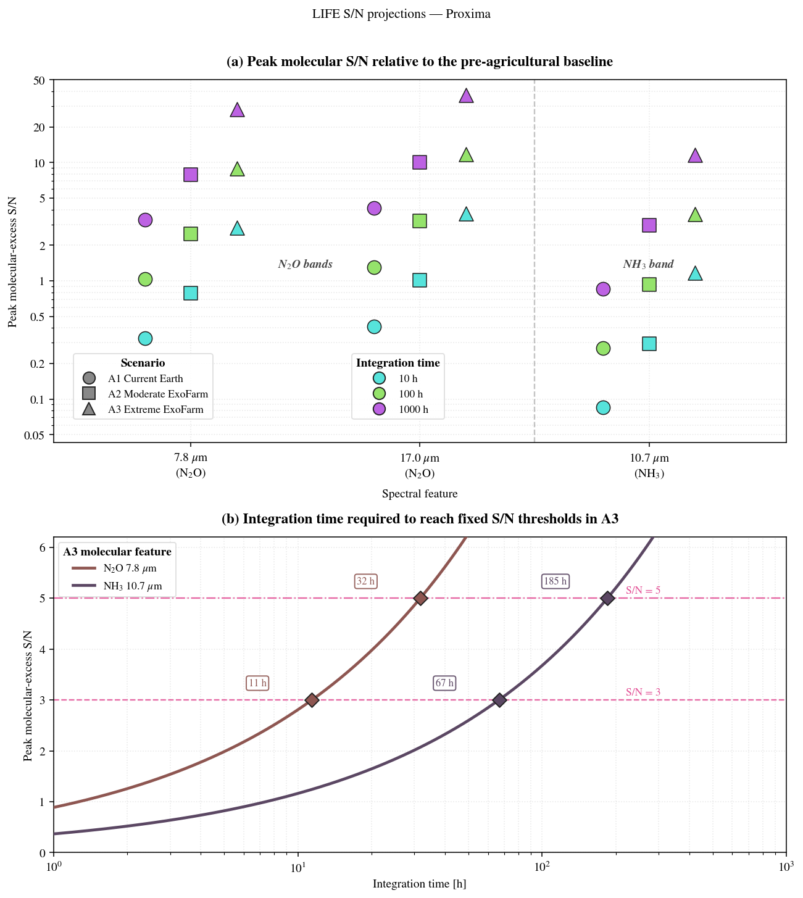
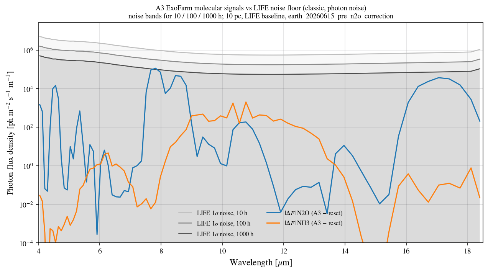
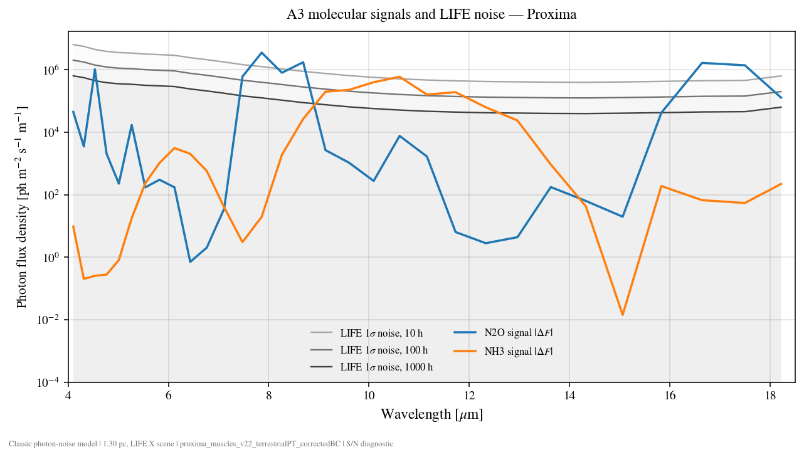

# Etapa III LIFE: metodología integrada, resultados y atlas de figuras

**Fecha de integración:** 2026-08-30
**Campañas:** `life_earth_sun_10pc_interface_v1` y
`life_proxima_b_earthlike_v1`
**Alcance:** forzamiento agrícola A0--A3 → fotoquímica VULCAN → emisión
térmica POSEIDON → LIFEsim clásico → diagnósticos moleculares → datos
sintéticos → retrievals POSEIDON.
**Estado:** informe integrado de resultados de la rama clásica. LIFEsimMC con
PHRINGE, ruido de inestabilidad y covarianza permanece como trabajo futuro.

Este documento reúne en una sola narrativa la metodología ejecutada, los
resultados cuantitativos y las figuras principales de la Etapa III. No
sustituye los manifiestos ni los archivos numéricos: funciona como mapa
científico de la evidencia que ya existe. La reconstrucción metodológica
detallada está en la [metodología completa](life_stage_iii_classic_methodology_2026-08-30.md)
y la calificación de lo que puede considerarse validado está en la
[validación de LIFEsim clásico](lifesim_classic_stage_iii_validation_2026-08-30.md).

La lectura distingue cuatro niveles de afirmación: **fuente** para valores
tomados de artículos o productos de archivo; **decisión de proyecto** para la
matriz A0--A3 y las configuraciones adoptadas; **resultado directo** para cifras
recalculables desde CSV, NPZ o retrievals; e **interpretación** para el alcance
científico asignado a esos resultados. Ninguna interpretación sustituye los
archivos fuente enlazados.

## 1. Pregunta científica y resultado principal

La pregunta es si el aumento de los flujos superficiales de N2O y NH3 asociado
a agricultura planetaria modifica una atmósfera terrestre de manera suficiente
para dejar una señal recuperable en emisión térmica por un interferómetro tipo
LIFE. La cadena no fija abundancias detectables: aplica flujos de frontera,
calcula la respuesta fotoquímica vertical y propaga esa respuesta hasta la
observación y la inferencia.

El resultado principal de la rama clásica es doble:

1. En el benchmark Tierra--Sol a 10 pc, incluso A3 permanece muy por debajo del
   ruido fotónico/astrofísico de la configuración LIFE adoptada. Esta capa
   valida la interfaz, pero no proporciona una perspectiva de detección
   favorable.
2. En el análogo terrestre bajo Proxima, la cercanía eleva sustancialmente la
   sensibilidad: A3 alcanza S/N de banda 4.80 para N2O a 17 µm en 10 h. En los
   retrievals canónicos, únicamente A3 a 240 h produce una medición de N2O
   (`log10 X_N2O = -6.19 ± 0.22`) que se separa 3.14 sigma de la referencia A0
   efectiva. A1 y A2 permanecen como límites superiores y NH3
   no queda identificado de forma independiente.

La cifra 3.14 sigma es un diagnóstico de separación respecto de la referencia
A0 efectiva, calculada como promedio columnar ponderado en presión del perfil
vertical VULCAN para hacerla comparable con el parámetro isoquímico recuperado;
no es una significancia bayesiana ni una comparación de evidencias entre
modelos con y sin N2O. Frente al posterior A0, que es ancho, la separación es
aproximadamente 1.25 sigma.

## 2. Diseño del experimento

### 2.1 Escenarios agrícolas

La perturbación se aplica en VULCAN mediante flujos inferiores en
`molecules cm^-2 s^-1`:

```text
F_i(A_j) = F_i(A0) + alpha_i,j * Delta F_i,agri
```

| Escenario | Interpretación | `alpha_NH3` | `alpha_N2O` | Flujo NH3 | Flujo N2O |
| --- | --- | ---: | ---: | ---: | ---: |
| A0 | fondo preagrícola | 0 | 0 | `2.94e9` | `1.58e9` |
| A1 | Tierra actual | 1 | 1 | `1.30e10` | `2.30e9` |
| A2 | ExoFarm moderado, ancla 30B | 3.50 | 2.55 | `3.82e10` | `3.416e9` |
| A3 | ExoFarm extremo, envolvente S2 | 15 | 15 | `1.54e11` | `1.238e10` |

Las velocidades de deposición inferiores son `1 cm s^-1` para NH3 y
`1e-4 cm s^-1` para N2O. La diferencia es físicamente importante: NH3 queda
fuertemente limitado por solubilidad, reactividad y sumideros superficiales,
mientras que N2O tiene una deposición mucho menor y sobrevive mejor hasta las
regiones que contribuyen al espectro térmico.

La campaña Tierra--Sol requiere una salvedad de procedencia. Sus perfiles A2 y
A3 fueron guardados el 2026-06-15 con los flujos N2O anteriores a la corrección
vigente (`3.35e9` y `1.20e10`). Por ello se rotula
`earth_20260615_pre_n2o_correction` y solo se usa como benchmark de interfaz.

### 2.2 Por qué se usaron dos sistemas

| Capa | Función | Configuración | Límite interpretativo |
| --- | --- | --- | --- |
| Tierra--Sol | control de interfaz | gemelo terrestre sintético a 10 pc; G2V; `1 R_E`; perfiles VULCAN existentes | A2/A3 son precorrección de N2O; no representan la matriz vigente |
| Proxima | prueba favorable alrededor de una M cercana | análogo terrestre a 1.30 pc; `1.23 R_E`; SED MUSCLES de GJ 551 | no es la atmósfera medida de Proxima b; PT/Kzz es un control terrestre |

Los 10 pc de la primera capa pertenecen únicamente a la escena LIFE. No
alteran la irradiación de VULCAN. En la segunda capa se preservan la estrella y
la geometría de Proxima, pero no se afirma que el planeta real posea superficie,
atmósfera terrestre o agricultura.

### 2.3 Flujo metodológico



## 3. Datos de entrada y fotoquímica

### 3.1 Tierra--Sol

Se reutilizaron cuatro perfiles Tierra--Sol A0--A3 aceptados, todos con
`end_case=1`. Esta capa evita introducir una nueva estrella y permite comprobar
la cadena VULCAN--POSEIDON--LIFEsim. Su uso científico queda condicionado por
la [nota de procedencia N2O](earth_sun_n2o_matrix_provenance_2026-07-20.md).

### 3.2 Proxima

Para GJ 551 se descargó el producto MUSCLES Treasury Survey v22
`adapt-const-res-sed`, con 54 997 muestras entre 3 Å y 5.5 µm. El FITS se
conserva en `Photochemical_Modeling/Config/Stellar_Spectra/` con MD5
`f0f91be58db0896dc1152a0a958b485d`.

MUSCLES entrega flujo observado en la Tierra. El conversor aplicó una sola
transformación a superficie estelar,

```text
F_surf = F_obs (d / R_star)^2,
```

con `d=1.30 pc` y `R_star=0.14 R_sun`, además de Å → nm y densidad por Å →
densidad por nm. VULCAN aplica después `(R_star/a)^2` para llevar el flujo a la
órbita; no se duplicó el factor geométrico. La integral bolométrica resultó
1.037 veces la estimada con la luminosidad adoptada, una comprobación de
normalización satisfactoria.

Los cuatro modelos Proxima A0--A3 usaron `atm_Earth_Jan_Kzz.txt` como control
PT/Kzz, la red `SNCHO_full_photo_network` con fotólisis y las condiciones de
frontera corregidas. Todos alcanzaron `end_case=1`, con 13 255, 12 916, 13 854
y 14 275 pasos para A0, A1, A2 y A3. Los perfiles exportados y sus hashes están
registrados en el [manifiesto Proxima](../Thermal_Emission_Spectroscopy/outputs/life_proxima_b_earthlike_v1/manifest.json).

## 4. Emisión térmica y contrafactuales moleculares

POSEIDON interpoló cada perfil sobre 100 capas entre 1 bar y `3e-8 bar`, con
superficie rocosa opaca. La salida principal es el flujo planetario observado
`Fp` en `W m^-2 m^-1`; también se conserva `Fp/Fs` cuando corresponde.

Para aislar una molécula se produjo un contrafactual: dentro de A1, A2 o A3 se
reemplazó únicamente su perfil vertical por el perfil A0 y se mantuvo fijo el
resto. Se generaron 18 contrafactuales por sistema para N2O, NH3, H2O, CO2, O3
y CH4. Por tanto, el residual

```text
Delta F_i(lambda) = F_full(lambda) - F_reset_i_to_A0(lambda)
```

mide una contribución espectral condicionada a que todo lo demás permanezca
fijo. No equivale por sí solo a identificar la molécula en un retrieval.

### Figura 1. Espectros A0--A3 observados



En Tierra--Sol las curvas se superponen casi por completo a escala de flujo
absoluto. Esta figura es útil para comprobar unidades y geometría, pero no
permite juzgar visualmente la detectabilidad molecular.



La mayor densidad de flujo de Proxima se debe principalmente a la corta
distancia. De nuevo, la separación entre escenarios requiere residuales y un
modelo de ruido.

### Figura 2. Residuales moleculares





Estas figuras muestran dónde cambia el espectro al resetear cada molécula. N2O
presenta estructura útil alrededor de 7.8 y 17 µm; NH3 contribuye alrededor de
10.6 µm, pero su residual no garantiza que pueda separarse de PT, radio,
presión superficial u otras abundancias.

## 5. Escena LIFEsim clásica y definición del S/N

POSEIDON se conectó a LIFEsim clásico convirtiendo flujo energético a flujo de
fotones,

```text
F_ph(lambda) = Fp(lambda) lambda / (h c).
```

El modelo incluye fuga estelar, zodi local y exozodi. La salida conserva la
malla LIFE, el espectro binado, S/N por bin y sigma fotónica diagonal.

| Parámetro | Tierra--Sol | Proxima |
| --- | ---: | ---: |
| Distancia | 10 pc | 1.30 pc |
| Colectores | 4 × 2 m | 4 × 2 m |
| Banda | 4--18.5 µm | 4--18.5 µm |
| Resolución | R=50, 77 bins | R=20, 31 bins |
| Throughput / QE | 5% / 0.7 | 5% / 0.7 |
| Exozodi | 1 zodi | 3 zodis |
| Tiempo de referencia | 10 h | 10 h |

La escena Proxima se comparó con el benchmark LIFE X. Para colectores de 2 m
produjo S/N=166.5 en 10 h para un control de cuerpo negro, frente a 170
publicado: acuerdo del 2%.

La S/N molecular integrada por banda se definió como

```text
SNR_i,band = sqrt[sum_k (Delta F_i,k / sigma_k)^2].
```

Es un diagnóstico dirigido: conoce la forma del contrafactual y suma sus bins.
No debe llamarse detección. Los plots de comparación también muestran
**S/N pico por bin**, que es una métrica distinta y normalmente menor que la
S/N integrada por banda.

### 5.1 Tiempo de integración

LIFEsim clásico sí permite calcular directamente cualquier duración mediante
`LifeSceneClassic.observe(..., integration_time_s=...)`. Históricamente se
calculó 10 h de forma directa y se proyectaron 240 y 1200 h con

```text
sigma(t) = sigma(10 h) sqrt(10 h/t).
```

El escalado se validó entre 1, 10 y 100 h dentro del régimen fotónico clásico.
Las barras de 1200 h no son matemáticamente incorrectas; al estrecharse hacen
dominante el desajuste entre los perfiles VULCAN y el modelo paramétrico del
retrieval. Por eso los productos de 1200 h son pilotos de auditoría excluidos,
no resultados canónicos. Antes de reincorporarlos se deben ejecutar 10, 240 y
1200 h directamente y comparar las sigma bin a bin.

## 6. Resultados del diagnóstico clásico

### 6.1 S/N integrado por banda a 10 h

| Escenario | Banda | Tierra--Sol | Proxima |
| --- | --- | ---: | ---: |
| A1 | N2O 7.5--8.1 µm | 0.021 | 0.328 |
| A1 | N2O 16.5--17.5 µm | 0.009 | 0.481 |
| A1 | NH3 9.5--11.5 µm | 0.001 | 0.109 |
| A2 | N2O 7.5--8.1 µm | 0.049 | 0.791 |
| A2 | N2O 16.5--17.5 µm | 0.020 | 1.199 |
| A2 | NH3 9.5--11.5 µm | 0.003 | 0.371 |
| A3 | N2O 7.5--8.1 µm | **0.163** | **2.806** |
| A3 | N2O 16.5--17.5 µm | **0.074** | **4.800** |
| A3 | NH3 9.5--11.5 µm | **0.005** | **1.441** |

Fuentes numéricas:
[Tierra--Sol](../Thermal_Emission_Spectroscopy/outputs/life_earth_sun_10pc_interface_v1/tables/life_classic_snr_table.csv)
y [Proxima](../Thermal_Emission_Spectroscopy/outputs/life_proxima_b_earthlike_v1/tables/life_classic_snr_table.csv).

### Figura 3. Comparación sintética entre objetivos



El panel izquierdo resume las tres bandas de A3 a 10 h; el derecho proyecta el
tiempo requerido para S/N=5 bajo `sqrt(t)`. La expresión “same ExoFarm signal”
del título debe leerse como “mismo rótulo de forzamiento A3”, no como química o
espectro idénticos. Cambian la SED, la fotoquímica, el radio, la resolución, el
exozodi y la distancia.

| A3, banda | Tierra--Sol: horas para S/N=5 | Proxima: horas para S/N=5 |
| --- | ---: | ---: |
| N2O 7.5--8.1 µm | ≈9 400 h | ≈32 h |
| N2O 16.5--17.5 µm | ≈45 700 h | ≈11 h |
| NH3 9.5--11.5 µm | ≈10 millones h | ≈120 h |

Estos tiempos son proyecciones diagnósticas dentro del modelo clásico. No
incluyen ruido de inestabilidad, covarianza ni pérdidas de extracción.

### Figura 4. S/N pico por bin y escalado temporal





Estas figuras usan 10/100/1000 h como rejilla visual y muestran el mejor bin,
no la suma integrada de toda la banda. Por eso, por ejemplo, el panel Proxima
estima ≈185 h para que el **pico** de NH3 alcance S/N=5, mientras la tabla de
banda obtiene ≈120 h. No hay contradicción: son estadísticas diferentes.

### Figura 5. Señal A3 frente al piso de ruido





La comparación muestra por qué la conclusión no depende únicamente de que
exista una banda molecular: en Tierra--Sol los residuales permanecen bajo el
piso clásico incluso al prolongar el tiempo; en Proxima las bandas A3 de N2O
se aproximan o superan el ruido en tiempos mucho menores. Los 10/100/1000 h son
puntos ilustrativos y no la matriz canónica de retrievals 10/240 h.

## 7. Datos sintéticos y retrievals

Cada observación sintética contiene longitud de onda, semiancho de bin, `Fp` y
`sigma_Fp`. Se añadió una realización gaussiana independiente con semilla
registrada a partir de la semilla maestra `20260725`. Los ocho datasets
canónicos Proxima son A0--A3 × {10 h, 240 h}; el
[índice de datasets](../Thermal_Emission_Spectroscopy/outputs/life_proxima_b_earthlike_v1/life_data/dataset_index.json)
registra cada archivo y semilla.

El retrieval usa POSEIDON y MultiNest con 200 live points. Ajusta un PT Madhu,
abundancias isoquímicas de H2O, CO2, CH4, O3, N2O y NH3, radio, presión
superficial y una tolerancia fraccional `Piette20`. El *truth* es un perfil
vertical VULCAN, de modo que el ajuste isoquímico introduce un desajuste de
modelo deliberado que debe permanecer visible en la interpretación.

### 7.1 Resumen de los retrievals canónicos

| Tiempo | Escenario | N2O recuperado | Clasificación N2O | NH3 recuperado | Clasificación NH3 |
| ---: | --- | ---: | --- | ---: | --- |
| 10 h | A0 | `-9.22 ± 1.79` | límite superior | `-9.07 ± 1.71` | límite superior |
| 10 h | A1 | `-9.83 ± 1.37` | límite superior | `-9.83 ± 1.24` | límite superior |
| 10 h | A2 | `-8.23 ± 1.85` | límite superior | `-9.40 ± 1.35` | límite superior |
| 10 h | A3 | `-6.50 ± 0.41` | medido, no distingue A0 | `-9.28 ± 1.37` | límite superior |
| 240 h | A0 | `-8.40 ± 1.76` | límite superior | `-9.56 ± 1.52` | límite superior |
| 240 h | A1 | `-8.30 ± 1.61` | límite superior | `-9.41 ± 1.36` | límite superior |
| 240 h | A2 | `-9.26 ± 1.73` | límite superior | `-9.58 ± 1.52` | límite superior |
| 240 h | A3 | **`-6.19 ± 0.22`** | **medido; 3.14 sigma vs A0 efectivo** | `-9.50 ± 1.53` | límite superior |

Los valores son `log10` de mixing ratio isoquímico. La tabla fuente es
[`retrieval_separation_from_A0.csv`](../Thermal_Emission_Spectroscopy/outputs/_comparison/retrieval_separation_from_A0.csv).

### 7.2 Qué ocurrió con NH3

El contrafactual A3 de Proxima alcanza S/N de banda 1.44 en 10 h y, bajo el
escalado clásico, 7.1 en 240 h. Sin embargo, el retrieval varía simultáneamente
PT, radio, presión superficial, seis abundancias y tolerancia de modelo. Además,
representa NH3 con una abundancia constante en altura, mientras el *truth*
VULCAN tiene un perfil vertical. El posterior permanece ancho y degenerado.

Por tanto, la rama clásica demuestra una contribución espectral condicionada
de NH3, pero no una identificación molecular independiente. Resolver esta
diferencia requiere comparar evidencias con/sin NH3, mejorar o probar el modelo
vertical y repetir realizaciones de ruido; no basta con integrar más horas.

### 7.3 Por qué 1200 h queda fuera

Los cuatro datasets Proxima de 1200 h y el retrieval A3--1200 h se preservan
como evidencia de auditoría. Sus barras siguen correctamente la proyección
fotónica, pero la alta precisión hace que el desajuste entre el *truth* VULCAN y
el modelo inverso simplificado domine la likelihood. No pertenecen a la matriz
8/8 y no sostienen los resultados canónicos. Su inventario está en el
[README de la campaña](../Thermal_Emission_Spectroscopy/outputs/life_proxima_b_earthlike_v1/README.md).

## 8. Inventario razonado de figuras

Se localizaron quince PNG en las campañas clásicas. Las nueve figuras
embebidas arriba forman el atlas principal. Las restantes se conservan porque
documentan variantes de presentación o diagnósticos previos; no se deben borrar
solo por ser redundantes en función.

| Figura | Métrica / función | Uso recomendado |
| --- | --- | --- |
| [`earthsun_vs_proxima_life_snr.png`](../Thermal_Emission_Spectroscopy/outputs/_comparison/earthsun_vs_proxima_life_snr.png) | S/N de banda A3 y tiempo proyectado a S/N=5 | síntesis principal, con la salvedad sobre “mismo A3” |
| [`emission_A0A3_Fp_obs.png` Tierra](../Thermal_Emission_Spectroscopy/outputs/life_earth_sun_10pc_interface_v1/plots/emission_A0A3_Fp_obs.png) | flujo observado A0--A3 | control de escala y geometría |
| [`emission_A0A3_Fp_Fs.png`](../Thermal_Emission_Spectroscopy/outputs/life_earth_sun_10pc_interface_v1/plots/emission_A0A3_Fp_Fs.png) | contraste planeta/estrella Tierra | diagnóstico de interfaz; no mezclar con `Fp` |
| [`emission_A0A3_Fp_obs.png` Proxima](../Thermal_Emission_Spectroscopy/outputs/life_proxima_b_earthlike_v1/plots/emission_A0A3_Fp_obs.png) | flujo observado A0--A3 | comparación de escala con Tierra |
| [`emission_molecular_residuals_earth_sun.png`](../Thermal_Emission_Spectroscopy/outputs/life_earth_sun_10pc_interface_v1/plots/emission_molecular_residuals_earth_sun.png) | contrafactuales Tierra | figura molecular principal |
| [`life_earth_sun_emission_molecular_residuals_v1.png`](../Thermal_Emission_Spectroscopy/outputs/life_earth_sun_10pc_interface_v1/plots/life_earth_sun_emission_molecular_residuals_v1.png) | variante histórica de residuales Tierra | conservar como variante, no duplicar en el cuerpo principal |
| [`emission_molecular_residuals_proxima.png`](../Thermal_Emission_Spectroscopy/outputs/life_proxima_b_earthlike_v1/plots/emission_molecular_residuals_proxima.png) | contrafactuales Proxima | figura molecular principal |
| [`life_classic_snr_comparison_earth_sun.png`](../Thermal_Emission_Spectroscopy/outputs/life_earth_sun_10pc_interface_v1/plots/life_classic_snr_comparison_earth_sun.png) | pico por bin, 10/100/1000 h | diagnóstico temporal ilustrativo |
| [`life_classic_snr_comparison_proxima.png`](../Thermal_Emission_Spectroscopy/outputs/life_proxima_b_earthlike_v1/plots/life_classic_snr_comparison_proxima.png) | pico por bin, 10/100/1000 h | diagnóstico temporal ilustrativo |
| [`life_classic_snr_vs_time.png`](../Thermal_Emission_Spectroscopy/outputs/life_earth_sun_10pc_interface_v1/plots/life_classic_snr_vs_time.png) | S/N de banda vs tiempo, Tierra | diagnóstico cuantitativo complementario |
| [`life_classic_A3_signal_vs_noise_times_earth_sun.png`](../Thermal_Emission_Spectroscopy/outputs/life_earth_sun_10pc_interface_v1/plots/life_classic_A3_signal_vs_noise_times_earth_sun.png) | señal A3 vs sigma, 10/100/1000 h | diagnóstico principal de piso de ruido |
| [`life_classic_A3_signal_vs_noise_times_proxima.png`](../Thermal_Emission_Spectroscopy/outputs/life_proxima_b_earthlike_v1/plots/life_classic_A3_signal_vs_noise_times_proxima.png) | señal A3 vs sigma, 10/100/1000 h | diagnóstico principal de piso de ruido |
| [`life_classic_A3_signal_vs_noise.png`](../Thermal_Emission_Spectroscopy/outputs/life_earth_sun_10pc_interface_v1/plots/life_classic_A3_signal_vs_noise.png) | variante Tierra de un solo tiempo | conservar como variante histórica |
| [`life_classic_A3_signal_vs_noise_times.png`](../Thermal_Emission_Spectroscopy/outputs/life_earth_sun_10pc_interface_v1/plots/life_classic_A3_signal_vs_noise_times.png) | variante Tierra multitiempo | conservar; preferir el archivo con sufijo `_earth_sun` |
| [`life_classic_snr_comparison.png`](../Thermal_Emission_Spectroscopy/outputs/life_earth_sun_10pc_interface_v1/plots/life_classic_snr_comparison.png) | variante de comparación Tierra | conservar; preferir el archivo con sufijo `_earth_sun` |

No existen todavía plots canónicos de posteriores o espectros recuperados bajo
`Thermal_Emission_Spectroscopy/outputs/`. En consecuencia, este informe resume
los retrievals mediante la tabla numérica auditada y no inventa una figura
inferencial que aún no se ha generado.

## 9. Qué queda validado y qué no

### Validado para la rama clásica

- procedencia y normalización del SED MUSCLES de Proxima;
- aceptación VULCAN A0--A3 de Proxima y uso controlado de Tierra--Sol;
- interfaz de unidades POSEIDON--LIFEsim y chequeos de cuerpo negro;
- calibración de la escena Proxima contra LIFE X;
- forwards, 18 contrafactuales por sistema y tablas de S/N;
- reproducción exacta de los ocho datasets canónicos desde productos LIFEsim y
  semillas registradas;
- finalización de ocho retrievals Proxima A0--A3 × {10 h, 240 h}.

### No validado como conclusión instrumental final

- ruido de inestabilidad dependiente del tiempo;
- extracción de señal con PHRINGE;
- covarianza espectral y likelihood correlacionada;
- robustez frente a múltiples realizaciones de ruido;
- evidencia bayesiana de modelos con/sin N2O o con/sin NH3;
- matriz Tierra--Sol A2/A3 con los flujos N2O corregidos;
- realismo climático o atmosférico de Proxima b.

LIFEsim clásico es suficiente para validar la interfaz y establecer una cota de
sensibilidad fotónica/astrofísica. No sustituye LIFEsimMC/PHRINGE para una
afirmación instrumental completa.

## 10. Conclusión científica

La cadena ejecutada demuestra que una perturbación agrícola puede propagarse
de manera trazable desde flujos superficiales hasta una señal térmica sintética
y un retrieval. Dentro de la rama clásica, N2O es el observable más prometedor:
el caso extremo A3 alrededor del análogo Proxima produce una señal de banda
fuerte y, a 240 h, una medición que excluye la referencia A0 efectiva bajo el
modelo adoptado. El mismo experimento alrededor de un gemelo solar a 10 pc es
desfavorable.

La interpretación debe mantenerse condicionada. La ventaja de Proxima no es
una prueba de que Proxima b sea habitable o agrícola y no puede reducirse a una
ley universal de distancia: cambian estrella, química, resolución, exozodi y
geometría. NH3 deja una contribución contrafactual, pero no sobrevive como
medición independiente en el retrieval. Finalmente, la sigma diagonal, una
sola semilla y la ausencia de covarianza convierten estos resultados en un
benchmark científico válido pero optimista.

El siguiente paso no es prolongar mecánicamente la proyección a 1200 h. Es
ejecutar una campaña mínima LIFEsimMC/PHRINGE A0/A3 con varios ruidos, preservar
la covarianza y comparar modelos con y sin la molécula objetivo.

## 11. Archivos y proyectos para reproducir o ampliar el análisis

### Evidencia local

- [Metodología detallada](life_stage_iii_classic_methodology_2026-08-30.md)
- [Validación científica](lifesim_classic_stage_iii_validation_2026-08-30.md)
- [Manifiesto Tierra--Sol](../Thermal_Emission_Spectroscopy/outputs/life_earth_sun_10pc_interface_v1/manifest.json)
- [Manifiesto Proxima](../Thermal_Emission_Spectroscopy/outputs/life_proxima_b_earthlike_v1/manifest.json)
- [Script de emisión](../Thermal_Emission_Spectroscopy/scripts/emission_forward.py)
- [Interfaz LIFEsim clásico](../Thermal_Emission_Spectroscopy/scripts/life_scene_classic.py)
- [Construcción de datasets](../Thermal_Emission_Spectroscopy/scripts/make_life_datasets.py)
- [Retrieval de emisión](../Thermal_Emission_Spectroscopy/scripts/run_life_retrieval.py)
- [Diseño de campaña](life_retrieval_campaign_design_2026-07-25.md)

### Proyectos científicos y software

- [LIFE](https://life-space-mission.com/)
- [LIFEsim](https://github.com/fdannert/LIFEsim)
- [LIFEsimMC](https://github.com/pahuber/LIFESIMMC)
- [PHRINGE](https://github.com/pahuber/PHRINGE)
- [POSEIDON](https://github.com/MartianColonist/POSEIDON)
- [VULCAN](https://github.com/shami-EEG/VULCAN)
- [MUSCLES Treasury Survey HLSP](https://doi.org/10.17909/T9DG6F)

### Referencias científicas clave

- Haqq-Misra et al. (2022), base ExoFarm 30B:
  [doi:10.3847/2041-8213/ac65ff](https://doi.org/10.3847/2041-8213/ac65ff).
- Haqq-Misra et al. (2025), envolvente tecnosférica S2:
  [doi:10.1016/j.techfore.2025.124194](https://doi.org/10.1016/j.techfore.2025.124194).
- Tsai et al. (2021), VULCAN:
  [doi:10.3847/PSJ/abd022](https://doi.org/10.3847/PSJ/abd022).
- MacDonald (2023), POSEIDON:
  [doi:10.21105/joss.04873](https://doi.org/10.21105/joss.04873).
- Dannert et al. (2022), LIFE II y simulación/extracción:
  [doi:10.1051/0004-6361/202141958](https://doi.org/10.1051/0004-6361/202141958).
- Carrión-González et al. (2023), LIFE X y objetivos conocidos:
  [doi:10.1051/0004-6361/202347027](https://doi.org/10.1051/0004-6361/202347027).
- Huber et al. (2025), errores correlacionados en interferómetros anuladores:
  [doi:10.3847/1538-3881/adfb6b](https://doi.org/10.3847/1538-3881/adfb6b).
