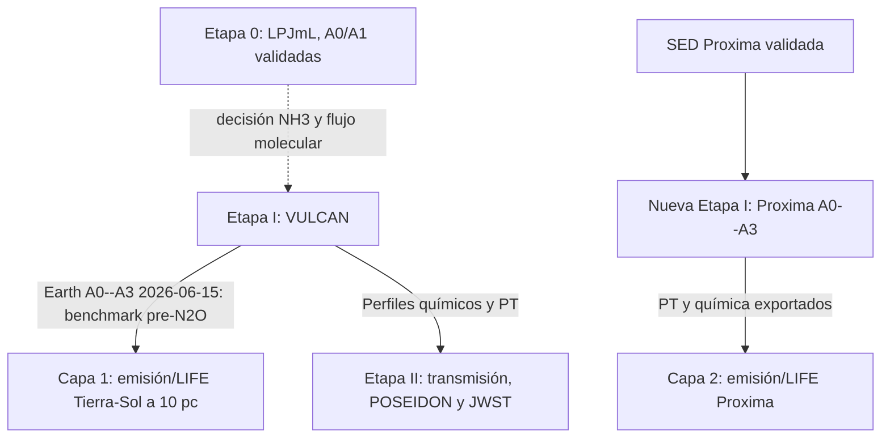

## Estado vigente — 2026-10-29

**LIFE: comparación de detectabilidad y condiciones de superficie (29-oct):** [informe comparativo](life_proxima_detectabilidad_comparacion_literatura_2026-10-29.md). La deposición sigue la configuración terrestre de VULCAN; otras velocidades, realizaciones de ruido y covarianza son extensiones opcionales sujetas a recursos. Se mantiene el análisis del ajuste con los productos existentes. La deposición se calculó desde los perfiles guardados, sin simulaciones ni retrievals nuevos; no prueba una causa única. Fuente numérica: informe integrado vigente.

**Análisis LIFE A1/A3 unificado — 29-oct:** [informe vigente y tablas trazables](life_proxima_a1_a3_retrievals_analisis_integrado_2026-10-29.md). Se reconstruyeron 42 modelos y 36 contrastes corregidos con hashes de insumos, probabilidades y K de siete gases frente a A0/A1/A3, muestras ponderadas y de igual peso, enriquecimientos, regiones y residuos. La salida de 1000 h conserva su estado exploratorio y seis NaN derivados de coordenadas fijas pendientes de revisión formal. Los registros LIFE previos de este tracker son bitácora histórica. Pendientes: incertidumbre del muestreo anidado, sensibilidad de prior/umbral, adecuación del modelo y ruido/covarianza; no se ejecutaron retrievals nuevos.

**Estabilización LIFE A1/A3 (28-oct):** [inventario de 979 archivos y SHA-256](evidence/life_proxima_a1_a3_release_2026-10-28/README.md) generado y copia en `E:\Respaldos\ExoFarm_MDwarfs\LIFE_Proxima_A1_A3_20261028` verificada archivo por archivo; incluye logs ignorados por Git, más 12 registros de supervisor añadidos y verificados por separado. Se capturó después la lista actual de 240 paquetes del entorno POSEIDON y se verificó también en E:, sin atribuirla automáticamente al entorno histórico de muestreo. El informe y productos oficiales aún no estaban versionados al revisar el repositorio. Quedan pendientes preservar el entorno y las opacidades externas, el cierre selectivo de Git y el diagnóstico de 16 rutas largas históricas ausentes en la copia de trabajo, cuyos objetos existen en `HEAD`. No se han registrado bajas ni restauraciones.

**Synthetic noise overlays on signal panels (2026-10-27):** LIFE A3 1/10/100 h uncertainties are drawn as ±1σ curves on the lower Proxima N₂O/NH₃ panels; the upper model spectra remain clear. JWST NIRSpec PRISM and MIRI LRS uncertainties are drawn on the lower TRAPPIST-1e signal panels for 10/20/100 transits; the original axis limits stay fixed, and clipped portions are identified. The five-transit series is omitted. No new forward models, POSEIDON runs, or retrievals were performed. [LIFE report](life_proxima_emission_spectra_with_life_data_2026-10-27.md) · [JWST report](trappist1e_jwst_noise_curves_signal_panels_2026-10-27.md).

**Cerrada y validada — matriz LIFE A1/A3 con binning corregido, campaña r01 (28-oct):** 33/33 retrievals auditados (21 A1 y 12 LOO A3), más tres modelos A3 completos de referencia auditados. El manifiesto registra `complete_validated`, `campaign_state.json` y el estado de recuperación quedaron conciliados después de la salida 0 del supervisor, y no hay procesos activos. El informe y sus dos CSV contienen resultados y 30 contrastes emparejados; se conservaron snapshots de preauditoría, campañas anteriores y productos con el binning anterior. [Informe y tablas](life_proxima_a1_a3_corrected_binning_matrix_results_2026-10-28.md) · [campaña](../Thermal_Emission_Spectroscopy/outputs/life_proxima_b_earthlike_v1/retrievals/a1_a3_corrected_binning_matrix_loo_20261021_r01/README.md) · [bitácora](life_proxima_a1_a3_corrected_binning_matrix_2026-10-21.md).

**Cerrada y validada — campaña A3 1 h/10 h corrected-bin:** los seis modelos (completo/sin NH₃/sin N₂O por duración) finalizaron con exit 0 y pasaron auditoría independiente. Se conciliaron `campaign_state.json` y `manifest.csv` una vez terminado el supervisor; los snapshots previos se preservan. ΔlnZ (completo − sin X): a 1 h, sin NH₃ `−0.526485±0.234278` y sin N₂O `−0.029618±0.234922`; a 10 h, sin NH₃ `−0.225706±0.292617` y sin N₂O `+9.141993±0.292323`. El último resultado favorece incluir N₂O en esta comparación condicionada; sigma calibrado `+4.664` es auxiliar. En el completo de 10 h, `P(N₂O>A0)=0.99986` y `P(NH₃>A0)=0.8040`; la dirección posterior y la preferencia entre modelos son evidencias distintas. Véanse el [informe final](life_proxima_a3_1_10h_corrected_binning_loo_results_2026-10-21.md) y [README/ledger r03](../Thermal_Emission_Spectroscopy/outputs/life_proxima_b_earthlike_v1/retrievals/a3_1_10h_binning_corrected_loo_20261020_r03/README.md). La sigma no es significancia frecuentista y la comparación no atribuye origen agrícola.

**Registro histórico del muestreo (20-oct):** las líneas de progreso siguientes describen lecturas transitorias y no implican que haya procesos activos; la campaña terminó y su auditoría cerró.

**Figura oficial vigente — A1/A3 con N₂O y NH₃ primero, sin panel P–T:** se regeneró tras la auditoría de los seis completos. PNG/PDF/SVG y hashes coinciden; las ediciones anteriores siguen preservadas. [Figura, procedencia y reproducción](life_proxima_corrected_binning_full_posteriors_plot_2026-10-28.md) · [resultados LOO](life_proxima_a1_a3_corrected_binning_matrix_results_2026-10-28.md).

**Completado — actualización inferencial A3–100 h corregido (20-oct; prior regional actualizado 26-oct):** evidencia y errores reproducidos desde la auditoría primaria; cuantiles y probabilidades recalculados desde muestras nativas verificadas. NH3 ≥A1: `98.6654 %`, `K marginal=23.991`, 95 % `[2.572,25.377] A1` (anchura `0.994 dex`); conjunta ≥A1: `98.6654 %`, `K(R11/complemento)=113.924`. El prior efectivo fue verificado el 26-oct; queda pendiente cuantificar la incertidumbre Monte Carlo regional. Se documentan χ² explícito `57.19`, denominadores declarado/libre y diferencia de redondeo con el CSV de auditoría. Tres contrastes A0 fijos emparejados a 100 h siguen pendientes; las evidencias históricas de esos contrastes no se combinan con el completo corregido. Sin nuevos samplers ni cambios al manuscrito. [Informe actualizado de regiones](life_proxima_a1_regions_corrected_binning_2026-10-26.md).

Inventario recuperable de la línea LIFE Proxima y su secuencia de cierre: [checklist maestra](life_proxima_analysis_checklist_2026-10-20.md) y [plan de retrievals afectados por el cambio de binning](life_proxima_corrected_binning_update_plan_2026-10-21.md). La matriz r01 de 33 está activa; el manifiesto y el resumen de arriba son la fuente del estado al 26-oct. El atlas de completos generado hoy no cierra ni sustituye las auditorías/LOO aún pendientes.

**Análisis de regiones ExoFarm/A1 acordado 21-oct y ejecutado 26-oct:** se usaron las muestras corregidas existentes de A3–1/10/100 h; el cálculo requirió **0 retrievals nuevos**. Las cuatro regiones conjuntas y sus masas previas quedaron calculadas con el prior efectivo auditado. La matriz general pendiente es independiente: 33 retrievals, o 36 al sumar tres A0-fijos opcionales. Para evidencia causal ExoFarm–preagrícola falta definir las familias predictivas; aún no hay conteo. [Método y resultados](life_proxima_a1_regions_corrected_binning_2026-10-26.md).

**Cierre del cálculo regional A3 (2026-10-26):** revisé los priors en el runner y en las configuraciones resueltas de 1/10/100 h. Las masas marginales y conjuntas del prior son analíticas y exactas para la parametrización actual; los cuatro conteos posteriores quedaron reproducidos con hashes. `K(R11/complemento)=0.106/4.181/113.924`. La incertidumbre Monte Carlo, las colas escasas de 10/100 h y la sensibilidad al umbral siguen pendientes. No hacen falta retrievals nuevos para la tabla actual. [Informe y reproducción](life_proxima_a1_regions_corrected_binning_2026-10-26.md).

**Cerrada y validada — A3–100 h, binning corregido, ablaciones LOO (20-oct):** `sin NH3` MPI8 y `sin N2O` MPI7 completaron con exit 0. Baseline, muestras, espectro, PT, `log_X`, MultiNest, finitud, hashes, priors, exclusiones y callback del operador corregido pasaron auditoría independiente. `ΔlnZ` completo menos ablación: +2.748991±0.344630 para NH3 y +84.660508±0.346532 para N2O; sigma bilateral calibrada auxiliar +2.853/+13.217. El posterior completo tiene `P(N2O>A0)=1.0000`, `P(NH3>A0)=0.9913`; especie ausente = N/A. `χ²_red=3.57` en el completo y 13.55 sin N2O advierte tensión de ajuste. Ledger y manifiesto reconciliados conservando los contadores iniciales 6380/6822 frente a 6381/6823 filas finales válidas. [Informe y tablas](life_proxima_a3_100h_corrected_binning_molecular_ablation_2026-10-19.md); [campaña validada](../Thermal_Emission_Spectroscopy/outputs/life_proxima_b_earthlike_v1/retrievals/a3_100h_binning_corrected_loo_20261019/README.md).

Campaña A3–1000 h/A0 con binning corregido: tres corridas exit0; productos primarios y evidencia validados. Finitud estricta false por seis NaN en desviaciones derivadas de parámetros fijos; aceptación formal pendiente de revisión explícita. ln B libre/A0: N₂O `626.5061±0.3845`, NH₃ `−0.9927±0.3825` (sigma N/A), conjunta `626.0635±0.3822`. N₂O muestra posterior por encima de A0; NH₃ conserva incertidumbre amplia y la masa posterior sobre A0 es menor que la nominal del prior. `χ²_red=14.29` del completo limita inferencias. [Informe de cierre/auditoría](life_proxima_a3_1000h_a0_fixed_binning_corrected_audit_2026-10-17.md); el manifiesto conserva `PENDING_FIXED_MOMENT_REVIEW`.

**A3–100 h, binning corregido, MPI14 (muestreo y auditoría cerrados; 2026-10-20):** el usuario autorizó continuar el checkpoint serial validado en una campaña separada; el primer preflight Open MPI falló por incompatibilidad con MPICH/PMI1 y el retry MPICH/Hydra pasó. MultiNest terminó con `exit_code=0`, 44.526 reemplazos, 1.474.040 evaluaciones y `ln(ev)=894.331224 ± 0.246654`. La auditoría independiente de productos, datos, priors, operador y hashes pasó el 2026-10-20; el baseline queda aceptado como comparador. La diferencia histórica `ln Z=884.333304` frente a `894.331224` sigue siendo sensibilidad metodológica, porque también cambió la rejilla 3.8–19 a 3–20 μm y el manifiesto antiguo no conserva todos los límites de prior. El campo de error del primer preflight se conserva como historial junto al retry PASS y al exit 0 final. [Bitácora con tabla y figura](life_proxima_a3_100h_binning_corrected_mpi14_resume_2026-10-18.md), [campaña MPI14 validada](../Thermal_Emission_Spectroscopy/outputs/life_proxima_b_earthlike_v1/retrievals/a3_100h_binning_corrected_mpi14_resume_20261018/).

**FR-Genghis, pausa solicitada 2026-10-04 16:38 COT:** campaña detenida por el usuario tras terminarse únicamente los 21 procesos verificados de los cinco bloques; no quedan procesos activos ni lock. Los cinco checkpoints conservados coinciden con los hashes de controller y sidecars, con restart byte a byte, y pasaron `lpjcheck -pedantic` (exit 0). No hay códigos finales ni productos aceptados. Véase [registro de pausa](fr_genghis_campaign_pause_2026-10-04.md) para hashes, años y limitaciones.

**FR-Genghis, seguimiento 2026-10-04 15:57 COT:** 00000_07999 guardó un checkpoint nuevo, SHA-256 3558df2823e16b0e75da872c64c07afffa62ae65334e01a5f09bd30045f0934a. El archivo archivado y restart/checkpoint.lpj coinciden byte a byte; lpjcheck -pedantic terminó con exit 0 e indicó reanudación desde el año 1566. Los otros hashes vigentes, también coincidentes entre archivo archivado y restart, son 08000_15999 8b3bdde51ef3348ef0309c17bda51de83f7d6a71307261f46670323cd63a8110; 16000_23999 8320adbef33619710eada5a49c9c87522116b4ded3b100e9580b38dd87d88605; 24000_31999 0e52b9672760d674e24d0211aedaa0b5273f99200f633f559c5d2d7b4b46c3aa; 32000_39999 dc6f24a5fc1adb6fc9c56703f664ca75590d7986c25eb90981b7bb9a4dbf3864. Siguen activos los cinco bloques con un rank MPI por bloque, CH4 y MAX_PARALLEL=5; no hay códigos finales ni productos aceptados. Hay 12 GiB de RAM disponible, 7,0 de 8 GiB de swap ocupados y 498 GiB libres en disco; vmstat no mostró intercambio sostenido. Se conserva MAX_PARALLEL=5. El exit 137 de 00000_07999 sigue siendo histórico del 2026-10-01. river_routing=false y reservoir=false limitan la interpretación al routing local desactivado.

**FR-Genghis, seguimiento 2026-10-04 14:56 COT:** los cinco bloques siguen en POTENTIAL_CHUNKS_RUNNING, con cinco LPJmL y cinco mpirun -np 1 activos; cada modelo usa ~39,9–40,0% de CPU. No hay checkpoint nuevo desde la revisión anterior. Los hashes del último checkpoint guardado, el archivo archivado y restart coinciden: 00000_07999 c59f10b4ee452d24259ae591ede142485bdc26413dbd381c758222ba9e1cfd6d; 08000_15999 8b3bdde51ef3348ef0309c17bda51de83f7d6a71307261f46670323cd63a8110; 16000_23999 8320adbef33619710eada5a49c9c87522116b4ded3b100e9580b38dd87d88605; 24000_31999 0e52b9672760d674e24d0211aedaa0b5273f99200f633f559c5d2d7b4b46c3aa; 32000_39999 dc6f24a5fc1adb6fc9c56703f664ca75590d7986c25eb90981b7bb9a4dbf3864. La RAM disponible es 11 GiB y quedan 499 GiB libres en disco; la swap llegó a 8,0/8,0 GiB ocupados, con 8 KiB libres. vmstat registró 8 KiB/s de swap-out en un intervalo y cero si/so en los tres siguientes; no se observa intercambio sostenido en esa ventana, pero la reserva de swap está agotada. No hay códigos finales ni productos aceptados. Mantengo MAX_PARALLEL=5 sin cambios. El exit 137 de 00000_07999 sigue siendo histórico, fechado el 2026-10-01. river_routing=false y reservoir=false limitan la interpretación al routing local desactivado.

**FR-Genghis, seguimiento 2026-10-04 13:55 COT:** la campaña sigue en POTENTIAL_CHUNKS_RUNNING con cinco bloques, cinco procesos LPJmL y un rank MPI por bloque; MAX_PARALLEL=5 y retención completa. 08000_15999 guardó un checkpoint nuevo, SHA-256 8b3bdde51ef3348ef0309c17bda51de83f7d6a71307261f46670323cd63a8110. El archivo archivado y restart/checkpoint.lpj coinciden byte a byte; lpjcheck -pedantic terminó con exit 0 e indicó reinicio desde el año 1494. Los otros hashes vigentes, también coincidentes entre restart y archivo, son 00000_07999 c59f10b4ee452d24259ae591ede142485bdc26413dbd381c758222ba9e1cfd6d; 16000_23999 8320adbef33619710eada5a49c9c87522116b4ded3b100e9580b38dd87d88605; 24000_31999 0e52b9672760d674e24d0211aedaa0b5273f99200f633f559c5d2d7b4b46c3aa; 32000_39999 dc6f24a5fc1adb6fc9c56703f664ca75590d7986c25eb90981b7bb9a4dbf3864. Los cinco LPJmL usan cerca de 40% de CPU; hay 11 GiB de RAM disponible, 7,6 de 8 GiB de swap ocupados y 499 GiB libres en disco. vmstat mostró actividad pequeña en la primera muestra y cero si/so en las cuatro siguientes: swap casi llena, sin paginación sostenida observada. No hay códigos finales ni productos aceptados. Se mantiene el límite MAX_PARALLEL=5. El exit 137 de 00000_07999 sigue siendo un incidente histórico del 2026-10-01. river_routing=false y reservoir=false limitan la interpretación al routing local desactivado.

**FR-Genghis, seguimiento 2026-10-04 11:53 COT:** los cinco bloques permanecen activos con un rank MPI por bloque, MAX_PARALLEL=5, CH4 y retención completa; cada LPJmL usa ~39,9--40,0% de CPU. No hay códigos finales ni productos aceptados. No se guardaron checkpoints nuevos; los SHA-256 de los cinco últimos eventos de controller coinciden con restart y archivo archivado (cmp=PASS): 00000_07999 c59f10b4ee452d24259ae591ede142485bdc26413dbd381c758222ba9e1cfd6d; 08000_15999 e8a62f04e7ec5b47c6e9e3468fc6a38910743f8cca7c659f0897ae23bdafcd2b; 16000_23999 8320adbef33619710eada5a49c9c87522116b4ded3b100e9580b38dd87d88605; 24000_31999 0e52b9672760d674e24d0211aedaa0b5273f99200f633f559c5d2d7b4b46c3aa; 32000_39999 dc6f24a5fc1adb6fc9c56703f664ca75590d7986c25eb90981b7bb9a4dbf3864. Los stdout avanzaron: 16000_23999 registra la fila 1493 y 32000_39999 la 1485; 00000 se mantiene en 1565, 08000 en 1493 y 24000 en 1485. Los cinco LPJmL, mpirun y checkpoint_runner siguen activos. Hay 11 GiB de RAM disponible y 500 GiB libres en disco; la swap está ocupada en 8,0 de 8 GiB (12 KiB libres). Las cuatro muestras de intervalo posteriores al promedio inicial de vmstat mostraron si/so=0, sin paginación sostenida en la ventana. Se conserva MAX_PARALLEL=5; no se cambia la ejecución. El exit 137 de 00000_07999 sigue siendo el incidente histórico del 2026-10-01. river_routing=false y reservoir=false limitan la interpretación al routing local desactivado.

**FR-Genghis, seguimiento 2026-10-04 10:52 COT:** los cinco bloques siguen activos con un rank MPI por bloque, MAX_PARALLEL=5, salida CH4 y retención completa; los cinco LPJmL usan ~39,9--40,0% de CPU. No hay códigos finales ni productos aceptados. No se guardaron checkpoints nuevos; para todos los bloques, el último SHA-256 del controller coincide con restart y archivo archivado, y cmp pasa: 00000_07999 c59f10b4ee452d24259ae591ede142485bdc26413dbd381c758222ba9e1cfd6d; 08000_15999 e8a62f04e7ec5b47c6e9e3468fc6a38910743f8cca7c659f0897ae23bdafcd2b; 16000_23999 8320adbef33619710eada5a49c9c87522116b4ded3b100e9580b38dd87d88605; 24000_31999 0e52b9672760d674e24d0211aedaa0b5273f99200f633f559c5d2d7b4b46c3aa; 32000_39999 dc6f24a5fc1adb6fc9c56703f664ca75590d7986c25eb90981b7bb9a4dbf3864. Las últimas filas visibles siguen en 1565 (00000), 1493 (08000) y 1485 (24000); los otros segmentos consultados continúan activos desde checkpoint. Hay 11 GiB de RAM disponible y 500 GiB libres en disco; la swap llegó a 8,0/8,0 GiB, sin bytes libres. En vmstat, las cuatro muestras de intervalo posteriores a la línea promedio inicial mostraron si/so=0; una indicó un proceso bloqueado, sin que la ventana muestre paginación sostenida. La swap está agotada y mantengo MAX_PARALLEL=5 bajo vigilancia, sin cambiar procesos en esta lectura. El exit 137 del controller.stderr de 00000_07999 sigue siendo histórico (2026-10-01). river_routing=false y reservoir=false limitan la interpretación al routing local desactivado.

**FR-Genghis, seguimiento 2026-10-04 09:51 COT:** continúan activos los cinco bloques con un rank MPI cada uno, MAX_PARALLEL=5, salida CH4 y retención completa; los cinco LPJmL usan ~39,9--40,0% de CPU. No hay códigos finales ni productos aceptados. No hubo checkpoint nuevo: los hashes del último evento del controller coinciden con restart y archivo archivado, y cmp pasa para los cinco bloques: 00000_07999 c59f10b4ee452d24259ae591ede142485bdc26413dbd381c758222ba9e1cfd6d; 08000_15999 e8a62f04e7ec5b47c6e9e3468fc6a38910743f8cca7c659f0897ae23bdafcd2b; 16000_23999 8320adbef33619710eada5a49c9c87522116b4ded3b100e9580b38dd87d88605; 24000_31999 0e52b9672760d674e24d0211aedaa0b5273f99200f633f559c5d2d7b4b46c3aa; 32000_39999 dc6f24a5fc1adb6fc9c56703f664ca75590d7986c25eb90981b7bb9a4dbf3864. Las filas recientes visibles son 1565 en 00000_07999, 1493 en 08000_15999 y 1485 en 24000_31999; 16000 y 32000 continúan activos desde sus checkpoints. Hay 11 GiB de RAM disponible y 500 GiB libres en disco, pero la swap está ocupada en 8,0 de 8 GiB, con solo 4 MiB libres. Las cuatro muestras de intervalo de vmstat mostraron si/so=0: no se observa paginación sostenida en esa ventana, aunque el margen de swap está prácticamente agotado. Mantengo MAX_PARALLEL=5 y vigilo recursos. El exit 137 presente en el stderr de 00000_07999 corresponde al incidente histórico del 2026-10-01. river_routing=false y reservoir=false limitan la interpretación al routing local desactivado.

**FR-Genghis, seguimiento 2026-10-04 08:50 COT:** los cinco bloques siguen activos con un rank MPI por bloque, MAX_PARALLEL=5, CH4 y retención completa; los cinco LPJmL usan 39,9% de CPU y no hay códigos finales ni productos aceptados. No se guardaron checkpoints nuevos: para los cinco bloques, los SHA-256 del último evento del controller, restart y archivo archivado coinciden y cmp pasa. Hashes vigentes: 00000_07999 c59f10b4ee452d24259ae591ede142485bdc26413dbd381c758222ba9e1cfd6d; 08000_15999 e8a62f04e7ec5b47c6e9e3468fc6a38910743f8cca7c659f0897ae23bdafcd2b; 16000_23999 8320adbef33619710eada5a49c9c87522116b4ded3b100e9580b38dd87d88605; 24000_31999 0e52b9672760d674e24d0211aedaa0b5273f99200f633f559c5d2d7b4b46c3aa; 32000_39999 dc6f24a5fc1adb6fc9c56703f664ca75590d7986c25eb90981b7bb9a4dbf3864. El registro más reciente sigue en la fila 1493 de 08000_15999; los otros segmentos visibles no cambiaron. La memoria disponible es 11 GiB, quedan 500 GiB en disco y la swap está ocupada en 8,0 de 8 GiB (30 MiB libres). En vmstat, las cuatro filas de intervalo posteriores al promedio inicial mostraron si/so=0; no se observa paginación sostenida en esa ventana. La reserva de swap está agotada y queda bajo vigilancia; mantengo el límite de cinco procesos. El exit 137 que aparece en controller.stderr.log de 00000_07999 pertenece al incidente histórico del 2026-10-01. river_routing=false y reservoir=false limitan la interpretación al routing local desactivado.

**FR-Genghis, seguimiento 2026-10-04 07:49 COT:** siguen activos los cinco bloques con un rank MPI cada uno, MAX_PARALLEL=5, salida CH4 y retención completa. Los cinco LPJmL usan 39,8--39,9% de CPU; no hay códigos finales ni productos aceptados. Los SHA-256 del checkpoint guardado, restart y archivo archivado coinciden (cmp=PASS) y no cambiaron desde la revisión anterior: 00000_07999 c59f10b4ee452d24259ae591ede142485bdc26413dbd381c758222ba9e1cfd6d; 08000_15999 e8a62f04e7ec5b47c6e9e3468fc6a38910743f8cca7c659f0897ae23bdafcd2b; 16000_23999 8320adbef33619710eada5a49c9c87522116b4ded3b100e9580b38dd87d88605; 24000_31999 0e52b9672760d674e24d0211aedaa0b5273f99200f633f559c5d2d7b4b46c3aa; 32000_39999 dc6f24a5fc1adb6fc9c56703f664ca75590d7986c25eb90981b7bb9a4dbf3864. El segmento más reciente de 08000_15999 registró la fila 1493. Hay 11,3 GiB disponibles y 500 GiB libres en disco; la swap está ocupada en 7,94 de 8 GiB (unos 61 MiB libres). vmstat 1 6 mostró valores nulos de swap-in/out después de la primera muestra, así que no se observa paginación sostenida en ese intervalo. Mantengo el límite de cinco procesos y vigilo la reserva de swap. El exit 137 de 00000_07999 sigue siendo histórico, del 2026-10-01. river_routing=false y reservoir=false limitan la interpretación al routing local desactivado.

**FR-Genghis, seguimiento 2026-10-04 06:49 COT:** los cinco bloques continúan activos con un rank MPI por bloque, MAX_PARALLEL=5, CH4 y retención completa. 16000_23999 guardó el checkpoint 8320adbef33619710eada5a49c9c87522116b4ded3b100e9580b38dd87d88605; hash del controlador, archivo archivado y restart coinciden, cmp pasa y lpjcheck -pedantic devuelve 0, con restart desde año 1492. Los demás hashes no cambiaron: 00000_07999 c59f10b4ee452d24259ae591ede142485bdc26413dbd381c758222ba9e1cfd6d; 08000_15999 e8a62f04e7ec5b47c6e9e3468fc6a38910743f8cca7c659f0897ae23bdafcd2b; 24000_31999 0e52b9672760d674e24d0211aedaa0b5273f99200f633f559c5d2d7b4b46c3aa; 32000_39999 dc6f24a5fc1adb6fc9c56703f664ca75590d7986c25eb90981b7bb9a4dbf3864. Los cinco LPJmL usan alrededor de 40% de CPU. La swap bajó a 6,8 de 8 GiB y quedan 10 GiB de RAM disponible y 500 GiB libres en /home; vmstat mostró solo actividad breve, no sostenida. No hay error fatal ni códigos finales; el exit 137 en 00000_07999 es histórico del 2026-10-01. Se mantiene MAX_PARALLEL=5. river_routing=false y reservoir=false limitan la interpretación al routing local desactivado.

**FR-Genghis, seguimiento 2026-10-04 05:49 COT:** los cinco bloques siguen activos con un rank MPI cada uno, MAX_PARALLEL=5, salida CH4 y retención completa. No hay checkpoints nuevos; los últimos hashes del controlador/restart se mantienen: 00000_07999 c59f10b4ee452d24259ae591ede142485bdc26413dbd381c758222ba9e1cfd6d; 08000_15999 e8a62f04e7ec5b47c6e9e3468fc6a38910743f8cca7c659f0897ae23bdafcd2b; 16000_23999 eacf565edfd881572b7db1cbf64eae100f060af6b19836dc24d16a4e0a886ec3; 24000_31999 0e52b9672760d674e24d0211aedaa0b5273f99200f633f559c5d2d7b4b46c3aa; 32000_39999 dc6f24a5fc1adb6fc9c56703f664ca75590d7986c25eb90981b7bb9a4dbf3864. Cada LPJmL continúa alrededor de 40% de CPU y no hay errores fatales ni códigos finales. La swap ahora está completamente ocupada (8,0 de 8,0 GiB); quedan 11 GiB de RAM disponible y 501 GiB libres en /home. vmstat no mostró intercambio sostenido después del primer intervalo, pero el margen de swap se agotó. Se mantiene MAX_PARALLEL=5 y no se amplía. El exit 137 de 00000_07999 sigue siendo un incidente histórico del 2026-10-01. river_routing=false y reservoir=false limitan la interpretación al routing local desactivado.

**FR-Genghis, seguimiento 2026-10-04 04:48 COT:** los cinco bloques siguen activos con un rank MPI por bloque, MAX_PARALLEL=5, salida CH4 y retención completa. Los últimos checkpoints no cambiaron y sus restart coinciden con los hashes del controlador y archivo archivado: 00000_07999 c59f10b4ee452d24259ae591ede142485bdc26413dbd381c758222ba9e1cfd6d; 08000_15999 e8a62f04e7ec5b47c6e9e3468fc6a38910743f8cca7c659f0897ae23bdafcd2b; 16000_23999 eacf565edfd881572b7db1cbf64eae100f060af6b19836dc24d16a4e0a886ec3; 24000_31999 0e52b9672760d674e24d0211aedaa0b5273f99200f633f559c5d2d7b4b46c3aa; 32000_39999 dc6f24a5fc1adb6fc9c56703f664ca75590d7986c25eb90981b7bb9a4dbf3864. Los cinco LPJmL mantienen cerca de 40% de CPU, sin error fatal actual ni códigos finales; el exit 137 de 00000_07999 es histórico del 2026-10-01. Hay 11 GiB de RAM disponible y 501 GiB libres en /home, pero la swap subió a 7,8 de 8,0 GiB (161 MiB libres). vmstat registró actividad solo en el primer intervalo y cero intercambio en los tres siguientes, sin paginación sostenida observada. Se conserva MAX_PARALLEL=5 sin ampliarlo y se vigila el margen de memoria. river_routing=false y reservoir=false limitan la interpretación al routing local desactivado.

**FR-Genghis, seguimiento 2026-10-04 03:47 COT:** se mantienen activos los cinco bloques, un rank MPI por bloque, MAX_PARALLEL=5, salida CH4 y retención completa. El bloque 32000_39999 guardó el checkpoint dc6f24a5fc1adb6fc9c56703f664ca75590d7986c25eb90981b7bb9a4dbf3864; el hash de controller, archivo y restart coincide, cmp pasa y lpjcheck -pedantic termina con 0, indicando reanudación desde el año 1484. Los últimos SHA-256 sin cambio son 00000_07999 c59f10b4ee452d24259ae591ede142485bdc26413dbd381c758222ba9e1cfd6d; 08000_15999 e8a62f04e7ec5b47c6e9e3468fc6a38910743f8cca7c659f0897ae23bdafcd2b; 16000_23999 eacf565edfd881572b7db1cbf64eae100f060af6b19836dc24d16a4e0a886ec3; 24000_31999 0e52b9672760d674e24d0211aedaa0b5273f99200f633f559c5d2d7b4b46c3aa. Los cinco procesos LPJmL usan cerca de 40% de CPU; quedan 11 GiB de RAM disponibles, 6,5 de 8 GiB de swap están ocupados y hay 501 GiB libres en /home. vmstat no mostró intercambio sostenido. No hay error fatal actual ni códigos finales; el exit 137 de 00000_07999 es el incidente histórico del 2026-10-01. Se mantiene el máximo de cinco procesos. river_routing=false y reservoir=false limitan la interpretación al routing local desactivado.

**FR-Genghis, seguimiento 2026-10-04 02:46 COT:** los cinco bloques continúan activos con un rank MPI cada uno, MAX_PARALLEL=5, salida CH4 y retención completa. El bloque 00000_07999 guardó un checkpoint nuevo: SHA-256 c59f10b4ee452d24259ae591ede142485bdc26413dbd381c758222ba9e1cfd6d; el controlador, el archivo archivado y restart/checkpoint.lpj coinciden, cmp pasa y lpjcheck -pedantic devuelve 0, con restart desde año 1564. Los demás checkpoints y hashes coinciden sin cambios: 08000_15999 e8a62f04e7ec5b47c6e9e3468fc6a38910743f8cca7c659f0897ae23bdafcd2b; 16000_23999 eacf565edfd881572b7db1cbf64eae100f060af6b19836dc24d16a4e0a886ec3; 24000_31999 0e52b9672760d674e24d0211aedaa0b5273f99200f633f559c5d2d7b4b46c3aa; 32000_39999 56929c418b142ba637156110295a9c531f9e3a0b7bf5c1d48adb204127fdd792. Los cinco LPJmL siguen cerca de 40% de CPU; RAM disponible 12 GiB, swap usada 6,7 de 8 GiB y 502 GiB libres en /home. vmstat no mostró intercambio sostenido. Se mantiene MAX_PARALLEL=5. No hay error fatal actual ni códigos finales; el exit 137 de 00000_07999 continúa siendo histórico del 2026-10-01. river_routing=false y reservoir=false limitan la interpretación al routing local desactivado.

**FR-Genghis, seguimiento 2026-10-04 01:46 COT:** los cinco bloques continúan activos, con un rank MPI por bloque, MAX_PARALLEL=5, salida CH4 y retención completa de checkpoints. Los SHA-256 vigentes de controller.log y restart son: 00000_07999 88f680589b802dd42ca806fb59eaa8c23ed4f84ed0cc2543fc11e8481c29c60f; 08000_15999 e8a62f04e7ec5b47c6e9e3468fc6a38910743f8cca7c659f0897ae23bdafcd2b; 16000_23999 eacf565edfd881572b7db1cbf64eae100f060af6b19836dc24d16a4e0a886ec3; 24000_31999 0e52b9672760d674e24d0211aedaa0b5273f99200f633f559c5d2d7b4b46c3aa; 32000_39999 56929c418b142ba637156110295a9c531f9e3a0b7bf5c1d48adb204127fdd792. Para los checkpoints nuevos de 08000_15999 y 24000_31999, hash del controlador, archivo archivado y restart coinciden, cmp pasa y lpjcheck -pedantic devuelve 0; informa reanudación desde los años 1492 y 1484. Los cinco LPJmL mantienen cerca de 40% de CPU. Quedan 11 GiB disponibles y 503 GiB en /home, pero la swap está en 7,0 de 8,0 GiB; vmstat no mostró intercambio sostenido tras el primer intervalo. Se conserva MAX_PARALLEL=5 sin ampliarlo y se vigila la memoria. Los stderr recientes solo muestran advertencias conocidas; el exit 137 de 00000_07999 sigue siendo histórico del 2026-10-01. Aún no hay códigos finales ni productos aceptados. river_routing=false y reservoir=false limitan la interpretación al routing local desactivado.

**FR-Genghis, seguimiento 2026-10-03 19:40 COT:** el bloque 16000_23999 guardó un checkpoint nuevo tras la fila anual 1490: SHA-256 eacf565edfd881572b7db1cbf64eae100f060af6b19836dc24d16a4e0a886ec3. La copia archivada y restart/checkpoint.lpj coinciden; lpjcheck -pedantic terminó con código 0 e indicó reanudación desde el año 1490. El proceso ya continúa en un segmento nuevo. Los otros checkpoints permanecen: 00000_07999, año 1561, 88f680589b802dd42ca806fb59eaa8c23ed4f84ed0cc2543fc11e8481c29c60f; 08000_15999, año 1489, 6479e6dcb8e3f6e122557a70cbbe04f5f13c3c7dd2c80eabff64dd2c7cabef7d; 24000_31999, año 1481, 70174d7e6bfb430dd691f87529472571949b7215e4099043cf1ee53adbd454ae; y 32000_39999, año 1481, 56929c418b142ba637156110295a9c531f9e3a0b7bf5c1d48adb204127fdd792. En los cinco bloques, el SHA-256 del restart activo coincide con el último checkpoint registrado por el controlador. Las últimas filas anuales visibles son 1563, 1491, 1490, 1483 y 1483, respectivamente. Siguen activos cinco LPJmL y cinco mpirun con un rank por bloque, cerca de 40% de CPU cada uno; no hay códigos finales ni productos aceptados, y los stderr recientes no muestran fallos fatales. El exit 137 de 00000_07999 sigue limitado al incidente histórico del 2026-10-01. Quedan 9,6 GiB de RAM disponible, 6,1 GiB de swap usada de 8 GiB y 505 GiB libres en el filesystem. vmstat mostró un intercambio pequeño en el primer intervalo y cero si/so en los dos siguientes, sin paginación sostenida. Se conserva MAX_PARALLEL=5, CH4 y la retención completa de checkpoints; no aumento el paralelismo. river_routing=false y reservoir=false limitan la interpretación al routing local desactivado.
**FR-Genghis, seguimiento 2026-10-03 13:35 COT:** la campaña sigue en ejecución con cinco procesos LPJmL activos, un rank MPI por bloque y MAX_PARALLEL=5; la retención completa de checkpoints y la salida CH4 siguen configuradas. Los SHA-256 de los cinco restart/checkpoint.lpj coinciden con el último CHECKPOINT_SAVED de cada controller.log: 00000_07999, año 1561, 88f680589b802dd42ca806fb59eaa8c23ed4f84ed0cc2543fc11e8481c29c60f; 08000_15999, año 1489, 6479e6dcb8e3f6e122557a70cbbe04f5f13c3c7dd2c80eabff64dd2c7cabef7d; 16000_23999, año 1487, 753623983d436f2b20b476ef8fedf9c7c6ca60a4ca1ddd1f8a84928393bd8d80; 24000_31999, año 1481, 70174d7e6bfb430dd691f87529472571949b7215e4099043cf1ee53adbd454ae; 32000_39999, año 1481, 56929c418b142ba637156110295a9c531f9e3a0b7bf5c1d48adb204127fdd792. Los cinco modelos mantienen alrededor de 40% de CPU cada uno. free -h informa 10 GiB disponibles, pero la swap de 8 GiB está completamente ocupada; VmSwap suma aproximadamente 7,8 GiB en tres procesos y es casi nula en los otros dos. vmstat 1 4 mostró salida de swap de 365 KiB/s en el primer intervalo y cero swap-in/out en los tres siguientes, sin intercambio sostenido durante la muestra. Quedan 506 GiB libres en el filesystem. Esto señala presión de memoria que conviene vigilar; con CPU activa y sin paginación sostenida observada, mantengo MAX_PARALLEL=5 y no cambio ni detengo procesos. Los stderr recientes revisados no muestran fallos fatales; el exit 137 de 00000_07999 es el incidente histórico del 2026-10-01. No hay códigos finales ni productos aceptados. La interpretación conserva river_routing=false y reservoir=false, por lo que el routing de esta campaña sigue siendo local.
**FR-Genghis, seguimiento 2026-10-03 11:33 COT:** se verificaron dos checkpoints nuevos. `00000_07999` avanzó hasta después de la fila anual 1561, SHA-256 `88f680589b802dd42ca806fb59eaa8c23ed4f84ed0cc2543fc11e8481c29c60f`; `08000_15999` avanzó después de la fila 1489, SHA-256 `6479e6dcb8e3f6e122557a70cbbe04f5f13c3c7dd2c80eabff64dd2c7cabef7d`. En ambos casos el restart activo y el archivo de checkpoint registrado por `controller.log` tienen el mismo SHA-256. `lpjcheck -pedantic` terminó con código 0 para cada configuración y reportó reanudación desde los años 1562 y 1490, respectivamente. Los cinco bloques siguen activos, un rank MPI por bloque, `MAX_PARALLEL=5`, retención completa de checkpoints; no hay códigos finales ni productos aceptados. Los checkpoints sin cambio son `16000_23999` año 1487, SHA-256 `753623983d436f2b20b476ef8fedf9c7c6ca60a4ca1ddd1f8a84928393bd8d80`; `24000_31999` año 1481, `70174d7e6bfb430dd691f87529472571949b7215e4099043cf1ee53adbd454ae`; y `32000_39999` año 1481, `56929c418b142ba637156110295a9c531f9e3a0b7bf5c1d48adb204127fdd792` (ya validado, reanudación desde 1482). Los procesos consumen cerca de 40% CPU cada uno; RAM disponible 11 GiB, swap usada 6.0 de 8 GiB y 506 GiB libres en el filesystem. `vmstat` mostró swap-in/out nulo en las muestras posteriores al primer intervalo, sin intercambio sostenido. Los segmentos activos no muestran errores fatales; las advertencias observadas son conocidas. El exit 137 en el stderr de `00000_07999` sigue siendo histórico del 2026-10-01, anterior a esta generación. Se conserva `MAX_PARALLEL=5`; routing local desactivado (`river_routing=false`, `reservoir=false`) limita la interpretación.
**FR-Genghis, seguimiento 2026-10-03 10:45 COT:** `32000_39999` guardó su primer checkpoint tras la fila anual 1481, SHA-256 `56929c418b142ba637156110295a9c531f9e3a0b7bf5c1d48adb204127fdd792`; el archivo activo y el archivo archivado indicado por `controller.log` coinciden byte a byte. La comprobación correcta `lpjcheck -pedantic` sobre `checkpoint_config.json`, con `inpath`, `outpath` y `restartpath` de este bloque, terminó con código 0 e indicó reanudación desde el año 1482; el supervisor inició un nuevo segmento. Los cinco bloques continúan activos, con un rank MPI por bloque y `MAX_PARALLEL=5`; no hay códigos finales ni productos aceptados. Checkpoints vigentes: `00000_07999` año 1560, SHA-256 `1f43bf9901be316f4ab6885e75ae14eaeced573048d640d2a9dc8aa012762212`; `08000_15999` año 1488, `836c31b82f3b9a788e530e071aeced8c0ea09d8707d014f50a47171865d9f3e1`; `16000_23999` año 1487, `753623983d436f2b20b476ef8fedf9c7c6ca60a4ca1ddd1f8a84928393bd8d80`; `24000_31999` año 1481, `70174d7e6bfb430dd691f87529472571949b7215e4099043cf1ee53adbd454ae`; `32000_39999` año 1481, hash indicado arriba. La salida CH4 aparece en la configuración comprobada. Los cinco LPJmL usan cerca de 40% CPU cada uno. RAM disponible 11 GiB, swap ocupada 6.5 de 8 GiB y 509 GiB libres en el filesystem; `vmstat` mostró un primer intercambio de salida pequeño y luego cero swap-in/out en las muestras siguientes, sin intercambio sostenido. Los segmentos activos muestran progreso/arranque y advertencias conocidas, sin error fatal actual; el traceback con exit 137 en `00000_07999` pertenece al 2026-10-01 y es anterior a la reanudación vigente. Mantengo el límite de cinco procesos y las limitaciones interpretativas `river_routing=false` y `reservoir=false`.
**FR-Genghis, seguimiento 2026-10-03 09:32 COT:** 24000_31999 guardó checkpoint después de la fila anual 1481; SHA-256 70174d7e6bfb430dd691f87529472571949b7215e4099043cf1ee53adbd454ae. El SHA-256 del restart coincide con controller/archive; lpjcheck terminó con exit 0 e informó que el restart continúa desde 1482. El supervisor inició un nuevo segmento para el mismo bloque, que sigue activo. Permanecen activos los cinco bloques, MAX_PARALLEL=5 y un rank MPI por bloque; no hay códigos finales ni productos aceptados. Checkpoints vigentes: 00000_07999 año 1560, SHA-256 1f43bf9901be316f4ab6885e75ae14eaeced573048d640d2a9dc8aa012762212; 08000_15999 año 1488, 836c31b82f3b9a788e530e071aeced8c0ea09d8707d014f50a47171865d9f3e1; 16000_23999 año 1487, 753623983d436f2b20b476ef8fedf9c7c6ca60a4ca1ddd1f8a84928393bd8d80; 24000_31999 año 1481, hash indicado arriba; 32000_39999 aún sin checkpoint guardado. Los últimos años anuales visibles siguen en 1561, 1489, 1487, 1481 y 1481. Hay 7.5 GiB de RAM disponible, 3.2 GiB de swap usada y 511 GiB libres en /home; vmstat no indica intercambio sostenido. Segmentos activos revisados sin errores fatales. Mantengo MAX_PARALLEL=5 y river_routing=false/reservoir=false como limitaciones de interpretación.

**FR-Genghis, seguimiento 2026-10-03 08:32 COT:** se guardó un nuevo checkpoint para 16000_23999 tras la fila anual 1487; SHA-256 753623983d436f2b20b476ef8fedf9c7c6ca60a4ca1ddd1f8a84928393bd8d80. El hash del restart activo coincide con el de controller/archive, y lpjcheck terminó con exit 0; informó reinicio desde el checkpoint en año 1488. El supervisor relanzó normalmente el mismo bloque con un nuevo segmento; siguen cinco bloques activos, MAX_PARALLEL=5, un rank MPI cada uno, sin códigos finales ni productos aceptados. Los otros checkpoints no cambian: 00000_07999 año 1560, SHA-256 1f43bf9901be316f4ab6885e75ae14eaeced573048d640d2a9dc8aa012762212; 08000_15999 año 1488, 836c31b82f3b9a788e530e071aeced8c0ea09d8707d014f50a47171865d9f3e1. 24000_31999 y 32000_39999 siguen sin checkpoint guardado. Las últimas filas visibles son 1561, 1489, 1487, 1481 y 1481; los otros bloques mantienen actividad de CPU aunque sus filas anuales no avanzaron desde la última revisión. RAM disponible 8.0 GiB, swap usada 4.2 GiB de 8 GiB, disco libre 514 GiB; vmstat mostró swap-in/out nulos en las dos muestras instantáneas, sin intercambio sostenido. El segmento nuevo de 16000_23999 y los stderr revisados no muestran errores fatales. Mantengo el límite en cinco y la cautela interpretativa river_routing=false/reservoir=false.

**FR-Genghis, seguimiento 2026-10-03 07:32 COT:** los cinco bloques continúan activos con un rank MPI por bloque y MAX_PARALLEL=5. Los tiempos de CPU de los cinco LPJmL avanzaron unos 23 min durante los 58 min entre muestreos (cerca de 41% por proceso), aunque las últimas filas anuales siguen en 1561, 1489, 1487, 1481 y 1481; los stdout no cambian desde aproximadamente 01:57–04:43 COT según el bloque. No aparecieron checkpoints nuevos. Los últimos checkpoints, sin cambios y con SHA-256 verificado contra el restart, son 00000_07999 año 1560 (1f43bf9901be316f4ab6885e75ae14eaeced573048d640d2a9dc8aa012762212), 08000_15999 año 1488 (836c31b82f3b9a788e530e071aeced8c0ea09d8707d014f50a47171865d9f3e1) y 16000_23999 año 1486 (7f3b065e67ed12d4ec1703faf068cb07d16667a83879fa04cde7b35e6d19077e); 24000_31999 y 32000_39999 siguen sin checkpoint guardado desde A0. No hay códigos finales ni productos aceptados. Quedan 7.3 GiB de RAM disponible, swap usada 3.8 GiB de 8 GiB y 515 GiB libres en /home; vmstat mostró swap-in/out nulos en las dos muestras instantáneas tras la primera, sin señal de intercambio sostenido. Los stderr activos no reportan errores fatales; el exit 137 histórico de 00000_07999 corresponde al 2026-10-01. Mantengo MAX_PARALLEL=5 por prudencia y river_routing=false/reservoir=false como limitaciones de interpretación.

**FR-Genghis, seguimiento 2026-10-03 05:29 COT:** los cinco bloques continúan activos con MAX_PARALLEL=5 y un rank MPI por bloque. Las filas más recientes observadas son: 00000_07999 año 1561, 08000_15999 1489, 16000_23999 1487, 24000_31999 y 32000_39999 1481. Los checkpoints siguen en los años 1560, 1488 y 1486, con SHA-256 1f43bf9901be316f4ab6885e75ae14eaeced573048d640d2a9dc8aa012762212, 836c31b82f3b9a788e530e071aeced8c0ea09d8707d014f50a47171865d9f3e1 y 7f3b065e67ed12d4ec1703faf068cb07d16667a83879fa04cde7b35e6d19077e; aún no hay checkpoint de esta generación para los otros dos bloques, códigos finales ni productos aceptados. Cada LPJmL consume cerca de 40.9% de CPU; quedan 3.7 GiB de RAM disponible, 7 MiB de swap usada y 515 GiB libres en /home. Los stderr recientes revisados muestran advertencias conocidas, sin error fatal actual; el exit 137 de 00000_07999 pertenece a una generación anterior (2026-10-01). Mantengo el máximo en cinco por la reserva de RAM inferior a 4 GiB. river_routing=false y reservoir=false limitan la interpretación al routing local sin ríos ni reservorios.

**FR-Genghis, seguimiento 2026-10-03 00:29 COT:** los cinco bloques de la generación iniciada a las 21:55 COT continúan activos; cada LPJmL usa cerca del 40% de CPU y entre 4.6 y 5.7 GiB de RSS. La RAM disponible bajó de 5.2 GiB a las 23:29 COT a 4.3 GiB; a las 22:23 COT había 8.3 GiB disponibles. La swap usada es 6.5 MiB y quedan 515 GiB libres en `/home`. Aún no hay checkpoints nuevos desde el relanzamiento; `24000_31999` y `32000_39999` siguen sin uno de esta generación. Los stdout no muestran todavía la fila anual parseable que activa el checkpoint del wrapper; según [checkpoint_runner.py](../Agricultural_Fluxes_LPJmL/workflows/franck2011_reproduction/checkpoint_runner.py#L109), el SIGTERM de guardado espera esa fila además del intervalo de 3600 s. Los cinco LPJmL mantienen actividad de CPU y los stderr activos no muestran errores fatales, así que la ausencia de checkpoint aún no indica una interrupción. Mantengo `MAX_PARALLEL=5` y no lo aumento; observar la RAM en los siguientes ciclos. Sin códigos finales ni productos aceptados. `river_routing=false` y `reservoir=false` limitan la interpretación al routing local desactivado.

**FR-Genghis, seguimiento 2026-10-02 22:09 COT:** los cinco bloques permanecen activos; cada LPJmL usa aproximadamente 39–40% de CPU y 4.4–4.8 GiB de RSS. Quedan 8.4 GiB de RAM, swap sin uso y 515 GiB libres en /home. El consumo subió desde el arranque, así que mantengo MAX_PARALLEL=5 sin ampliarlo durante esta generación. Los stdout nuevos aún están en inicio; stderr contiene advertencias conocidas y no aparecen errores, fallos fatales, procesos muertos ni errores de segmentación. Los mensajes muestran el año 1489 tras retomar 08000 desde 1488 y 1481 en 24000 iniciado desde A0. Aún no hay códigos de salida ni checkpoints nuevos; el rendimiento total no está cuantificado.
**FR-Genghis reanudado con cinco bloques — 2026-10-02 21:56 COT:** tras el reinicio del PC/WSL, se confirmó que no había workers y se retiró el directorio de bloqueo vacío. Por instrucción del usuario, la campaña volvió a correr a las 21:55:35 con bloques de 8.000 celdas, `MAX_PARALLEL=5`, un rank MPI por bloque, CH4 y retención completa (`MAX_ARCHIVED_CHECKPOINTS=0`). Los bloques `00000_07999`, `08000_15999` y `16000_23999` reanudan desde años 1560, 1488 y 1486; sus reinicios coinciden byte a byte con el archivo y `lpjcheck -pedantic` devolvió exit 0. SHA-256: `1f43bf9901be316f4ab6885e75ae14eaeced573048d640d2a9dc8aa012762212`, `836c31b82f3b9a788e530e071aeced8c0ea09d8707d014f50a47171865d9f3e1` y `7f3b065e67ed12d4ec1703faf068cb07d16667a83879fa04cde7b35e6d19077e`. `24000_31999` y `32000_39999` arrancan desde A0. Hay cinco pares LPJmL/`mpirun -np 1` activos. A las 21:56:37 había 29 GiB disponibles, swap sin uso y 515 GiB libres en `/home`; la muestra corresponde al arranque. No hay códigos finales ni productos aceptados y la ganancia de rendimiento todavía no se mide. `river_routing=false` y `reservoir=false` limitan la interpretación al routing local desactivado. Informe: [bitácora de paralelismo](lpjml_capacity_chunk_parallelism_2026-10-01.md).
> **FR-Genghis interrumpido — revisión 2026-10-02 21:14 COT:** configuración de la última generación: `MAX_PARALLEL=4`, un rank MPI por bloque, bloques de 8.000 celdas, CH4 y retención completa. Los workers estaban activos a las 20:11; dos comprobaciones a las 21:13 y 21:14 confirmaron que ya no había LPJmL, `mpirun`, `checkpoint_runner` ni launcher. Los logs de esa generación no crecieron después de las 19:53 y `campaign_status.txt` conserva un RUNNING obsoleto. Checkpoints íntegros: 00000 año 1560, SHA-256 `1f43bf9901be316f4ab6885e75ae14eaeced573048d640d2a9dc8aa012762212`; 08000 año 1488, `836c31b82f3b9a788e530e071aeced8c0ea09d8707d014f50a47171865d9f3e1`; 16000 año 1486, `7f3b065e67ed12d4ec1703faf068cb07d16667a83879fa04cde7b35e6d19077e`. Los tres coinciden entre restart y archivo, y `lpjcheck -pedantic` devolvió exit 0. 24000 empezó desde A0 sin guardar checkpoint. Sin códigos finales ni productos aceptados; no se hallaron eventos OOM en los registros de kernel disponibles y la causa queda indeterminada. Se mantiene detenida sin relanzar otra copia. `river_routing=false`/`reservoir=false` limitan la interpretación. Informe: `lpjml_capacity_chunk_parallelism_2026-10-01.md`.

> **Serie oficial LIFE Proxima A1/A3 1/10/100 h, actualizada 2026-10-03:**
> los seis retrievals están cerrados y validados. A1-1 h usa ahora la
> realización independiente (seed `2125532119`, `χ²_red=1.10`, 16 dof;
> 7.334 muestras); la primera (seed `368516754`) queda como sensibilidad. La
> promoción fue post hoc tras revisar ambos posteriores. Los outputs de 1 h se
> recuperaron sin sobrescribir desde el scratch preservado tras un error de
> ruta del wrapper; muestras, espectros, P--T, log-X, MultiNest y métricas
> pasaron validación estructural y de finitud. El atlas focal 1/10/100 h muestra
> H2O, CO2, CH4, O3, N2O y NH3, además de P--T; O2 sigue recuperado pero su
> columna se omite. A1 está en verde y A3 en rosa; A0 efectiva, en verde oscuro
> punteado. La V2 oficial usa límites dinámicos por especie calculados con
> perfiles VULCAN y posteriores, acotados al prior `[-12,-1]`; V1 conserva el
> rango completo y V3 depende solo de las posteriores. `χ²_red`:
> A1-1 h `1.10`, A3-1 h `1.66`, A1/A3-10 h `1.55/1.28` y A1/A3-100 h
> `3.18/4.94` (16 dof cada uno).
> Las distancias a A0 son condicionales; `ln Z` entre datasets independientes
> no constituye factor de Bayes. La matriz/datasets 8/8 y los scratch siguen
> intactos como archivo legacy. Informe: [campaña oficial](life_proxima_a1_a3_1_10_100h_official_retrieval_campaign_2026-10-01.md),
> [atlas oficial PNG](../Thermal_Emission_Spectroscopy/final_products/figures/retrieval_A1_A3_1_10_100h_official_six_species_PT_proxima.png) (también [PDF](../Thermal_Emission_Spectroscopy/final_products/figures/retrieval_A1_A3_1_10_100h_official_six_species_PT_proxima.pdf) y [SVG](../Thermal_Emission_Spectroscopy/final_products/figures/retrieval_A1_A3_1_10_100h_official_six_species_PT_proxima.svg)); el render reproducible y las variantes permanecen bajo `outputs/life_proxima_b_earthlike_v1/plots/`.

> **Nueva rama A0 autorizada — 2026-10-10.**
> **Auditoría 2026-10-11:** 3/3 exit 0, procesos de campaña inactivos.
> Productos primarios/priors/hashes/evidencias PASS; finitud estricta FAIL
> en desviaciones derivadas de parámetros fijos (`NaN` en N₂O/conjunta).
> Cierre explícitamente autorizado: `ACCEPTED_WITH_FIXED_MOMENT_SALVEDAD`.
> Originales conservados, siete momentos auxiliares estables de dispersión
> cero, 52 hashes científicos intactos y 13 controles PASS; finitud estricta
> false conservada. Tabla final ln B `29.440/1.170/31.103` y sigma
> `7.96/2.12/8.17`. Monitor eliminado tras verificar el cierre.
> [Informe de auditoría y decisión](life_proxima_a3_100h_a0_fixed_audit_2026-10-11.md),
> [síntesis de las 45 corridas focales y conclusión ExoFarm/LIFE](life_proxima_exofarm_retrieval_layers_synthesis_2026-10-11.md).
>
> Probabilidad posterior de
> enriquecimiento calculada desde los seis modelos completos oficiales:
> N₂O A3-10 h `99.957 %`, A3-100 h `0/7479` muestras por debajo; NH₃
> A3-100 h `94.866 %` y su intervalo 95 % cruza A0. Referencia escalar
> congelada, sin atribuir probabilidad de agricultura. Runner de priors fijos
> y 18 candidatas preparados; el usuario limitó la ejecución a **A3-100 h**
> con las tres hipótesis (individual N₂O, individual NH₃ y conjunta). Arranque
> 19:05 COT: supervisor PID 758, MPI6 PID 779/783 y seis ranks por uno;
> conjunto en cola. Los otros 15 casos no se ejecutarán. Fuente de verdad:
> `selected_scope.json`, `campaign_state.json` y `manifest.csv`; el plan
> inicial se conserva como historial. Los tres casos terminaron y sus ln B
> están aceptados con salvedad; los PID anteriores son historia de arranque. Validación
> setup-only en `a0_fixed_reference_20261010/preflight/`. Informe:
> [procedimiento A0](life_proxima_a0_enrichment_methodology_2026-10-10.md).
>
> **LOO LIFE Proxima cerrada y auditada — 2026-10-10:** `campaign_state.json`
> registra 36/36 ablaciones completas con `return_code=0`, preflight `PASS` y
> 14 parámetros por variante; no quedan casos activos ni pendientes. La
> auditoría independiente validó los productos posteriores, espectros, perfiles
> P–T/log-X, trazas y archivos MultiNest de las 36 corridas, además de las seis
> evidencias completas oficiales; 36/36 parejas pasan y no hay errores. Los
> seis datasets de entrada coinciden por SHA-256 entre cada modelo completo y
> las seis ablaciones que lo comparten. Se reutilizaron los retrievals completos
> (`official_full_model_runs_reused=true`) y no se modificó la matriz 8/8
> (`canonical_8of8_modified=false`). El supervisor y los procesos MPI ya no
> estaban activos en la comprobación de cierre.
>
> Se reporta `ln B = ln Z(completo) − ln Z(sin X)` solo dentro de cada pareja
> escenario/tiempo/dataset. La incertidumbre de ln B combina en cuadratura los
> errores MultiNest; la tabla vigente usa sigma calibrado, convención citada por
> Lin et al. (Benneke & Seager 2013, ecuaciones 8–9), y `N/A` para `ln B ≤ 0`.
> Se verificaron 27 cifras calibradas y nueve `N/A`, sin nuevos retrievals;
> [método y CSV](life_proxima_loo_sigma_lin_convention_2026-10-10.md). Es una
> calibración histórica auxiliar. H₂O, CO₂ y CH₄ favorecen la inclusión en las seis parejas; O₃
> solo da preferencia clara a 100 h; N₂O muestra señal positiva en cinco de seis
> parejas, y NH₃ solo una preferencia débil en A3-100 h. Las conclusiones siguen
> condicionadas a una realización diagonal de ruido y al modelo isochem. Tabla,
> figura, validador, referencias y límites: `life_proxima_molecular_ablation_loo_2026-10-04.md`.
> Estado fuente, manifiesto, archivos de cada corrida y resumen auditable están
> en `Thermal_Emission_Spectroscopy/outputs/life_proxima_b_earthlike_v1/retrievals/molecule_ablation_loo_20261004/`.
>
> **Registro de recuperación del 2026-10-10 (histórico):** después del corte
> eléctrico se inspeccionaron los checkpoints `resume.dat`, `live.points` y
> `phys_live.points` de `A1_100h_no_H2O` y `A3_100h_no_H2O`; ambos se continuaron
> en su scratch original con `--resume`. Los logs de recuperación conservan la
> secuencia, los hashes y las configuraciones de continuación. La cola retomó
> después las celdas restantes y finalizó sin cambiar los seis retrievals
> completos ni la matriz 8/8. Log:
> `molecule_ablation_loo_20261004.resume_20261010_power_recovery.log`.

> **Registro de la comparación A1-1 h, 2026-10-01/02:** la realización
> independiente (seed `2125532119`), MPI6 PID `1874`, cerró con exit 0 y
> productos finitos. N₂O q16/q50/q84 `−10.901/−9.200/−7.441`; la primera
> realización (seed `368516754`) da `−7.565/−5.767/−5.416`. El contraste
> muestra sensibilidad a la realización; la elección de seed 2125532119 como
> oficial fue post hoc. Los `ln Z` de estos datasets no se comparan como
> Bayes factor. [Registro y figura de contraste](life_proxima_a1_1h_independent_noise_repeat_2026-10-02.md).

> **Runs LIFE Proxima A1 MPI6R1 de 10/100 h completados 2026-09-29 COT:** los runs
> reanudados de 10/100 h cerraron con `exit_code=0`. Se verificaron resultados,
> muestras posteriores, espectros, P--T, log-X y archivos MultiNest sin NaN/Inf.
> `χ²_red=1.55/3.18` (16 dof); N2O se estrecha en el dataset de 100 h, pero no
> se demuestra separación formal A1/A0 y el ajuste/PT revelan tensión de modelo.
> Se originaron como auditoría fuera de la matriz amplia 8/8; el 2026-10-01
> se promovieron al brazo oficial A1 10/100 h de la serie focal 1/10/100.
> Datasets y checkpoints MPI6 siguen intactos. Informe y figura abajo.

> **FR-Genghis, revisión 2026-10-02 14:36 COT:** tres bloques activos con CPU: últimos años visibles 1560, 1488 y 1485. Checkpoints verificados por SHA-256: `1f43bf9901be316f4ab6885e75ae14eaeced573048d640d2a9dc8aa012762212`, `836c31b82f3b9a788e530e071aeced8c0ea09d8707d014f50a47171865d9f3e1` y `7f3b065e67ed12d4ec1703faf068cb07d16667a83879fa04cde7b35e6d19077e`; el tercero se guardó a las 14:29 COT. Sin nuevos registros anuales en los dos primeros desde 12:34; sin códigos finales ni productos aceptados. RAM disponible 14 GiB, swap 95 MiB y 517 GiB libres. Advertencias recientes no fatales. Siguen CH4, `MAX_PARALLEL=3`, un rank por bloque, retención completa y `river_routing=false`/`reservoir=false`.

> **FR-Genghis, revisión 2026-10-02 13:38 COT:** los tres bloques siguen activos, con CPU creciente. Últimas filas visibles: 1560, 1488 y 1485; checkpoints activos recalculados: `1f43bf9901be316f4ab6885e75ae14eaeced573048d640d2a9dc8aa012762212`, `836c31b82f3b9a788e530e071aeced8c0ea09d8707d014f50a47171865d9f3e1` y `e9d67152cc7770b7a53e11440effa12ed699d984969f1d53967c0199a0ae14ce`. No hay nuevos registros anuales desde 12:34 COT; RAM disponible 15 GiB, swap 575 MiB y 518 GiB libres. Sin códigos finales ni productos aceptados; advertencias recientes no fatales. Continúan CH4, `MAX_PARALLEL=3`, un rank por bloque, retención completa y `river_routing=false`/`reservoir=false`.

> **FR-Genghis: checkpoint del tercer bloque validado 2026-10-02 01:27 COT:**
> `16000_23999` guardó el año 1482, SHA-256
> `de713797e50d9ccf0b3b9a67eb89746035f3eb9f36f436377364c1745757f857`;
> `lpjcheck -pedantic` confirmó el checkpoint/configuración con código 0.
> `00000_07999` y `08000_15999` registran años 1557 y 1485, y sus checkpoints
> activos conservan los hashes ya verificados de los años 1556 y 1484. Los
> tres procesos siguen activos; `ps` informa 61--70 % CPU, RAM disponible
> 14 GiB, swap 1.5 MiB y 523 GiB libres en disco. No hay códigos de salida
> finales ni productos aceptados. Se mantienen CH4, tres bloques, un rank por
> bloque, retención completa, `river_routing=false` y `reservoir=false`.

> **FR-Genghis reanudado con más paralelismo 2026-10-01 18:51 COT:** WSL se
> había reiniciado; se confirmó ausencia de procesos, logs inmóviles y un
> bloqueo global vacío. Tras autorización, se reanudó a las 18:49 desde los
> checkpoints comprobados, con tres bloques, un rank MPI por bloque,
> `MAX_PARALLEL=3`, CH4 y retención completa. `00000_07999` retomó desde año
> 1556, SHA-256
> `f150c32b9c5ebdbe9202cf15dc18785d35d0c4efa20575f301ba2db9541c2080`;
> `08000_15999` desde año 1484, SHA-256
> `7d687ce9dfc6fe08478f181152cce943f9095f19b37d7e583833e939574f4e85`.
> `lpjcheck` aceptó ambos. `16000_23999` comenzó desde A0 y aún no tiene
> checkpoint. Primera lectura: 25 GiB disponibles, swap 0 y 525 GiB libres.
> La ganancia aún no se mide; no se acepta salida científica. Routing local
> y embalses siguen desactivados. Informe:
> [`lpjml_capacity_chunk_parallelism_2026-10-01.md`](lpjml_capacity_chunk_parallelism_2026-10-01.md).
> **Revisión 19:08 COT:** siguen activos tres procesos; una muestra
> instantánea registró 80 %, 68 % y 52 % de CPU y 4.2--4.7 GiB de RSS por
> proceso; 17 GiB disponibles, swap 0 y 525 GiB libres.
> Los SHA-256 de los dos reinicios verificados siguen iguales. Las bitácoras
> nuevas aún no reportan año simulado adicional; el bloque 16000 sigue sin
> checkpoint. No se observan errores; la velocidad está pendiente de medición.

> **FR-Genghis, seguimiento 2026-10-02 04:30 COT:** los reinicios de
> `00000_07999` y `08000_15999` avanzaron a los años 1558 y 1486; sus nuevos
> SHA-256 (`4c1beab2ecf40db4e78cfbdd8a4ed5843bc9f0ba39031d37d2a9e88cdca07030`,
> `66d13bb13237714af53246b13840d21177ad7b5c252dbb7c6527eda02a6b1578`)
> pasaron `lpjcheck -pedantic` con código 0. `16000_23999` registró 1483 y
> conserva el checkpoint íntegro de 1482 (`de713797e50d9ccf0b3b9a67eb89746035f3eb9f36f436377364c1745757f857`).
> Los tres LPJmL están activos y consumen CPU; no hay códigos finales ni
> resultados aceptados. Quedan 16 GiB de RAM disponibles, 1.5 MiB de swap y
> 521 GiB libres. El `exit 137` histórico de 00000 precede a la reanudación
> actual; los stderr recientes solo muestran advertencias. Se mantiene
> `MAX_PARALLEL=3`, un rank por bloque, retención completa y routing/embalses
> locales desactivados.

> **FR-Genghis, seguimiento 2026-10-02 08:30 COT:** `00000_07999` registra
> 1559 y mantiene el checkpoint de 1558 (`4c1beab2ecf40db4e78cfbdd8a4ed5843bc9f0ba39031d37d2a9e88cdca07030`);
> `08000_15999` registra 1487 y conserva el checkpoint de 1486
> (`66d13bb13237714af53246b13840d21177ad7b5c252dbb7c6527eda02a6b1578`).
> `16000_23999` guardó el año 1484
> (`e9d67152cc7770b7a53e11440effa12ed699d984969f1d53967c0199a0ae14ce`);
> `lpjcheck -pedantic` aceptó el reinicio con código 0. Los tres procesos
> continúan activos y usan CPU; hay 14.7 GiB disponibles, 1.5 MiB de swap y
> 520 GiB libres. Sin errores actuales ni códigos finales. Routing y embalses
> locales siguen desactivados.

> **FR-Genghis, seguimiento 2026-10-02 10:32 COT:** sin avance nuevo de año
> ni checkpoint desde 08:30. Se mantienen 1559/1558 en `00000_07999`
> (`4c1beab2ecf40db4e78cfbdd8a4ed5843bc9f0ba39031d37d2a9e88cdca07030`),
> 1487/1486 en `08000_15999`
> (`66d13bb13237714af53246b13840d21177ad7b5c252dbb7c6527eda02a6b1578`) y
> checkpoint 1484 en `16000_23999`
> (`e9d67152cc7770b7a53e11440effa12ed699d984969f1d53967c0199a0ae14ce`).
> Los tres LPJmL siguen activos, con 61.5--68.9 % de CPU por proceso; quedan
> 14 GiB de RAM disponibles, 1.5 MiB de swap usados y 520 GiB en disco. No hay
> códigos finales ni errores actuales; el exit 137 en stderr de 00000 es
> histórico. Se conserva CH4, `MAX_PARALLEL=3`, un rank por bloque, retención
> completa y routing/embalses locales desactivados.

> **FR-Genghis, seguimiento 2026-10-02 11:33 COT:** `16000_23999` registra
> ahora la fila 1485; conserva el checkpoint 1484
> (`e9d67152cc7770b7a53e11440effa12ed699d984969f1d53967c0199a0ae14ce`).
> Los bloques `00000_07999` y `08000_15999` siguen en filas 1559/1487 y
> checkpoints 1558/1486, SHA-256
> `4c1beab2ecf40db4e78cfbdd8a4ed5843bc9f0ba39031d37d2a9e88cdca07030` y
> `66d13bb13237714af53246b13840d21177ad7b5c252dbb7c6527eda02a6b1578`.
> Los tres LPJmL siguen activos y usan CPU; RAM disponible 14 GiB, swap usada
> 1.5 MiB, 520 GiB libres. Los SHA-256 se recalcularon y el restart 16000
> conserva la aceptación previa de `lpjcheck -pedantic` (código 0). No hay
> salida final; las advertencias recientes no son fatales. Siguen CH4,
> `MAX_PARALLEL=3`, retención completa y routing/embalses locales desactivados.

> **FR-Genghis, seguimiento 2026-10-02 12:34 COT:** los logs avanzaron a
> 1560 en `00000_07999` y 1488 en `08000_15999`; ambos controladores guardaron
> nuevos checkpoints y los SHA-256 de los restart activos son
> `1f43bf9901be316f4ab6885e75ae14eaeced573048d640d2a9dc8aa012762212` y
> `836c31b82f3b9a788e530e071aeced8c0ea09d8707d014f50a47171865d9f3e1`,
> respectivamente.
> `16000_23999` continúa en la fila 1485 con checkpoint 1484
> (`e9d67152cc7770b7a53e11440effa12ed699d984969f1d53967c0199a0ae14ce`).
> Los tres procesos siguen activos con CPU; hay 16 GiB de RAM disponibles,
> 1.5 MiB de swap y 518 GiB libres. Los dos nuevos guardados constan en sus
> controladores y se calcularon sus hashes; no hay códigos finales ni errores
> actuales. Sigue la configuración CH4, `MAX_PARALLEL=3`, retención completa
> y routing/embalses locales desactivados.

> **FR-Genghis reanudado 2026-09-22 20:48 America/Bogota:** el bloque
> `00000_07999` se reanudó desde el checkpoint archivado tras confirmar que
> no había procesos de la ejecución anterior. Archivo y restart coinciden en
> SHA-256 `80c0a282b424c4f5f6b9faae3eca2b8f2c69e40f4fa9fe4a2ee43fe39e71f52a`.
> LPJmL volvió a ejecutarse con un rank; el bloque aún no termina.

> **A0 validado 2026-09-22:** `a0_natural` terminó con `exit_code=0`, cubrió
> 1996--2005 y pasó la validación estructural y la integración global. Las
> medias son `1.334471e9` moléculas `cm-2 s-1` de N2O (`9.9920 TgN/año`) y
> `2.964787e9` de NH3 (`11.0996 TgN/año`). N2O queda cerca de la referencia
> A1−A0; NH3 solo alcanza 42.16 % del incremento congelado. La decisión de
> calibración/alcance de NH3 precede al acoplamiento fotoquímico.

> **A0 reanudado 2026-09-21 00:30 UTC:** el control natural emparejado alcanzó
> el año 1587 antes de una interrupción externa de WSL. El checkpoint archivado
> `1789938392320082500.lpj` conserva SHA256
> `4c6dfe69fd019922380ab6196ba52572365734b44219f2d3db64298387149b7c`, igual
> al reinicio activo. Ocho ranks volvieron a ejecutarse desde ese punto; la
> validación A0 y el contraste causal A1--A0 siguen pendientes.

> **Interrupción verificada 2026-09-19 04:20 America/Bogota:** A1 sin procesos MPI en dos consultas; último año completo 1742, log detenido desde 2026-09-15 01:28. Indicador a1_RUNNING desactualizado. Checkpoint activo año 1738 (2.8 GiB), SHA256 recalculado coincide con el registrado: 08122825cc13ccf1168f652658c6cdd7721f57c16f44ab9b485de315457af3e3. Hay 23 generaciones. Spin-up natural completado conservado. Seguimiento pausado; no se relanzó. Próximo: confirmar causa de interrupción y reanudar A1 desde 1739 con autorización. Flujos y comparación pendientes.

> **Cambio de fase verificado 2026-09-14 02:08 America/Bogota:** spin-up completado a las 00:33 con exit_code=0; reinicio final 940 MiB y SHA256 de origen/copia A1 verificados idénticos. A1 activa automáticamente desde 00:33, año simulado 1498, ocho ranks y primer checkpoint año 1492 guardado 01:35 (2.4 GiB). WARNING013 de normalización de uso de suelo pendiente de evaluación global antes de aceptar flujos. Seguimiento horario activo; productos 1996–2005 y comparación pendientes.

> **Reanudación validada 2026-09-12 14:38 America/Bogota:** campaña global_a1_checkpoints_20260909 activa con ocho ranks y build LPJmL-6.0.6-balance-fix-20260912. Prueba global separada años -2 a 5 PASS: balances activos, trayectoria previa idéntica a precisión del log, checkpoint íntegro. Campaña retoma su checkpoint original año -3; checkpoints y seguimiento horarios activos. A1 sigue automáticamente tras spin-up. Informe: docs/lpjml_balance_checkpoint_fix_2026-09-12.md. Entradas previas son historial.

> **Recuperación autorizada 2026-09-12:** build separado LPJmL-6.0.6-balance-fix-20260912 compilado; prueba global corta balance_recovery_20260912 en ejecución desde copia del checkpoint año -3. Se conserva fail_on_balance=true. Campaña original detenida hasta validación; después se seleccionará el build corregido y se reanudará desde el checkpoint original. Véase docs/lpjml_balance_checkpoint_fix_2026-09-12.md. Seguimiento horario todavía pausado.

> **Incidente verificado 2026-09-12 03:49 America/Bogota:** global_a1_checkpoints_20260909 permanece FAILED, sin procesos MPI y sin crecimiento del log desde 2026-09-11 01:34. Último año completo 2; ERROR004 de balance de carbono en año 3, celdas 50566 y 58993. Checkpoint activo de 01:27 conserva SHA256 d4b276cd3f65732a50e1d818dca0681935d2debf0d3abbce727fcf2d430117d5. Hay 35 generaciones según último inventario. Seguimiento pausado; no se relanzó. Próximo: diagnosticar balance y validar recuperación antes de continuar. A1/comparación pendientes; estimación temporal anterior suspendida.

> **Reanudación 2026-09-09 20:43 America/Bogota:** usuario confirma apagado del PC como causa de la interrupción y autoriza continuar. Checkpoint activo verificado por SHA256; lpjcheck confirma año -1578 y ocho procesos LPJmL activos. Campaña global_a1_checkpoints_20260909 reanudada desde ese estado para continuar en -1577; checkpoints horarios y seguimiento activos. A1 seguirá tras spin-up. Notas anteriores conservadas como historial.

> **Incidente 2026-09-09 15:57 America/Bogota:** global_a1_checkpoints_20260909 interrumpida; dos consultas sin procesos y WSL recién iniciado. Último log -1562 a las 15:15:41. Checkpoint de las 15:00 al año -1578 íntegro: SHA256 recalculado del activo y copia archivada coincide con 3dcda941501b5240d8d1a1eadeb1b6a136db8897a27a0b98d3f39be756048b93. Recuperación disponible desde -1577; 16 años de avance posterior no guardados. Causa del cierre pendiente. No se relanzó; seguimiento pausado. A1 y comparación pendientes.

> **Estado actual 2026-09-09 07:49 America/Bogota:** nueva campaña `global_a1_checkpoints_20260909` lanzada en E:, ocho ranks MPI activos. Spin-up desde cero, seguido automáticamente por A1; checkpoints horarios con copias archivadas y SHA256. Recuperación A1 probada: 13 NetCDF idénticos al piloto continuo. Seguimiento horario activo. Detalles y rutas en [checkpoints](../docs/lpjml_checkpoints_2026-09-09.md). Las notas de interrupción siguientes corresponden a la campaña anterior.
> **2026-09-09 — checkpoints:** controlador periódico implementado y recuperación MPI probada en ocho celdas: guardado al año -389, continuación -388–1700 con salida cero; 2089 años de diagnósticos coinciden con el piloto continuo a la precisión del log. Campaña global sigue detenida; falta integrar el controlador en su lanzador y validar recuperación A1/NetCDF. Véase [informe de checkpoints](../docs/lpjml_checkpoints_2026-09-09.md).
> **Incidente 2026-09-09 02:00 America/Bogota:** campaña `global_a1_20260907` interrumpida. Dos comprobaciones confirman ausencia de procesos LPJmL/mpirun; WSL indica menos de un minuto de actividad. Última salida: año -231, modificada a las 01:29:08. `campaign_status.txt` conserva SPINUP_RUNNING obsoleto y run_status solo el inicio; carpeta spinup_natural/restart vacía. Causa del cierre sin determinar. No se relanzó. A1, validación y comparación pendientes; seguimiento pausado hasta decidir recuperación.

# ExoFarm Project Status and Management Tracker

> **Estado validado 2026-09-22:** A1 agrícola y A0 natural completaron ocho
> ranks, `exit_code=0`, 67 420 celdas y los diez años 1996--2005. Las salidas
> tienen máscaras, unidades, finitud y conversiones auditadas. El contraste
> A0/A1 muestra N2O próximo al incremento congelado y NH3 en 42.16 %; falta
> decidir la calibración/alcance de NH3 antes de acoplar VULCAN. Evidencia:
> [`lpjml_global_a1_validation_2026-09-20.md`](lpjml_global_a1_validation_2026-09-20.md)
> y [`lpjml_global_a0_control_validation_2026-09-22.md`](lpjml_global_a0_control_validation_2026-09-22.md).

**Fecha de actualización:** 2026-10-13

> **Decisión vigente para Stage III (actualizada 2026-10-02):** la serie oficial
> focal es A1/A3 a 1/10/100 h, con configuración POSEIDON común. Sus seis
> retrievals están cerrados y validados. A1-1 h oficial usa la realización
> independiente seed 2125532119; la primera, seed 368516754, queda preservada
> como sensibilidad. La promoción fue post hoc tras revisar ambas posteriores.
> El atlas se regeneró con la selección. Los demás retrievals se clasifican
> como legacy y se conservan; la matriz amplia A0–A3 × {10 h, 240 h} 8/8 sigue
> intacta como archivo. Una realización por caso, ruido diagonal, perfil
> `isochem`; `z` condicional y `ln Z` solo por dataset.

> **Stage III — auditoría Proxima A1/A3 a 240 h completada 2026-09-30 COT:**
> ambos runs MPI6 (seis ranks cada uno) cerraron con código 0 y sus productos
> superaron validación de muestras, archivos MultiNest, espectro, PT, log-X y
> finitud. `χ²_red=9.55/11.20` (16 dof). El preflight A3 queda señalado como
> fuera del umbral estricto (0.3901σ RMS; 1.247σ máximo). Su posterior estrecha
> de N2O no sostiene por sí sola una detección robusta: está 2.39 `σ68` bajo la
> abundancia A3 efectiva y coexiste con tensión espectral/PT. Auditoría fuera de
> 8/8; datasets canónicos intactos. Informe:
> [`auditoría A1/A3 240 h`](life_proxima_a1_a3_240h_o2_fixed_surface_audit_2026-09-29.md).
> La figura comparativa 10/100/240 h se conserva como vista histórica/legacy.
> La figura oficial focal muestra H2O, CO2, CH4, O3, N2O y NH3 (O2 sigue en
> retrieval pero se omite como columna), con filas 1/10/100 h y P--T. A1 usa
> verde, A3 rosa y A0 efectiva verde oscuro punteado. En cada molécula A0 se
> etiqueta una sola vez; debajo de cada panel se escriben `q50=...; z=...`
> con el color del escenario. Una ecuación limpia y sin caja define
> `z_(s|A0)^desc=[q50_s-log10(VMR_A0,eff)]/σ68_s`, con
> `σ68_s=(q84_s-q16_s)/2`. z es descriptivo, condicionado al modelo, y no una
> significancia de detección. Los perfiles VULCAN de abundancia aparecen en
> las tres filas; el PT de entrada VULCAN va en negro discontinuo en la
> primera, y posterior/bandas 68/95% aparecen por fila. Se quitaron la clave
> redundante del intervalo, la nota local del PT, las entradas PT de la
> leyenda global y el pie gris. La columna PT no incluye χ²red/ln Z; esas
> métricas siguen en la tabla de campaña. Cada marginal tiene área unitaria
> (densidad dex⁻¹) y eje vertical independiente, por lo que las alturas no se
> comparan entre tiempos. La V2 (perfiles VULCAN + posteriores, xlim dentro
> de `[-12,-1]`) queda promovida como atlas oficial y usa el nombre base que
> produce `--official-a1-a3-times`. V1 conserva el prior completo bajo
> `_full_prior_xlim`; V3 ajusta los límites solo con las posteriores y usa el
> mismo tope del prior. Los perfiles que queden fuera de cada ventana se
> recortan solo visualmente. Se amplió la separación entre filas y el espacio
> inferior. Cada variante está en PNG, PDF y SVG; ocupa 7.287×5.232 in (PNG
> 2187×1569 a 300 dpi; tipografía ≥6 pt). La serie clásica focal queda cerrada;
> la Etapa III global sigue abierta por LIFEsimMC/PHRINGE, covarianza y
> robustez con varias realizaciones.
> La fila de
> 100 h usa datasets de auditoría independientes (A1 seed `460512527`, A3
> seed `129315834`) y no altera la matriz 8/8.

**Estado local 2026-09-07:** recuperación LPJmL autorizada en E: (`Riqueza`),
volumen que aloja Ubuntu. Dependencias Open MPI/SciPy instaladas y build MPI
6.0.6 validado por `make test` y `lpjml -v`; descarga oficial, checksum y
extracción completados (`INPUTS_VERIFIED`, 16:37 locales). Smoke test MPI
`mpi_smoke_20260907` aceptado: ocho celdas/dos ranks, reinicio y NetCDF auditados,
ocho pruebas aprobadas. [Informe y salvedades](lpjml_mpi_smoke_validation_2026-09-07.md).
Seguimiento horario actualizado a la campaña global A1 activa.
Las rutas y pruebas de este equipo están en el
[registro de recuperación](lpjml_wsl_storage_recovery_2026-09-07.md).
La campaña `global_a1_20260907` está en spin-up desde 17:37 locales, con
67,420 celdas y ocho ranks; A1 sigue automáticamente tras éxito. Véase el
[registro](lpjml_global_a1_campaign_2026-09-07.md). Resultados/comparación pendientes.
POSEIDON 1.4.0 importa en el conda local;
LIFEsim/LIFEsimMC/PHRINGE no están disponibles por importación en este equipo.
**Propósito:** Centralizar el estado operativo, dependencias de software,
decisiones de diseño y tareas técnicas pendientes del pipeline ExoFarm.

**Reanudación:** antes de iniciar trabajo técnico, leer
[`project_resume.md`](project_resume.md). Para la procedencia del benchmark
Tierra--Sol que alimentará LIFE, leer también
[`earth_sun_n2o_matrix_provenance_2026-07-20.md`](earth_sun_n2o_matrix_provenance_2026-07-20.md).

---

## 1. Estado operativo de las etapas

### Etapa 0: flujos agrícolas upstream

- **FR-Genghis crop-only CH4:** pausada por solicitud del usuario el 2026-10-04 16:38 COT. Los cinco checkpoints vigentes se validaron por SHA-256, comparación archivo/restart y `lpjcheck -pedantic`; los procesos y el lock se retiraron. Configuración conservada: `MAX_PARALLEL=5`, un rank MPI por bloque de 8.000 celdas, CH4 y retención completa. Sin códigos finales ni productos aceptados. No relanzar sin nueva autorización; véase [registro de pausa](fr_genghis_campaign_pause_2026-10-04.md).

- **Estado:** **campañas globales A1 y A0 completadas y validadas el 2026-09-22**
  para las emisiones agrícolas y naturales integradas de `N2O`/`NH3`; el
  contraste entre fondo natural y componente agrícola está auditado por especie.
- **Ejecución verificada:** checkout oficial LPJmL `v6.0.6`, commit
  `5af44a1ed023279a23c28d6dfe76945b97aaac57`; compilación serial y comprobaciones
  locales superadas. Paquete estándar oficial verificado por tamaño/MD5 y
  extracción (76 archivos); campaña `pilot_20260907T031220Z` terminada con
  código 0 en las tres etapas y NetCDF 1996--2005 auditados.
- **Flujo reproducible:** `workflows/franck2011_reproduction`, además de las
  notas metodológicas y el conversor de masa de N a flujo molecular en
  [`convert_lpjml_n_flux.py`](../Agricultural_Fluxes_LPJmL/scripts/convert_lpjml_n_flux.py).
- **Límite actual:** los productos globales están validados como emisiones de
  stand terrestres y el contraste entre `A0` natural y `ΔF_agri` está auditado. El
  océano no forma parte de estos productos. N2O queda próximo a la referencia
  congelada; NH3 alcanza 42.16 % y requiere decidir calibración/alcance antes de
  convertirlo en forzamiento validado para VULCAN.
- **Siguiente acción:** fijar esa decisión de NH3, conservar el contraste por
  especie, producir primero la sensibilidad de desnitrificación incompleta como
  postproceso con balance de masa y solo después congelar el acoplamiento
  fotoquímico. La definición amplia de rodales `isagriculture` queda aceptada;
  no se requiere una nueva corrida CFT para esta ruta.

### Etapa I: modelado fotoquímico

- **Tierra-Sol:** completado como conjunto aceptado de 2026-06-15. Los cuatro
  escenarios A0--A3 alcanzaron el estado estacionario guardado (`end_case = 1`).
  A2/A3 anteceden la corrección posterior de N2O: son un benchmark de interfaz
  LIFE, no la realización final de la matriz vigente hasta decidir un rerun o
  su uso explícitamente histórico.
- **TRAPPIST-1e:** completado y aceptado con salvedad de convergencia parcial
  (`end_case = 3`), atribuida a `C2H5` traza alrededor de 0.019 bar.
- **Parámetros físicos:** corregidos y auditados el 2026-06-15 (radio
  planetario, gravedad, espectro solar y eliminación del duplicado de `H2SO4`).
- **Proxima / nueva rama:** ejecutada como `life_proxima_b_earthlike`: SED
  MUSCLES versionada, rama VULCAN A0--A3 con PT/Kzz terrestre controlado y
  productos de emisión/LIFEsim bajo su propio árbol. No es una modificación de
  Earth--Sun ni TRAPPIST-1e.

### Etapa II: espectroscopia de transmisión y retrieval

- **Espectros forward y ruido:** completados para la campaña de transmisión
  TRAPPIST-1e.
- **Campaña de inversión actual:** la matriz optimizada A0/A3 de 18 combinaciones
  terminó en Ubuntu/WSL con los perfiles fotoquímicos corregidos. El commit
  `fb9812d` actualizó los BC N2O y regeneró los `.vul`/exports TRAPPIST usados
  por esta rama; la salvedad Earth--Sun de junio no se transfiere aquí. Las
  últimas cuatro ejecuciones cerraron el 2026-07-12 con código 0. Las 42 corridas
  anteriores se preservan como evidencia legacy, no como base de interpretación
  actual.
- **Capa curada:** las figuras actuales viven en
  [`Transmission_Spectroscopy/final_products/`](../Transmission_Spectroscopy/final_products/)
  y deben mantener la salvedad de convergencia parcial de TRAPPIST-1e.
- **S/N molecular integrado (2026-09-22):** se ejecutó
  `plot_molecular_snr_instrument.py` sobre las rejillas observadas de NIRSpec
  Prism y MIRI LRS. La figura y la tabla actuales integran la señal
  contrafactual de `N2O`/`NH3` por instrumento; las ventanas de picos quedan
  como descomposición secundaria y sus productos anteriores como evidencia
  legacy. El diagnóstico usa incertidumbres diagonales y no constituye una
  detección.
- **S/N LIFE integrado (2026-09-22):** se generó el análogo sobre todos los
  bins de `life_classic_binned_products.npz` para Tierra--Sol y Proxima. Como
  cada campaña tiene un único instrumento, el panel superior contiene dos
  moléculas y el inferior marca las horas A3 para S/N=3 y S/N=5. La figura
  Proxima quedó promovida a `Thermal_Emission_Spectroscopy/final_products/`;
  el S/N de picos anterior permanece como legacy.

### Etapa III: emisión térmica, LIFE y LIFEsimMC

**Auditoría A1/A3--240 h cerrada (2026-09-30 COT):** ambos retrievals MPI6
terminaron con `exit_code=0`; el lanzador cosechó los outputs bajo el sufijo
`_O2_fixedBlack1bar_noxtol_MPI6_AUDIT`. El validador confirmó coincidencia de
datasets/checksums, configuración, muestras posteriores y salidas finitas. Los
resultados muestran `χ²_red=9.55` (A1) y `11.20` (A3), cada uno con 16 dof.
Para A3, N2O queda muy estrecho pero su mediana está 2.39 `σ68` por debajo de
la referencia de entrada; NH3 es amplia, y la recuperación P–T y el ajuste
espectral mantienen tensión. No se interpreta la distancia condicional como
detección formal ni se comparan los `ln Z` entre datasets independientes como
factor de Bayes. La matriz canónica 8/8 y los datasets de entrada permanecen
intactos. Véase el [informe final](life_proxima_a1_a3_240h_o2_fixed_surface_audit_2026-09-29.md),
el [script de auditoría](../Thermal_Emission_Spectroscopy/scripts/audit_proxima_a1_a3_240h_mpi.py)
y la [figura comparativa por tiempo](../Thermal_Emission_Spectroscopy/outputs/life_proxima_b_earthlike_v1/plots/retrieval_A1_A3_10_100_240h_audit_molecular_profiles_PT_proxima.png).
La figura separa filas de 10/100/240 h y muestra N2O/NH3, posteriores
marginales, perfiles VULCAN verticales, A0 efectiva, barras asimétricas q16–q84,
distancias z y P–T. La cuadrícula y los recuadros siguen el generador original
`plot_profiles_posteriors()`; cada panel conserva los valores A0 y z, y cada
fila P–T informa χ²red, dof y ln Z por dataset. La hipótesis recuperada es
isochem; su incertidumbre se resume con barras horizontales, sin bandas log-X
verticales anchas. Las figuras anteriores se conservan como vistas históricas.

La reconstrucción metodológica reproducible de las dos capas, desde los datos
de entrada hasta el análisis y los retrievals, está en
[`life_stage_iii_classic_methodology_2026-08-30.md`](life_stage_iii_classic_methodology_2026-08-30.md).
La síntesis que reúne metodología, tablas, resultados y el atlas de plots está
en [`life_stage_iii_integrated_methodology_results_2026-08-30.md`](life_stage_iii_integrated_methodology_results_2026-08-30.md).

- **Estado consolidado (2026-08-30, actualizado 2026-08-31):** **rama LIFEsim
  clásica validada y cerrada documentalmente.** El entorno histórico conda
  `ExoFarm_LIFE` contenía POSEIDON 1.4.0 (+71 GB de opacidades, MD5 verificado),
  LIFEsim 0.2.32, LIFEsimMC 1.3.5 y PHRINGE 1.8.2. La reejecución actual se
  completó en Ubuntu/WSL con el entorno `POSEIDON` de
  `/home/wsldasan/miniconda3/envs/POSEIDON`, donde ahora están instalados
  LIFEsim 0.2.32 y el SpectRes modificado de fdannert (`2.1.1`, con
  `edge_mode`). Campaña `life_earth_sun_10pc_interface_v1`:
  forward de emisión A0--A3 + 18 contrafactuales + S/N con LIFEsim clásico
  ([informe](life_earth_sun_10pc_interface_snr_2026-07-22.md)). Interfaz validada
  (chequeo cuerpo negro PASS); tecnofirma ExoFarm **bajo el ruido** en baseline
  LIFE 2 m a 10 pc (mejor pico N2O 7.82 µm; √t confirmado). Perfiles
  pre-corrección: no es la matriz vigente.
- **Capa 2 `life_proxima_b_earthlike` — ejecutada (2026-07-23).** SED MUSCLES v22
  GJ551 → flujo superficial VULCAN (validado, bolométrica 1.037) → VULCAN Proxima
  A0--A3 **todos `end_case=1`** (BC corregidos, PT terrestre) → emisión POSEIDON +
  contrafactuales → S/N escena LIFE X (R=20, z=3, 1.30 pc; calibrada 166.5 vs 170
  @D=2m). Resultado: la tecnofirma A3 alcanza **S/N=5 en ~11--32 h** (N2O 17/7.8 µm)
  frente a años en Tierra--Sol — ~30--65× más detectable por cercanía. Análogo M
  controlado, no la atmósfera medida de Proxima b.
  [Bitácora](life_proxima_b_branch_bitacora_2026-07-22.md).
- **Retrievals de emisión (2026-07-25):** matriz canónica de 8 corridas Proxima A0--A3 x
  {10 h, 240 h} ejecutada con configuración validada (PT Madhu + `Piette20` +
  prior `R_p_ref` en metros). Con una campaña estándar de 10 d solo A3 mide N2O
  excluyendo la referencia pre-agrícola efectiva (3.14σ); A2/A1 quedan como
  límites superiores y no permiten extrapolar un número de campañas. El
  retrieval es más conservador que el diagnóstico de S/N. Los cuatro datasets
  de 1200 h y el retrieval A3--1200 h son evidencia de auditoría/piloto excluida
  de la matriz canónica. El piloto adicional A3--500 h ejecutado el 2026-08-31
  también queda excluido. El piloto histórico terminó con `ln Z = 893.18 +/-
  0.40`, `chi^2_red = 1.59` y radio `1.23 R_E`; el dataset usado coincide byte
  a byte con la observación directa de LIFEsim. Después se relanzaron por
  separado A3--500 h y A3--1200 h con datasets directos, `N_live=800` y la
  configuración actual de `Piette20`: `ln Z=901.17`, `chi^2_red=2.07` y
  `R_p_ref=1.23 R_E` a 500 h; `ln Z=898.31`, `chi^2_red=2.82` y
  `R_p_ref=1.26 R_E` a 1200 h. Ambos son auditoría/piloto y no cambian la
  matriz canónica.
  [Diseño y resultados](life_retrieval_campaign_design_2026-07-25.md),
  [auditoría](stage_iii_scientific_audit_2026-07-25.md).
- **Pendiente Etapa III:** rama LIFEsimMC/PHRINGE (inestabilidad instrumental +
  covarianza), múltiples realizaciones de ruido, modelos con/sin molécula y
  decisión de procedencia N2O de Tierra--Sol.
  Memoria: máx 2 solvers VULCAN a la vez (WSL 7.6 GB).
- **Objetivo:** la rama clásica ya generó forwards, ruido astrofísico/fotónico,
  S/N y retrievals diagonales. La extensión pendiente debe añadir ruido
  instrumental/covarianza antes de convertir esos resultados en una conclusión
  de detectabilidad instrumental de LIFE.
- **Contrato:** es una rama paralela a transmisión/JWST. No reutiliza espectros
  de transmisión, ruido PandExo ni conteos de tránsitos como entradas LIFE.
  La ruta técnica de ruido instrumental prevista es LIFEsimMC/PHRINGE; LIFEsim
  clásico queda para referencia astrofísica/yield.
- **Programa de dos capas:** `life_earth_sun_10pc` usa el conjunto Tierra--Sol
  congelado de 2026-06-15 para la primera validación de interfaz. La
  interpretación científica de la matriz vigente queda bloqueada por la
  salvedad de N2O. `life_proxima_b_earthlike` es la
  segunda capa y completó SED → VULCAN Proxima A0--A3 → emisión/LIFEsim clásico
  → S/N → retrievals canónicos. Ambas tienen productos clásicos autorizados; la
  rama instrumental LIFEsimMC/PHRINGE continúa pendiente.
- **Plan y puertas de activación:**
  [`docs/life_lifesim_stage_iii_plan.md`](life_lifesim_stage_iii_plan.md),
  [plan operativo de dos capas](life_stage_iii_two_layer_workplan_2026-07-20.md)
  y [`Thermal_Emission_Spectroscopy/README.md`](../Thermal_Emission_Spectroscopy/README.md).
  La selección y sus límites están en
  [`docs/life_target_selection_2026-07-20.md`](life_target_selection_2026-07-20.md).

---

## 2. Dependencias de software y entorno

- **VULCAN:** solver fotoquímico local en `VULCAN/`.
- **POSEIDON:** código de forward/retrieval en el entorno Anaconda `POSEIDON` de
  Ubuntu/WSL. Las rutas activas y requisitos de entrada están documentados en
  `Transmission_Spectroscopy/README.md`.
- **PandExo:** simulación de ruido de JWST exclusiva de la Etapa II.
- **LIFEsimMC + PHRINGE:** instalados y verificados por importación, pero aún no
  ejecutados como campaña científica de la Etapa III. Antes de una
  corrida se deben congelar versión/commit, licencia, entorno, diseño LIFE,
  escena astrofísica y la compatibilidad con la exportación de emisión de
  POSEIDON.
- **Espectro solar local Gueymard:** su ruta, archivo y checksum deben
  preservarse junto con la cita metodológica; no sustituirlo por una SED solar
  genérica al construir el benchmark.
- **Espectro TRAPPIST-1:** procedente de Mega-MUSCLES y escalado a flujo
  superficial en la etapa fotoquímica.
- **Espectro Proxima:** MUSCLES/MAST v22 preservado con metadatos y checksum;
  conversión a flujo superficial VULCAN validada y usada en la rama A0--A3.

---

## 3. Decisiones de diseño clave

| Fecha | Decisión | Razón / justificación | Estado |
| :--- | :--- | :--- | :--- |
| 2026-10-21 | Usar primero regiones de abundancia en los posteriores A3 corregidos para evaluar patrones por encima/debajo de A1 | La pregunta inicial se puede estudiar mediante odds prior/posterior de cuatro celdas N₂O/NH₃ en los retrievals completos existentes; fijar gases a A0 no representa esa hipótesis regional. | **Cálculo puntual completado 2026-10-26; 0 retrievals nuevos.** Priors efectivos y masas previas validados; fracciones posteriores y K calculados para 1/10/100 h. Incertidumbre Monte Carlo y sensibilidad al umbral pendientes. Los 33 de homologación A1/A3 (36 con tres A0-fijos opcionales) son independientes; contraste causal ExoFarm/preagrícola aún requiere distribuciones predictivas. Nota `life_proxima_a1_regions_corrected_binning_2026-10-26.md`. |
| 2026-10-17 | Cerrar la auditoría de las tres restricciones A0 A3–1000 h con binning corregido sin conceder automáticamente la excepción de finitud | El relanzamiento fresco acabó exit0 y pasó las comprobaciones científicas primarias; los archivos originales muestran seis NaN solo en desviaciones derivadas de parámetros fijos. | Evidencias, hashes, priors, dataset, callback y productos PASS; ln B N₂O 626.5061±0.3845, NH₃ −0.9927±0.3825, conjunto 626.0635±0.3822. Finitud estricta false y aceptación pendiente de revisión explícita de los NaN. Informe `life_proxima_a3_1000h_a0_fixed_binning_corrected_audit_2026-10-17.md`; no quedan retrievals activos. |
| 2026-10-16 | Relanzar desde cero las tres restricciones A0 A3–1000 h tras el apagón | Petición explícita del usuario de volver a lanzar; el intento anterior queda preservado y su scratch ya no ofrece checkpoints recuperables. A1/100 h y otros tiempos siguen fuera de alcance. | Nueva campaña aislada `a0_fixed_reference_A3_1000h_binning_corrected_20261016_relaunch_01`, scratch nuevo, `checkpoint_reuse=false`. A las13:18:16UTC: supervisor799 vivo, `PASS_ALL_THREE_MPI5`, MPI5 PID1126/1171/1236, 15 ranks y las tres variantes realmente muestreando. N₂O 12450/61633, NH₃ 11300/59725, conjunta11750/59165 reemplazos/muestras; ocho archivos raw por caso. PSS agregado≈6.72GiB, RAM disponible≈24GiB, swap0. Aceptación `PENDING`; ln(Z) de logs es transitoria hasta cierre/auditoría. Dataset SHA y completo corregido verificados. Seguimiento90min. Informe `life_proxima_a3_1000h_a0_binning_corrected_2026-10-15.md`. |
| 2026-10-15 | Ejecutar las tres referencias A0 A3–1000 h con el operador corregido, MPI5 cada una | Autorización explícita del usuario para N₂O/NH₃/ambas fijas, 15 ranks totales y seguimiento cada 90 minutos; revisión de 100 h aplazada. | Campaña nueva `a0_fixed_reference_A3_1000h_binning_corrected_20261015`, preflight MPI5 y memoria PSS antes de muestrear; completo corregido reutilizado; sin checkpoints de otra likelihood. Fuente: estado/manifest; aceptación y tabla emparejada pendientes. Informe `life_proxima_a3_1000h_a0_binning_corrected_2026-10-15.md`. |
| 2026-10-15 | Cerrar el retrieval A3–1000 h con binning coherente y registrar la comparación de operadores | Petición de completar la ejecución MPI15 autorizada, conservar el modelo/datos/priors y aislar el operador espectral. | Exit0; callback corregido ligado durante muestreo y postproceso, productos/comparación guardados y figura inspeccionada. Integración fotónica sobre bordes punto-medio; operador previo reconstruía bordes simétricos. χ² 542.64→242.88, pero χ² reducido≈14.29; `Δln Z` entre operadores no es evidencia molecular. `COMPLETE_PENDING_VALIDATION`; aceptación formal pendiente. Wrapper limitado a A3–1000 h/hash; runner general sin cambio; A0 antiguos usan otro operador. Informe `life_proxima_a3_1000h_binning_corrected_2026-10-14.md`. |
| 2026-10-14 | Continuar con capacidad espectral de seis coordenadas P–T | Petición «Continúa» en alcance binning/P–T, ruido excluido. Solo Madhu contra Fp sin ruido, química vertical y geometría fijas, operador coherente y dos arranques finitos. | COMPLETE_DIAGNOSTIC_ONLY:161 forwards, Q mínimo41.0199/RMS1.1503σ; ventanaNH₃ RMS0.06118 %/máximo0.9216σ, residual16.64 μm−4.164σ. xtol con gradientes altos y soluciones distintas, no óptimo certificado. Trece hashes/auditoría PASS, figura revisada. Opacidades por nodo térmico más próximo10 K, sensibilidad de resolución pendiente; cero nuevos retrievals/ruido. Informe `life_proxima_a3_pt_spectral_capacity_2026-10-14.md`. |
| 2026-10-14 | Autorizar controles aislados de binning/P–T y excluir ruido instrumental | El usuario acepta continuar las dos primeras vías y descarta la tercera. Se preserva el dataset y se usa una copia diagnóstica del operador, después química vertical fija para atribuir cambios térmicos. | COMPLETE_DIAGNOSTIC_ONLY: doce pruebas, cierre2.265×10⁻¹⁴ y χ²32.978; dos aproximaciones Madhu a T(P) convergentes. Tres forwards térmicos y reevaluación de un vector por forward_model real completados, diecinueve hashes/auditoría PASS, figura revisada. Cero retrievals/ruido/cambios instalados. Informe `life_proxima_a3_binning_pt_controls_2026-10-14.md`. La continuación superior ya ejecutó capacidad espectral finita; cambiar likelihood requiere campaña nueva, sin reutilizar checkpoints. |
| 2026-10-14 | Separar N₂O/NH₃ isochem del resto VULCAN y revisar realismo del ruido LIFE | Tres controles forward autorizados; literatura instrumental primaria antes de inferir un piso. PT y especies restantes intactos, operador del generador compartido. | COMPLETE_DIAGNOSTIC_ONLY: RMS relativos0.07382/0.01664/0.07567 %, máximos0.477/0.872/0.871 veces σ1000 h; contratos/finitud/hashes PASS. Ruido fotónico optimista, ningún piso adoptado. Cuatro retrievals1000 h cerrados exit0, auditoría científica pendiente. Informe `life_proxima_a3_target_isochem_and_noise_budget_2026-10-14.md`; no fix ni nuevos retrievals. |
| 2026-10-13 | Proponer una fase adicional NH3 de captación superficial reducida | El usuario acepta la idea y solicita evaluar sentido e implicaciones. Añadir el eje `1/0.65 cm/s` a A0-A3 permite comparar emisión y eficiencia de retirada con controles emparejados. Plausibilidad condicionada del mecanismo; magnitud y persistencia global sin validar. | PROPOSAL_DOCUMENTED_NOT_IMPLEMENTED_OR_SIMULATED. Cuatro candidatos `A0-A3_NH3D065` por entorno futuro, control A0 contrafactual, flujos NH3/N2O y demás entradas fijos dentro de cada pareja. Informe `nh3_reduced_capture_extra_phase_proposal_2026-10-13.md`, manifiesto y diagnóstico de caja lineal; sin nuevos BC/perfiles/campañas. Pendientes entorno, ejecución separada y balance físico oceánico. |
| 2026-10-13 | Seleccionar un único coeficiente superficial NH3 debilitado: `0.65 cm/s` | Petición explícita del usuario. Partición idealizada: referencia global `1`, cobertura oceánica `0.70` y ancla marina regional de Lee `0.50 cm/s`; retirar `0.35` oceánico en el límite de compensación y conservar `0.65` terrestre. Calibración residual e hipótesis de geometría/intercambio explícitas; atmósfera oxidante y pérdidas químicas activas. | DESIGN_SELECTED_NOT_IMPLEMENTED_OR_SIMULATED. Inferencia condicionada, sin evidencia de saturación global persistente ni balance oceánico cerrado. Flujos actuales incluyen emisión marina: futura sensibilidad efectiva no equivale a intercambio océano-atmósfera neto cero. Informe `nh3_weakened_surface_sink_vdep_0p65_design_2026-10-13.md`; ningún BC/perfil modificado, ninguna corrida nueva. |
| 2026-10-13 | Reemplazar la propuesta heurística NH3 por definición física de transporte y reservorio | Petición explícita de leer el origen del `1 cm/s`. Hauglustaine 1994 no tabula NH3; Hu 2012, tabla 3 nota e, lo supone por solubilidad/reactividad y explica resistencias en el apéndice C. | Lectura y revisión completadas, sin simulaciones. Malla `0.1/0.01 cm/s` retirada como propuesta vigente. Ancla marina Lee 1998: `0.5 cm/s` y rango preliminar `0.2-1.5`, solo componente oceánico. Pendientes estado NHx/pH/T/salinidad, transporte, sumideros terrestres y separación de emisiones marinas para evitar doble conteo. Informe `nh3_deposition_velocity_provenance_and_physical_scenarios_2026-10-13.md`. |
| 2026-10-13 | Documentar la separación entre emisión NH3 y sumidero superficial antes de proponer escenarios | Revisión solicitada de Huang y VULCAN. El código representa pérdida efectiva con `v_dep=1 cm/s`, sin distinguir océano/suelo/vegetación. Haqq-Misra 2022 limita la plausibilidad de superficies saturadas para O2-N2. | Revisión y auditoría de cuatro Earth `.vul` completadas; JSON y script en `docs/evidence/nh3_surface_sinks_2026-10-13/`. La malla heurística inicial quedó reemplazada por la revisión física de procedencia del mismo día; nunca se ejecutó. Informe `nh3_surface_sinks_huang_vulcan_review_2026-10-13.md`; matriz A0-A3 y campañas activas intactas. |
| 2026-10-13 | Redistribuir tres variantes A0 A3–1000 h de MPI3 a MPI5 desde checkpoint | Petición explícita del usuario; completo ya cerrado. Quince ranks sobre dieciséis CPU lógicas, sin cambio científico ni regeneración de datos. | RUNNING en inicialización, supervisor5062 y MPI5080/5090/5100; checkpoints 889636/882767/884613 evaluaciones validados, 24 archivos respaldados por SHA-256. Productos completos protegidos. Logs actuales recovery_20261013_MPI5_R1; falta confirmar restauración y avance MultiNest, posteriormente auditoría. |
| 2026-10-12 | Extender los contrastes A0 individuales y conjunto a A3–1000 h en paralelo | El usuario confirma cuatro modelos, supersediendo el alcance previo limitado al completo. Mismo dataset/ruido, opacidades, rejilla nativa y priors restantes; completo activo MPI6 intacto y tres nuevas variantes MPI3, quince ranks en dieciséis CPU lógicas. | RUNNING: supervisor 1139, preflight 3/3 PASS, MPI 1208/1238/1271 y nueve ranks nuevos activos en carga inicial; completo MPI805 continúa muestreo. ~21 GiB disponibles, swap vacía. Campaña separada `a0_fixed_reference_A3_1000h_20261012`; auditoría y ln B/sigmas emparejados pendientes. |
| 2026-10-12 | Reanudar exclusivamente el completo A3–1000 h desde checkpoint | Autorización explícita tras comprobar interrupción sin supervisor/MPI. Se recupera el estado persistido de 2 646 212 evaluaciones y 51 200 reemplazos; 800 puntos vivos finitos y dentro de priors, superficie fija exacta y 29 hashes intactos. | R1 lanzada 17:25:14 COT con un MPI6 `--resume`, mismos basename/dataset/configuración/scratch. Ocho archivos originales respaldados y verificados por hash; logs anteriores conservados, duplicados rechazados. Pendiente confirmación del contador restaurado y posterior cierre/auditoría. Informe `life_proxima_a3_1000h_checkpoint_resume_2026-10-12.md`. |
| 2026-10-11 | Extender únicamente A3 a 1000 h y corregir la rejilla de cálculo para igualar al generador | Autorización del usuario de un completo, 41.6667 días de integración. El preflight 3.8–19 μm falló a 0.7963/2.545 σ; un control en la rejilla nativa 3–20 μm a R=10000 reproduce exactamente el forward. Misma física, priors, 31 bins y dataset; umbrales intactos. | Primer intento FAILED sin muestreo, preservado. Intento separado `a3_1000h_full_20261011/native_grid_retry/` RUNNING desde 19:42:38 UTC; preflight PASS, una ejecución MPI6, 14 parámetros libres, 29 hashes intactos. Pendientes resultado y auditoría; no autoriza A1, LOO, A0 fija ni nuevos perfiles. Informe `life_proxima_a3_1000h_extension_2026-10-11.md`. |
| 2026-10-10; cierre aceptado 2026-10-11 | Ejecutar las hipótesis A0 individuales y conjunta únicamente en A3-100 h; aceptar salvedad de momentos fijos | Selección explícita del usuario: tres corridas y autorización posterior del cierre; mismo completo/dataset, opacidades y priors restantes. | 3/3 exit 0 y productos primarios PASS. ACCEPTED_WITH_FIXED_MOMENT_SALVEDAD: ocho NaN originales de desviaciones fijas preservados, siete momentos auxiliares estables, 52 hashes intactos y 13 controles PASS. ln B finales 29.440/1.170/31.103, sigma calibrado 7.96/2.12/8.17. Evidencia de N₂O sobre referencia A0 condicionada; NH₃ débil; sin atribución causal agrícola. Síntesis `life_proxima_exofarm_retrieval_layers_synthesis_2026-10-11.md`; otras 15 sin ejecutar. |
| 2026-10-10 | Separar presencia molecular, enriquecimiento posterior y evidencia frente a A0 fija | La masa posterior sobre el promedio A0 responde a una pregunta direccional; ln B libre/A0 también puede favorecer abundancias inferiores. Mantener las opacidades y fijar valores no nulos contrasta la referencia escalar del atlas, no toda la atmósfera preagrícola. | Postproceso completo, doce filas marginales y seis conjuntas; referencia y 18 candidatas congeladas como historial. Selección posterior vigente: tres A3-100 h, registrada en la fila superior. Informe `life_proxima_a0_enrichment_methodology_2026-10-10.md`. |
| 2026-10-10 | Calcular y guardar sigma con la convención citada por Lin et al., a solicitud del usuario | Se reconstruye la fórmula bilateral de Benneke & Seager (2013), ecuaciones (8)–(9), citada en §5.2 de Lin et al. (2021); su tabla 2 usa `N/A` para B≲1. Se conserva ln B como métrica principal y se retira el sigma firmado del reporte vigente. | Completado: 36 filas, 27 calibradas y nueve `N/A`; CSV en productos finales, informe `life_proxima_loo_sigma_lin_convention_2026-10-10.md`, controles publicados y ecuaciones verificados. Cero retrievals nuevos; CSV auditado firmado anterior preservado como histórico. |
| 2026-10-07 | Reportar `ln B` emparejado como resultado principal; conservar sigma solo como columna auxiliar explícitamente limitada | La conversión inversa de Sellke es una calibración controvertida, no una significancia frecuentista medida; análisis recientes cuestionan la conversión habitual y subrayan sensibilidad a priors. | Actualizado el 2026-10-10 a sigma calibrado bilateral y `N/A` según la convención citada por Lin; referencias a Trotta (2008), Madhusudhan et al. (2025), Kipping & Benneke (2025) y Thorngren et al. (2025). |
| 2026-10-04 | Cuantificar preferencia por especie con 36 retrievals LIFE Proxima sin molécula | Para cada A1/A3 × 1/10/100 h, comparar el modelo completo con seis modelos que omiten individualmente H₂O, CO₂, CH₄, O₃, N₂O o NH₃, usando idéntico dataset/realización; reportar `ln B = lnZ(completo) − lnZ(sin X)` dentro de cada pareja. | **Completado y auditado 2026-10-10**: 36/36 exit 0; preflight 36/36 `PASS`, 14 parámetros por ablación, 36/36 conjuntos de productos válidos y seis modelos completos verificados. ΔlnZ procede de `stats.dat` final; los hashes de entrada coinciden dentro de cada pareja. Sin casos activos o pendientes; seis modelos completos preservados y `canonical_8of8_modified=false`. Tabla y auditoría en `life_proxima_molecular_ablation_loo_2026-10-04.md`, CSV/JSON en la raíz de la campaña. |
| 2026-10-02 | Reanudar FR-Genghis con cinco bloques concurrentes después del reinicio del PC | WSL expone 16 CPU lógicas y 31 GiB de RAM; cinco procesos LPJmL de un rank cada uno aumentan concurrencia y conservan margen de memoria para los estados por bloque. | **En ejecución desde 21:55:35 COT**; 3 bloques reanudan de checkpoints aceptados, 2 arrancan desde A0. Medir avance y vigilar la RAM antes de ampliar más; `river_routing=false` y `reservoir=false`. Informe: `lpjml_capacity_chunk_parallelism_2026-10-01.md` |
 en `FR-genghis-khan-crop-only` | WSL expone 16 CPU lógicas; cuatro bloques aislados usan un rank MPI cada uno y retienen checkpoints completos. | **Interrumpida, detectada 2026-10-02 21:14 COT**: workers presentes a las 20:11 y ausentes en dos verificaciones a las 21:13/21:14; logs actuales sin crecimiento desde 19:53. Últimos checkpoints íntegros 00000/08000/16000 en años 1560/1488/1486; SHA-256 `1f43bf9901be316f4ab6885e75ae14eaeced573048d640d2a9dc8aa012762212`, `836c31b82f3b9a788e530e071aeced8c0ea09d8707d014f50a47171865d9f3e1`, `7f3b065e67ed12d4ec1703faf068cb07d16667a83879fa04cde7b35e6d19077e`; `cmp` y `lpjcheck -pedantic` pasaron para los tres. 24000 empezó desde A0 sin checkpoint. No hay exit codes/productos finales; sin evidencia OOM, causa indeterminada; no relanzar automáticamente. Recursos tras la interrupción: RAM disponible 30 GiB, swap 0, disco libre 516 GiB. Flags de routing/embalses locales apagados. Informe: `lpjml_capacity_chunk_parallelism_2026-10-01.md` |
| 2026-10-01 | Aumentar a tres bloques simultáneos para `FR-genghis-khan-crop-only` | Ejecutar rangos disjuntos con un rank MPI por bloque y mantener separados outputs/restarts usa tres núcleos; todas las generaciones se conservan. | **Activo desde 2026-10-01 18:49 COT**: `00000_07999` reanuda desde año 1556 (`f150c32b...1c2080`), `08000_15999` desde año 1484 (`7d687ce9...74f4e85`), ambos aceptados por `lpjcheck`; `16000_23999` comienza desde A0. Primera lectura con 25 GiB disponibles, swap 0 y 525 GiB libres. Mejora pendiente de medición; `river_routing=false` y `reservoir=false` limitan interpretación. Informe: `lpjml_capacity_chunk_parallelism_2026-10-01.md` |
| 2026-10-01; actualización 2026-10-02 | Fijar A1/A3 a 1/10/100 h como serie oficial; demás retrievals legacy | Configuración común para comparar tiempos; 1 h usa dataset separado generado desde el forward con sigma escalada y realización normal independiente. | **Vigente**: seis retrievals validados. A1-1 h oficial es NOISE2, seed 2125532119, con 337,319 evaluaciones y 7,334 muestras; seed 368516754 se conserva como sensibilidad. La adopción fue post hoc tras revisar posteriores. El atlas actual tiene tres versiones PNG/PDF/SVG, revisadas visualmente. La matriz A0--A3 × {10 h, 240 h} 8/8 sigue intacta como archivo legacy; informe en `life_proxima_a1_a3_1_10_100h_official_retrieval_campaign_2026-10-01.md`. |
| 2026-09-30 | Cerrar auditoría conjunta A1/A3 Proxima LIFE a 240 h con MPI6 y presentar la comparación por tiempos | Ambos runs finalizaron con código 0 y pasaron validación; la lectura científica está condicionada por ruido diagonal/una realización, isochem, desajuste P–T y `χ²_red` alto. | **Completado; legacy para la serie focal**: `χ²_red=9.55/11.20` (16 dof); N2O A3 se separa descriptivamente de A0, pero queda 2.39 `σ68` bajo A3 efectiva. Se preservan informe/productos; la figura 10/100/240 h es histórica, sin detección formal. |
| 2026-09-30 | Refinar la figura comparativa A1/A3 por tiempo para N2O/NH3 frente a A0 | La primera composición comprimía cinco especies, dibujaba bandas log-X anchas y omitía valores A0 y z por panel. | **Completado**: dos moléculas, barras horizontales asimétricas q16–q84, perfiles VULCAN A1/A3, referencia A0 efectiva y z firmados; columna P–T y `χ²_red` por fila. La fila de 100 h conserva realizaciones independientes y queda fuera de 8/8. |
| 2026-10-01 | Adaptar el generador existente a la figura oficial A1/A3 de 1/10/100 h | Se conserva la composición del atlas original con dos especies, perfiles y P--T, añadiendo los productos oficiales de 1 h y manteniendo la vista 10/100/240 h como auditoría. | **Completado**: `plot_proxima_retrieval_products.py --official-a1-a3-times` genera PNG/PDF con N2O/NH3, q16–q84, perfiles VULCAN, A0 efectiva, z descriptivos y métricas por dataset; inspección visual realizada. Figura histórica 10/100/240 h intacta. |
| 2026-10-03 | Comparar visualmente densidades entre tiempos y despejar métricas del atlas LIFE oficial | Una altura de densidad distinta por fila podía confundir la comparación visual; las etiquetas de resultados también competían con los histogramas. | **Iteración supersedida**: los valores bajo los paneles, PT VULCAN negro discontinuo, ecuación z sin caja y limpieza de leyenda se conservan; la versión actual usa ejes verticales autoajustados por panel y exporta además el compañero dinámico. |
| 2026-10-03 | Refinar la lectura del atlas oficial A1/A3 1/10/100 h | Repetir perfiles verticales moleculares por tiempo, retirar entradas P--T de la leyenda global y separar A0, q50 y z descriptivo sin añadir pies redundantes. | Iteración visual anterior, reemplazada por el ajuste final inmediatamente superior. Se conservan las decisiones de perfiles VULCAN en las tres filas, prior completo, A0 por especie y leyenda global sin P--T; cambió la presentación de las métricas, fórmula y PT de entrada. |
| 2026-10-03 | Promover V2 como atlas oficial Proxima LIFE | El encuadre conjunto de posteriores y perfiles verticales conserva el contexto físico de cada especie y tiempo sin mostrar abundancias fuera del prior. | **Oficial y promovido**: V2 ocupa el nombre base reproducible en `outputs/.../plots/` y sus copias PNG/PDF/SVG están en `Thermal_Emission_Spectroscopy/final_products/figures/`; V1 se preserva como `_full_prior_xlim` y V3 como `_posterior_xlim`. Los tres formatos finales se verificaron idénticos a la fuente. Retrievals y matriz 8/8 intactos. La subcampaña clásica A1/A3 1/10/100 h queda cerrada; la rama instrumental de Stage III sigue pendiente. |
| 2026-10-03 | Cerrar tres vistas de xlim para el atlas Proxima LIFE A1/A3 | Conservar una referencia de prior completo, ofrecer un encuadre de datos+perfiles y añadir otro que dependa solo de las posteriores, evitando mostrar abundancias por debajo de −12. | **Completado y revisado visualmente**: V1 prior `[-12,-1]`; V2 xlim por perfiles+posteriores, acotado a `[-12,-1]`; V3 xlim posterior-only, también dentro del prior. Las tres se exportan como PNG/PDF/SVG. Densidades normalizadas con eje y independiente por panel; la matriz 8/8 y los retrievals permanecen intactos. |
| 2026-10-02 | Mostrar todo el prior de las especies visibles en el atlas | Los límites adaptativos enfocaban las muestras y no mostraban de forma uniforme el espacio permitido por los priors. | **Completado**: los seis paneles de abundancia usan `log10(VMR)=[-12,-1]`. Los tramos VULCAN bajo el límite inferior quedan fuera de la ventana; retrievals y priors permanecen intactos. La versión anterior de siete columnas se preserva en su ruta previa. |
| 2026-10-02 | Comparar dos realizaciones A1-1 h y designar la entrada vigente de la serie focal | Misma señal, bins y sigma; cambia solo la realización diagonal para medir sensibilidad puntual. | **Completado; promoción post hoc**: seed 2125532119 quedó oficial A1-1 h y seed 368516754 como sensibilidad preservada. La mediana N₂O cambia de `−5.767` a `−9.200` dex; dos realizaciones no estiman cobertura. Atlas principal regenerado y revisado; figura de contraste preservada. Matriz 8/8 intacta y legacy. Informe: `life_proxima_a1_1h_independent_noise_repeat_2026-10-02.md`. |
| 2026-09-29 | Reemplazar intentos seriales A1 por retrievals POSEIDON MPI6 a 10 y 100 h, y recuperar desde checkpoint | El usuario priorizó ejecución MPI real. Tras fallos de escritura en `nested.F90:2391`, se validaron checkpoints y reanudó en Linux ext4 de WSL; datasets y originales quedaron intactos. | **Completado como auditoría, fuera de 8/8**: MPI6R1 terminó con `exit_code=0` para ambos tiempos. `χ²_red=1.55/3.18`, 16 dof; `log_N2O` mediano `−9.522/−7.127` (10/100 h), con contracción a 100 h. Aún sin distinción formal A1/A0; PT y ajuste muestran tensión. Productos validados, figura y reporte generados; monitor cerrado tras documentar. |
| 2026-09-29 | Contrastar el PT recuperado A3--10/100 h con el perfil VULCAN de entrada | Los archivos POSEIDON guardan perfiles Madhu posteriores con bandas por nivel; se interpoló el PT VULCAN en `log10(P)` sobre 97 niveles comunes y se verificó el checksum normalizando CRLF a LF. | **Completado, auditoría excluida de 8/8**: RMS de `T_mediana−T_VULCAN` = 32.71 K (10 h) y 60.36 K (100 h); la anchura mediana 68% se reduce de 43.40 a 20.61 K, pero VULCAN queda dentro de bandas marginales 2σ en solo 54.6% y 9.3% de niveles. La discrepancia de 100 h evidencia tensión perfil/datos; no aísla por sí sola su causa. Figura y resumen JSON guardados bajo `outputs/life_proxima_b_earthlike_v1/{plots,tables}/`. |
| 2026-09-28 | Cerrar la auditoría corregida A3--10 h y prevenir truncamiento de futuras raíces MultiNest | MultiNest terminó; Analyzer no encontró `.dat`, pues POSEIDON concatenaba el mismo tag como nombre del modelo y del retrieval. Los nombres crudos llegaron a 100 caracteres (`.d`/sin extensión). SHA-256 comprobado; copia byte-idéntica; postproceso sin repetir muestreo. Se eliminó la duplicación para nuevos lanzamientos. | **Cerrada, fuera de 8/8**: 10 h `chi²_red=1.28`, `z_N2O=+5.59`, `z_NH3=+0.85`; 100 h `chi²_red=4.94`, `z_N2O=+13.24`, `z_NH3=+5.63`. z condicionales, no detecciones; evidencia de tiempos distintos no es factor de Bayes. Figura, resumen y manifiestos en el informe A3--10 h. |
| 2026-09-27 | Ejecutar A3--10 h con la interfaz LIFE corregida | Hace una comparación más homogénea con el retrieval corregido de 100 h: O2, superficie negra fija a 1 bar, `R=10000`, `N_live=800`, `isochem`, sin inflación ni `x_tol`. El dataset conserva sus 31 bins clásicos. | **Finalizada 2026-09-28**; PID Ubuntu `30640`. Forward validado (RMS 0.07963 sigma, máximo 0.2545 sigma). El postproceso se recuperó desde MultiNest ya cerrado; auditoría fuera de 8/8. Informe: `life_proxima_a3_10h_o2_fixed_surface_audit_2026-09-27.md`. |
| 2026-09-26 | Recuperar el posprocesamiento del retrieval corregido Proxima A3--100 h | MultiNest terminó con 1,804,581 evaluaciones (`ln Z=884.33±0.24`); POSEIDON falló después porque Analyzer esperaba `.dat` y la muestra se guardó sin extensión. Se recuperó desde los mismos puntos MultiNest, sin repetir likelihood ni muestreo. | **Auditoría cerrada y excluida de 8/8**: `chi²_red=4.94` (16 dof), `R_p_ref=1.2202±0.0062 R_⊕`, `z_N2O=+13.24`, `z_NH3=+5.63` descriptivos frente a A0 efectiva; no son detecciones con el desajuste isochem/VULCAN. Figura y productos validados; monitor programado cancelado. Informe: `life_proxima_a3_100h_o2_fixed_surface_audit_2026-09-23.md`. |
| 2026-09-23 | Repetir Proxima A3--100 h con O2 y superficie negra explícita a 1 bar | El forward de producción incluye O2 y `surface=True`; las auditorías previas omitían O2 y usaban `surface=False`. La validación controlada con interfaz completa pasó a `R=10000` (RMS 0.2518 sigma, máximo 0.8048 sigma); `R=2000/5000` no alcanzan. | **MultiNest completado 2026-09-26** con `N_live=800`, `isochem`, sin `x_tol` ni inflación, `log_P_surf=0`. Posprocesamiento recuperado sin nueva corrida; auditoría separada fuera de 8/8. |
| 2026-09-23 | Corregir la interfaz de los retrievals LIFE antes de inferir horas A3--A0 | Los forwards controlados reproducen exactamente A3 y muestran que el generador incluye O2 y `surface=True` a 1 bar, mientras las auditorías usan seis especies y `surface=False` con malla hasta 1 bar. En POSEIDON, `surface=False` desactiva la superficie explícita; la etiqueta `fixed-bottom` era metodológicamente incorrecta. Con perfiles verdaderos, la variante completa sin superficie tiene distancia cuadrática 293.31/703.95 en 31 bins a 100/240 h; ambas diferencias se compensan parcialmente. | **Diagnóstico cerrado y corrección ejecutada**. La auditoría corregida mantiene `chi²_red=4.94`; aún hay tensión de perfil y no se afirma detección. No cambió la matriz 8/8. Informe: `life_proxima_a3_forward_swap_audit_2026-09-23.md` y auditoría corregida A3--100 h. |
| 2026-09-23 | Diagnosticar residuos A3 10/100/240 h antes de ampliar retrievals | Se integraron los espectros medianos y el forward A3 verdadero a los 31 bins LIFE (`error=2.28e-14` frente al producto guardado). A 100/240 h, 88.9 %/80.0 % del chi² de las medianas cae fuera de las ventanas N2O/NH3 estrechas; el desplazamiento espectral entre verdad y mediana correlaciona 0.974 entre tiempos. | **Auditoría completada**, sin retrievals nuevos ni cambio de la matriz 8/8. Los forwards controlados posteriores identificaron diferencias de superficie y O2; aún no aíslan toda la causa del residuo ajustado. Informe: `life_proxima_a3_retrieval_residuals_2026-09-23.md`. |
| 2026-09-23 | Añadir A3 a 100 h como auditoría intermedia de LIFE | El diagnóstico S/N integrado sitúa NH3 cerca de 5 a 100 h; se usó una realización nueva de 31 bins con sigma escalada por `sqrt(t)`. El retrieval conserva `isochem`, `N_live=800`, sin inflación y el modo heredado `surface=False` con malla hasta 1 bar. | **Completada y excluida de la matriz 8/8**; `chi²_red=5.27`, `z_N2O=+4.69`, `z_NH3=+3.04`, ambos z descriptivos bajo desajuste y diferencia de interfaz. Figura auditada: `../Thermal_Emission_Spectroscopy/outputs/life_proxima_b_earthlike_v1/plots/retrieval_A3_audit_profiles_posteriors_10_100_240h_proxima.png`. ln Z no se compara entre datasets de distinta exposición como Bayes factor. |
| 2026-09-22 | Adoptar S/N molecular integrado por instrumento para transmisión | La suma cuadrática sobre todos los bins observados conserva la información de la rejilla instrumental; las ventanas moleculares heredadas quedan como diagnóstico secundario. Se muestran N2O/NH3 en NIRSpec y MIRI para no ocultar contribuciones débiles. | Cerrado para el diagnóstico; covarianza y marginalización de nuisance parameters siguen pendientes |
| 2026-09-22 | Adoptar S/N molecular integrado sobre la rejilla LIFE | LIFE tiene un único instrumento por campaña; el resumen principal debe comparar `N2O` y `NH3` sobre todos los bins y proyectar las horas A3 para S/N=3/5. El benchmark Tierra--Sol conserva su rótulo pre-corrección de N2O. | Cerrado para la rama clásica; covarianza LIFEsimMC/PHRINGE pendiente |
| 2026-09-23 | Auditar retrievals Proxima A3 a 10/240 h con modo `fixed-bottom` heredado y sin `x_tol` | Se repitieron ambos tiempos con `N_live=800`, `error_inflation=none`, abundancias `isochem` y `surface=False` con malla hasta 1 bar, manteniendo los datasets LIFE de la matriz. | **Cerrado como auditoría excluida**; 10 h `chi^2_red=1.43`, 240 h `13.07`. La precisión estrecha de N2O a 240 h no es interpretable como detección con ese desajuste. El modo no reproduce la superficie negra explícita del generador. No cambia el cierre canónico 8/8. Informe: `life_proxima_a3_10_240h_fixedp1bar_noxtol_audit_2026-09-23.md`; figura comparativa: `../Thermal_Emission_Spectroscopy/outputs/life_proxima_b_earthlike_v1/plots/retrieval_A3_molecular_posteriors_audit_comparison_proxima.png`. |
| 2026-09-20 | Aceptar la campaña global A1 para emisiones agrícolas de stand | `global_a1_checkpoints_20260909` terminó con `exit_code=0`; diez años, 67 420 celdas, máscaras/unidades/finitud, checkpoint SHA-256 y análisis global pasaron. `WARNING013` queda documentada como normalización explícita de uso de suelo. | Cerrado para emisiones agrícolas; el contraste A0/A1 se completó el 2026-09-22 y NH3 requiere decisión de alcance |
| 2026-09-22 | Interpretar `n2_agr` como flujo ponderado por rodal agrícola | LPJmL suma `N_denit * stand->frac` para los tipos que `isagriculture(stand)` clasifica como agrícolas. La integración usa `land_area` y no vuelve a multiplicar por `cellfrac_agr`; `n2_agr` incluye rodales gestionados y no equivale automáticamente a solo cultivo anual. | Cerrado para el balance A1; una separación estricta por CFT requiere `cftfrac`/`cft_n2_emis` en una corrida diagnóstica |
| 2026-09-22 | Priorizar `FR-genghis-khan-crop-only` y activar una rama CH4 separada | El primer escenario asignará toda la tierra elegible al cultivo anual ganador, excluirá pasture, ganado y manure, y activará `with_methane=true` en una corrida nueva. Las salidas CH4 no se pueden recuperar de A1 porque A1 se ejecutó con `with_methane=false`; la compatibilidad del reinicio debe probarse antes del global. | Prototipo methane-enabled y contrato CLM aceptados; campaña activa con `MAX_PARALLEL=4`, cuatro bloques simultáneos y un rank MPI por bloque. Los bloques 00000/08000/16000 se reanudaron desde checkpoints validados; 24000 inició desde A0. Sin códigos finales, mapa global ni corrida crop-only final; routing/embalses locales desactivados. |
| 2026-09-22 | Reservar `FR-save-forests` como segunda rama de capacidad agrícola | Mantiene la selección energética crop-only y añade la máscara de bosques tropicales/boreales perennifolios de Franck. | Diseño posterior; máscara forestal pendiente |
| 2026-09-07 | Lanzar global A1 y comparar su aporte agrícola con los BC | Autorización del usuario; ocho ranks para ocho núcleos físicos, 67,420 celdas, referencia A1−A0 congelada. Emisiones agrícolas LPJmL y efecto causal neto requieren alcances distintos. | Cerrado con la validación 2026-09-22; N2O queda próximo a la referencia y NH3 en 42.16 % |
| 2026-09-07 | Aceptar la interfaz MPI de ocho celdas y dos ranks | Spin-up/A1 terminan correctamente, restart idéntico, diez años con ocho celdas válidas y ocho pruebas aprobadas. | Piloto aceptado; revisar advertencias de entradas y uso de suelo antes de aceptar global |
| 2026-09-07 | Recuperar LPJmL en el filesystem Ubuntu alojado en E: | El usuario pidió el disco de mayor espacio; E: tiene 7.7 TB libres y ya aloja Ubuntu. Se conserva Open MPI 4.1.6 existente y se instala su paquete de desarrollo. | Dependencias instaladas, descarga/verificación en curso; smoke test y global pendientes |
| 2026-09-06 | Preparar el primer global como A1 actual y ejecutarlo con MPI en otro PC | Permite obtener primero flujos físicos de N2O/NH3 sin mezclar la reconstrucción todavía incompleta de los escenarios de capacidad de carga. Se fijaron LPJmL 6.0.6, MPICH, salida compacta coordinada, smoke test de ocho celdas y fases spin-up/A1 recuperables. | Paquete y runbook verificados; ejecución global pendiente del PC destino |
| 2026-09-06 | Aceptar el piloto LPJmL de una celda | Las entradas oficiales pasaron tamaño, MD5 y extracción; spin-up, A1 con N y rendimiento potencial terminaron con código 0; los NetCDF 1996--2005 tienen unidades, dimensiones y valores finitos plausibles. | Cerrado como prueba de interfaz; no es un resultado global ni un forzamiento VULCAN |
| 2026-09-01 | Reactivar la Etapa 0 para una primera prueba Franck 2011 + N2O/NH3 | El usuario autorizó una prueba reproducible que separe la reproducción moderna de capacidad de carga del benchmark físico con ciclo de N. | Cerrado para el piloto; reproducción global activa |
| 2026-09-01 | Evaluar Bayes factors rápidos para A3/A0 y el exceso de N2O | Se compararon plantillas fijas sobre el mismo dataset A3--240 h, con la likelihood diagonal de `Fp`; se separó la comparación de escenario de la comparación molecular. | Cerrado como experimento de auditoría; evidencia marginalizada e instrumental pendiente |
| 2026-06-15 | Aceptar TRAPPIST-1e en `end_case = 3` | La no convergencia está dominada por química traza irrelevante para los objetivos espectrales. | Cerrado con salvedad |
| 2026-06-30 | Promover Lin PT + `100x CO2` para TRAPPIST-1e | Perfil térmico y abundancia de `CO2` adoptados como baseline oficial; los isoquímicos anteriores pasan a legacy. | Cerrado |
| 2026-07-01 | Corregir `alpha_N2O` y piso de ruido | Se alinearon los flujos de `N2O` con los alpha 2.55 y 15, y se impuso el piso de ruido de PandExo. | Cerrado |
| 2026-07-02 | Migrar el plot de posterior de notebook a script | `plot_profile_posterior_comparison.py` se convirtió en la ruta más robusta para la matriz vigente. | Cerrado |
| 2026-07-02 | Corregir priors y piso de superficie | Se activó `surface=True`, con priors revisados para abundancias y presión superficial. | Cerrado |
| 2026-07-12 | Completar campaña optimizada de retrievals | Las 18 corridas A0/A3 finalizaron; advertencias de borde de prior quedan como salvedad, no como fallos. | Cerrado |
| 2026-07-13 | Promover el par conjunto A0/A3 de 100+100 | Presupuesto total de 200 tránsitos para las figuras actuales; 5/50 se conservan como legacy. | Cerrado |
| 2026-07-20 | Suspender la Etapa 0 LPJmL | Mantener código, checkout y documentación, pero no dedicar ejecución ni acoplamiento mientras se prioriza la interpretación observacional. | Activo / suspendido |
| 2026-07-20 | Crear una Etapa III separada para LIFE | Emisión térmica y observación directa requieren un observable, una interfaz instrumental y métricas diferentes de transmisión/JWST. | Planificado |
| 2026-07-20 | Usar LIFEsimMC/PHRINGE para ruido instrumental | LIFEsimMC modela inestabilidades y covarianza; LIFEsim clásico no sustituye este caso. | Planificado |
| 2026-07-20 | Adoptar Tierra--Sol a 10 pc como objetivo LIFE primario | Es un benchmark publicado para retrievals LIFE y para LIFEsimMC con ruido correlacionado; reutiliza el conjunto Tierra--Sol convergido como interfaz pre-corrección y aísla la perturbación A0--A3. | Cerrado para alcance; interpretación pendiente de procedencia |
| 2026-07-20 | Priorizar Proxima como segunda capa M | Proxima b combina una geometría LIFE favorable con una SED MUSCLES pública; la rama se etiqueta como análogo terrestre bajo el entorno Proxima, no como atmósfera observada. | Planificado / bloqueado por fotoquímica |
| 2026-07-20 | Usar PT/Kzz terrestre controlado para el baseline Proxima | Aísla el efecto de sustituir la SED solar por la de Proxima; una sensibilidad climática requiere una campaña y evidencia distintas. | Cerrado para alcance inicial |
| 2026-07-20 | Separar el benchmark Tierra--Sol de junio de la matriz N2O corregida | Los perfiles A2/A3 aceptados usan `3.35e9`/`1.20e10`; los BC activos usan `3.416e9`/`1.238e10`. El benchmark puede validar interfaz LIFE, pero resultados científicos finales requieren rerun o rótulo histórico explícito. | Abierto: decisión antes de interpretación LIFE |
| 2026-07-20 | Diferir M8V a 5 pc, Teegarden y TRAPPIST-1e real | Siguen siendo preguntas alternativas de geometría/fotoquímica, no sustitutos de las dos capas aprobadas. | Activo / diferido |
| 2026-07-20 | Bloquear retrievals LIFE hasta validación | No lanzar retrievals sin interfaz, diagnóstico de señal/SNR y registro de campaña. | **Superada para la rama clásica** por la decisión 2026-07-25 de ejecutar una cota optimista con sigma diagonal; sigue vigente para claims instrumentales/finales basados en LIFEsimMC. |
| 2026-07-25 | **Anclar los tiempos de integración LIFE a la literatura** | Regímenes corto/razonable/extremo = **10 h / 240 h (~10 d) / 1200 h (50 d)**, tomados de LIFE X (S/N=170 en 10 h para Proxima b; criterio S/N=7 en <100 h), LIFE XII (~10 d para planeta templado alrededor de M a 5 pc; ~50--100 d para Tierra a 5 pc) y LIFE III (~7 semanas para R=50/S-N=10 en Tierra a 10 pc). Evita elegir tiempos arbitrarios. | **Cerrado** |
| 2026-07-25 | **Abrir la matriz de retrievals de emisión con sigma diagonal** | Con el diagnóstico de señal/SNR validado en ambas capas y el manifiesto registrado, se autorizó inicialmente una matriz de 14 retrievals usando sigma por bin de LIFEsim clásico, declarada como cota optimista hasta LIFEsimMC/PHRINGE. | **Cerrado 8/8**: matriz final Proxima A0--A3 × {10 h, 240 h}; PT Madhu + `Piette20` + prior de `R_p_ref` en metros. Solo A3 a 240 h mide N2O y excluye la referencia A0 efectiva a 3.14 sigma **dentro de la configuración usada**; la omisión de O2 en el modelo de retrieval exige revisar ese resultado antes de una afirmación física. |
| 2026-08-30 | **Clasificar los productos de 1200 h** | Fueron generados con la cadena clásica y documentan el diagnóstico de desajuste a S/N alto, pero no pertenecen a la matriz final 8/8. | **Evidencia de auditoría/piloto excluida**: conservar, no contar en resultados canónicos ni borrar como residuo. |
| 2026-08-30 | **Validar documentalmente la rama LIFEsim clásica** | La interfaz, forwards, contrafactuales, S/N y retrievals clásicos tienen evidencia suficiente para un benchmark reproducible con limitaciones. | **Cerrado con salvedades**: sigma diagonal, una semilla, sin covarianza instrumental ni comparación con/sin molécula. |
| 2026-08-30 | **Ajustar la legibilidad de las figuras Proxima de espectro/señal y SNR** | Títulos compactos, etiquetas moleculares sin guías verticales, rellenos claramente diferenciados, composición de tres paneles alineada al análogo de transmisión y límites de ejes ajustados a los datos separan mejor la información visual sin alterar los datos. | **Cerrado para la capa visual**; se regeneraron y verificaron los plots clásicos, y la comparación SNR/proyección quedó promovida en PNG/PDF. |
| 2026-08-30 | **Generar y refinar el atlas de retrieval LIFE Proxima** | Se usaron los productos existentes de espectro, muestras, perfiles VULCAN y bins LIFE de la matriz canónica. Las figuras espectrales interpolan las curvas a 250 puntos globales y 75 por zoom, y muestran A0/A3 con la semántica Retrieved/True/Observed alineada al código de transmisión. La matriz de perfiles usa histogramas, medianas discontinuas, perfiles sólidos, barras de incertidumbre y métricas por panel según la referencia de transmisión. Los envelopes continuos quedan en alpha 0.025/0.05 y las líneas espectrales se atenúan para priorizar las observaciones; los marcadores ampliados llevan un borde gris fino y se dibujan opacos, mientras las barras de error conservan su transparencia. | **Cerrado para revisión**; tres figuras en PNG/PDF bajo `outputs/life_proxima_b_earthlike_v1/plots/`, sin incluir A3--1200 h ni modificar los datos. |
| 2026-08-31 | **Usar una referencia A0 efectiva en el atlas de perfiles** | Para comparar el posterior isoquímico con el perfil vertical VULCAN sin escoger arbitrariamente la capa superficial, se añadió el promedio columnar ponderado en presión de A0 como referencia escalar reproducible. El atlas conserva el perfil VULCAN sólido y la mediana posterior discontinua de A3; las figuras espectrales mantienen A0/A3. | **Cerrado**; el código está en `retrieval_reference.py`, el CSV reporta `A0_effective` y la separación firmada, y el atlas muestra la distancia A3--A0 efectiva. |
| 2026-08-31 | **Simplificar el encabezado y las métricas del atlas de perfiles** | Se eliminó el texto explicativo redundante bajo el título y el `Delta log X` de los recuadros. La leyenda de perfil VULCAN A3, posterior A3 y referencia A0 efectiva queda horizontal bajo el título; la fórmula de `z` se muestra aparte y los recuadros conservan la mediana A3, el valor A0 de referencia y su distancia en sigma. | **Cerrado**; se mantuvieron las líneas sólido/discontinua/punteada y se alinearon los colores con `True`/`Retrieved` de los plots espectrales. |
| 2026-08-31 | **Priorizar las observaciones en el espectro global de retrieval** | Se retiró el grid de fondo del panel global y se aumentó el tamaño de sus marcadores observados, conservando los bins, barras de error y curvas de entrada. | **Cerrado**; cambio exclusivamente visual, regenerado en PNG/PDF. |
| 2026-08-31 | **Ajustar la escala final de los puntos observados y la fórmula de distancia** | Los marcadores con barras de error se ampliaron a 5.8 pt en el panel global y 6.2 pt en los zooms, con borde gris ligeramente reforzado. La fórmula de `z` se desplazó un poco hacia arriba y a la izquierda en el atlas de perfiles. | **Cerrado**; tres PNG/PDF oficiales regenerados y revisados visualmente, sin cambios en datos ni retrievals. |
| 2026-08-31 | **Ejecutar un piloto intermedio A3--500 h** | Comprobar la estabilidad de la configuración corregida entre 240 h y el piloto excluido de 1200 h sin alterar el índice ni la matriz canónica. Se usó WSL Ubuntu, conda `POSEIDON`, PT Madhu, `Piette20`, prior de `R_p_ref` en metros y 200 puntos vivos. | **Cerrado como auditoría**; MultiNest terminó normalmente (`43 893` evaluaciones, `chi^2_red = 1.59`, `R_p_ref = 1.23 R_E`). La ejecución inicial usó sigma escalada; la validación directa de LIFEsim 0.2.32 produjo un `.dat` idéntico, por lo que no se repitió MultiNest. Véanse `life_proxima_a3_500h_retrieval_audit_2026-08-31.md` y `life_proxima_a3_500h_lifesim_direct_validation_2026-08-31.md`. |
| 2026-08-31 | **Instalar LIFEsim y validar el cálculo directo A3--500 h** | El entorno WSL `POSEIDON` necesitaba LIFEsim y el SpectRes de fdannert para comprobar la procedencia del piloto. Se preservaron el índice canónico y el dataset anterior. | **Cerrado**; LIFEsim 0.2.32 + SpectRes 2.1.1 pasan la calibración LIFE X (166.5 vs 170 a 2 m). El archivo directo tiene 31 bins y coincide byte a byte con el dataset usado por el retrieval. Sigue siendo auditoría/piloto, no matriz canónica. |
| 2026-08-31 | **Comparar ruido directo de LIFEsim con el escalado temporal** | Se llamaron directamente las escenas Proxima A0/A3 en 1, 10, 100, 240, 500 y 1200 h y se compararon con `sigma(10 h)*sqrt(10 h/t)`, usando la misma realización normal emparejada. | **Cerrado como auditoría**; máxima diferencia relativa `6.7e-16` y máxima diferencia emparejada `8.5e-15 sigma`. El escalado reproduce el ruido clásico, pero no sustituye LIFEsimMC/PHRINGE ni prueba covarianza instrumental. Véase `docs/life_proxima_lifesim_noise_scaling_2026-08-31.md`. |
| 2026-08-31 | **Relanzar retrievals robustos Proxima A3 a 500 h y 1200 h** | Se usaron datasets directos de LIFEsim, el prior físico de `R_p_ref` en metros, `Piette20`, `Madhu`, `isochem` y `N_live=800`, manteniendo salidas separadas del índice y la matriz canónicos. | **Cerrado como auditoría/piloto, con salvedad de prior**; ambos runs terminaron con posterior completo: 500 h `ln Z=901.17`, `chi^2_red=2.07`, `R_p_ref=1.23 R_E`; 1200 h `ln Z=898.31`, `chi^2_red=2.82`, `R_p_ref=1.26 R_E`. `a1` queda cerca de su límite superior en ambos casos; falta prueba de sensibilidad con prior ampliado. No se usan para claims canónicos ni de detección. Véase `docs/life_proxima_a3_500h_1200h_robust_retrieval_2026-08-31.md`. |
| 2026-09-01 | **Probar un perfil vertical `two-gradients` para NH3 en A3--500 h** | Se reutilizó el dataset directo de LIFEsim y se mantuvieron PT `Madhu`, `Piette20` y el prior físico de radio. Sólo NH3 recibió `species_vert_gradient`; `N_live=1000` y salida separada `nh3twograd`. | **Cerrado como diagnóstico/auditoría excluida**; posterior completo con `ln Z=895.86`, `chi^2_red=3.15`, 18 parámetros y 16 001 muestras. La caída vertical tiene dirección compatible con VULCAN, pero la capa alta es ancha y el ajuste no mejora al isquímico robusto. Véase `docs/life_proxima_a3_500h_nh3_two_gradients_2026-09-01.md`. |

---

## 4. Tareas pendientes e incertidumbres

### LIFE Proxima — regiones de enriquecimiento y alcance de retrievals

- `[x]` Acordar el primer contraste para la pregunta de patrones altos/bajos:
  posprocesar los completos A3 corregidos de 1/10/100 h, contando cuatro
  regiones conjuntas N₂O/NH₃ respecto de A1. No se requieren retrievals nuevos
  inicialmente; los modelos A0-fijos son una sensibilidad diferente.
- `[ ]` Validar la masa previa conjunta efectiva de cada región y la cobertura
  de muestras; estimar odds y su incertidumbre Monte Carlo. Proponer muestreo
  dirigido solo si esos diagnósticos muestran cobertura insuficiente.
- `[ ]` Si se quiere una afirmación causal ExoFarm frente a preagrícola,
  especificar distribuciones predictivas de ambas familias (perfiles,
  fotoquímica, P–T y ruido) antes de contar o lanzar retrievals. Las 33 corridas
  de homologación A1/A3, o 36 con tres A0-fijos opcionales, no son por sí mismas
  ese contraste.

Nota de método y conteo: `life_proxima_enrichment_region_comparison_decision_2026-10-21.md`.

### Investigación de escenarios: sumideros NH3

- `[x]` Revisar Huang 2022, Tsai 2021 y Haqq-Misra 2022; reconstruir la
  emisión agrícola vigente y auditar deposición en los cuatro Earth `.vul`.
  [Informe y evidencia](nh3_surface_sinks_huang_vulcan_review_2026-10-13.md).
- `[x]` Leer Hauglustaine 1994 y Hu 2012; comprobar la ausencia de NH3 en la
  tabla original y la prescripción específica de Hu. Retirar la malla heurística
  como propuesta física. [Procedencia y nuevas hipótesis](nh3_deposition_velocity_provenance_and_physical_scenarios_2026-10-13.md).
- `[x]` Seleccionar `v_dep(NH3)=0.65 cm/s` como único coeficiente debilitado,
  con partición condicionada y compensación oceánica como motivación física.
  [Diseño y límites](nh3_weakened_surface_sink_vdep_0p65_design_2026-10-13.md).
  Selección documentada; sin implementación ni simulaciones.
- `[x]` Proponer una fase adicional con A0-A3 a `0.65 cm/s` y referencias
  emparejadas a `1 cm/s`, dejando explícitas plausibilidad condicionada,
  implicaciones y controles. [Propuesta de fase](nh3_reduced_capture_extra_phase_proposal_2026-10-13.md).
  Diseño documentado, sin ejecución.
- `[ ]` Antes de ejecutar esta fase, seleccionar entorno/campaña y comprobar
  parejas de entradas actuales; no usar Earth A2/A3 históricos como controles
  de la matriz N2O corregida. Aceptar perfiles antes de espectros y retrievals.
- `[ ]` Definir una sensibilidad separada por transporte oceánico y estado
  NHx/pH/T/salinidad, con consumo del reservorio y sumideros terrestres.
  Separar la emisión marina ya incluida en A0 antes del intercambio
  bidireccional. Incorporar controles A0 comparables para atribución agrícola.
- `[ ]` Para una interpretación oceánica del valor seleccionado, comprobar
  persistencia del punto de compensación y la partición/altura de intercambio;
  distinguir el presupuesto físico de la sensibilidad efectiva con flujos
  prescritos intactos. La selección no autoriza nuevas corridas ni una matriz N2O.

### Activo: Etapa 0 LPJmL

- `[x]` Recuperar datos y validar la prueba MPI en este PC sobre E:.
- `[x]` Revisar las advertencias de entradas, incluida la normalización de
  fracciones de uso de suelo >1; `WARNING013` queda documentada como una
  normalización explícita de LPJmL y no hubo códigos de error.

1. `[x]` Reactivar LPJmL con decisión explícita y fijar versión/commit.
2. `[x]` Compilar LPJmL `v6.0.6` y verificar el ejecutable local.
3. `[x]` Descargar, verificar por checksum y extraer el paquete estándar oficial.
4. `[x]` Correr y aceptar el piloto de una celda con ciclo de N activo y la
   rama de rendimiento potencial.
5. `[x]` Preparar instalación reproducible LPJmL/MPICH, auditoría del otro PC,
   smoke test MPI y runner global A1 por fases.
6. `[x]` Ejecutar el benchmark global A1 actual y aceptar sus flujos agrícolas
   de `N2O`/`NH3`. `global_a1_checkpoints_20260909` terminó con ocho ranks,
    diez años, `exit_code=0`, checksum y análisis global validados. La tabla
    frente a la referencia está en el informe 2026-09-20; el control natural y
    el contraste `A0 + ΔF_agri` quedaron validados el 2026-09-22.
7. `[ ]` Ejecutar la reproducción global moderna y comparar con los objetivos
   publicados de Franck et al. (2011).
8. `[x]` Ejecutar/validar el control natural A0 emparejado y contrastarlo con
   `ΔF_agri` antes de acoplar salidas a los lower-boundary fluxes de la Etapa I, con
   unidades/metadatos auditados. A0 cubre 1996--2005 y su contraste por especie
   está en `lpjml_global_a0_control_validation_2026-09-22.md`; queda decidir la
   calibración de NH3.
9. `[ ]` Generar la tabla/manifest de `epsilon` para transferencia de N2 a N2O
   (`epsilon = 0, 0.1, 0.25, 0.5, 1`), con conservación exacta de masa por
   celda/año y salida global en `TgN/año` y `molecules cm-2 s-1`.

### Prioridad activa: validación de Etapa II

1. `[ ]` Generar múltiples realizaciones de ruido PandExo para medir tasas de
   falsos positivos y negativos en distinguibilidad de escenarios.
2. `[ ]` Para la campaña optimizada de transmisión de Etapa II, ejecutar las
   comparaciones bayesianas con/sin opacidad `N2O`/`NH3` y no presentar un
   posterior como detección sin ese análisis. El contraste LOO de emisión LIFE
   (Etapa III, A1/A3, seis especies) ya quedó completado; son campañas distintas.
3. `[ ]` Mantener separados los productos de la campaña optimizada de 18
   corridas y la evidencia legacy de 42 corridas.

### Etapa III: rama clásica cerrada y rama instrumental pendiente

**Frontera de cierre (2026-10-10):** la subcampaña de retrievals clásicos
Proxima A1/A3 a 1, 10 y 100 h queda cerrada junto con el atlas oficial V2 y la
campaña LOO de 36 ablaciones moleculares. Esta última compara cada modelo
completo con seis variantes sin especie sobre el mismo dataset y ruido; sus
productos y evidencias finales pasaron auditoría. Esto completa el objetivo
aprobado para la serie clásica, no toda la Etapa III. Para una conclusión
instrumental robusta aún faltan: congelar y validar la configuración
LIFEsimMC/PHRINGE, conservar y modelar su covarianza (o validar una
whitening/likelihood equivalente), repetir realizaciones independientes y
contrastar modelos con/sin `N2O`/`NH3` con ese ruido instrumental. También se
debe decidir si el benchmark Tierra--Sol se actualiza con los BC de N2O
corregidos o se mantiene solo como interfaz histórica. Los retrievals LIFE
actuales usan ruido diagonal y una realización por dataset; sus evidencias son
condicionales y no constituyen por sí solas una detección instrumental.

#### Completado — LIFEsim clásico

1. `[x]` Forward de emisión POSEIDON A0--A3 para Tierra--Sol y Proxima.
2. `[x]` Contrafactuales N2O/NH3 y moléculas de control.
3. `[x]` Escenas LIFEsim clásico, validaciones de unidades/cuerpo negro/LIFE X
   y tablas de S/N.
4. `[x]` Fotoquímica Proxima A0--A3 convergida, SED y conversión auditadas.
5. `[x]` Matriz amplia histórica de retrievals Proxima A0--A3 × {10 h, 240 h},
   8/8; se preserva intacta y queda legacy para el contraste focal A1/A3
   1/10/100 h.
6. `[x]` Clasificación de los productos 1200 h como pilotos de auditoría.
7. `[x]` Instalación de LIFEsim 0.2.32/SpectRes compatible y validación directa
   del dataset A3--500 h.
8. `[x]` Comparación directa frente a escalado `sqrt(t)` para el ruido clásico
   de LIFEsim en Proxima A0/A3.
9. `[x]` Retrievals robustos de auditoría A3 a 500 h y 1200 h con datasets
   directos de LIFEsim, `N_live=800` y configuración `Piette20`.
10. `[x]` Prueba diagnóstica de perfil `two-gradients` para NH3 en A3--500 h,
    con posterior completo y salida separada.

11. `[x]` Diagnósticos rápidos de Bayes factor A3/A0 y N2O A3/N2O reiniciado,
    calculados sobre el mismo dataset A3--240 h con plantillas fijas.
12. `[x]` Auditoría POSEIDON de A3 a 10/240 h con `N_live=800`, abundancias
    `isochem`, sin inflación de errores, `surface=False` con malla hasta 1 bar y sin
    `x_tol`; salida excluida de la matriz canónica.
13. `[x]` Retrieval de auditoría A3 a 100 h con la misma configuración y
    dataset de 31 bins; MultiNest y productos finales validados, sin NaN/Inf.
    Generada e inspeccionada la figura de perfiles/posteriores, métricas y z
    para 10/100/240 h; informe y READMEs actualizados. Excluida de la matriz 8/8.
14. `[x]` Prueba de forwards controlados para O2, superficie, PT, química y
    radio a 100/240 h; interfaz equivocada confirmada y figura revisada.
15. `[x]` Recuperar y validar los productos del retrieval corregido A3--100 h
    desde la muestra MultiNest ya cerrada; sin nuevas evaluaciones de likelihood.
    Figura legacy/corregida inspeccionada y auditoría/READMEs actualizados;
    monitor programado cancelado. El resultado sigue excluido de la matriz 8/8.
16. `[x]` Retrieval corregido A3--10 h con O2, superficie negra a 1 bar,
    `R=10000`, `N_live=800`, `isochem`, sin inflación ni `x_tol`. MultiNest
    finalizó; el postproceso se recuperó de la muestra cruda `.d` validada sin
    repetir muestreo. Posterior, espectro, P--T y log-X validados; comparación
    10/100 h y residuos en bins propios, figura PNG/PDF y tablas generadas.
    Sigue excluido de 8/8; z descriptivos y `ln Z` no comparable entre datasets.
    Informe: `life_proxima_a3_10h_o2_fixed_surface_audit_2026-09-27.md`.
17. `[x]` Comparación del P--T posterior A3 10/100 h con el perfil VULCAN
    registrado en el manifiesto; figura PNG/PDF y resumen JSON generados e
    inspeccionados. El caso de 100 h se aparta más del perfil fuente pese a
    bandas posteriores más estrechas; lectura descriptiva, sin atribuir causa
    única ni alterar los retrievals o la matriz canónica.
18. `[x]` Retrievals A1 de 10/100 h reanudados desde checkpoints MPI6R1,
    con seis ranks por run; `exit_code=0`, salidas posteriores, espectro,
    P--T, log-X y finitud validados. Figura compacta revisada visualmente e
    informe/README/tracker actualizados. Fuera de la matriz amplia 8/8; ahora
    constituyen el brazo A1 10/100 h de la serie focal oficial.
19. `[x]` Completar y refinar la figura conjunta A1/A3 con los productos de
    auditoría de 100 h: filas 10/100/240 h, N2O/NH3, perfiles verticales
    VULCAN, referencia A0 efectiva, barras asimétricas q16–q84, z firmados y P--T.
    Se retiraron las bandas moleculares anchas de log-X; los datasets de 100 h
    llevan semillas independientes y permanecen fuera de la matriz canónica 8/8.
20. `[x]` Ejecutar retrievals A1/A3 de 1 h con la configuración oficial común
    (MPI6, `isochem`, O2, superficie negra fija a 1 bar, `N_live=800`, sin
    inflación ni `x_tol`). A1/A3 cerraron con exit 0 (22,161/22,068 replacements;
    633,896/435,197 muestras). Se recuperaron los 13 productos de cada scratch
    sin sobrescritura, se corrigió el path del wrapper, se validaron productos
    finitos y se generó/revisó la figura oficial 1/10/100 h. Informe de campaña
    enlazado en la tabla de decisiones.
21. `[x]` Ejecutar, validar y promover la realización independiente A1-1 h
    (seed `2125532119`, tag `_O2_fixedBlack1bar_noxtol_MPI6_NOISE2`) a entrada
    vigente de la serie focal. N₂O cambia de mediana `−5.767` a `−9.200` dex
    frente a seed `368516754`. La elección se hizo tras inspeccionar resultados
    y es post hoc; dos realizaciones no miden cobertura. Productos finitos,
    `exit_code=0`; la matriz 8/8 se preserva como legacy.

22. [x] Diagnosticar el S/N directo/escalado de LIFE para A1/A3 a 1/10/100 h.
    Se reutilizó el ancla directa guardada de 10 h, se verificó la sigma en los
    seis datasets (desvío máximo 4.68e-7 por redondeo) y se confirmó
    SNR proporcional a sqrt(t); las llamadas LIFEsim previas siguen citadas
    como validación directa de 0.2.32. Informe y figura nuevos; índice 8/8 intacto.
23. [x] Cerrar el atlas oficial de la serie focal con seis especies, perfiles
    VULCAN por tiempo y columna P--T; promover V2 (perfiles+posteriores,
    recortada al prior) como salida por defecto y conservar V1/V3 como
    alternativas PNG/PDF/SVG. Revisión visual completada; no cambian retrievals
    ni la matriz 8/8.
24. [x] Consolidar la metodología reproducible de la campaña LIFE Proxima
    A1/A3 1/10/100 h: bases de datos, transformaciones, escena y ruido LIFE,
    construcción de datos, priors, retrieval y resultados. El informe incorpora
    las figuras de emisión, S/N integrado/proyección y posteriores/P–T, y separa
    el criterio broadband de LIFE X del diagnóstico molecular de esta campaña.
    Se enlazó desde docs, experiments y Stage III. Informe:
    `life_proxima_a1_a3_1_10_100h_methodology_2026-10-03.md`.

25. [x] Registrar y calcular enriquecimiento marginal/conjunto respecto a A0
    efectiva desde los seis completos oficiales; guardar CSV y referencia
    congelada con hashes, priors nominales y advertencia de colas finitas.
    Los tres prototipos A3-100 h pasaron el preflight emparejado (13/13/12
    parámetros efectivamente libres); controles unitarios y compilación PASS.
26. [x] Completar/auditar **solo las tres hipótesis A3-100 h** con A0 fija.
    Muestreo 3/3 exit 0 y auditoría primaria completa; aceptación explícita
    con salvedad de NaN derivados, originales intactos y siete momentos
    auxiliares estables. Tabla final CSV/JSON, 52 hashes y 13 controles PASS;
    síntesis de procedimiento/capas e interpretación registradas, sin relanzar.
    Las otras 15 candidatas quedan fuera del alcance; no ejecutarlas.
    Véase `life_proxima_a3_100h_a0_fixed_audit_2026-10-11.md` y
    `life_proxima_exofarm_retrieval_layers_synthesis_2026-10-11.md`.
27. [~] Cerrar las tres restricciones A0 A3–1000 h con binning corregido.
    Las tres terminaron exit0 y sus productos primarios, posterior/prior,
    evidencias, hashes, dataset y operador pasan la auditoría. Quedan seis
    NaN solo en desviaciones derivadas para coordenadas fijas; los originales
    se preservaron y el estado está `PENDING_FIXED_MOMENT_REVIEW`. Requiere
    decisión humana sobre aceptar o mantener la salvedad; no lanzar nada más.
    Véase `life_proxima_a3_1000h_a0_fixed_binning_corrected_audit_2026-10-17.md`.

#### Pendiente — LIFEsimMC/PHRINGE y robustez inferencial

**Edición del manuscrito completada 2026-10-16:** [nota, hashes y diffs](life_manuscript_bayesian_integration_2026-10-16.md). Se incorporó la línea argumental completa a la sección LIFE del `.tex` original, con cuatro tablas, K nominales y sensibilidad a restricciones A0; bibliografía Benneke–Seager/Wogan añadida. Bloqueo editorial: compilador integrado carece de `aastex701.cls`, error ya presente antes de editar; PDF y disposición final pendientes. Persisten prior efectivo, corrección de la serie histórica y A3–1000 h como pasos científicos separados. Sin nuevas corridas.

**Postprocesado alternativo completado 2026-10-15:** se añadieron [masas ≥ A1 y K nominales condicionales](life_proxima_a1_posterior_regions_2026-10-15.md#ampliación-sensibilidad-a-los-retrievals-alternativos-a0) para las dos restricciones individuales A0 de A3–100 h. Hashes y coordenadas fijas verificados. NH3: 94,43 %, K nominal 5,50 al fijar N2O; N2O: ≈100 % al fijar NH3. Contrastando contra ambas fijas, liberar N2O/NH3 da ln B 29,932/1,663. Pendientes de esta línea: prior efectivo y aplicación sobre serie corregida aceptada. Sin nuevo retrieval ni cambios al manuscrito.

**Decisión y postprocesado 2026-10-15:** el usuario adoptó regiones individuales y conjunta con abundancias ≥ A1, motivadas por el benchmark agrícola actual. [Método y resultados ejecutados](life_proxima_a1_posterior_regions_2026-10-15.md): seis posteriores históricas, hashes verificados, doce conteos A0 reproducidos; A3–100 h tiene masa conjunta 92,19 % y K nominal 18,19. El criterio es retrospectivo y descriptivo de abundancias. Pendientes: validar prior efectivo y repetir sobre posteriores corregidas aceptadas; cualquier probabilidad causal ExoFarm exige hipótesis predictivas y prior contextual. La [revisión de Wogan](life_proxima_wogan_abundance_region_bayes_2026-10-15.md) conserva la fundamentación. Sin nueva campaña.

**Incidente 2026-10-16 11:44UTC — A0 A3–1000h binning corregido:**
El supervisor816 y los PID MPI1083/1130/1177 con sus quince workers ya no
existen en Ubuntu. El inspector falló literalmente con
`JSONDecodeError: Expecting value: line 1 column 1 (char 0)` al leer el estado;
verificación binaria: `campaign_state.json` 16386/16386 bytes nulos y
`manifest.csv` 1790/1790 bytes nulos, ambos con mtime10:10:30UTC. El último
progreso recuperable en logs es N₂O41400/704371, NH₃38550/700838 y
conjunta37550/693688 reemplazos/muestras. No hay trazas fatales ni líneas de
cierre/exit; los tres scratch conservan ocho archivos MultiNest cada uno. El
log R1 termina tras PASS_MPI5 y los tres lanzamientos; no determina la causa.
El ValueError del log supervisor antiguo corresponde al gate textual inicial,
no al intento R1 que sí pasó. Campaña interrumpida y no aceptable hasta nueva
auditoría. Sin restaurar archivos ni relanzar/reanudar; se requiere instrucción
explícita para cualquier recuperación. [Detalle](life_proxima_a3_1000h_a0_binning_corrected_2026-10-15.md).

**Recuperación autorizada 2026-10-16 12:04UTC:** el usuario pidió relanzar las
tres variantes en una campaña/scratch nuevos; se dejó el intento previo
preservado y no se reutilizaron checkpoints. A las13:18:16UTC el supervisor799
sigue vivo; preflight3/3 PASS, tres MPI5 (1126/1171/1236), quince ranks activos
y las tres variantes muestreando. Reemplazos/muestras: N₂O 12450/61633,
NH₃ 11300/59725, conjunta11750/59165; ocho archivos raw por caso. PSS total
de ranks≈6.72GiB; RAM disponible≈24GiB y swap0, sin error observado. Estado
`RUNNING`, aceptación `PENDING`; evidencias ln(Z) aún transitorias y auditoría
pendiente del cierre. Detalle en el informe enlazado arriba.

**Seguimiento 2026-10-16 09:49UTC (16oct04:49COT) — A0 A3–1000h corregidas:**
`RUNNING`, aceptación `PENDING`, supervisor816 y MPI5 1083/1130/1177; quince
ranks OMP1 activos. N₂O/NH₃/conjunta: reemplazos41000/38000/37050,
evaluaciones686281/681683/673688; desde08:14UTC avanzaron2150/3000/2450
reemplazos y85200/84865/84691 evaluaciones. CPU creció en los quince ranks;
ocho archivos MultiNest/caso y cinco bindings por log. No aparecen firmas de
fallo fatal. Dataset SHA `5611c5904ef03aa02586bed15f14c0c2560ac5ae6fa9463ef420229311db75fa`,
operador SHA `ba17b7056eb094bd210aca23aacd6aa9dbdcfabdf65352d641faf93c20252731`;
callback y preflights PASS, priors libres cotejados y dimensiones13/13/12.
RAM disponible23.44GiB, PSS19≈6.999GiB, swap0. Sin productos aceptados ni
interpretación de ln Z transitoria. Procesos y alcance intactos; revisión90min.
[Registro](life_proxima_a3_1000h_a0_binning_corrected_2026-10-15.md).

**Seguimiento 2026-10-16 08:14UTC (16oct03:14COT) — A0 A3–1000h corregidas:**
`RUNNING`, supervisor816 y tres MPI5 1083/1130/1177; quince ranks OMP1.
N₂O/NH₃/conjunta: reemplazos38850/35000/34600, evaluaciones
601081/596818/588997; desde06:48UTC aumentaron2250/3400/2650 reemplazos y
77397/76938/78317 evaluaciones. CPU aumentó en todos los ranks, ocho archivos
MultiNest/caso, cinco bindings del operador por log, cero errores fatales.
Dataset/operator hashes, callback y source-equivalence PASS; priors libres
coinciden con el completo, dimensiones13/13/12 y valores A0 exactos. RAM
23.33GiB disponible, PSS19≈7.131GiB, swap0. Aceptación pendiente; ln Z
transitoria sin interpretación. Sin cambios de procesos/alcance; monitor90min.
[Registro](life_proxima_a3_1000h_a0_binning_corrected_2026-10-15.md).

**Seguimiento 2026-10-16 06:48UTC (16oct01:48COT) — A0 A3–1000h corregidas:**
`RUNNING`, supervisor816 y tres MPI5 1083/1130/1177, quince workers OMP1.
N₂O/NH₃/conjunta: reemplazos36600/31600/31950 y evaluaciones
523684/519880/510680; desde05:22UTC avanzaron2450/3600/2300 y
70207/67763/64301. Quince contadores CPU crecieron; ocho archivos
MultiNest/caso, cinco bindings del operador por log, cero patrones fatales.
Dataset y operador conservan SHA autorizados; preflight y callback ligado en
muestreo/postproceso PASS; priors/tipos de coordenadas libres coinciden con el
completo. RAM22.93GiB disponible, PSS19≈6.833GiB, swap0. Sin salidas finales
aceptadas ni interpretación de ln Z; no se alteran procesos ni alcance.
Monitor90min; exposiciones1/10/100h aplazadas. [Registro](life_proxima_a3_1000h_a0_binning_corrected_2026-10-15.md).

**Seguimiento 2026-10-16 05:22UTC (16oct00:22COT) — A0 A3–1000h corregidas:**
`RUNNING`, supervisor816 y MPI5 1083/1130/1177 activos; quince workers
PMI_SIZE5/OMP1. N₂O/NH₃/conjunta: reemplazos34150/28000/29650,
evaluaciones453477/452117/446379. Desde03:54UTC avanzaron2750/2600/2750
reemplazos y59831/58358/58383 evaluaciones; CPU aumentó en los quince ranks.
RAM disponible24.41GiB, PSS19procesos≈6.412GiB, swap0. Ocho archivos
MultiNest/caso, binding5/5 y cero patrones fatales. Dataset/configuración,
hash actual del operador y auditoría de equivalencia PASS; dimensiones15/13,
15/13,15/12, valores A0 y opacidades retenidas. Sin productos finales
aceptados ni ln Z interpretable; procesos y alcance sin cambios. Monitor90min;
1/10/100h aplazados. [Registro](life_proxima_a3_1000h_a0_binning_corrected_2026-10-15.md).

**Seguimiento 2026-10-16 03:54UTC (15oct22:54COT) — A0 A3–1000h corregidas:**
`RUNNING`, supervisor816 y MPI5 1083/1130/1177 verificados; quince workers
activos con PMI_SIZE5/OMP1. N₂O/NH₃/conjunta: reemplazos31400/25400/26900,
evaluaciones393646/393759/387996; desde02:31UTC avanzaron4150/2300/3250
reemplazos y66868/67944/64215 evaluaciones, con CPU creciente en los quince
ranks. RAM disponible23.32GiB; PSS19procesos≈6.629GiB, swap0. Ocho archivos
MultiNest y binding5/5 por caso; cero patrones fatales. El manifiesto/dataset,
hash actual del operador y auditoría de equivalencia PASS; dimensiones15/13,
15/13,15/12, valores A0 y opacidades retenidas. Sin productos finales
aceptados ni ln Z interpretable; procesos y alcance sin cambios. Monitor90min;
1/10/100h aplazados. [Registro](life_proxima_a3_1000h_a0_binning_corrected_2026-10-15.md).

**Seguimiento 2026-10-16 02:31UTC (15oct21:31COT) — A0 A3–1000h corregidas:**
`RUNNING`, supervisor816 y MPI5 1083/1130/1177 verificados; quince workers
activos con PMI_SIZE5/OMP1. N₂O/NH₃/conjunta: reemplazos27250/23100/23650,
evaluaciones326778/325815/323781; todas avanzaron desde01:03UTC y aumentaron
los quince contadores CPU. RAM disponible23.75GiB; PSS19procesos≈6.788GiB,
swap0. Cinco bindings del operador y ocho archivos MultiNest por caso; cero
errores fatales. Dataset SHA y configuraciones resueltas conformes, dimensiones
15/13,15/13,15/12 y valores A0 exactos; opacidades retenidas. Sin salidas
finales aceptadas ni interpretación de ln Z provisional; alcance y procesos
sin cambios. Monitor90min activo; 1/10/100h aplazados. [Registro](life_proxima_a3_1000h_a0_binning_corrected_2026-10-15.md).

**Seguimiento 2026-10-16 01:03UTC (15oct20:03COT) — A0 A3–1000h corregidas:**
`RUNNING`, supervisor816, mpiexec1083/1130/1177 y quince workers reales activos.
N₂O/NH₃/conjunta: reemplazos23600/21000/21400 y
evaluaciones268018/263805/265548; todos avanzaron desde23:32UTC, igual que
los quince contadores CPU. RAM23.47GiB disponible, PSS19procesos≈6.295GiB,
swap0. Checkpoints20:03COT;49 hashes y tres configuraciones resueltas PASS,
dimensiones15/13,15/13,15/12, opacidades retenidas y binding5/5 por caso.
Equivalencia de fuente PASS; cero errores fatales. Sin cambios de ejecución,
aceptación o alcance; monitor90min activo y1/10/100h aplazados.
[Registro](life_proxima_a3_1000h_a0_binning_corrected_2026-10-15.md).

**Seguimiento 2026-10-15 23:32UTC — tres referencias A0 A3–1000h corregidas:**
`RUNNING`, supervisor816 y tres MPI5 con identidad1083/1130/1177; quince
workers activos. N₂O/NH₃/conjunta: reemplazos20050/19000/18900,
evaluaciones198465/198059/197914; aumentaron respecto al muestreo22:05UTC,
y aumentó CPU en todos los ranks. RAM23.93GiB disponible, PSS19procesos
≈6.30GiB, swap0. Checkpoints recientes, binding5/5 en cada log, cero errores
fatales;49 hashes protegidos y tres configuraciones resueltas conformes.
Sin cambios de ejecución ni aceptación; monitor90min activo, otros tiempos
aplazados. [Registro](life_proxima_a3_1000h_a0_binning_corrected_2026-10-15.md).

**Seguimiento 2026-10-15 22:05UTC — tres referencias A0 A3–1000h corregidas:**
`RUNNING`; tres preflights MPI5 PASS, supervisor816 y mpiexec1083/1130/1177
verificados, quince ranks totales: cinco0–4 por comunicador/OMP1. Reemplazos N₂O/NH₃/conjunta
17650/17150/16850; evaluaciones143555/144342/143586. Contadores y CPU avanzan;
RAM disponible24.24GiB, swap0, PSS19procesos≈6.32GiB,49 hashes protegidos PASS.
Gate de memoria permitió las tres simultáneas; equivalencia de fuente PASS.
Sin errores fatales ni cambios de ejecución; monitor90min activo y100h aplazado.
Aceptación, tabla y cierre pendientes. [Registro](life_proxima_a3_1000h_a0_binning_corrected_2026-10-15.md).

**Cierre 2026-10-15 — completo A3–1000 h con operador LIFE coherente:** `[x]`
preflight científico y gate MPI15/PSS PASS; `[x]` producción terminada
`exit_code=0`; `[x]` productos/comparación anterior-correcto guardados y figura
inspeccionada; `[x]` proceso MPI ausente al cierre. Estado fuente
`COMPLETE_PENDING_VALIDATION`, aceptación `PENDING_INDEPENDENT_REVIEW`.
El χ² bajó 542,64→242,88 (17 dof), aunque el χ² reducido corregido ≈14,29
sigue señalando mal ajuste. `Δln Z=148,6876±0,3835` es exclusivamente
sensibilidad al operador; no es Bayes factor molecular ni se convierte a sigma.
Medianas posteriores: N₂O −6,1089→−6,0579; NH₃ −10,4866→−9,1300, manteniendo
NH₃ una cola amplia a abundancias bajas. A0 antiguos no son comparables con el
operador nuevo. El alcance inicial mantuvo la resolución térmica; preserva
productos anteriores, seis oficiales, 36 LOO y matriz 8/8.
[Informe y productos](life_proxima_a3_1000h_binning_corrected_2026-10-14.md).
El mecanismo validado es integración de fotones con bordes reales de punto
medio; el runner general aún no lo activa por defecto. El wrapper de esta
corrida exige el hash/dataset A3–1000 h. Para otras exposiciones o A0, ampliar
el preflight y aplicar un único operador a ambos miembros de la comparación.
**Pendiente para retrievals futuros:** decidir y probar una integración
reutilizable del operador en el runner general, con contrato de datos y pruebas
por dataset; esta tarea no cambia ni relanza productos archivados.

**Continuación P–T 2026-10-14:** `[x]` prueba espectral Madhu determinista
con química vertical/geometría fijas, dos arranques/161 forwards, exit0.
Q mínimo41.0199, ventanaNH₃ máximo0.9216σ, residual16.64 μm−4.164σ.
Trece hashes/finitud/auditoría PASS y figura revisada. xtol y gradientes
altos impiden certificar óptimo. `[ ]` Decidir control de resolución T_fine,
actual nodo más próximo10 K, antes de escoger otra familiaP–T. Sin nuevas
campañas/evidencias/ruido, resultados anteriores intactos.
[Registro](life_proxima_a3_pt_spectral_capacity_2026-10-14.md).

**Alcance vigente 2026-10-14:** ruido instrumental/covarianza **excluido
por el usuario** de esta continuación. `[x]` Adaptador diagnóstico de
binning coherente, doce pruebas y cierre sobre verdad guardada PASS.
`[x]` Aproximar Madhu a T(P) verdadero con los mismos priors, sin usar
flujos/σ en el objetivo. `[x]` Tres forwards P–T con química vertical
intacta y reevaluación de un vector archivado por forward_model real:
RMS flujo8.437/10.137 %, χ² del vector542.643→365.856 sin optimización.
Diecinueve hashes/finitud/auditoría PASS y figura revisada. `[x]` Evaluar
capacidad espectral Madhu con química fija y operador coherente mediante
la continuación superior; `[ ]`
decidir una eventual familia térmica/campaña nueva, sin despacho automático.
Ningún retrieval ni cambio oficial. No reanudar con likelihood distinta.
[Registro](life_proxima_a3_binning_pt_controls_2026-10-14.md).

**Actualización 2026-10-14 — híbridos y ruido:** `[x]` tres forwards solo
N₂O/NH₃/ambas constantes al promedio A3, otros perfiles y PT idénticos,
productos finitos y siete hashes PASS. Máximo conjunto0.871 veces σ1000 h;
figura inspeccionada. `[x]` LIFE XII/II y Huber2025 revisados: presupuesto
fotónico actual optimista, piso universal no establecido. `[ ]` Armonizar
operador en copia diagnóstica, separar otras especies/PT y evaluar presupuesto
instrumental/covarianza requieren autorización. `[x]` Muestreo cuatro modelos
1000 h cerrado exit0; NH₃ incluida. `[ ]` Auditoría integral y aceptación
científica pendientes, estados COMPLETE_PENDING_VALIDATION; no relanzar.
[Informe y productos](life_proxima_a3_target_isochem_and_noise_budget_2026-10-14.md).

**Control autorizado 2026-10-14:** `[x]` regenerar A3 vertical y A3 isochem
con promedio en presión, ambos con PT verdadero, comparar con LIFE sin ruido
guardado. Vertical/LIFE identidad numérica; isochem RMS22.28 %/máximo58.30 %,
ventana9.5–11.5 μm máximo0.826 %. Dos forwards nuevos, exit0, PT/VMR/hashes
PASS y figura revisada; no optimización ni nuevos retrievals. El control
posterior autorizado separó N₂O/NH₃; `[ ]` las otras especies y otros valores
isochem permanecen fuera del alcance ejecutado.
[Procedencia](life_proxima_a3_vertical_life_isochem_comparison_2026-10-14.md).

**2026-10-14 — diagnóstico interfaz confirmado:** `[x]` lectura/recuperación
de posterior, ruido y operador instalados revisados; `[x]` discrepancia de
binning identificada con forward guardado (RMS2.926σ, máximo8.986σ a1000 h),
debida sobre todo a recentering de canales, más ponderación energética/fotónica.
`[ ]` Autorizar copia diagnóstica para armonizar operador y probar control
verdadero; `[ ]` separar PT/isochem/muestreo después. No aplicar fixes ni
relanzar por automatismo. 1000 h pendiente; 100 h aceptado conserva valores
y añade advertencia científica de interfaz. Tres pruebas unitarias PASS.
[Diagnóstico reproducible](life_proxima_nh3_1000h_interface_diagnosis_2026-10-14.md).

**Visualización 2026-10-13:** `[x]` ocho marginales completas A3 N₂O/NH₃
1/10/100/1000 h frente a A0 generadas, verificadas e inspeccionadas, con
PNG/PDF/JSON y script reproducible. `[ ]` Auditar cambio NH₃ 100→1000 h
y los nuevos productos; esta figura mantiene aceptación 1000 h pendiente.
[Registro](life_proxima_a3_posterior_enrichment_plot_2026-10-13.md).

**Registro histórico 2026-10-13:** completo A3–1000 h exit 0, pendiente
auditoría. Tres variantes A0 reanudadas por petición explícita MPI3→MPI5;
checkpoints finitos/fijos correctos, 24 archivos respaldados y hashes PASS.
Supervisor5062, MPI5080/5090/5100, quince ranks confirmados en inicialización;
falta comprobar restauración y avance MultiNest. Logs actuales
`a0_fixed_reference_A3_1000h_20261012/recovery_20261013_MPI5_R1/`.
El presupuesto MPI3 anterior es histórico. Mantener mismos dataset/priors.
[Registro](life_proxima_a3_1000h_mpi5_resume_2026-10-13.md).

**Alcance vigente 2026-10-12 — cuatro A3–1000 h:** `[~]` completo existente
y tres nuevas restricciones A0 (N₂O/NH₃/ambas), explícitamente confirmadas
en paralelo. Completo MPI6 intacto; variantes MPI3, presupuesto global 15
ranks/16 CPU, mínimo 8 GiB disponibles por arranque. RUNNING desde
18:04:42 COT (supervisor 1139); preflight 3/3 PASS, MPI 1208/1238/1271,
nueve ranks nuevos en carga de opacidades. Luego auditoría y tabla de tres ln B/sigmas.
Supersede la exclusión histórica de A0 a 1000 h, conservando A1/LOO/PT fuera.
Fuente: `a0_fixed_reference_A3_1000h_20261012/{selected_scope.json,campaign_state.json,manifest.csv}`.
[Procedimiento](life_proxima_a3_1000h_a0_comparison_2026-10-12.md).

**Actualización 2026-10-12 — recuperación A3–1000 h autorizada:** cálculo
interrumpido, sin supervisor/MPI y sin causa exacta registrada. Checkpoint
PASS (800 puntos vivos finitos, priors/fijo correctos, 29 hashes intactos),
2 646 212 evaluaciones / 51 200 reemplazos. R1 RUNNING desde 17:25:14 COT,
supervisor 803, mpiexec 805 y seis ranks 820–825 en inicialización; respaldo
de ocho archivos con hash idéntico y duplicación rechazada. Misma configuración
y MPI6 `--resume`; no se inicia de cero. Fuente de verdad:
`native_grid_retry/campaign_state.json` y log `recovery_20261012_R1/retrieval.log`.
Véase [recuperación](life_proxima_a3_1000h_checkpoint_resume_2026-10-12.md).

**Autorización adicional 2026-10-11:** `[~]` ejecutar **solo un completo
A3–1000 h** (41.6667 días), mismo modelo/prior oficial, dataset nuevo
independiente y scratch separado, MPI6/N_live=800. Preflight y auditoría final
obligatorios; exit 0 no implica aceptación. No autoriza A1–1000 h, LOO,
A0 fija ni cambio P–T. Primer intento: preflight FAIL (RMS 0.7963 σ,
máximo 2.545 σ), sin MPI ni MultiNest. Preservar registros y diagnosticar
coherencia de rejilla numérica. Control nativo: RMS=máximo=0 σ, finitud PASS.
Corrección explícita: rejilla de cálculo 3–20 μm, R=10000, mismos 31 bins,
física y priors intactos; no se relajan umbrales. Intento separado y fuente
de verdad en `retrievals/a3_1000h_full_20261011/native_grid_retry/`; primer
intento conservado íntegro. **RUNNING desde 19:42:38 UTC**; preflight PASS,
supervisor 818, mpiexec 921, seis ranks 932–937 en inicialización. Auditoría
posterior pendiente. Véase el
[procedimiento](life_proxima_a3_1000h_extension_2026-10-11.md).

**Prerequisito A3--A0:** `[x]` el forward con O2 y superficie negra explícita
a 1 bar pasó la prueba y el retrieval corregido de 100 h se cerró/recuperó. Su
posterior distingue descriptivamente A3 de A0 efectiva bajo abundancias
isochem, pero `chi²_red=4.94` histórico (≈4.65 con 17 dof nominales)
conserva tensión de ajuste. Las comparaciones marginalizadas LOO y A0 fija
ya están cerradas; apoyan presencia/enriquecimiento N₂O A3-100 h de manera
condicionada. La robustez física/generalización requiere sensibilidad al
perfil vertical, priors/referencia A0, múltiples realizaciones y covarianza;
la autorización A3–1000 h no amplía esos controles de robustez. El modo
heredado `fixed-bottom` usa `surface=False` y queda solo para reproducir
auditorías.

1. `[ ]` Congelar versión/commit, licencia, escena perturbada, semilla y
   configuración instrumental del piloto MC.
2. `[ ]` Validar el contrato de espectro custom y preservar SED/covarianza.
3. `[ ]` Implementar whitening reproducible o likelihood correlacionada.
4. `[ ]` Ejecutar al menos A0/A3 Proxima con varias realizaciones de ruido.
5. `[~]` Comparar evidencia de modelos con/sin N2O y, si procede, con/sin NH3.
   El diagnóstico de plantillas fijas A3/A0 y N2O reiniciado ya está cerrado;
   queda pendiente la evidencia marginalizada con parámetros nuisance y ruido
   instrumental/correlacionado.
6. `[ ]` Si se usan los retrievals A3 de 500/1200 h para inferencia cuantitativa,
   repetirlos con sensibilidad al prior ampliado de `a1`.
7. `[ ]` Decidir rerun Tierra--Sol con BC N2O corregidos o mantenerlo solo como
   benchmark histórico de interfaz.
8. `[ ]` Mantener M8V a 5 pc, Teegarden y TRAPPIST-1e real como alternativas
   posteriores sujetas a insumos y campañas separadas.

> **Reanudación autorizada 2026-09-19 04:53 America/Bogota:** A1 global se reanudó desde el checkpoint íntegro del año 1738, cuya copia activa y archivada conserva SHA256 `08122825cc13ccf1168f652658c6cdd7721f57c16f44ab9b485de315457af3e3`. El spin-up natural se omitió por estar completado; ocho ranks del build `LPJmL-6.0.6-balance-fix-20260912` están activos. La nueva ejecución debe repetir 1739–1742 y continuar hasta 2005. Productos y comparación siguen pendientes.

**Resguardo LIFE Proxima (2026-11-14):** 480 insumos vigentes verificados y copia independiente de emisión, documentación y registros en E:, con 2941 archivos cotejados por SHA-256. Dependencias externas pendientes. [Alcance y comprobación](life_proxima_resguardo_resultados_vigentes_2026-11-14.md).

**Mapa de flujo LIFE (2026-11-14):** dependencias vigentes y campañas históricas candidatas a auditoría; no mover ni borrar hasta completar referencias. [Mapa](life_proxima_mapa_flujo_y_custodia_2026-11-14.md).

**Organización LIFE (2026-11-14):** guía de lectura e inventarios de campañas e imports; depuración de dependencias externas y referencias cruzadas pendiente. [Inventario y decisiones](life_flujo_inventario_decisiones_2026-11-14.md).

**Alcance LIFE indicado por el usuario (2026-11-14):** priorizar flujo corregido A1/A3 1/10/100 h; 1000 h y ablaciones antiguas fuera del foco. El script integrado aún los consulta; desacoplar y verificar antes de proponer bajas exactas. [Decisión](life_flujo_inventario_decisiones_2026-11-14.md).

**LIFE 1/10/100 h (2026-11-14):** análisis centrado reproducido, 42 modelos y 36 LOO, 11 tablas idénticas a la edición de 29-oct; 1000 h y comparación antigua fuera de los 446 insumos. [Procedencia y límites](life_proxima_flujo_1_10_100h_2026-11-14.md).

**Auditoría 1000 h (2026-11-14):** cinco campañas históricas identificadas; flujo centrado independiente, consumidores históricos aún referencian sus rutas. [Auditoría](life_proxima_auditoria_1000h_2026-11-14.md).
